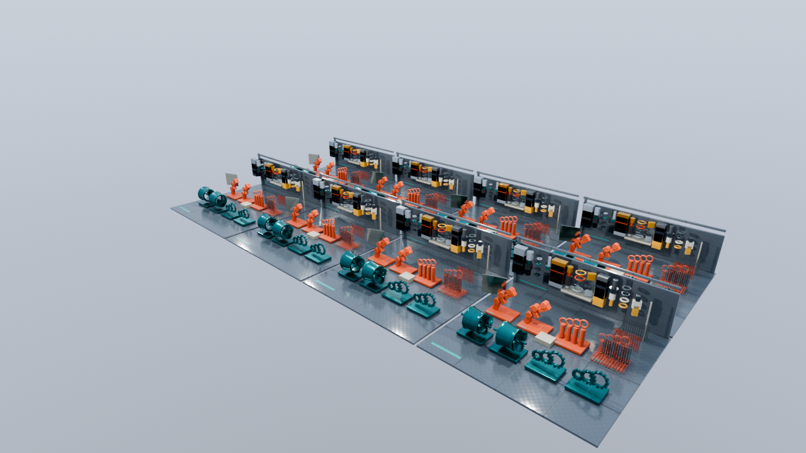
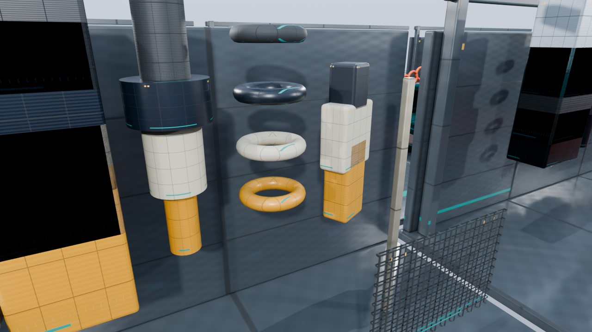
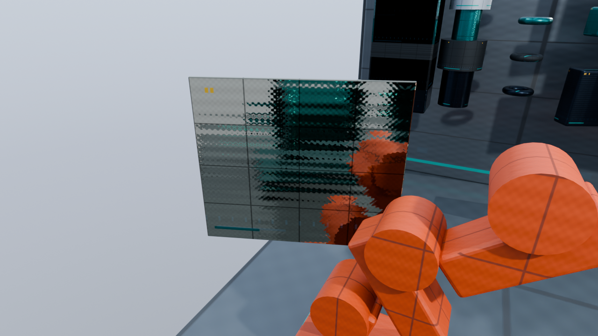
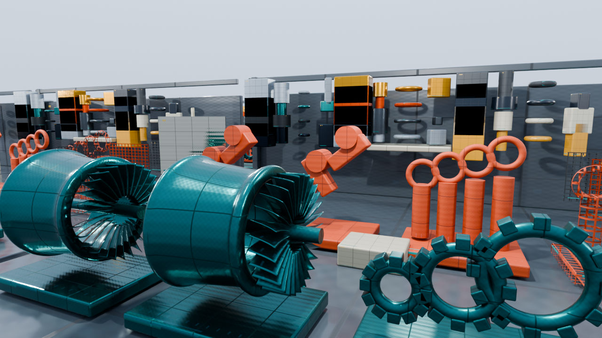
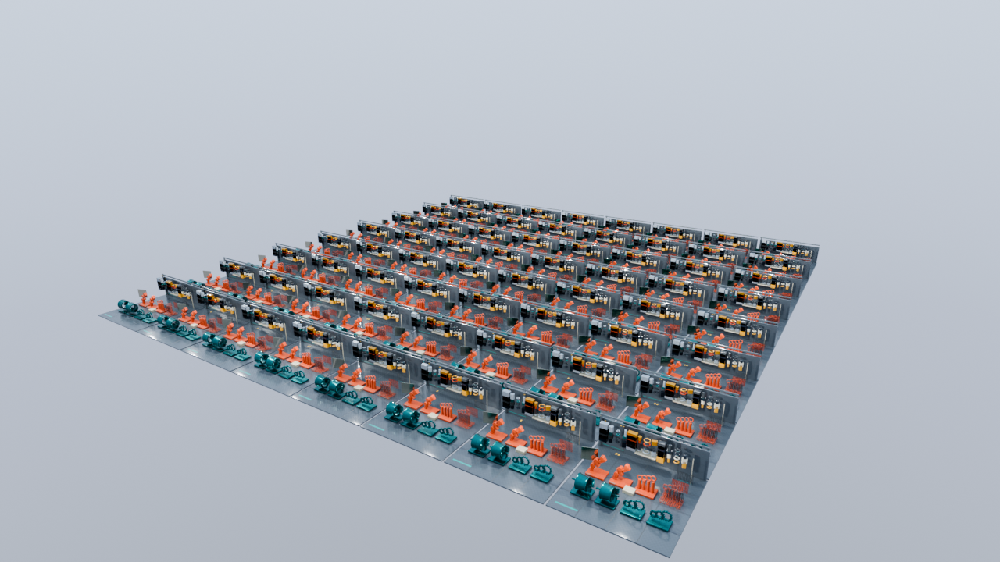

# BindlessGallery：多数の材質・形状を比較する工業技術ミュージアム

発展編12〜15向けの自作アセットです。先にBlender正本・書出し・検証・参考画像を完成させ、その後に両APIへ接続します。

タービン、コンプレッサー、ギア、トランスミッション、ロボットアーム、アクチュエーター、ポンプ、熱交換器の8展示機械と、床・壁・棚・鏡面パネル・部品などを組み合わせます。MASKの格子は16材質ごとに用意しています。BLEND、アニメーション、LOD、ストリーミングは対象外です。

| 項目 | 内容 |
|---|---|
| 固有形状 | 64、131,560三角形。材質違いは同じAccessorを共有 |
| 材質 | 256、Base Color／Normal／ORM／Emissive |
| 実画像 | Base Color 256、Normal 64、ORM 64、Emissive 16、計400 |
| 画像形式 | 全画像512×512、RGBA8 PNG。色画像はsRGB、Normal／ORMは線形 |
| Mini | 128配置、16材質、64画像 |
| Standard | 512配置、64材質、208画像 |
| Stress | 4,096配置、256材質、400画像 |
| カメラ | Mini／Standard／Stress全景、材質接写、反射、遮蔽 |
| 測定経路 | 20秒、60 Hz、端点を含む1,201スナップショット |

NormalとORMは材質番号mod 64、Emissiveはmod 16で共有します。単純な色違いに加え、表面ごとの傷、粗さ、金属性、識別表示があり、400枚のファイル内容はすべて異なります。AOは1、MASKのcutoffは0.5です。全画像のmipを持つRGBA8 GPU容量は約533.3 MiBで、実際の確保容量・Descriptor容量は描画アプリが別に報告します。

参考画像は保存済みBlenderデータをCycles CPU、64 samples、seed 0、denoise有効、8 bounces、AgX Medium High Contrastで1280×720へレンダーします。リアルタイム側の画素一致の正解画像ではありません。ライトと画像の光学的な差を含みます。

書出しはglTF 2.0、外部BINとPNGです。材質バリエーションは標準glTFのMeshとして表し、実際のGeometry Accessorは共有します。シーン設定の`gallery.primitiveGeometry`はCPU側でこの共有関係を再構成するための対応表です。環境IBLは既存WorkshopSkyを参照します。

[編集・再書出し手順](../../SourceArt/Blender/BindlessGallery/README.md)、[ハッシュと数値一覧](BindlessGalleryManifest.json)を参照してください。
