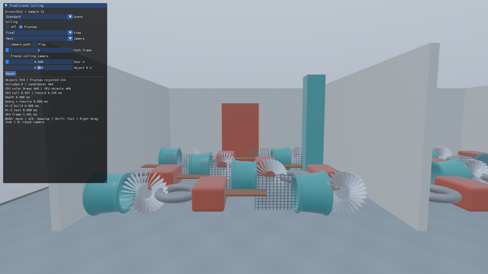
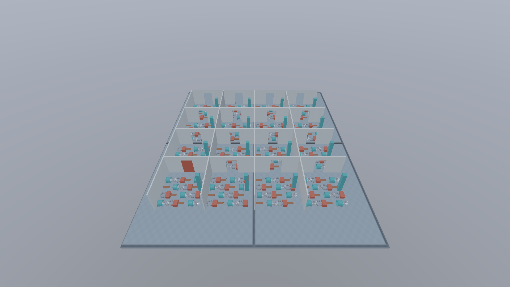

# CullingLab：遮蔽物と可視性を比較するシーン

Blenderの保存済み正本に壁・開口部・柱・扉を制作し、WorkshopのHousing、Rotor、Bearing、ToolBox、BenchTop、GridPanelを再配置した教材です。床はConcrete、壁はPlaster、柱はTeal、扉はToolBox由来の材質を使用します。

| シーン | 検査対象のPrimitive配置 | 建築物 | 合計 |
|---|---:|---:|---:|
| Mini | 64 | 22 | 86 |
| Standard | 512 | 82 | 594 |
| Stress | 4,096 | 322 | 4,418 |

小物の6形状を共有し、負荷を増やすときは配置数を増やします。建物全体を一つのメッシュにはしません。`object:`のIDを検査対象、`occluder:`を不透明な遮蔽物、`door:`を移動する遮蔽物として識別します。格子のMASK材質は検査対象であり、遮蔽物ではありません。

Miniは2×2、Standardは4×4、Stressは8×8区画です。各区画の背面に開口部を設け、最初の区画には横へ開く扉を配置しています。Plazaカメラは俯瞰から遮蔽の少ない条件を、Openingは開口部の被覆を観察するために使います。

[正本の編集・書出し手順](../../SourceArt/Blender/CullingLab/README.md)。glTFは既存Workshop CPUローダーのプロフィールに合わせ、外部BINと梱包元のPNGを配布します。IBLは既存WorkshopSkyを参照します。

Manifestには正本・書出しファイルのSHA-256と制作Blender版を記録します。`validate.py`はハッシュ、IDの一意性、配置数、遮蔽物のAlpha、正の一様スケール、1,201フレームの経路を検査します。通常の実行にBlenderは必要ありません。

画像はゲーム用APIの実描画です。カリングの正解はBlenderレンダーではなく、同じAPI・シーン条件でのカリングOFF描画から取得します。
