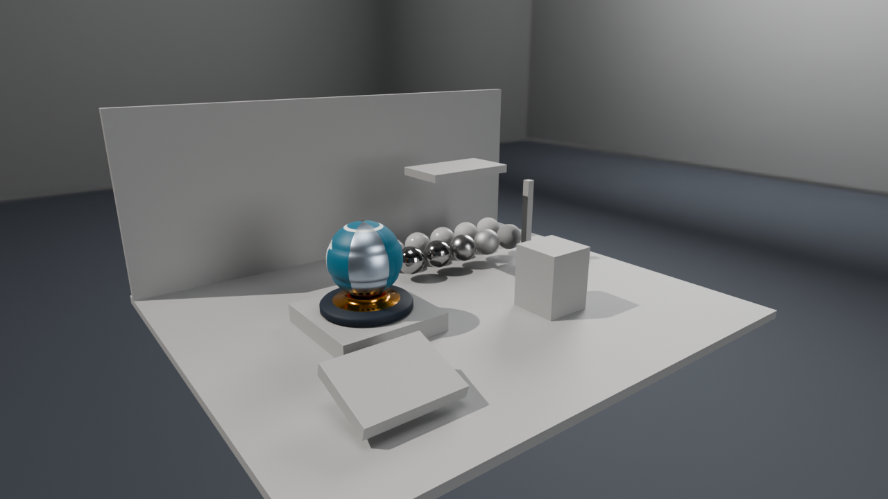
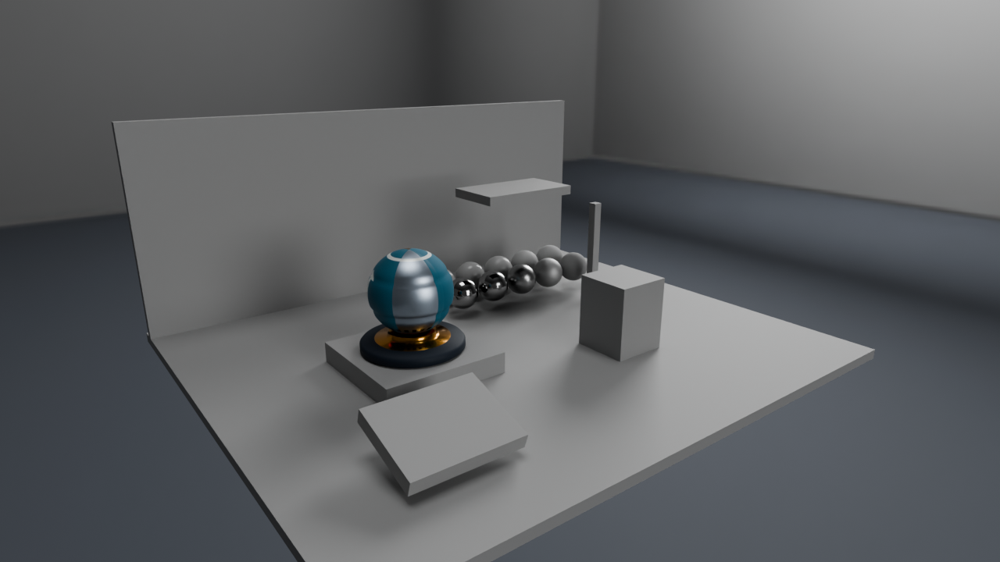
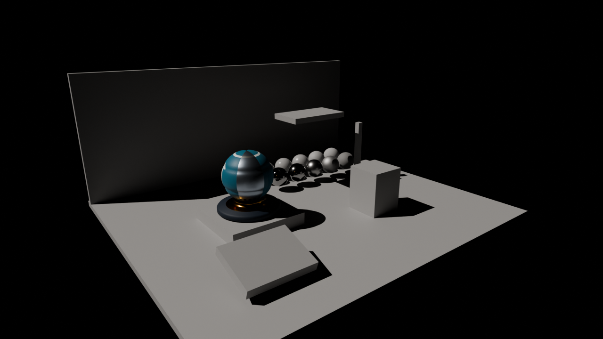

# CubemapとIBLとShadowのためのLighting Labアセット

Shader Ballは材質の違いを見るのに適していますが、環境からの光や床へ落ちる影を学ぶには、周囲の照明と、その光を受ける面も必要です。Lighting Labは、第10〜13回で同じ条件を使いながら、Cubemap、拡散IBL、鏡面IBL、Shadow mapを順に加えるための自作アセットです。

## 展示シーンと材質比較

既存のShader Ballを展示台に置き、同じBase Colorを持つ材質比較球10個を並べます。比較球はMetallicが0と1の二つのグループに分け、各グループでRoughnessを0.05、0.15、0.3、0.6、0.9へ変えています。8-bit ORMで保存するため、実際の値には量子化があります。床、背面壁、箱、厚みのある浮いた板、細い柱、斜面は、Shadowの投影・接地・自己遮蔽・バイアスを観察するための形状です。



BlenderのCyclesによる参考画像です。新規17モデルは合計9,684三角形で、既存Shader Ballの8,640三角形とは別に数えています。全モデルを不透明の三角形として扱い、透過やアルファ抜きは使いません。表示・照明用の床や壁と、HDR環境を撮影するための部屋は別の形状です。

`Assets/Scenes/LightingLab/Exhibition.json`にモデル、位置・回転・スケール、カメラ、方向光、Shadow対象を保存します。`MaterialStudy.json`は比較球を近くから見る配置です。各glTFは1 Node・1 Mesh・1 Primitive・1 Materialとし、既存の限定ローダーで読める形式を維持します。glTFと配置JSONは右手系・Y-up・m、サンプルではCPU側で左手系へ変換します。

## 環境の原本と配布データ

Studioは中立色の部屋と白い発光パネル、Roomは暖色の窓面と寒色の補助光・色のある壁を持つ環境です。Blenderのパノラマカメラで2048×1024の線形OpenEXRへ描き、表示用のAgXやsRGBエンコードを適用せずに照明データとして使います。方向光はこの環境へ焼き込まず、サンプルで別に加えます。

| データ | 仕様 | 用途 |
|---|---|---|
| Studio／RoomのOpenEXR | 2048×1024、float32、線形RGB | 編集・再計算用の原本 |
| Environment.dds | 512×512×6、RGBA16F、1 mip | Skyboxと理想鏡面 |
| Irradiance.dds | 32×32×6、RGBA16F、1 mip | 拡散環境光の事前積分 |
| Specular.dds | 256×256×6、RGBA16F、9 mip | 粗さ別のGGX環境反射 |
| BRDF.dds | 256×256、RG16F | NoVとRoughnessから引く鏡面積分のA／B |
| Orientation.dds | 256×256×6、RGBA16F | 面名・上向き矢印・非対称な角による方向確認 |

DDSの面順は+X、-X、+Y、-Y、+Z、-Zです。面内の行は上から下へ進み、全方向を左手系・Y-upとして扱います。通常の縮小用mipmapと、粗さ別の鏡面積分を保存したmipは役割が違います。BRDF LUTは色画像ではなく数値データです。どのDDSにもsRGB変換を掛けません。

方向確認用環境は理想鏡面の診断モードで使います。StudioのIrradianceと混ぜて照明を評価する用途には使いません。

## 保存済みBlenderデータから更新する

編集正本は`SourceArt/Blender/LightingLab`のLightingLab.blend、Studio.blend、Room.blendです。Blender 5.2.1 LTSと付属Python／NumPyを使い、実行アプリへBlenderの依存は持ち込みません。以下はリポジトリルートのPowerShellで実行します。

```powershell
$blenderExe = 'C:\Program Files\Blender Foundation\Blender 5.2\blender.exe'
& $blenderExe --background SourceArt/Blender/LightingLab/LightingLab.blend --python-exit-code 1 --python SourceArt/Blender/LightingLab/export.py
& $blenderExe --background --factory-startup --python-exit-code 1 --python SourceArt/Blender/LightingLab/bake.py
$blenderPython = Join-Path (Split-Path $blenderExe -Parent) '5.2/python/bin/python.exe'
& $blenderPython SourceArt/Blender/LightingLab/validate.py --manifest
.\Tools\TestLightingLabAssets.ps1
```

`export.py`は保存済みメッシュと梱包PNGを使います。配置を一時的に外してローカル形状のglTFを書き、配置JSONへ位置を保存した後、Blender上の配置を元へ戻します。正本を保存し直したり、初期形状を再生成したりしません。

`bake.py`は保存済みの環境をCycles CPU、256 samples、seed 0、denoise有効でEXRへ描き、`ibl.py`でDDSを生成します。EXRだけを再利用したい場合は`--reuse-exr`、一方の環境だけを更新する場合は`--environment Studio`または`Room`を指定します。BRDF LUTは環境に依存せず、既存ファイルがない場合に生成します。反射モデルの式を変えた場合は`--force-lut`でBRDF LUTも再生成してください。生成後は`validate.py --manifest`で配布ハッシュを更新し、それから検証します。

初期生成の`generate.py`は、正本が存在するとエラーにします。通常の編集・再書出しでは実行しません。形状や画像の編集は正本へ保存し、画像を梱包してから再書出しします。既存ShaderBall.blendとその配布データは変更しません。

## IBLを事前計算する

Hammersley列の1024 samplesを固定して使います。拡散側はcosine-weighted samplingで半球を積分し、照度相当の値Eを保存します。シェーダ側でBase Color／πと掛けるため、一定色Cの環境ならE=πCになります。

鏡面側はGGXの微小面をサンプリングし、V=Nとして得た反射方向の環境光をNoLで重み付けします。mip 0は理想鏡面の再サンプル、mip 1〜8はRoughness=mip／8の積分です。GGXのalphaはmax(Roughness, 0.045)の二乗です。BRDF LUTもSchlick Fresnelとheight-correlated Smithを使い、現在のPBRシェーダの規約へ揃えています。[IBLの共通解説](../EnvironmentLighting.md)で式と近似の範囲を説明します。

NaN、Inf、halfの表現範囲を超える値はDDS保存時に拒否します。`Assets/Scenes/LightingLab/Manifest.json`に寸法、面順、色空間、積分規約、制作バージョン、配布ファイルのサイズとSHA-256を記録します。

## Cycles参考画像の使い方



環境照明のみの参考表示です。追加の方向光を無効にし、最大バウンス数を1に制限しています。Principled BSDFとリアルタイム側の材質近似・環境積分は同じ実装ではないため、画素の一致を求める正解画像にはしません。



方向光のみの参考表示です。Worldの強度を0にし、Sunの角度を0にして、投影する方向と遮蔽物・床の位置関係を観察します。完成画像は環境光と方向光を合わせ、最大バウンス数を8にします。参考画像はいずれも1280×720、Cycles CPU、128 samples、seed 0、denoise有効、AgX／Medium High Contrastです。

```powershell
& $blenderExe --background SourceArt/Blender/LightingLab/LightingLab.blend --python-exit-code 1 --python SourceArt/Blender/LightingLab/render_references.py
```

カメラと配置はJSONの条件へ揃えます。照明の明るさ・材質モデル・表示変換の違いは残るので、数値検証には一定色環境や既知形状のテストを使い、Cycles画像は現象と画づくりのリファレンスとして使います。

## 検証とライセンス

`TestLightingLabAssets.ps1`は固定版glTF-Validator 2.0.0-dev.3.10で全17モデルを確認し、一時フォルダへの再書出し、JSON・BIN・参照PNGの一致、元のblendのハッシュを検査します。初回のValidator取得は既存の`Tools/TestShaderBallAssets.ps1`を使用します。`validate.py`はDDSの各面・mip、有限値、HDR値と、一定色環境の積分も確認します。

アプリの検証と画像取得は`Tools/TestLightingLab.ps1 -CaptureDocs`、リサイズ・最小化復帰は`Tools/TestSamples.ps1`で行います。結果と実際に使ったSDK・コンパイラ・GPUは[検証記録](../Verification.md)に記録します。

新規モデル、環境、スクリプトは自作のMIT License、Copyright (c) 2026 masafumiです。第三者のHDRIや写真は使用していません。DirectXTexとDear ImGuiのライセンスは各出力フォルダのLicensesへ同梱します。
