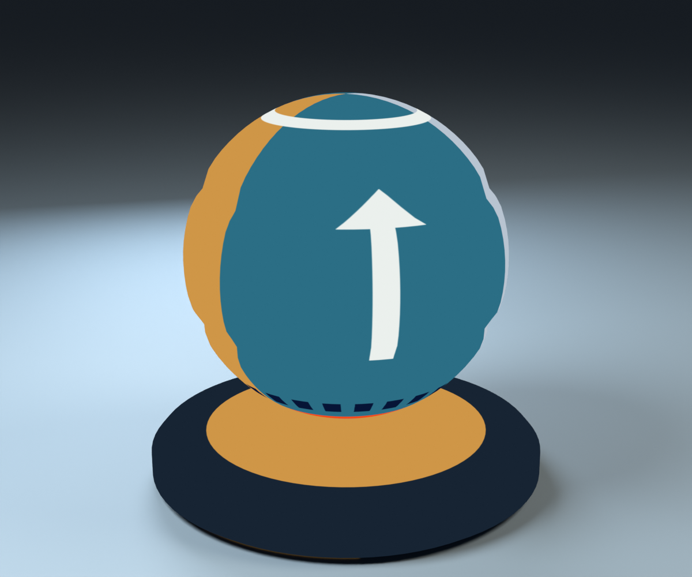
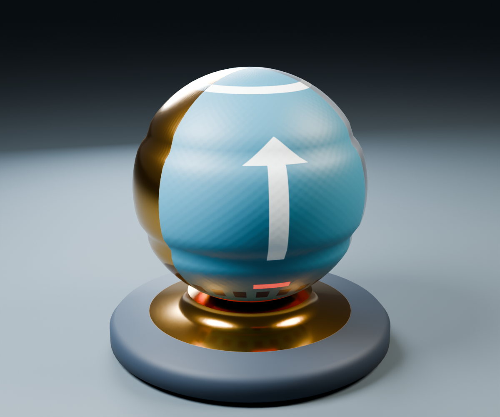

# glTF／ライティング／PBRサンプル用Shader Ball

球と台座を一つのメッシュにした、自作のMITライセンスのアセットです。[サンプル06](../GltfLoading.md)ではAlbedoだけを表示し、[07](../Direct3D12/07_Lighting.md)でLambert／Blinn-Phong、[08](../Direct3D12/08_PBR.md)で同じ形状とUVへNormal・ORM・Emissiveを加えます。CPUのglTFローダーとnlohmann/jsonはサンプル06で導入しています。

## Blenderでの参考表示

以下は**Blender 5.2.1 LTSのCyclesで描画した参考画像**です。Direct3D12／Vulkanサンプルの実行画像ではありません。床・カメラ・ライトは撮影用で、配布glTFには含まれません。



Albedo確認用は照明の影響を受けないEmissionシェーダで表示しています。白い矢印と上側の白帯、下側のオレンジ帯・青い四角で向きとUVを確認できます。画像内の床には撮影用の照明と影があります。Albedoテクスチャ自体には照明や影を焼き込んでいません。



PBR確認用はPrincipled BSDFを使います。塗装、金色と銀色の金属、複数の粗さ、微細な凹凸と発光模様を持ちます。BlenderのPrincipled BSDFとサンプル08のPBRシェーダでは、照明・BRDF・トーンマッピングによって見え方が変わります。AOはglTF書出し用のOcclusion入力に接続しており、このレンダーではORMのRをBSDFに乗算していません。

## ファイルと形状

| 場所 | 内容 |
|---|---|
| [ShaderBall.blend](../../SourceArt/Blender/ShaderBall/ShaderBall.blend) | 編集・再書出しの正本。画像を梱包済み |
| [制作スクリプトと操作手順](../../SourceArt/Blender/ShaderBall/README.md) | 初期生成、編集後のベイク、保存済みデータからの書出し |
| [ShaderBall_Albedo.gltf](../../Assets/Models/ShaderBall/ShaderBall_Albedo.gltf) | Albedo 1枚だけを参照する導入用 |
| [ShaderBall_PBR.gltf](../../Assets/Models/ShaderBall/ShaderBall_PBR.gltf) | 接線・Normal・ORM・Emissiveを追加したPBR用 |
| [Manifest.json](../../Assets/Models/ShaderBall/Manifest.json) | 配布ファイルのサイズ・SHA-256、制作バージョン |
| [検証記録](Verification.md) | 実際に実施した確認とツールのバージョン |

球の浅い2本の溝は実形状です。Normal Mapの微細な表面模様とは別に、後続のShadow Mapで形状の影を確認できます。台座は回転体にし、外周と上側の段にベベルを設けています。

三角形化・スケール適用後のモデルは8,640三角形、UVは1セットです。台座を含めて幅1.2 m、高さ1.16 m、接地面は高さ0です。球と台座は同じオブジェクト・メッシュに結合した二つの連結成分で、接合部はわずかに交差させています。閉じた一つの多様体を必要とする物理・製造用途は想定していません。

両glTFは1 Node・1 Mesh・1 Primitive・1 Materialです。PBR版は接線による頂点分割が許されるため、同一性はインデックスを展開した三角形ごとの位置・法線・UVで検証します。今回のデータではバイナリとJSONの再書出しも一致します。

## テクスチャと色空間

7枚とも1024×1024、8-bit RGBA、不透明のPNGで、同じUVを使用します。

| ファイル | 内容 | GPUでの扱い |
|---|---|---|
| [Albedo.png](../../Assets/Models/ShaderBall/Textures/Albedo.png) | 塗装・金属のベースカラー、矢印・方向確認模様 | sRGBとして読んで線形化 |
| [Normal.png](../../Assets/Models/ShaderBall/Textures/Normal.png) | Blenderでベイクした接線空間法線。中立値はおよそ(128,128,255) | 線形値。sRGB変換しない |
| [Metallic.png](../../Assets/Models/ShaderBall/Textures/Metallic.png) | 金属255、塗装などの非金属0。RGBに同じ値 | 線形値 |
| [Roughness.png](../../Assets/Models/ShaderBall/Textures/Roughness.png) | 金属の滑らかな領域、塗装、粗い領域。RGBに同じ値 | 線形値 |
| [AO.png](../../Assets/Models/ShaderBall/Textures/AO.png) | 溝・接合部の局所的な遮蔽をCyclesでベイク。白は遮蔽なし | 線形値 |
| [ORM.png](../../Assets/Models/ShaderBall/Textures/ORM.png) | **R=AO、G=Roughness、B=Metallic** | 線形値 |
| [Emissive.png](../../Assets/Models/ShaderBall/Textures/Emissive.png) | 小さなオレンジの発光模様。通常部分は黒 | sRGBとして読んで線形化 |

Metallic・Roughness・AOは教材で個別に説明するための画像です。glTFのPBR版はそれらの個別画像を参照せず、ORMを使います。検証ではORMの各チャンネルが対応する単独画像の値と全ピクセルで一致することを確認します。

色空間は**マテリアルでの用途から決定**します。同じPNG形式でもNormalとORMをAlbedoと同じsRGB形式でサンプリングすると数値が変わります。後のAPI実装ではAlbedo・EmissiveをsRGBのSRV／Image View、Normal・ORMをUNORMの線形ビューに対応させてください。AOは動的なShadow Mapの代わりにはなりません。

NormalはRGBを`2 * rgb - 1`で接線空間ベクトルに戻し、補間後に正規化します。glTFのビタンジェントは`B = cross(N, T.xyz) * T.w`です。画像はglTFの接線空間規約に合わせており、API名だけを理由にGチャンネルを反転させません。UVと接線基底を揃えて使用します。

## 二つの書出し設定

| 項目 | Albedo版 | PBR版 |
|---|---|---|
| 形式 | glTF Separate | glTF Separate |
| 外部バッファ | `ShaderBall_Albedo.bin` | `ShaderBall_PBR.bin` |
| 頂点属性 | POSITION、NORMAL、TEXCOORD_0 | 左記＋TANGENT |
| 参照画像 | Albedo | Albedo、Normal、ORM、Emissive |
| Base Color | Albedo、factorは既定の白 | 同じ |
| Metallic / Roughness | factor 0 / 0.5、画像なし | ORMのB / G、factorは既定の1 |
| Occlusion | なし | ORMのR、strengthは既定の1 |
| Emissive | なし | Emissive、factor=(1,1,1) |

Albedo版にもglTF標準の`pbrMetallicRoughness`マテリアルを使います。読込サンプルのシェーダがBase Colorだけを表示する構成にし、`KHR_materials_unlit`拡張は導入しません。法線はPBRへの接続を見越して出力しています。

透過・両面描画・カメラ・ライト・アニメーション・スキン・モーフ・圧縮・追加マテリアル拡張を使いません。`alphaMode`などJSONから省略されている項目には、glTF 2.0の既定値を適用します。

## 教材ローダーの読込仕様

最初のローダーはこのアセットの仕様を明示的な対応範囲にします。汎用glTF対応を称さず、未対応機能を見つけた場合はファイル名とJSONの場所が分かるエラーを返す設計にしてください。

| glTF要素 | 初回の対応範囲 |
|---|---|
| Container | glTF 2.0 JSON＋相対URIの外部`.bin`／PNG。GLB・data URIは後続 |
| Scene / Node | 1 scene、1 node、1 mesh参照、変換なし。右手系・Y-up、単位m |
| Mesh / Primitive | 1 mesh、1 primitive、TRIANGLES（mode省略時は4）、indicesあり |
| POSITION / NORMAL | FLOAT（5126）、VEC3、非normalized |
| TEXCOORD_0 | FLOAT、VEC2、1セット |
| TANGENT | PBR版ではFLOAT、VEC4。Wは±1 |
| Indices | UNSIGNED_SHORT（5123）またはUNSIGNED_INT（5125）、SCALAR。今回の書出しは16-bit |
| BufferView / Accessor | bufferViewとaccessor両方のbyteOffset、byteStride、省略時の密な配置を扱う。sparseは未対応 |
| Material | サンプル06ではBase Color Texture／Factor、texture index、既定値、不透明。サンプル08はNormal／ORM／Emissiveと各係数 |
| Texture / Image / Sampler | `texture → image`の参照を辿る。材質ごとに画像順序を仮定しない。UV0、REPEAT、LINEAR。今回のminFilterはLINEAR_MIPMAP_LINEAR |

頂点属性は同じ頂点数に揃っていること、最終バイトがBufferViewとBufferの範囲内に収まること、インデックスが頂点数未満であることを確認します。バイト長の計算は整数オーバーフローも検査します。`.bin`はlittle-endianです。生バイト列をC++の構造体へ無条件にキャストせず、アクセサの型・配置を見てCPU頂点構造へコピーする方針です。

UV境界と台座の平面／曲面境界では、位置が同じでもUV・法線・接線が異なる頂点を分割してあります。ロード時に位置だけで再統合しないでください。POSITIONのmin/maxはバウンディングボックスの計算にも使えます。

初回はPNGのmip 0だけを作成しても構いません。その場合はSamplerのLOD範囲を0に制限し、未作成mipを参照させないようにします。将来mipを追加する際はglTFのSampler設定を反映してください。

### 座標系とUV

glTFは右手系・Y-upで保存しています。既存サンプルの左手系へ合わせる場合、CPU側でZを反転します。

```text
position'    = ( x,  y, -z)
normal'      = (nx, ny, -nz)
tangent.xyz' = (tx, ty, -tz)
tangent.w'   = -tangent.w
triangle'    = (i0, i2, i1)
uv'          = uv
```

Z反転は鏡映なので、面の順序と接線の符号も揃えます。上の式では変換後も`cross(N', T') * w'`が変換後のビタンジェントになります。

**glTFにはOBJローダーの`1-v`処理を流用しません。** BlenderのglTFエクスポータが画像の原点規約に合わせたTEXCOORD_0を出力しています。WICで得たPNGの上から下へ進む行と組み合わせ、座標をそのまま渡します。二重のUV反転は矢印と上下の帯で検出できます。

将来ノード変換を扱う際は、glTFの列ベクトル行列をそのままHLSLの行ベクトル規約に渡さないでください。`S=diag(1,1,-1,1)`とすると、右手系の列ベクトル行列`M`を左手系へ変換した後、行ベクトル用には`transpose(S * M * S)`とします。今回のノードは変換なしです。

### JSONライブラリの方針

[nlohmann/json v3.12.0](https://github.com/nlohmann/json/tree/v3.12.0)を`ThirdParty/nlohmann-json`のGit Submoduleとして追加し、コミット`55f93686c01528224f448c19128836e7df245f72`へ固定しています。使用するのは`single_include/nlohmann/json.hpp`です。[MITライセンスと著作権表示](https://github.com/nlohmann/json/blob/v3.12.0/LICENSE.MIT)を保持します。

JSONの構文解析をライブラリへ任せ、glTFの構造・アクセサ・材質の解釈は教材として自作しています。以前のcgltf案はこの方針に置き換えました。アセット制作後に追加した[サンプル06の解説](../GltfLoading.md)を参照してください。

## 検証と参考資料

```powershell
.\Tools\TestShaderBallAssets.ps1
```

Khronos glTF-Validatorの固定版を使用し、両glTFと保存済み`.blend`からの一時再書出しを検証します。画像サイズ・ORMチャンネル・法線・接線・参照ファイル・個数・形状の同一性・Manifestのハッシュも確認します。ツールは`.cache`内に置き、実行サンプルの依存関係には含めません。

- [Khronos glTF 2.0仕様](https://registry.khronos.org/glTF/specs/2.0/glTF-2.0.html)：アクセサ、材質、色空間、UV・接線規約。
- [Blender glTF 2.0エクスポータ](https://docs.blender.org/manual/en/latest/addons/scene_gltf2.html)：材質ノードとglTFの対応。
- [Khronos glTF-Validator](https://github.com/KhronosGroup/glTF-Validator)：構造と外部リソースの検証。

自作モデル・画像・スクリプトはリポジトリの[MITライセンス](../../LICENSE)で利用できます。Copyright (c) 2026 masafumi。第三者配布モデル・写真・フォント・HDRIは使用していません。
