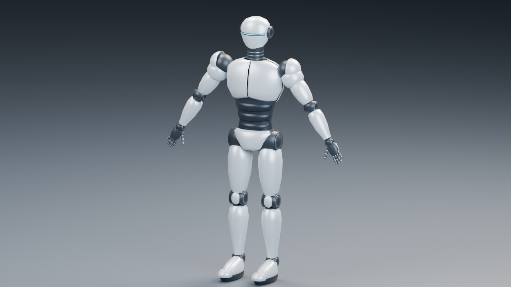
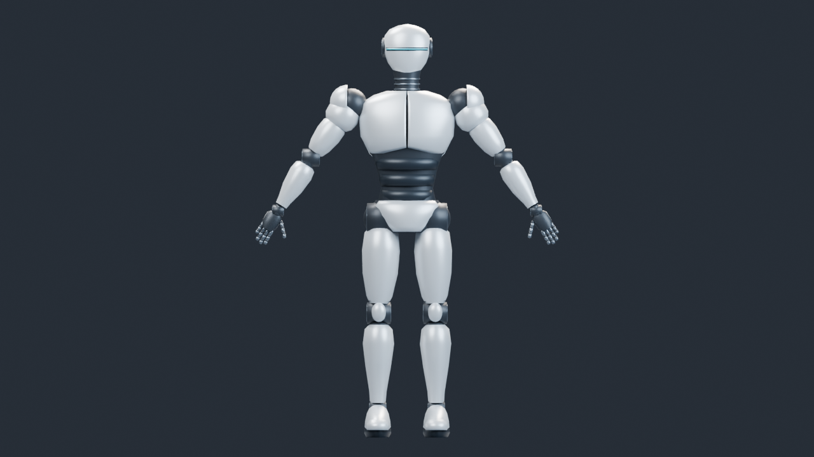
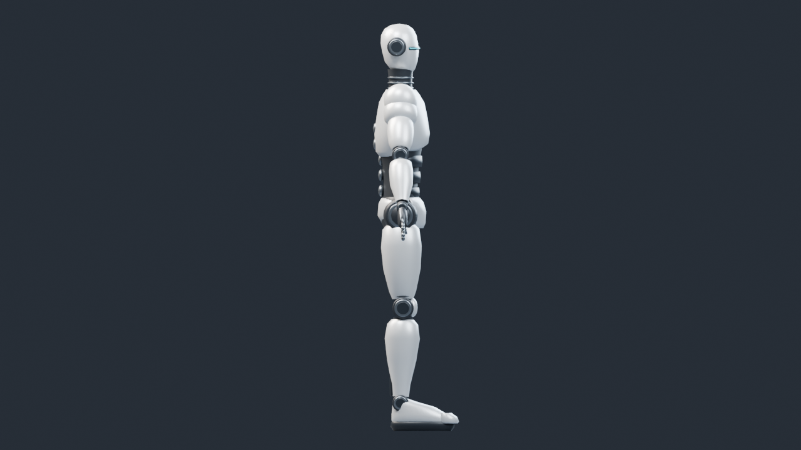
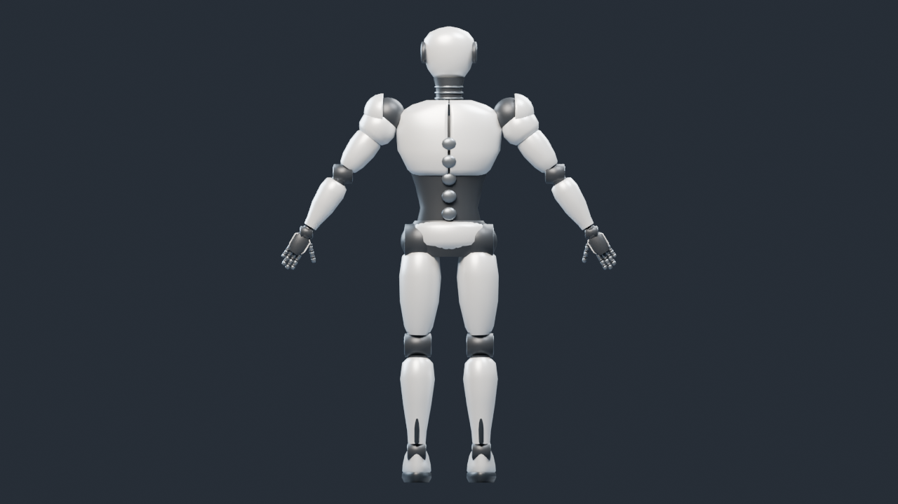
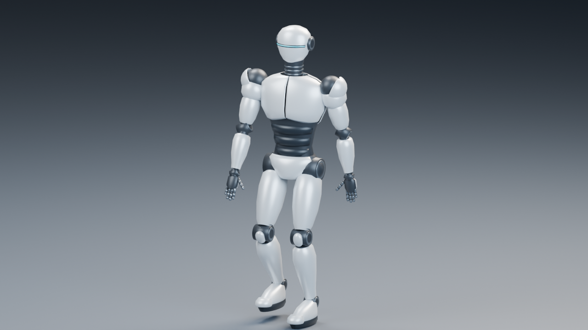

# GPUスキニング向け白銀ヒューマノイド

添付の三面図を参考に制作した、白銀の装甲、黒い関節、水色のバイザーを持つロボットです。AポーズのBlender正本と、ボーン・ウェイトを保持したglTF／GLBを用意しました。この原本を保持した[Universal Animation Library適用版](SilverRobotAnimated.md)を、基本22／23と発展10で使用しています。

| 項目 | 内容 |
|---|---|
| 正本 | `SourceArt/Blender/SilverRobot/SilverRobot.blend` |
| 配布 | `Assets/Models/SilverRobot/SilverRobot.gltf`＋BIN、同内容のGLB |
| 高さ | 1.908 m、足底Z=0、Blenderはメートル単位 |
| リグ | Root＋胴体・首・頭、左右の肩・腕・脚・足先、5指×3節、計53ボーン |
| メッシュ | 1メッシュ、44,584三角形、5 Primitive、出力31,138頂点 |
| 材質 | PearlSilver、JointGraphite、BrushedTitanium、InsetBlack、VisorCyan |
| スキニング | 線形ブレンド、正規化済みウェイト、4成分のJOINTS_0／WEIGHTS_0 |
| 画像依存 | なし。core glTFのPBR定数とEmissiveを使用 |
| 同梱Action | Aポーズ、Tポーズ、待機、その場歩行。すべて自作 |

装甲を1本のボーンへ固定することで、金属の殻が曲がることを避けています。胴体内部や可動部は2本のボーンへブレンドし、GPUスキニングで実際に複数ウェイトを処理できる構成です。指の各節も独立したボーンとウェイトを持ちます。IK・制御リグ・物理シミュレーションに依存せず、配布されたTRSキーだけで再生できます。

## Blenderでの操作と再出力

[正本のREADME](../../SourceArt/Blender/SilverRobot/README.md)に、編集、Action選択、Aポーズへの復帰、再出力、レンダー、検証のコマンドがあります。保存済みblendが正本で、`export.py`は編集したモデルを初期値へ戻しません。`Part.*`頂点グループを使うと、単一メッシュ内の装甲をパーツ単位で選択できます。

## モーションを適用する準備

`Humanoid.json`には人型の意味名、実ボーン名、親、head／tail、Blender空間のレスト行列を保存しています。Blenderの上は+Z、前は-Y、キャラクターの左は+Xです。glTFでは上は+Y、前は+Zになり、Right-HandedのglTF座標を維持しています。サンプル側の左手系への変換は後続ローダーで扱います。

他の人型アセットと意味的に対応付けられますが、別リグのActionを直接選ぶだけで正しく動くわけではありません。リターゲット時には骨のレスト回転、肩のA/Tポーズ差、身長・腕脚の長さ、Root／Hipsの移動を補正します。`Retarget_Tpose`はその対応合わせ用です。VRM形式や特定エンジン専用のAvatar設定を出力したものではありません。

| Action | Blenderの範囲 | glTFの時間 | 用途 |
|---|---|---|---|
| Bind_Apose | 1〜2 | 1/30秒 | バインド姿勢の確認 |
| Retarget_Tpose | 1〜2 | 1/30秒 | 肩・腕の対応合わせ |
| Idle | 1〜61 | 2秒 | 小さな胴体・頭の動き、腕を下ろした待機 |
| Walk_InPlace | 1〜31 | 1秒 | 足の持上げ、膝の屈曲、腕振り、腰の上下移動 |

歩行は自作の確認用ループで、モーションキャプチャではありません。Rootは原点に固定し、接地と遊脚を意識した簡単な歩行をTRSキーへ保存しました。ゲームや実際の移動速度に合わせた高品質な歩行への差し替えは、モデル完成後に検討できます。

## 外部モーションの再配布候補

2026-10-14の原本制作時に調べた候補です。この原本には外部モーションを取り込んでいません。2026-10-15に別の[Animated版](SilverRobotAnimated.md)へUniversal Animation Library Standardを適用し、素材のライセンスと取得版を固定しました。

第一候補は[Quaternius Universal Animation Library](https://quaternius.com/packs/universalanimationlibrary.html)です。配布元はCC0を明記し、人型リグへのリターゲット用に歩行などの移動モーションを含むライブラリを提供しています。[公式配布ページ](https://quaternius.itch.io/universal-animation-library)ではStandard版が無償の選択肢で、Source版のblendは有料枠です。glTF／GLBからBlenderへ取り込んでリターゲットする方法を採れます。採用する際は取得したアーカイブの版・SHA-256・同梱ライセンスを固定し、取り込むクリップと骨対応を確認します。

[CC0 1.0](https://creativecommons.org/publicdomain/zero/1.0/)は権利放棄と補充的な許諾を定め、改変・商用利用・再配布を行えるため、モデルにリターゲットしたモーションを教材アセットとして同梱する候補になります。クレジットが義務でない場合でも、配布元・作者・取得版とCC0の本文を残す方針が適しています。

Mixamoは[Adobe Community掲載のFAQ](https://community.adobe.com/questions-696/mixamo-faq-licensing-royalties-ownership-eula-and-tos-589400?lang=en)で生のキャラクター・アニメーションファイルの配布を認めていないため、公開リポジトリへ再利用可能なモーションを同梱する候補から外します。作品内での利用許可と、素材ファイルそのものの再配布を区別しています。

LAFAN1は[公式リポジトリのライセンス](https://github.com/ubisoft/ubisoft-laforge-animation-dataset/blob/master/license.txt)がCC BY-NC-ND 4.0で、非商用・改変物の共有制限があります。MITアセットとともに配布するリターゲット済みモーションの候補には採用しません。

## 配布と検証

新規のメッシュ、材質、リグ、同梱ActionはリポジトリのMIT Licenseです。ユーザー提供画像は参考に使い、画像自体は同梱していません。

`Tools/TestSilverRobotAssets.ps1`はKhronos Validator、ウェイト・ボーン・逆バインド・三角形の検査、glTFデータによるCPUスキニングとBlenderの変形結果の照合、保存済みblendからの再出力一致を確認します。[検証記録](SilverRobotVerification.md)を参照してください。今回はGPU描画アプリの検証ではありません。
