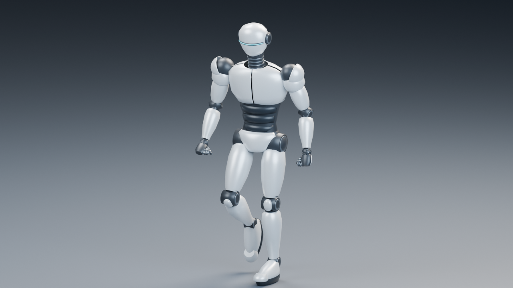
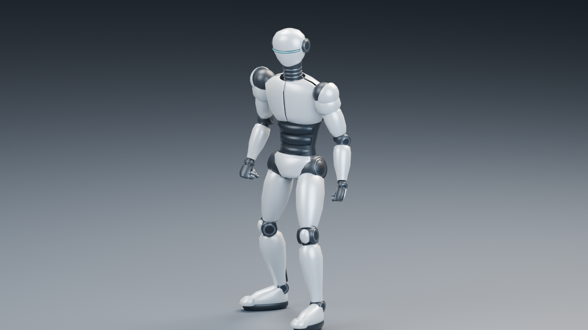
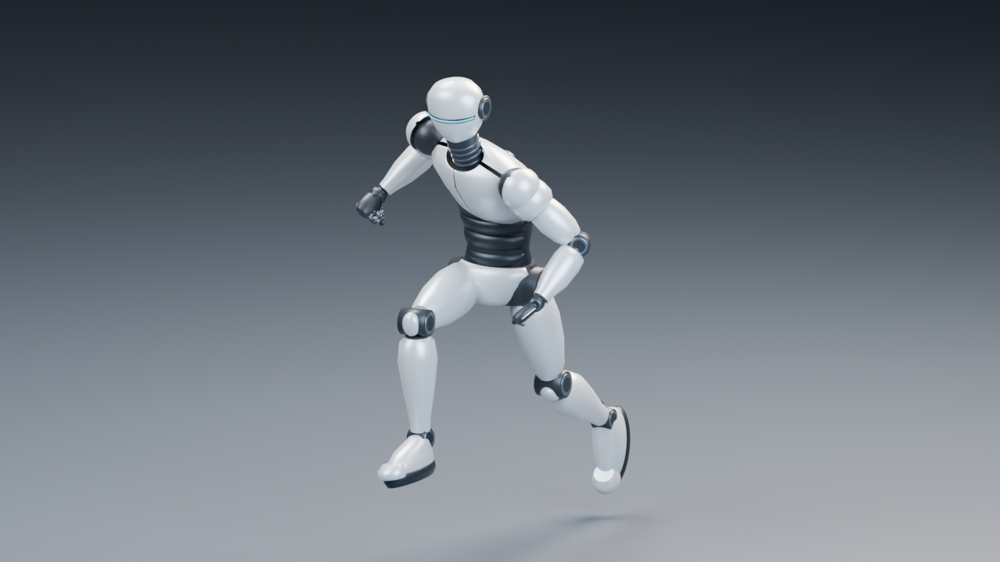
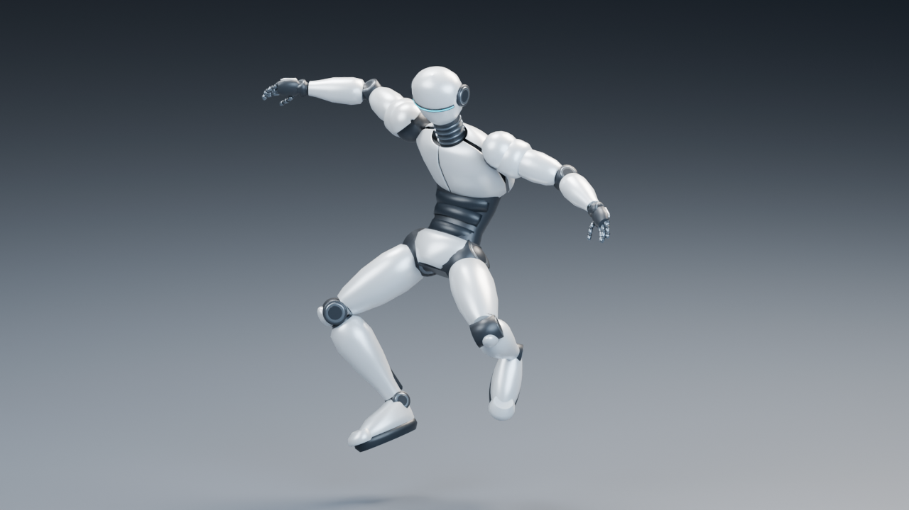
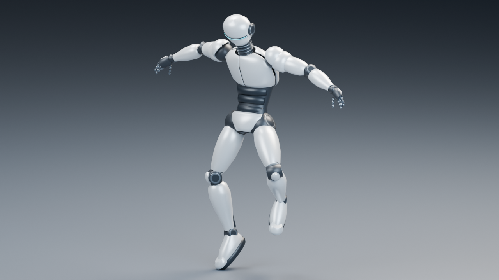
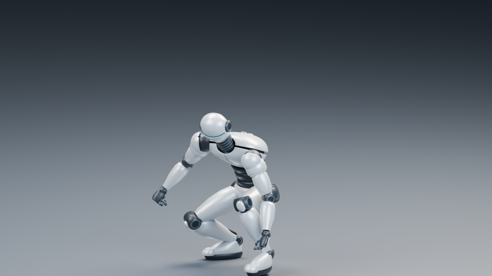

# Silver Robot：Universal Animation Libraryの適用

[Aポーズの原本](SilverRobot.md)を保持し、別の`SilverRobotAnimated.blend`へQuaterniusの6クリップをリターゲットしました。基本22／23と発展10は同じ配布glTFを使います。ロボットの形状・リグ・ウェイトは原本と同じです。



| データ | 保存先 |
|---|---|
| 編集正本 | [SilverRobotAnimated.blend](../../SourceArt/Blender/SilverRobot/SilverRobotAnimated.blend) |
| 保持したAポーズ原本 | [SilverRobot.blend](../../SourceArt/Blender/SilverRobot/SilverRobot.blend) |
| 実行配布 | [SilverRobot.gltf](../../Assets/Models/SilverRobotAnimated/SilverRobot.gltf)＋外部BIN |
| 他ツール向け | [SilverRobot.glb](../../Assets/Models/SilverRobotAnimated/SilverRobot.glb) |
| 人型の意味対応 | [Humanoid.json](../../Assets/Models/SilverRobotAnimated/Humanoid.json) |
| 元クリップ・骨対応・ライセンス・SHA-256 | [Animations.json](../../Assets/Models/SilverRobotAnimated/Animations.json) |
| 配布ファイル・保存済みblendのSHA-256 | [再出力検証結果](SilverRobotAnimatedAssets.json) |

## 採用素材とライセンス

[公式配布ページ](https://quaternius.itch.io/universal-animation-library)はStandard版とCC0を明記しています。今回は計画で指定した[glTFミラーの固定コミット](https://github.com/J-Ponzo/gltf-universal-animation-library/tree/e24c23cf2a1323488a3faa226ea7ea21f644b73e)を使います。これは2025-06-10の配布を元にした版で、公式ページの現行v3へ自動更新しません。

`ThirdParty/UniversalAnimationLibrary`をGit submoduleとしてコミット`e24c23cf2a1323488a3faa226ea7ea21f644b73e`へ固定しています。読込元は`glTF/AnimationLibrary_Godot_Standard.gltf`とBINです。作者Quaternius、元Action名、53本の骨対応、素材のSHA-256、同梱ライセンスのSHA-256を`Retargeting.json`と`Animations.json`へ保存しました。vendorファイルは変更していません。

新規制作したロボットのメッシュ・材質・リグと制作コードはリポジトリのMITです。取り込んだモーションは**CC0-1.0**で、[Quaternius-CC0.txt](../../Assets/Models/SilverRobotAnimated/Quaternius-CC0.txt)を別に同梱します。モデルのMIT表示でモーションの出所を置き換えません。提供された参考画像は配布物へ埋め込んでいません。

## GPUサンプルでモーションを見る

[実行動画一覧](Videos/README.md)に、1体のWalk／Runと64体の独立姿勢を掲載しました。Direct3D12のVSによる歩行とJog、VulkanのCompute CacheによるJog、両APIのMesh／Taskによる64体を見られます。上のCycles参考画像と合わせて、実際のPBR／Shadow表示での動きを確認してください。

## Actionと再生範囲

30 fpsでキーを焼き込み、IKや外部リターゲットアドオンに依存しないTRS Actionを保存しました。Bind_AposeとRetarget_Tposeも配布に含みます。

| 出力Action | 元Action | Blenderフレーム | 秒 | 初期再生 |
|---|---|---|---|---|
| UAL_Idle | Idle_Loop | 1〜76 | 2.5 | ループ |
| UAL_Walk | Walk_Loop | 1〜41 | 1.333333 | ループ |
| UAL_Run | Jog_Fwd_Loop | 1〜29 | 0.933333 | ループ |
| UAL_JumpStart | Jump_Start | 1〜41 | 1.333333 | 終端保持 |
| UAL_JumpLoop | Jump_Loop | 1〜76 | 2.5 | ループ |
| UAL_JumpLand | Jump_Land | 1〜39 | 1.266667 | 終端保持 |
| Bind_Apose | 原本の確認ポーズ | 1〜2 | 0.033333 | 確認用 |
| Retarget_Tpose | 原本の確認ポーズ | 1〜2 | 0.033333 | 確認用 |

RunはSprintではなくJogです。元の端フレームが30 fpsの整数に乗らないJogの0.916667秒とLandの1.25秒は、整数フレームへ丸めて0.933333秒／1.266667秒になっています。元の時間範囲を均等にサンプルするため、ごく小さい再生速度の差があります。元秒数と焼込み秒数を両方記録しています。

ジャンプ3本は独立選択です。遷移ブレンドやジャンプ状態機械、走行距離への自動追従はこの教材に含めていません。

## レスト回転、A/Tポーズ、体格、接地を補正する

[retarget.py](../../SourceArt/Blender/SilverRobot/retarget.py)は原本のT確認ポーズを参照し、ソースの各ボーンのレスト回転から現在回転への差分をターゲットの参照回転へ掛けます。胴体・手足・指の53本を意味で対応付け、ターゲット自身のボーン長と階層で位置を再構成します。AポーズのバインドをTポーズへ変更する処理ではありません。

Hipsの変位は腰高比約1.10178で補正し、腰の揺れと上下動を残します。Rootの水平移動は保存せず、その場で再生します。足／つま先へ影響する頂点の高さを評価し、床へ潜るフレームではRootを上へ補正します。この持上げもActionへ焼込みます。ループの最後は最初の姿勢へ揃えます。

これはFKのリターゲットと床への侵入防止で、足固定IKではありません。接地中の足の小さな滑りや、素材と体格の違いによる装甲間の隙間は残ります。腕・膝・手・足の向き、指、主要な装甲の干渉を6クリップのCycles画像で確認しました。より長い歩行距離や足の完全固定を必要とするゲーム用Motion Matchingは別の制作工程です。

| 待機 | Jog |
|---|---|
|  |  |

| ジャンプ開始 | 滞空 | 着地 |
|---|---|---|
|  |  |  |

## Blenderで確認し、編集したシーンを出力する

Blender 5.2.1 LTSでAnimatedのblendを開きます。Armatureを選び、Dope SheetをAction Editorへ変更してクリップを選びます。保存時はActionを外したAポーズで、NLAトラックはミュートです。複数Actionが重ならないよう、確認時も必要なActionだけを選択します。上記のフレーム範囲と30 fpsを使って再生してください。

```powershell
$blenderExe='C:\Program Files\Blender Foundation\Blender 5.2\blender.exe'
# 保存した編集内容をそのまま配布へ書き出す。モデルを再生成しない。
& $blenderExe --background SourceArt/Blender/SilverRobot/SilverRobotAnimated.blend `
  --python-exit-code 1 --python SourceArt/Blender/SilverRobot/export_animated.py
.\Tools\TestSilverRobotAnimated.ps1
```

リターゲットを再実行する場合は、原本を開いて`retarget.py -- --output .cache/skinning/NewAnimated.blend`と指定します。既存のAnimated正本を再生成で上書きしないため、デフォルトでは既存出力を拒否します。意図的に作り直す場合だけ`--overwrite`を指定してください。モデルを編集した後の通常の再出力には`export_animated.py`を使います。

検証はglTF／GLBのKhronosエラー・警告0、保存済みblendからのバイト一致、全8 ActionのBlender評価メッシュとCPUスキニングの照合を含みます。[数値結果](SilverRobotAnimatedValidation.json)と[GPU検証](../SkinningVerification.md)を参照してください。
