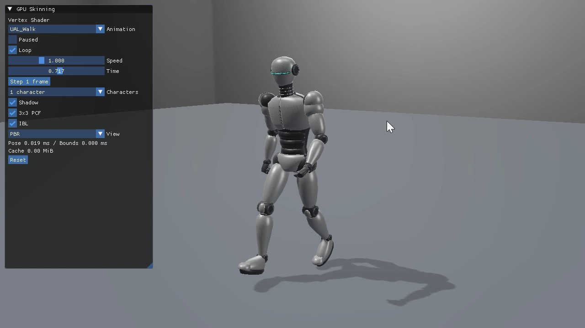
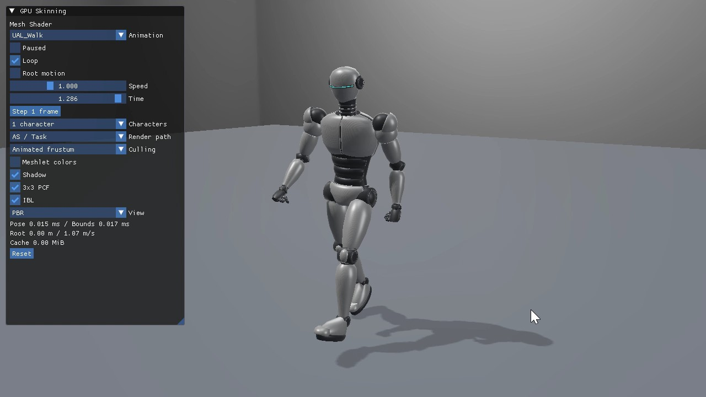
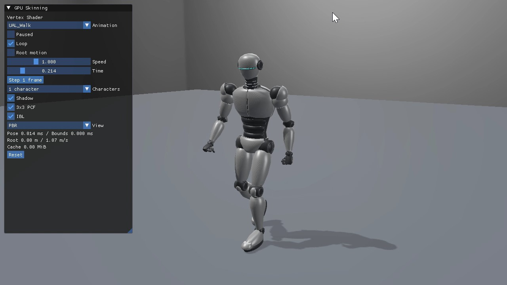
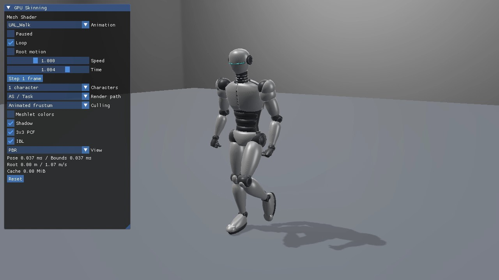
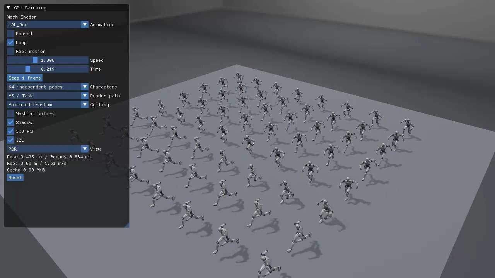
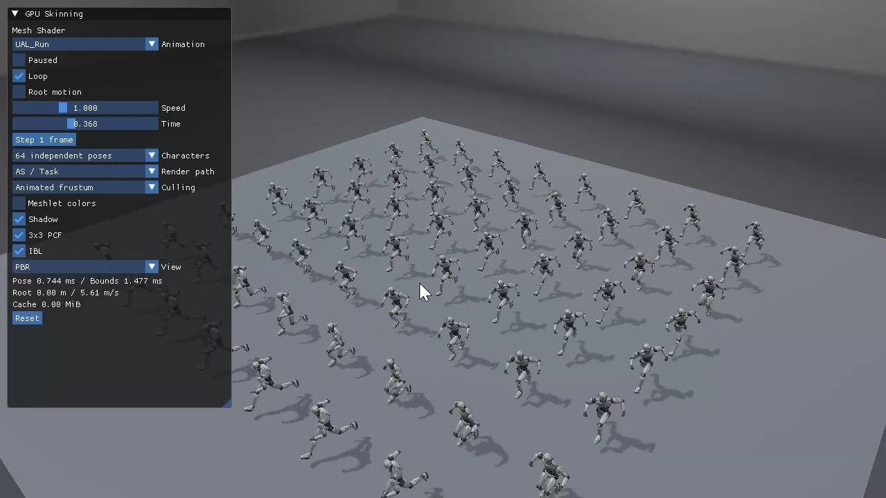

# GPUスキニングとキャラクター操作の実行動画

2026-10-15（日本時間）に録画された8本です。Direct3D12／Vulkanの3方式すべてで1体の歩行（UAL_Walk）を掲載し、Mesh Shaderは両APIの64体表示（UAL_Run／Jog）も用意しました。すべて1280×720です。**プレビュー画像をクリックするとMP4を開きます。**

全8本ともRoot motionはOFF、速度1、Loop・Shadow・3×3 PCF・IBLはONです。Mesh Shaderの4本はAS／TaskとAnimated frustumを使用しています。UIと手足・Shadowの動きを合わせて確認できます。

ファイル名をAPI・サンプル・クリップ・体数で揃えました。MP4は再圧縮せず、元のバイト列を保持しています。[Manifest.json](Manifest.json)に元ファイル名、録画日時、掲載記事、クリップ、体数、再生設定、容量、SHA-256を保存しています。

| 方式・体数 | Direct3D12の動画 | Vulkanの動画 | 解説記事 |
|---|---|---|---|
| Vertex：Walk／1体 | [Direct3D12](Direct3D12_22_VertexSkinning_Walk.mp4) | [Vulkan](Vulkan_22_VertexSkinning_Walk.mp4) | [D3D12](../../Direct3D12/22_VertexSkinning.md)／[Vulkan](../../Vulkan/22_VertexSkinning.md) |
| Compute Cache：Walk／1体 | [Direct3D12](Direct3D12_23_ComputeSkinningCache_Walk.mp4) | [Vulkan](Vulkan_23_ComputeSkinningCache_Walk.mp4) | [D3D12](../../Direct3D12/23_ComputeSkinningCache.md)／[Vulkan](../../Vulkan/23_ComputeSkinningCache.md) |
| Mesh／Task：Walk／1体 | [Direct3D12](Direct3D12_Advanced10_MeshShaderSkinning_Walk.mp4) | [Vulkan](Vulkan_Advanced10_MeshShaderSkinning_Walk.mp4) | [D3D12](../../Direct3D12/Advanced10_MeshShaderSkinning.md)／[Vulkan](../../Vulkan/Advanced10_MeshShaderSkinning.md) |
| Mesh／Task：Run／64体 | [Direct3D12](Direct3D12_Advanced10_MeshShaderSkinning_Run64.mp4) | [Vulkan](Vulkan_Advanced10_MeshShaderSkinning_Run64.mp4) | [D3D12](../../Direct3D12/Advanced10_MeshShaderSkinning.md)／[Vulkan](../../Vulkan/Advanced10_MeshShaderSkinning.md) |

## 1体の歩行：3方式×2API

### Direct3D12 22_VertexSkinning：UAL_Walk／1体

Vertex Shaderによる1体の歩行です。腕振り・膝の屈曲と、足に追従するShadowを確認できます。

[MP4を開く](Direct3D12_22_VertexSkinning_Walk.mp4) · 14.1秒 · 8.55 MiB

### Direct3D12 23_ComputeSkinningCache：UAL_Walk／1体

Compute Cacheによる1体の歩行です。UIのCache 1.43 MiBと、変形に追従するShadowを確認できます。

[MP4を開く](Direct3D12_23_ComputeSkinningCache_Walk.mp4) · 14.2秒 · 8.58 MiB

### Direct3D12 Advanced10_MeshShaderSkinning：UAL_Walk／1体

Mesh Shaderによる1体の歩行です。AS／TaskとAnimated frustumを有効にし、関節の動きとShadowを確認できます。

[MP4を開く](Direct3D12_Advanced10_MeshShaderSkinning_Walk.mp4) · 14.3秒 · 8.77 MiB

### Vulkan 22_VertexSkinning：UAL_Walk／1体

Vertex Shaderによる1体の歩行です。腕振り・膝の屈曲と、足に追従するShadowを確認できます。

[MP4を開く](Vulkan_22_VertexSkinning_Walk.mp4) · 14.5秒 · 8.73 MiB

### Vulkan 23_ComputeSkinningCache：UAL_Walk／1体

Compute Cacheによる1体の歩行です。UIのCache 1.43 MiBと、変形に追従するShadowを確認できます。

[MP4を開く](Vulkan_23_ComputeSkinningCache_Walk.mp4) · 14.8秒 · 8.80 MiB

### Vulkan Advanced10_MeshShaderSkinning：UAL_Walk／1体

Mesh Shaderによる1体の歩行です。AS／TaskとAnimated frustumを有効にし、関節の動きとShadowを確認できます。

[MP4を開く](Vulkan_Advanced10_MeshShaderSkinning_Walk.mp4) · 17.1秒 · 10.17 MiB

## Mesh Shaderの64体表示

両APIともUAL_Runを選び、64体の位相をずらしています。上の1体歩行とはクリップと体数が異なります。

### Direct3D12 Advanced10_MeshShaderSkinning：UAL_Run／64体

AS／TaskとAnimated frustumを有効にした64体のJogです。位相をずらした独立姿勢と、それぞれに追従するShadowを確認できます。

[MP4を開く](Direct3D12_Advanced10_MeshShaderSkinning_Run64.mp4) · 14.5秒 · 9.16 MiB

### Vulkan Advanced10_MeshShaderSkinning：UAL_Run／64体

AS／TaskとAnimated frustumを有効にした64体のJogです。位相をずらした独立姿勢と、それぞれに追従するShadowを確認できます。

[MP4を開く](Vulkan_Advanced10_MeshShaderSkinning_Run64.mp4) · 15.3秒 · 9.58 MiB

## 動画と数値検証の読み分け

動画ではモーション、キャラクター別の位相、操作パネルとShadowの追従を確認できます。キャッシュを複数パスが実際に共有すること、Barrierの妥当性、VS／CS／MSの数値一致は、コードと[GPU読戻し検証](../../SkinningVerification.md)で確認します。録画中のUIに表示されたCPU時間は、条件を固定したReleaseベンチマークの代わりには使いません。

モデルとモーションの出所・ライセンスは[Silver Robot Animated](../SilverRobotAnimated.md)、仕組みは[glTFローダー](../../GltfSkinningLoading.md)と[GPUスキニング共通章](../../GpuSkinning.md)を参照してください。

## 第28回：操作キャラクター

### ユーザー提供の操作録画（2026-10-21）

| API | 元の録画ファイル | 長さ | 容量 |
|---|---|---:|---:|
| Direct3D12 | [操作録画](<Shader.jp Direct3D12 28_CharacterController 2026-10-21 01-05-16.mp4>) | 約23.3秒 | 11.67 MiB |
| Vulkan | [操作録画](<Shader.jp Vulkan 28_CharacterController 2026-10-21 01-05-58.mp4>) | 約24.5秒 | 10.23 MiB |

どちらも1280×720、H.264の動画とAACの音声トラックを含むMP4です。録画のフレーム間隔は一定ではありません。元ファイル名とバイト列を保持し、Shader.jpの記事にも同じ動画を配置しています。[第28回の動画記録](../../CharacterControllerVideos.json)に出典、録画日時、容量、SHA-256、形式を記録しています。

解説：[共通章](../../CharacterController.md#ユーザー録画の操作動画)／[Direct3D12](../../Direct3D12/28_CharacterController.md#操作動画)／[Vulkan](../../Vulkan/28_CharacterController.md#操作動画)

### 固定入力による再現動画

[Direct3D12](Direct3D12_28_CharacterController.mp4)／[Vulkan](Vulkan_28_CharacterController.mp4)：300フレーム、1280×720、60 fps、5秒。固定刻みの自動入力で歩行・走行・回転・ジャンプ・着地・Resetを再現します。`Tools/CaptureCharacterVideo.ps1`で再生成できます。
