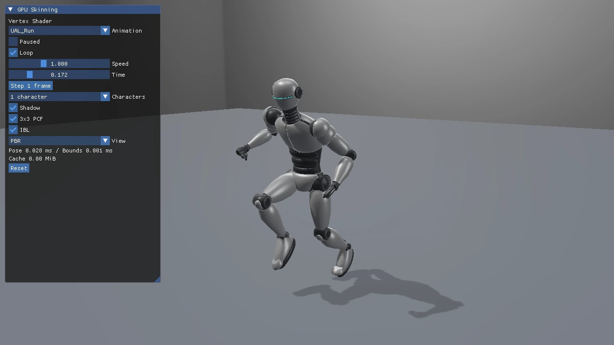
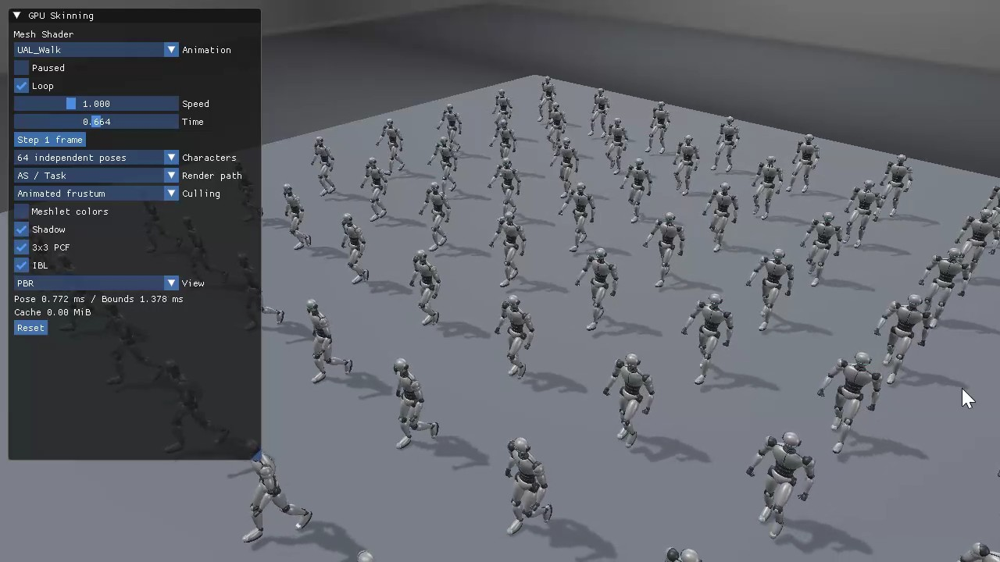

# GPUスキニングの実行動画

2026-10-15（日本時間）に録画された6本です。すべて1280×720の実行画面で、ImGuiのAPI別スキニング方式、選択クリップ、体数とShadowの動きを確認できます。**プレビュー画像をクリックするとMP4を開きます。**

録画はRoot motion切り替えの追加前で、現在のRoot motion OFFに相当するその場再生です。

ファイル名をAPI・サンプル・クリップ・体数で揃えました。MP4は再圧縮せず、元のバイト列を保持しています。[Manifest.json](Manifest.json)に元ファイル名、掲載先、クリップ、体数、容量、SHA-256を保存しています。

| 方式 | Direct3D12 | Vulkan | 見どころ |
|---|---|---|---|
| Vertex | [22の記事](../../Direct3D12/22_VertexSkinning.md) | [22の記事](../../Vulkan/22_VertexSkinning.md) | 1体のWalk／Runと動くShadow |
| Compute Cache | [23の記事](../../Direct3D12/23_ComputeSkinningCache.md) | [23の記事](../../Vulkan/23_ComputeSkinningCache.md) | VulkanのRun、変形済み頂点キャッシュ1.43 MiB |
| Mesh／Task | [発展10の記事](../../Direct3D12/Advanced10_MeshShaderSkinning.md) | [発展10の記事](../../Vulkan/Advanced10_MeshShaderSkinning.md) | 64体の独立姿勢、Animated frustum、Shadow |

今回の録画はD3D12 VSが2本、D3D12 Meshが1本、VulkanはVS／Compute／Meshが各1本です。方式はファイル名だけで判断せず、映像内のUIで確認しています。

## Direct3D12 22_VertexSkinning：UAL_Run／1体

VSでJogを変形し、腕振り・膝の屈曲・床へ落ちる影を確認できます。

[MP4を開く](Direct3D12_22_VertexSkinning_Run.mp4) · 8.41 MiB

## Direct3D12 22_VertexSkinning：UAL_Walk／1体

同じVSの歩行です。Runとの姿勢・周期の違いと、足に追従するShadowを確認できます。

[MP4を開く](Direct3D12_22_VertexSkinning_Walk.mp4) · 8.54 MiB

## Direct3D12 Advanced10_MeshShaderSkinning：UAL_Walk／64体

AS／TaskとAnimated frustumを有効にし、64体の位相をずらした歩行を描画しています。

[MP4を開く](Direct3D12_Advanced10_MeshShaderSkinning_Walk64.mp4) · 11.68 MiB

## Vulkan 22_VertexSkinning：UAL_Walk／1体

VulkanのVS経路で歩行、関節の動き、PBRとShadowを確認できます。

[MP4を開く](Vulkan_22_VertexSkinning_Walk.mp4) · 8.99 MiB

## Vulkan 23_ComputeSkinningCache：UAL_Run／1体

Compute CacheでJogを描画しています。UIのCache 1.43 MiBと、変形に追従するShadowを確認できます。

[MP4を開く](Vulkan_23_ComputeSkinningCache_Run.mp4) · 9.77 MiB

## Vulkan Advanced10_MeshShaderSkinning：UAL_Run／64体

TaskとAnimated frustumを有効にした64体のJogです。歩行のD3D12録画と異なるクリップで独立姿勢を確認できます。

[MP4を開く](Vulkan_Advanced10_MeshShaderSkinning_Run64.mp4) · 11.41 MiB

## 動画と数値検証の読み分け

動画ではモーション、キャラクター別の位相、操作パネルとShadowの追従を確認できます。キャッシュを複数パスが実際に共有すること、Barrierの妥当性、VS／CS／MSの数値一致は、コードと[GPU読戻し検証](../../SkinningVerification.md)で確認します。録画中のUIに表示されたCPU時間は、条件を固定したReleaseベンチマークの代わりには使いません。

モデルとモーションの出所・ライセンスは[Silver Robot Animated](../SilverRobotAnimated.md)、仕組みは[glTFローダー](../../GltfSkinningLoading.md)と[GPUスキニング共通章](../../GpuSkinning.md)を参照してください。
