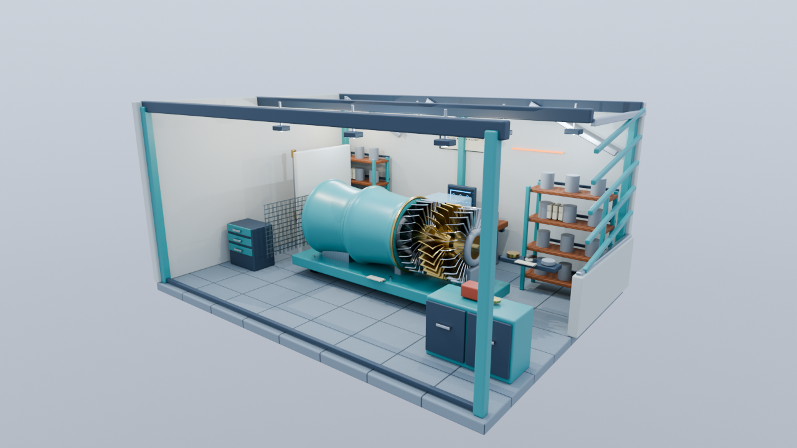
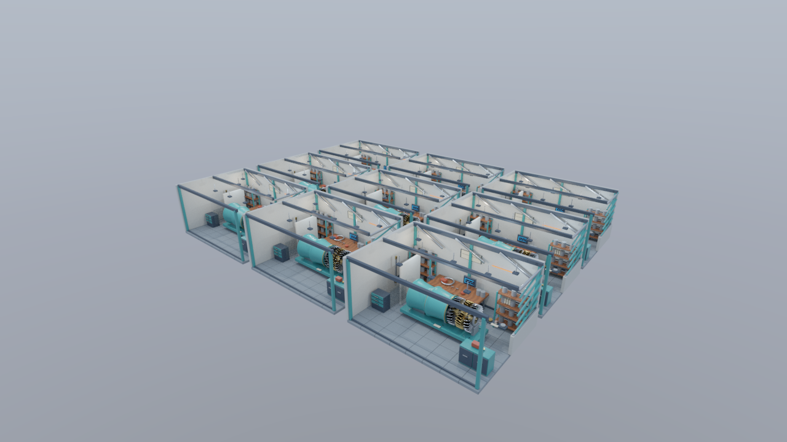
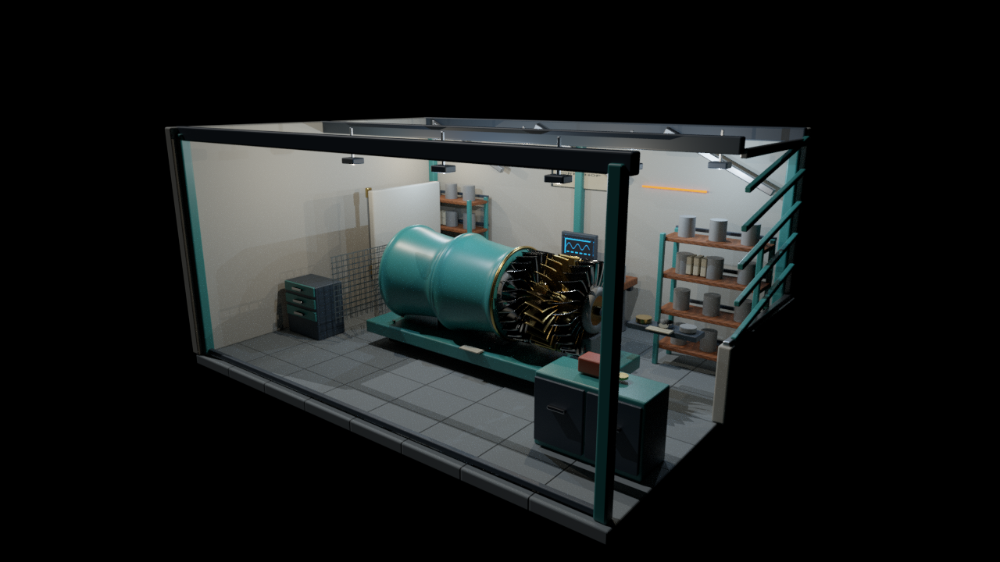
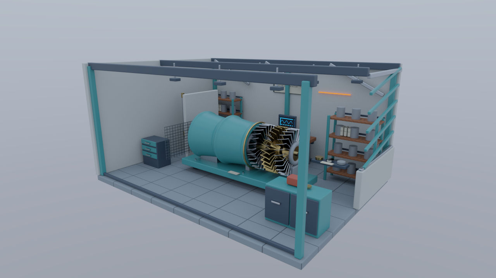
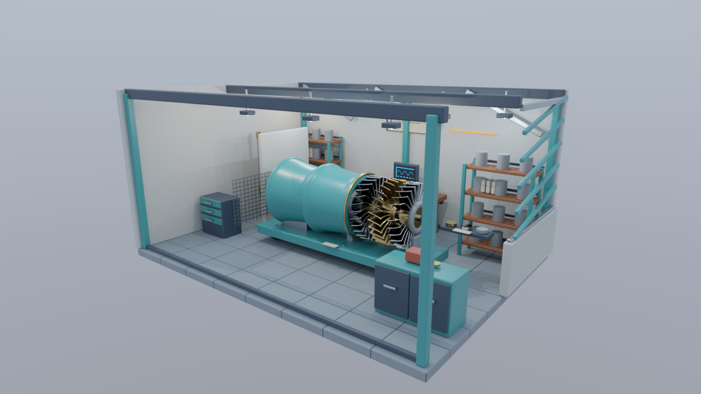
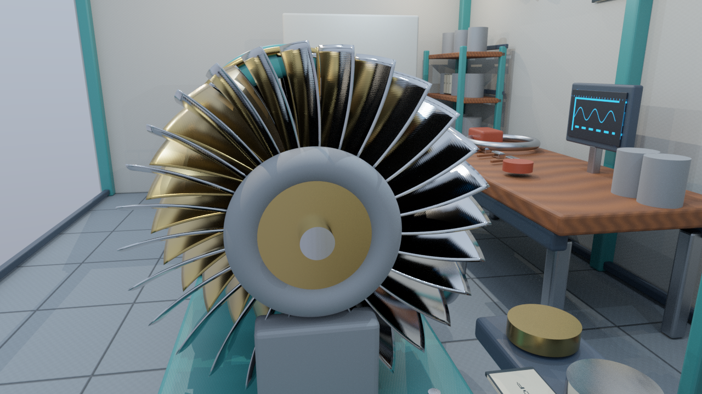
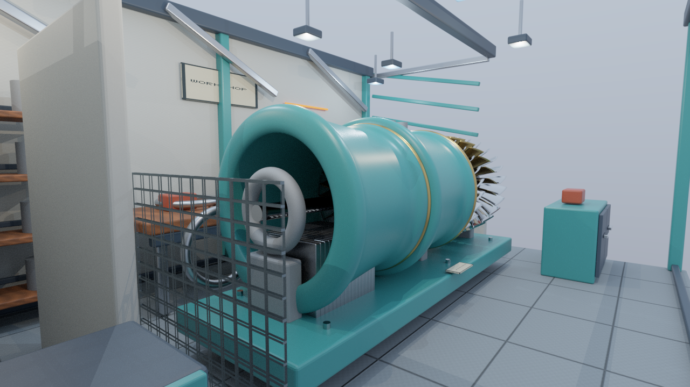
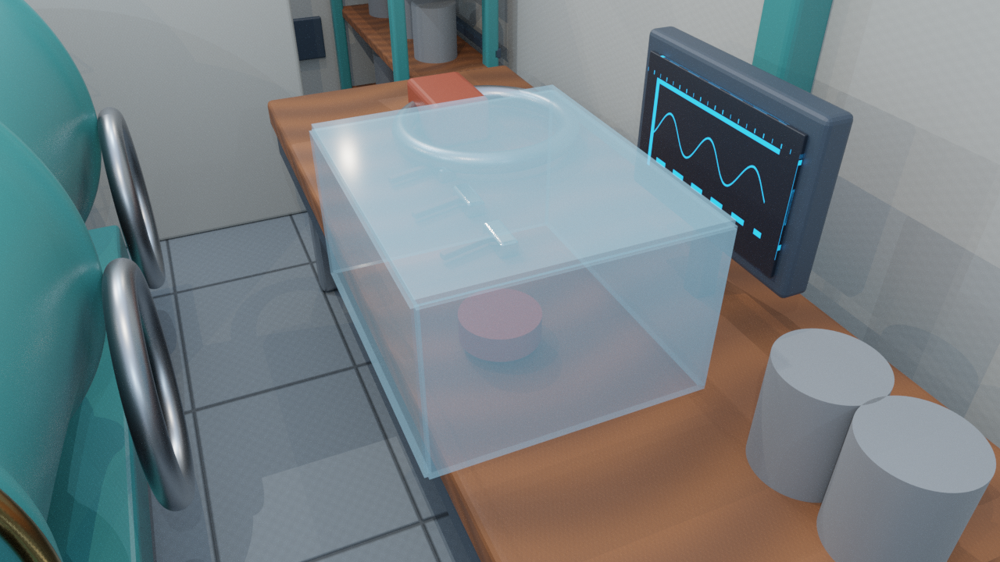

# Workshop：レンダリング方式を比較する工房アセット

Workshopは、Deferred Rendering、レイトレーシング、Mesh Shaderで同じ形状・材質・カメラを使うための自作シーンです。小型タービンの分解展示を中心に、木製作業台、塗装金属の棚、間仕切り、透明カバー、アルファ抜きの格子を配置しました。



この章はアセットとCyclesリファレンスの制作・配布仕様です。[第17・18回のDeferred](../DeferredRendering.md)では拡張CPUローダーで接続しました。既存の単一モデル用ローダーと第1〜16回のシーンは維持しています。

## 見栄えと観察点

正面と右側に開口部を持つ約8×6×4 mの工房です。壁・床の中立色に、暖色の木、青緑の塗装、銀色と真鍮色の金属を組み合わせています。曲面のハイライトと羽根のシルエットを主役にし、細かな汚れや独立したねじの描画を増やしすぎない構成にしました。

| 部品 | 観察する内容 |
|---|---|
| タービンの外装、ローター、ステーター、軸受 | 曲面、金属反射、自己遮蔽、メッシュ内部のクラスタ分割 |
| 作業台、収納、配管、棚 | 非金属と金属、粗さ、接地、反復配置 |
| 壁、間仕切り、柱 | 視錐台の外、遮蔽物の背後、カメラ移動による可視性の変化 |
| 透明カバー | Alpha Blendの透明合成。屈折・吸収は含まない |
| 安全格子 | MASKの穴と影。将来のAny-hit判定 |
| モニターと発光表示 | Render-to-Textureの接続先、HDR、Bloom |
| 材質クーポン | Chrome、Brass、RoughSteelの比較 |

点光源の器具と発光ディスプレイは別に配置しています。発光器具とその代理ライトを重ねて照明を二重に加える構成にはしていません。

## 標準版と負荷比較版

| 項目 | Standard | Stress |
|---|---:|---:|
| 配置後の三角形数（Full） | 251,200 | 2,260,800 |
| Mesh配置数 | 199 | 1,791 |
| Node数 | 219 | 1,919 |
| 点光源 | 8 | 72 |
| ディレクショナルライト | 1 | 1 |

Stressは同じ設備区画を9 m×7 m間隔の3×3へ展開します。形状を再分割して負荷を増やす方式ではなく、Standardと同じMesh・Material・画像を参照します。配置後の三角形数はちょうど9倍です。

StandardのOpaqueは251,128三角形／195 Primitive配置、OpaqueMaskは251,140／196、Fullは251,200／201です。Mesh配置とPrimitive配置は別に数えます。作業台のレールには2材質のPrimitiveがあるため、1 Mesh配置が複数の描画対象になる例も含めています。Stressの各数は9倍です。

共通の固有データは61 Mesh、62 Primitive、98,788三角形、16 Material、40 PNGです。ベースの材質は14 OPAQUE、1 MASK、1 BLEND。画像をRGBA8へ展開した全mipの容量見積りは184,549,664 bytes（約176 MiB）です。PNGにはmipを格納していないため、これは後続のテクスチャ作成工程での予算です。実際のGPUメモリには形状、G-buffer、Shadow、HDRなどが別途必要です。

Housingは19,200、RotorとStatorは各19,040、CoolantLoopは12,800、Bearingは12,288三角形です。建物全体を一つのMeshにせず、曲面を持つ部品にも十分な三角形があるため、将来はオブジェクト全体の可視性とMeshlet単位の可視性を分けて観察できます。



この画像はカリングを実装した結果ではありません。視錐台・法線コーン・遮蔽によるカリングと、LODやMeshlet生成は後続の工程です。

## glTFとシーン設定の接続仕様

`Assets/Models/Workshop/Workshop.gltf`にStandardとStressの2 Sceneを格納し、既定SceneをStandardにしています。外部BINは1個で、両SceneがMesh・Material・画像を共有します。Scene内のNodeを再帰的にたどり、同じMesh参照から複数の配置を作る構成です。

| データ | 保存場所と役割 |
|---|---|
| Workshop.gltf／Workshop.bin／Textures | 形状、材質、静的階層、配置、カメラ、ライト |
| Assets/Scenes/Workshop/Workshop.json | Scene選択、比較プリセット、露出、環境、カメラ条件、役割と経路のキー |
| CameraPath.json | 60 Hz、frame 0〜1200の1,201個の固定カメラスナップショット |
| Statistics.json | 固有・配置後の数、局所・シーン境界、画像予算、IBL数値試験 |
| Manifest.json | 配布・正本・スクリプト・参考画像のサイズ、SHA-256、制作規約 |

glTFは右手系・Y-up・mです。Blender正本はZ-upで、書出し時のY-up変換はBlenderのエクスポータが行います。後続のローダーが左手系へ変換するときは、Z反転、三角形の巻き順反転、接線W反転を一度だけ行います。階層の変換行列は`S=diag(1,1,-1,1)`で`S M S`へ変換します。

Node・Mesh・Material・Primitive・Sceneの`extras.id`を安定した識別子として使います。glTF配列の添字や表示名は永続的な識別子にしません。Sunは両Sceneでライト定義を共有し、NodeのIDをSceneごとに区別します。`sourceId`は共通の制作元を表します。

後続のCPUデータは次の単位で保持します。

- **Geometry:** Primitiveの頂点・Index・局所境界。固有形状ごとに保持する。
- **Material／Image:** 材質係数、Alpha、両面設定、画像参照。画像の再使用では画素データを複製しない。
- **Instance:** 安定ID、GeometryとMaterialへの参照、階層を評価したWorld変換、配置後の境界。
- **Scene conditions:** 選択したScene・プリセット・カメラ・環境・ライト・時刻。

Commonへ追加する場合もCPUデータと読込までに限定します。GPUリソース、描画パス、Barrier、転送、同期は各APIのサンプルで実装します。旧`GltfModel`と`LightingScene`の限定プロファイルと挙動は維持します。

### 拡張ローダーが必要とする範囲

複数Nodeと静的な親子階層、TRS、複数Mesh・Primitive・Material、同じMeshの複数参照を扱います。正の一様スケールのみを使用し、非一様スケールとミラーは制作時に適用します。

PrimitiveはIndexed TRIANGLESで、POSITION・NORMAL・TEXCOORD_0・TANGENTを持ちます。Float属性と16／32-bit unsigned Indexを扱い、アニメーション、Skin、Morph、圧縮、追加UV、Transmission、Volumeには依存しません。

| 入力 | 読込時の解釈 |
|---|---|
| Albedo | RGBはsRGB、Alphaは線形。Base Color Factorと掛ける |
| Normal | 線形、RGBの接線空間法線。Normal Scaleを適用 |
| ORM | 線形。R=Occlusion、G=Roughness、B=Metallic |
| Emissive | RGBはsRGB。Emissive FactorとEmissive Strengthを掛ける |

PNGのメタデータだけで色空間を決めず、用途からGPUのsRGB／UNORMを選びます。AOは現在すべて1で、室内の接地や遮蔽をAlbedo・ORMへ焼き込んでいません。材質共有により同じ画像を異なるFactorで使います。

HDR発光には[`KHR_materials_emissive_strength`](https://github.com/KhronosGroup/glTF/blob/main/extensions/2.0/Khronos/KHR_materials_emissive_strength/README.md)、ライトには[`KHR_lights_punctual`](https://github.com/KhronosGroup/glTF/blob/main/extensions/2.0/Khronos/KHR_lights_punctual/README.md)を使用します。使用する拡張はこの2種類です。

ライトはBlenderの`SPEC`設定で書き出します。付属エクスポータの変換は、Pointの`cd=Power[W]×683/(4π)`、Sunの`lux=Energy[W/m²]×683`です。StandardのPointは85 W×6個と45 W×2個、Sunは1.2 W/m²です。後続シェーダで現在の相対的な線形RGB規約へ合わせる場合は、ライト値を683で割る変換を明示し、同じ変換を比較する両方式に適用します。色付き光源、IBLとPrincipled BSDFを含む画素一致を保証する換算ではありません。

Blender 5.2ではSunのLight.energyとEmissionノードのStrengthが異なる場合があるため、最終のライト値は参考レンダーと同じ保存済みLight.energyから確定します。元の値と単位をWorkshop.jsonの`lightConversion`へ記録し、変換結果とglTFの値を検証します。既定Sunの書出し値は819.6 luxです。

glTFのライトはNodeのローカル−Zを照射方向とし、シェーダの「面からライトへ向かう方向」と符号が異なる点にも注意します。Shadow Mapはディレクショナルライト用を想定し、点光源Shadowは後の拡張です。

### 接線の再現性

BlenderのMikkTSpace出力は小数4桁へ丸められ、再読込で2成分が`0.0001`変わるケースを検出しました。配布時は書出し済みの位置・法線・UV・Indexから、float64のUV勾配と三角形の角度重みを使い、Gram-Schmidtで正規直交化した接線を生成します。Index順と頂点順は維持し、最後にfloat32へ保存します。

これにより保存済み正本からのBINもバイト単位で比較できます。CyclesはBlenderの接線計算を使うため、この接線方式の差も参考画像との近似差に含めます。新しい実行アプリが接線を生成し直す必要はありません。

## Alphaと将来の描画パス

| プリセット | 含む材質 | 比較の目的 |
|---|---|---|
| Opaque | OPAQUE | 基本描画と負荷比較 |
| OpaqueMask | OPAQUE、MASK | 通常比較。既定値 |
| Full | OPAQUE、MASK、BLEND | 透明合成を含む完成表示 |

MASKはBase Color Alpha×Factor Alphaを`0.5`と比較します。安全格子は両面材質で、裏面では法線の向きを反転します。DeferredのG-bufferとShadowの両方で同じAlpha判定を使い、将来のレイトレーシングでは同じ画像・UV・cutoffをAny-hitに渡します。[Alphaと両面材質の仕様](https://registry.khronos.org/glTF/specs/2.0/glTF-2.0.html#alpha-coverage)

BLENDはFactor Alphaが0.24の展示カバーです。深度テストあり・深度書込みなしのForwardパスへ渡し、後方から透明合成する仕様とします。屈折や吸収を持つガラスではありません。CyclesのAlphaによる遮光と、将来のリアルタイム透明合成には差が残ります。通常の負荷比較はOpaqueMaskを使い、BLENDのRay処理や透明Shadowを暗黙に加えません。

MeshletはPrimitive単位に生成し、材質境界とAlpha区分を維持します。両面のMASKでは法線コーンによる背面カリングを無効にします。レイトレーシングではGeometryを共有するBLASとInstanceのTLASへ接続できる構成です。Meshlet、BLAS、TLASのバイナリは今回配布しません。

## HDR環境とIBL

WorkshopSkyは、太陽の円盤を持たない穏やかな外部環境です。Worldの方向から空と地平線の色を作り、空間内の展示物、壁、点光源、Sunは含めません。保存済みのWorkshopSky.blendから2048×1024の線形float32 EXRへ描きます。

| 配布データ | 仕様 |
|---|---|
| WorkshopSky_Environment.dds | 512×512×6、RGBA16F、1 mip |
| WorkshopSky_Irradiance.dds | 32×32×6、RGBA16F、1 mip |
| WorkshopSky_Specular.dds | 256×256×6、RGBA16F、9 mip |
| BRDF.dds | 256×256、RG16F |

面順は+X、−X、+Y、−Y、+Z、−Z、Cubemapの方向は既存と同じ左手系・Y-upです。DDSは線形数値データで、sRGB変換を掛けません。

既存Lighting LabのCPU積分を再使用します。Hammersley 1024 samples、GGX `alpha=max(roughness,0.045)²`、Schlick、height-correlated Smithを維持し、Irradianceには照度相当のEを保存します。Lambertの`1/π`はシェーダ側です。一定色Cの環境についてE=πC、鏡面の全粗さでCを保つことを検証します。

この環境を使うIBLは、部屋の局所的な遮蔽や別の設備からの反射を再現しません。Cyclesや将来のレイトレーシングで差を観察する対象になります。

## カメラとCycles参考画像

カメラは垂直FOVを保存し、1280×720、Near 0.05 m、Far 150 mを基本にします。Hero、Materials、Occlusion、Transparency、StressHero、モニター用MonitorCameraを正本とglTFに収録します。CameraPath.jsonは入室、接近、間仕切りの側面通過、振り返りを含む20秒の経路です。Stressでも中央区画に同じ経路を適用できます。

比較時はScene・プリセット・カメラframe・ライト・環境・露出を同じ条件にします。カメラ経路は位置とTargetの線形補間で、移動距離を時間で測る場合も固定スナップショットを使用します。







比較用3画像は同じHeroカメラとOpaqueMaskです。DirectはWorldを0、Environmentは全ライトを0、Combinedは両方を有効にします。発光表示自体は各条件で見えます。最大バウンス1なので、発光面から他の材質への間接照明は含めません。







検証用7画像はCycles CPU、512 samples、固定seed 0、adaptive samplingなし、denoiseなし、最大バウンス1です。線形float32 EXRを保存し、露出1、チャンネルごとのReinhard、厳密なsRGB OETFでPNGに変換します。完成画像BeautyはFull、最大バウンス8、denoiseあり、AgX Medium High Contrastです。

正本と同じ書出し済み三角形と梱包PNGを使い、レンダー専用のSubdivision、Displacement、追加ライトを加えません。参考画像は現象と画づくりの比較に使います。Principled BSDF、接線計算、局所遮蔽、IBL、Alpha、間接反射による違いがあるため、画素一致の正解画像にはしません。

## 編集・再書出し・検証

編集正本は`SourceArt/Blender/Workshop/Workshop.blend`と`WorkshopSky.blend`です。Standardの部品を編集すると、同じMeshを共有するStressにも形状・材質の変更が反映されます。Standardの配置を変更した場合はStressの配置も編集してください。書出しは保存された両Sceneを使用し、9区画を勝手に再生成しません。

通常は正本を保存してから以下を実行します。Blender 5.2.1 LTSと付属Python／NumPyのみを使います。

```powershell
$blenderExe = 'C:\Program Files\Blender Foundation\Blender 5.2\blender.exe'
$workshopPython = Join-Path (Split-Path $blenderExe -Parent) '5.2/python/bin/python.exe'
& $blenderExe --background SourceArt/Blender/Workshop/Workshop.blend --python-exit-code 1 --python SourceArt/Blender/Workshop/export.py
& $blenderExe --background --factory-startup --python-exit-code 1 --python SourceArt/Blender/Workshop/bake.py
& $blenderExe --background SourceArt/Blender/Workshop/Workshop.blend --python-exit-code 1 --python SourceArt/Blender/Workshop/render_references.py
& $workshopPython SourceArt/Blender/Workshop/validate.py --manifest
.\Tools\TestWorkshopAssets.ps1
```

画像を編集したら保存して梱包し直します。Nodeの`id`、Mesh・Materialの名前とID、UV0、三角形、正の一様スケールを維持します。材質の`profile`カスタムプロパティは配布Factor・Alpha・発光強度を表すため、Principledの対応するノード値と同時に更新します。カメラ変更ではカメラの位置・回転・lens、`targetRH`、Standard Sceneの`workshop_config.cameras`を同じ条件へ更新します。検証がglTFと設定の位置・向き・垂直FOVを照合します。

`generate.py`は初期生成だけに使い、正本が存在すると処理を拒否します。`export.py`、`bake.py`、`render_references.py`は正本を保存しません。`bake.py --reuse-exr`は現在のEXRからDDSだけを再計算し、`--force-lut`はBRDF LUTを更新します。`export.py --output-dir`は別のAssetsルートへ書き出せます。

レンダーは`--preview`で640×360／32 samples、`--shot Beauty`などで単独画像を選べます。本番の配布画像は1280×720です。元のblend・環境EXR・レンダースクリプト・撮影条件の変更を検出して再レンダーし、変更がなければ出力ハッシュを確認して再使用します。共通ヘルパーを編集した場合は`--force`でレンダーし直してください。

`TestWorkshopAssets.ps1`はglTF-Validator 2.0.0-dev.3.10、形状・材質・共有参照・境界・カメラ・IBL・ハッシュを検証します。正本だけを隔離フォルダへコピーし、`.generated`なしで再書出しして、glTF・BIN・参照PNG・設定JSONをバイト単位で比較します。書出し前後で正本のSHA-256が変わらないことも確認します。

実行アプリには生成済みのglTF、PNG、DDS、設定だけを配布するため、Blenderと再ベイクは不要です。GPU描画と拡張CPUローダーの試験は[Deferred検証記録](../DeferredVerification.md)にまとめています。[アセット制作時の検証記録](WorkshopVerification.md)も参照してください。

自作アセットとスクリプトはMIT License、Copyright (c) 2026 masafumiです。外部モデル、写真、HDRI、追加Pythonパッケージは使用していません。
