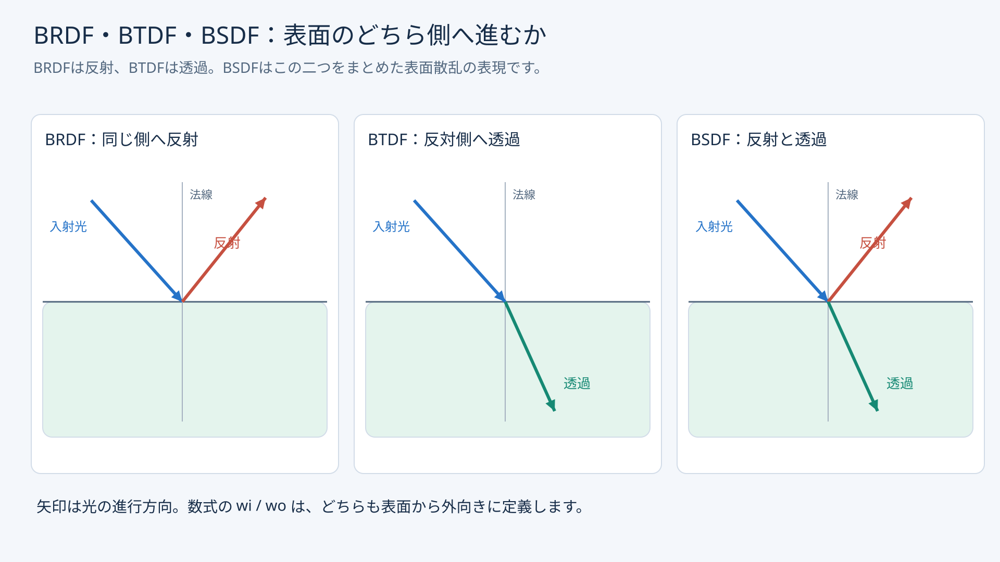
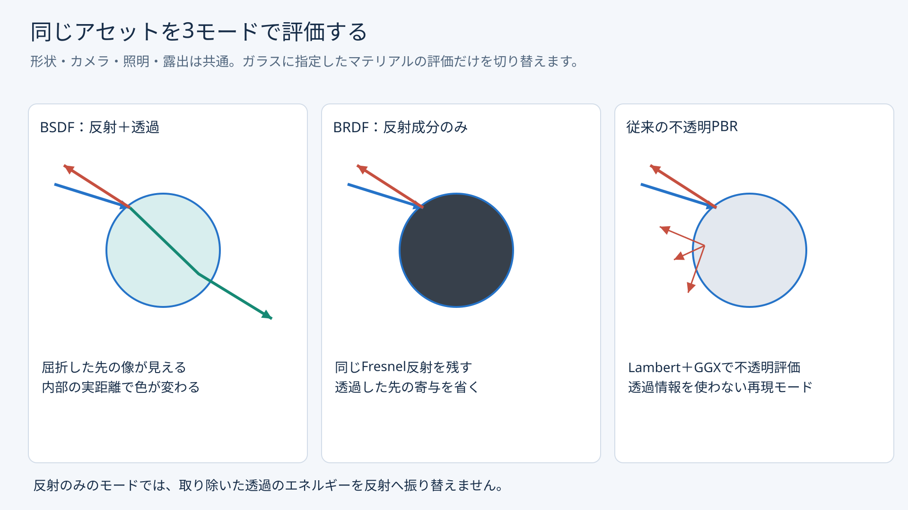
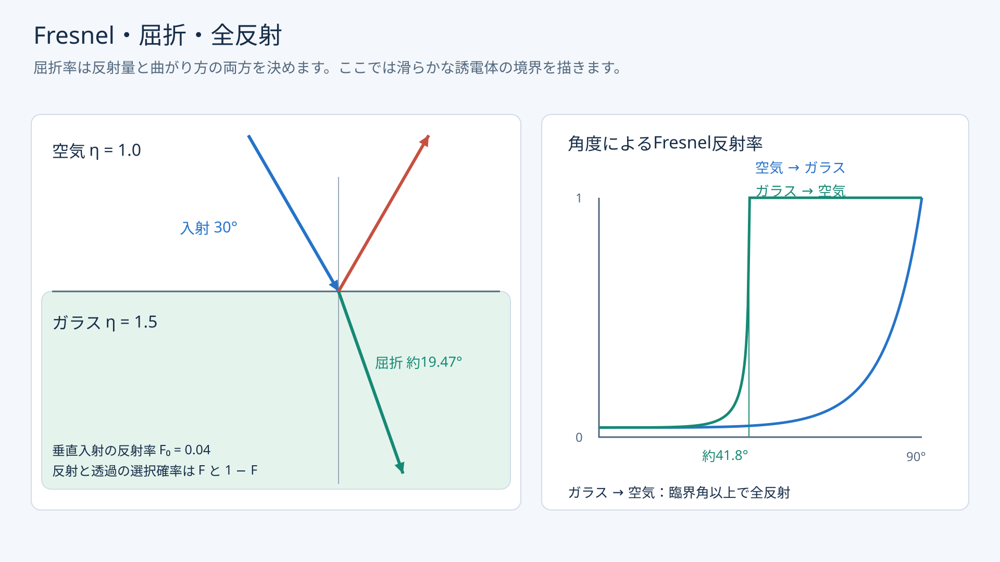
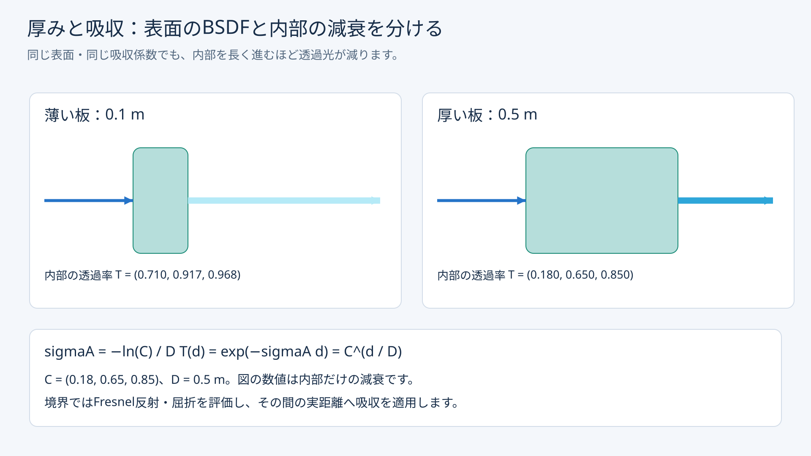

# BRDFとBSDF：反射・透過と色ガラス

発展18では、Lambert拡散とGGX鏡面の反射を使って光の経路を追いました。発展19では、同じパストレーシングにガラスの透過・屈折を加えます。同じアセットを反射と透過で評価する場合、反射成分だけを使う場合、従来の不透明PBRで評価する場合を、カメラ・照明・露出を揃えて比較します。

[共通アセット](Assets/BSDFMaterials.md)／[Direct3D12](Direct3D12/Advanced19_BSDFMaterials.md)／[Vulkan](Vulkan/Advanced19_BSDFMaterials.md)／[検証記録](BSDFMaterialsVerification.md)


1920×1080、1024 spp、最大16回の散乱、seed 1、露出1です。デノイズは使用していません。透明球の屈折した像、すりガラスのぼけ、奥のくさび形ガラスの色を観察してください。

## BRDFはBSDFの反射成分

BRDF（Bidirectional Reflectance Distribution Function）は、ある表面の点で、入ってきた光がどの方向へどれだけ反射するかを表します。Lambertも、鏡面のGGXもBRDFです。BRDFを使うことは「拡散だけ」「古い描画方式」という意味ではありません。

BTDF（Bidirectional Transmittance Distribution Function）は、表面の反対側へ透過する成分です。BSDF（Bidirectional Scattering Distribution Function）は、反射と透過をまとめて扱う表面散乱の表現です。反射だけを持つBSDFもあります。発展18の`BSDF.hlsli`は、そのような反射だけの実装でした。



[PNG版](Assets/Images/BSDFMaterials/hemispheres.png)

表面から外向きの二つの方向を`wo`、`wi`とすると、幾何法線に対して両方向が同じ側なら反射、反対側なら透過です。表面から出る光の式も、反射だけの半球積分から、両側を含む積分へ広がります。

```text
Lo(x, wo) = Le(x, wo)
          + ∫sphere fs(x, wo, wi) Li(x, wi) |N・wi| dwi

fs = fr  （反射側）
fs = ft  （透過側）
```

余弦項が絶対値になるだけで実装が終わるわけではありません。屈折方向、両側の屈折率、方向のPDF、界面を通過する際の重みを一致させる必要があります。定義の背景は[pbrtのBRDFとBTDF](https://pbr-book.org/4ed/Radiometry,_Spectra,_and_Color/Surface_Reflection)を参照してください。

## 散乱モデルと描画方式を分ける

| 概念 | 担当すること | 今回との関係 |
|---|---|---|
| BRDF／BTDF／BSDF | 表面での反射・透過の規則 | 比較するマテリアルモデル |
| ラスタライズ | 投影した形状から可視面を求める | BSDFの近似透過も実装できる |
| レイトレーシング | レイと形状の交差を求める | DXR／Vulkan RT Pipelineを使用 |
| パストレーシング | 経路を確率的に選び、光輸送を推定する | 3モード共通の積分器 |
| Principled BSDF | Blender等が提供する具体的な複合マテリアル | 今回はその全機能を再現しない |

ラスタライズは不透明物や、多数の物体を安定した時間で描く用途に向いています。透過では、背景の画像、奥行き、厚みなどを別途用意する方法があります。画面内の背景を参照する方式には、画面外や隠れた形状、重なった屈折面の扱いに制約があります。アルファ合成も便利ですが、面の被覆率と光が物質へ入る透過は別の量です。[glTF Transmission仕様](https://github.com/KhronosGroup/glTF/blob/main/extensions/2.0/Khronos/KHR_materials_transmission/README.md)もこの違いを説明しています。

理想鏡面の反射と屈折は、決定的なレイトレーシングでも追えます。反射・透過の両方を毎回分岐させると経路数が増え、粗い面では方向の積分も必要になります。今回はFresnelに応じて経路を確率的に選ぶパストレーシングを使います。粗い透過と多重反射へ拡張しやすい代わりに、ノイズと蓄積時間が必要です。

## 同じアセットを3通りに評価する



[PNG版](Assets/Images/BSDFMaterials/three-modes.png)

### 反射＋透過のBSDF

ガラスの表面ではFresnel反射と屈折を選び、内部では進んだ距離に応じて吸収を適用します。反射した周囲の像と、透過して届く背景の像が混ざります。


### 同じガラスの反射成分だけ

Fresnel、IOR、粗さを揃えたまま透過成分を省きます。透過したはずの寄与は0で、反射へ付け替えません。垂直に近いガラス面の反射は弱いので、周囲の反射や光源以外は暗く見えます。


モードに合わせてサンプリング確率を変更しても、BRDF自体のFresnel係数は残します。反射方向を必ず選ぶことと、反射率を1にすることは異なります。GPU試験では、空気からIOR 1.5へ垂直入射する反射成分の重みが0.04になることを確認します。

### 従来の不透明PBR

ガラス用の透過・吸収情報を使わず、従来のLambert＋GGXで不透明に評価します。今回の色ガラスはBase Colorが白で、青緑色をVolumeの吸収に保存しているため、このモードでは白い不透明な物体になります。


これはフォールバックの再現です。既存のローダーは未対応のglTF拡張を拒否するため、旧サンプルに新アセットをそのまま読み込ませた結果ではありません。3番目のモードは反射成分を取り出す理論比較とも異なり、マテリアルを別の反射モデルで解釈する比較です。

床や壁の評価式は3モードで共通です。ただしガラスを経由して床へ届く間接光も変わるため、床の最終画素まで一致するとは限りません。

UIの`Direct-light sampling`は、この3モードとは別の設定です。ここでの「BSDF」は現在の散乱モデルから方向を選ぶ推定方式の名前で、反射成分だけのモデルにも使えます。記事の主比較は全てNEE＋MISに揃えます。発展18と同様、サンプリングをBSDFだけへ切り替えても点光源・太陽などのデルタ光源の直接評価は残します。

## Fresnel・Snell・全反射

滑らかな誘電体の境界では、入射側と透過側の屈折率を`etaI`、`etaT`としてSnellの法則を使います。

```text
etaI * sin(thetaI) = etaT * sin(thetaT)
F0 = ((etaI - etaT) / (etaI + etaT))^2
```

空気1.0からガラス1.5へ垂直入射すると、反射率は0.04です。斜めになるほど反射が強くなります。ガラスから空気へ戻る場合、滑らかな境界では約41.81度以上で全反射になります。入射と出射で同じ屈折率比を使う実装は誤りです。



[PNG版](Assets/Images/BSDFMaterials/fresnel-refraction.png)

初期IORは1.5です。次は透明球だけを2.2へ変更した結果です。同じ形状でも、反射量と屈折した像の変形が変わります。


## 粗い透過とPDF

粗いガラスはGGXの可視微小面法線を選び、その微小面で反射または屈折します。粗さは反射にも透過にも適用します。次は透明球の粗さを0から0.3へ変更した結果です。


透過の半角ベクトルと、微小面法線から透過方向へのPDF変換には屈折率が入ります。反射用の`1 / (4 |V・H|)`を透過へ流用できません。また、radianceを追う経路では屈折率比の二乗による補正が必要です。入射・出射で相殺されるこの補正を、Russian rouletteの終了確率へそのまま含めると不要な終了が増えるため、`etaScale`で分離します。

粗さ0はデルタ分布として別処理します。通常の方向PDFで評価するNEEは行わず、BSDFで選んだ反射・透過先の発光を適切に加算します。実装の基準は[pbrtの誘電体BSDF](https://pbr-book.org/4ed/Reflection_Models/Dielectric_BSDF)と[パストレーサー](https://pbr-book.org/4ed/Light_Transport_I_Surface_Reflection/A_Better_Path_Tracer)です。

コードでは`eta = etaT / etaI`と定義します。粗い透過で`H = normalize(V + eta * L)`を使うと、微小面法線のPDFから方向PDFへのJacobianは次の形になります。`V`と`L`はいずれも表面から外向きです。

```text
denom = dot(L,H) + dot(V,H) / eta
dH/dL = abs(dot(L,H)) / denom^2
pdfTransmission = (1 - Fresnel) * pdfVisibleNormal * dH/dL
```

`Dielectric.hlsli`の`EvaluateSurface`は評価値とPDFを同時に返し、`SampleSurface`が`f * abs(N・L) / pdf`をthroughputの重みへ変換します。結果には反射／透過／デルタのフラグと`eta`を持たせます。Ray Generationでは次のように使います。

```hlsl
ScatterSample scatter = SampleSurface(s, V, rng);
beta *= scatter.weight;
if (scatter.flags & ScatterTransmission) {
    medium = NextMedium(s, scatter.direction, medium);
    etaScale *= scatter.eta * scatter.eta;
}
previousDelta = (scatter.flags & ScatterDelta) != 0;
```

`previousDelta`は、次に発光面へ到達したときのMISに使います。デルタの経路では通常の面光源サンプラから同じ方向を選べないため、その発光を重み1で加えます。GGXは微小面での単一散乱モデルで、微小面間の多重散乱によるエネルギー補償は今回加えていません。

## 表面の散乱と内部の吸収

BSDFが表すのは表面での散乱です。ガラス内部を通る間の吸収は、経路の状態として別に扱います。glTFの`attenuationColor = C`は`attenuationDistance = D`だけ進んだときの内部透過率です。

```text
sigmaA = -log(C) / D
T(d) = exp(-sigmaA * d) = C^(d / D)
```



[PNG版](Assets/Images/BSDFMaterials/absorption-thickness.png)

同じ吸収マテリアルでも、厚い部分ほど色が濃くなります。斜めに入射した場合や内部反射した場合も、実際に進んだ距離が増えます。次の0.1 m／0.5 mの板は同じマテリアルです。


今回のパストレーサーは厚みマップから距離を推定せず、レイの交差間距離を使います。`thicknessFactor > 0`は厚い媒質境界であることの判定に使用します。glTFのVolumeは散乱を含まない吸収モデルです。[Volume仕様](https://github.com/KhronosGroup/glTF/blob/main/extensions/2.0/Khronos/KHR_materials_volume/README.md)

UIの吸収距離0は「吸収なし」を表す教材用の値です。glTFで`attenuationDistance: 0`を指定する意味ではありません。吸収なしのglTFではこのプロパティを省略します。

## 経路・蓄積・今回の制約

幾何法線の外向きを保ち、表か裏かを判定します。BSDF評価用に視線側を向けた法線だけを保存すると、ガラスへ入ったのか出たのかを区別できません。ガラスは背面も探索し、透過後の媒質IDを更新します。一次レイはカメラから始め、近接クリップ位置より手前の境界も飛ばしません。カメラが内部にある場合はCPUで開始媒質を判定します。

今回のプロファイルは離れた閉メッシュを対象にし、ガラスの包囲箱の重なりを拒否します。入れ子・交差する媒質、液体入り容器、開いた薄膜は対象外です。RGBの一様吸収を使い、分散・媒質散乱・表面下散乱は加えていません。

通常のNEEでガラスを挟んだ屈折経路を直接接続することはできません。そのような経路はBSDFの方向選択から見つかるため、コースティクスは特に収束が遅くなります。1024 sppでも無条件にノイズがなくなるわけではありません。アルファで影を薄くする補正やfireflyのクランプは加えていません。


蓄積するのは発展18と同じRGBA32Fの線形HDR平均です。表示で露出・Reinhard・sRGB変換を適用します。モード、カメラ、マテリアル、積分条件、解像度の変更は蓄積をリセットし、露出とUI表示だけの変更では維持します。有限のバウンス上限による打切り誤差と、有限sppによるノイズは区別してください。

ReSTIR、デノイズ、再投影、専用コースティクス手法、分散、BSSRDFなどは後続候補です。今回のアセットとカメラ・seed・sppを、その比較条件として引き継げます。

図は[生成スクリプト](../Tools/DrawBSDFMaterialsFigures.py)でSVGと1920×1080 PNGを再生成できます。描画画像は両APIからのGPU読戻しです。全て自作アセット／図版で、MIT License、Copyright (c) 2026 masafumiです。
