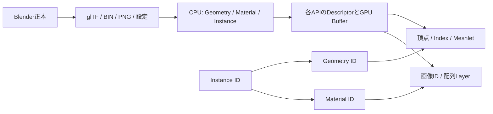
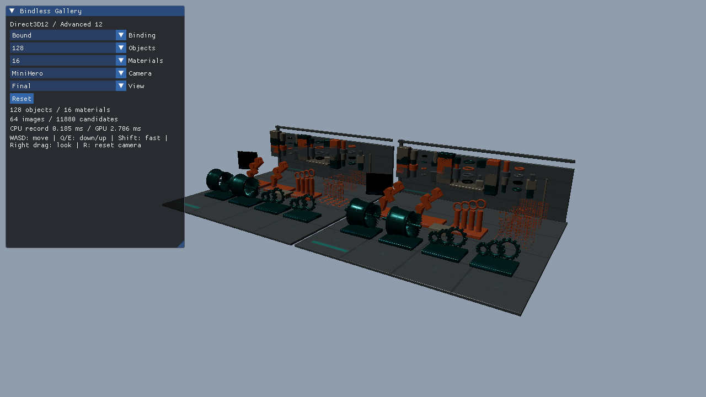
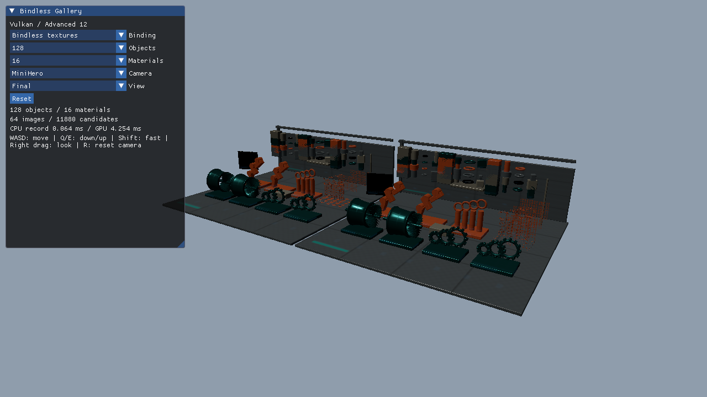

# バインドレス：材質からMesh Shader・レイトレーシングへ

このシリーズは、同じBindlessGalleryを使い、CPUがリソースを選んでバインドする方式から、シェーダがインデックスで選ぶ方式へ進みます。各APIの初期化、Descriptor作成、描画、同期、解放は各プロジェクトに記載しています。

既存の[Visibility Buffer](VisibilityBuffer.md)、[Mesh Shader](Meshlets.md)、[レイトレーシング](Raytracing.md)が使う固定64枠のテクスチャ配列も、バインドレスの一形態です。配列が固定長かどうかだけで分類するのではなく、誰がどの粒度でリソースを選択するかに注目してください。

## 学習順序

| 発展編 | 観察する違い | 前提 |
|---|---|---|
| 12 BindlessMaterials | 材質ごとのDescriptor切替と、Material IDから画像を引く処理 | 基本08・09・21 |
| 13 BindlessMeshShader | Meshletから異なる形状Bufferを参照し、GPU Drivenで描画をまとめる | 発展05・06・08 |
| 14 BindlessRaytracing | ヒット先から材質と形状を引く。固定Texture2DArrayとの格納制約の違い | 発展01〜03 |
| 15 BindlessHybrid | Mesh Shaderの一次面と、RTの影・反射で同じScene情報を使う | 新規13・14 |

最初に[Blenderアセット](Assets/BindlessGallery.md)を確認してください。Mini／Standard／Stressは配置数と材質数の出発点で、実行時にはそれぞれ独立して変更できます。

## CPUからシェーダへの参照



Geometryの実データは64種類です。材質バリエーションを別の頂点データにせず、InstanceがGeometryとMaterialを個別に参照します。Meshletはmeshoptimizerの固定版で作成し、64頂点・96三角形の上限を継承します。

`bound`は固定スロット、`textures`は画像のDescriptorインデックス、`resources`は画像に加えて形状・Scene BufferとHDR出力UAVをインデックスで参照します。フレーム定数とSamplerは固定です。バインドレスでもPipelineやDescriptor Heap／Setの初期設定と同期は必要です。

D3D12はSM6.6の`ResourceDescriptorHeap`を使い、Root Signatureに直接参照のフラグを付けます。Vulkanは型別Descriptor配列と非一様インデックス参照を使います。取得方法の差を共通HLSLの小さな関数に閉じ込め、材質・照明計算は共有します。[Microsoft仕様](https://microsoft.github.io/DirectX-Specs/d3d/HLSL_SM_6_6_DynamicResources.html)、[Khronos Descriptor indexingサンプル](https://docs.vulkan.org/samples/latest/samples/extensions/descriptor_indexing/README.html)

VulkanのDescriptor数はSceneを読み込んでから決め、使用する全要素へ有効なDescriptorを書き込みます。Update-after-bind、Partially bound、Variable descriptor countは初版では使用しません。GPUが参照中のDescriptorやBufferを書き換えず、モード・配置数・材質数の変更はGPU完了後に再構築します。

## 比較するときの条件

12／13の直接描画では同じInstance順と描画件数を使います。従来方式も材質順の並べ替えとDescriptorキャッシュを使います。GPU Drivenは別の比較として扱い、Computeの視錐台カリング、可視リスト、間接Mesh Dispatchに掛かる時間も含めます。CPUが可視数を読み戻してから描画を開始する経路はありません。

RTの`bound`は用途別の4つのTexture2DArrayと結合Bufferです。シェーダのヒットごとにCPUから材質をバインドし直す構成は使いません。`textures`／`resources`では同じ画像とmipを個別に参照します。画像の格納方法とBufferの配置も変わるため、RTの結果をCPUバインド削減だけの効果として説明しません。

14／15は共通のLOD 0参照を使い、BLAS／TLASの形状、レイ数、再帰深度3、MASK判定、影・反射の設定を固定します。15の一次面はMesh ShaderでG-bufferへ描き、Ray Generationがその面から影と1バウンス反射のレイを発生させます。Ray Queryは使用しません。

照明は共通HLSLのGGX系直接光、固定の環境近似、Emissiveです。Cycles参考画像には間接光と異なる表示変換があり、画素一致の正解にはしません。実装方式間の比較では同じHLSLの条件を揃えます。

## 実行と測定

固定ランタイムで両API・46条件×5反復を再測定しました。表・グラフ・JSONは再測定分を使い、重複があった初回データは参考用に分離しています。[検証記録と再測定手順](BindlessVerification.md#再測定の手順)を参照してください。

```powershell
# 64枠を超える画像を使い、同じ128配置で材質参照を比較する
.\bin\x64\Release\Direct3D12_Advanced12_BindlessMaterials\Direct3D12_Advanced12_BindlessMaterials.exe --gallery-preset Mini --materials 64 --binding bound
.\bin\x64\Release\Direct3D12_Advanced12_BindlessMaterials\Direct3D12_Advanced12_BindlessMaterials.exe --gallery-preset Mini --materials 64 --binding textures

# Buffer参照と、描画集約は別々に試す
.\bin\x64\Release\Vulkan_Advanced13_BindlessMeshShader\Vulkan_Advanced13_BindlessMeshShader.exe --binding resources
.\bin\x64\Release\Vulkan_Advanced13_BindlessMeshShader\Vulkan_Advanced13_BindlessMeshShader.exe --binding resources --gpu-driven

.\Tools\TestBindless.ps1 -Configuration Debug
.\Tools\TestBindless.ps1 -Configuration Release
# 固定コピーからの測定手順は検証記録を参照。
```

`--gallery-preset Mini|Standard|Stress`、`--objects 1..4096`、`--materials 1..256`、`--binding bound|textures|resources`、`--gallery-view final|material|geometry|uv`を用意しています。12の`resources`、12／14のGPU Driven、`bound`のGPU Drivenは明示的に拒否します。カメラ・カメラ経路・影／反射OFF・撮影・GPU読戻しは既存と同じCLIを使います。

測定はRelease、VSync／UI OFF、60フレームのウォームアップ＋1,200フレーム、固定20秒経路で行います。初期化・画像転送・AS構築は定常描画と分離します。各条件を5回実行し、モードの順番を入れ替えます。`MeasureBindless.ps1 -FullMatrix`で全テーマについて配置数・材質数の軸を測定できます。標準実行は12で両軸を測り、13〜15で同じStandard条件を比較します。

CPUの更新、コマンド記録、Submit、GPU待ち、Presentと、GPUのCull／Geometry／RT／Lighting／Display／Totalを別に保存します。JSONは集計値と条件、CSVはフレーム値です。GPU機能、CPU負荷、画像キャッシュ、描画件数によって結果が変わります。高速化を合格条件にはせず、[実測データ](BindlessPerformance.json)と検証条件を併記します。

## バインド切替の実画面

Mini、128配置、16材質でUIのBindingを実際に操作した画像です。シーンのHDRは切替前後で一致し、Descriptorの取得経路が変わります。Resetで起動時の指定へ戻ります。






## 測定値の読み方

GPUの`geometry`はG-buffer、`lighting`はCompute照明、`display`はトーンマップです。14／15のBRDFと影・反射はRTの同じシェーダで計算するため`rt`に合算し、独立の`lighting`は0です。`total`はカリングから表示パスまでを囲み、UI・Present・末尾の統計読戻しを含みません。CPUの`record`はコマンド記録、`gpu-wait`はGPU完了待ち（VulkanはAcquire待ちも含む）、`present`はPresent APIの呼出時間です。VSync OFFでもPresentは実行します。

容量はアセット画像、Scene Buffer、5枚のRGBA32F＋D32画像、ASの結果Bufferを報告します。画像・Scene Buffer・描画先についてAPIが返すアライメント込みの容量を併記します。Swapchain・UI・Query Pool、フレーム定数・可視リスト・間接引数・SBT、および転送・AS scratchの一時領域は集計範囲外です。D3D12のDescriptor容量は個数×incrementによるアドレス範囲です。VulkanのDescriptor容量はAPIから実サイズを取得できないためnullとし、Descriptorの個数を記録します。

可視件数は測定後の末尾フレームを対象とします。一次面のInstance／Geometry数はID画像からGPUで集計し、Meshlet数はGPU Drivenの可視リストのカウンタを使用します。別にCPUの視錐台参照計算を保存します。可視件数の読戻しは定常測定後に実行し、1200フレームの時間へ混ぜません。CSVには各フレームのCPU／GPU時間を保存します。

`Tools/TestBindlessUI.ps1`は新規8本の実ウィジェット操作とHDRの往復一致を検査します。`Tools/TestBindlessFailures.ps1`は不正ID・容量超過・非対応のモード指定・Shader欠落を検査します。`Tools/TestBindlessShaders.ps1`は全オフラインバイナリを検証し、RT側へRay Queryが混入していないことも調べます。

グラフ作成は開発用のMatplotlib 3.10.7を使う`Tools/PlotBindless.py`です。描画サンプルの実行依存には含めません。測定の全フレーム・条件・コンパイラ情報は[圧縮データ](Measurements/Bindless/Frames.zip)と[ハッシュ](Measurements/Bindless/Manifest.json)、集計は[JSON](BindlessPerformance.json)に保存します。

## 固定bindingとインデックスの区別

| HLSL | Vulkan set 0 | 対象 |
|---|---|---|
| b0 | binding 0 | 320 byteのフレーム定数 |
| t0 | binding 1 | 固定4枠、用途別4 Array、または個別画像配列 |
| s0 | binding 2 | 固定Sampler |
| t512 | binding 3 | 固定9 Buffer、または324個の個別Buffer配列 |
| u0 | binding 4 | HDRと表面情報を含む5個のUAV |
| t900 | binding 5 | パス間で読む4個の画像 |
| t904 | binding 6 | 固定のTLAS |
| u5 | binding 7 | 可視リストと統計用のBuffer |
| b1 | push constants | Instance／Meshlet base／Driven／候補数の16 byte |

D3D12のtextures／resourcesでは画像を`ResourceDescriptorHeap[NonUniformResourceIndex(heaps.x + imageId)]`から取得します。resourcesのBufferは`heaps.y + bufferId`、HDR出力は`heaps.z`から取得します。Vulkanではそれぞれ型別配列の要素を参照します。Frame、Sampler、TLASやパス間の固定bindingも残し、Sceneの個別リソースを段階的にインデックス化します。

Buffer IDは0=Geometry一覧、1=Material一覧、2=Instance一覧、3+Geometry ID×5から頂点／Index／Meshlet／頂点参照／三角形参照、323=候補リストです。Geometry一覧の実IDは安定しており、材質の変更で形状を複製しません。Instanceの`ids.z`には元の配置IDを残し、描画用のソート後インデックスと区別します。
