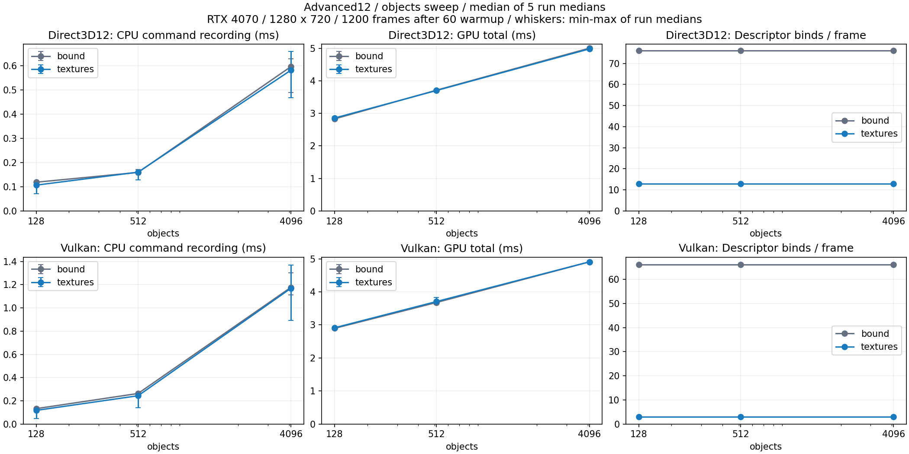
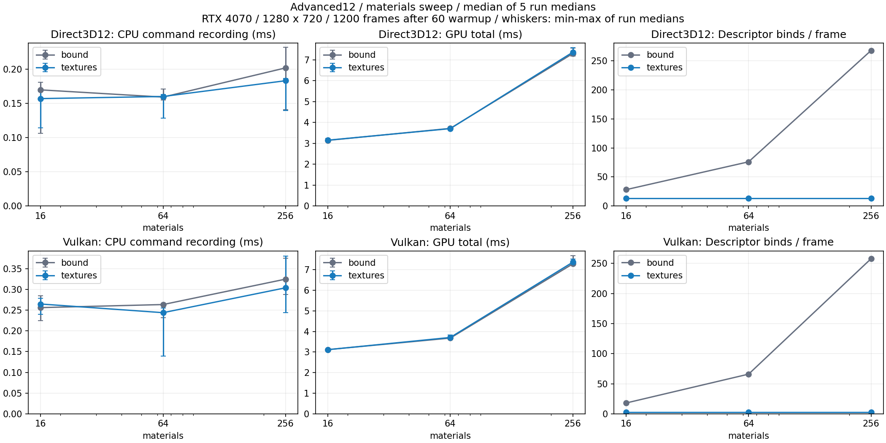
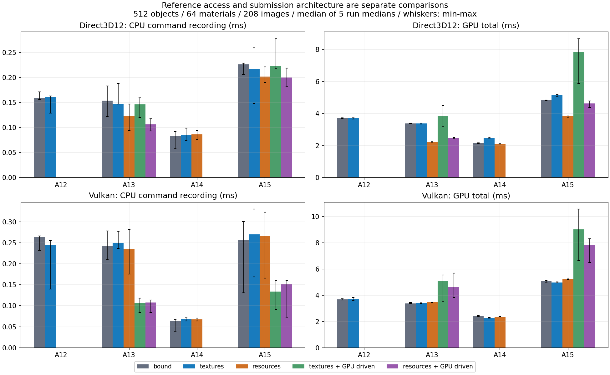

# バインドレス発展編の検証・測定

2026-10-18、BindlessGalleryと発展12〜15の両APIを対象に検証しました。[共通章](BindlessGraphics.md)、[アセット](Assets/BindlessGallery.md)、[実測JSON](BindlessPerformance.json)から参照できます。

## 環境

| 項目 | 検証した値 |
|---|---|
| OS／CPU | Windows 11 Pro 10.0.26300／Intel Core i9-13900F |
| GPU／ドライバ | NVIDIA GeForce RTX 4070／32.0.16.1088（Windowsの報告値） |
| VS／MSVC | Visual Studio 2026、v145、MSVC 19.51.36257（`_MSC_FULL_VER=195136257`） |
| SDK／言語 | Windows SDK 10.0.26100.0、C++20、HLSL 2021、SM6.6、x64 |
| Direct3D12 | Agility SDK 1.619.6、NuGet DXC 1.9.2609.5（01b62ad47） |
| Vulkan | SDK 1.4.341.1、付属DXC file version 1.9.0.5180（e35541826）、target 1.3 |
| Blender／Validator | Blender 5.2.1 LTS、glTF-Validator 2.0.0-dev.3.10 |
| シーン | 1280×720、固定Sampler、1フレームごとにGPU完了を待つ構成 |

## アセット

64 Geometry、131,560固有三角形、256材質、400枚の異なる512×512 PNGを検査しました。glTF Validatorはerror／warning／info／hintすべて0。法線・接線・UV・境界・インデックス・ID・MASK・PNGのCRCと色空間・ファイルの一意性を独立に確認しています。

Mini 128／16、Standard 512／64、Stress 4096／256の配置・材質数、20秒60Hzの1201経路サンプルを検査しました。材質違いのglTF Meshが同じAccessorを共有することも確認しています。保存済みBlender正本だけを隔離フォルダへコピーし、400枚のPNGを含む全出力のハッシュが一致しました。正本の上書きガードと、7種類の不正アセットも検査しています。

Cyclesの1280×720参考画像5枚と、両APIのStandard実描画8枚を目視確認しました。参考画像とリアルタイム描画は照明・反射・表示変換が異なるため、画素一致の基準にはしません。[アセットハッシュ](Assets/BindlessGalleryManifest.json)、[実描画の条件・ハッシュ](BindlessCaptures.json)。

## 正当性の検査

`TestBindlessCpu.ps1`は両構成で64形状の共有、材質数の独立指定、画像IDとArray layerの対応、64頂点／96三角形のMeshlet上限、元の三角形と巻き順の再構成を確認します。

`TestBindless.ps1`は各構成22モード、Mini 128配置／64材質／208画像を使います。`bound`とのHDR差は絶対0.001＋相対0.002以内、D32は絶対2e-6以内、PositionとInstance IDも照合します。DepthとMASKの可視範囲が一致することを検査します。14は未使用のDepthを読み戻さず、一次レイのUV・ヒット距離・Instance IDを比較します。

`TestBindlessFeatures.ps1`は材質ID／形状IDの色をCPUのハッシュと比較し、UVを元の三角形・World変換・重心座標から独立に計算します。各構成192画素の照合で、CPU側は細長い三角形の桁落ちを避けるため倍精度を使用します。許容差はUV 0.006、再構成点の三角形平面との距離0.002mです。

GPU Drivenは直接描画と参照順序が変わり、交差面・共面の三角形で勝つ画素が変わります。既存のMesh Shader試験と同様に1画素の境界近傍を除きます。Instance IDの一致率は99.8%以上、境界除外は15%未満に制限し、除外割合と残るHDR差を数値記録します。現在のシーンの除外は約8%、境界以外の最大HDR差は0〜1.91e-6です。参照方式だけを変える直接描画には、この境界除外を適用しません。

空の可視リスト、カリングOFFの全候補、65配置の端数を検査し、GPU可視Meshletカウンタを独立のCPU視錐台計算と照合します。`TestBindlessUI.ps1`は8本のBindingウィジェットを実際のImGui入力で操作し、ResetとシーンHDRの往復一致を確認します。`TestBindlessEffects.ps1`は影／反射の個別OFFによってHDRが変わり、一次面が保たれることを確認します。

`TestBindlessFailures.ps1`は4097配置、257材質、非対応モード、boundでのGPU Driven、不正Geometry ID、Shader欠落を拒否することを検査します。CLIエラーも`--frames`と`--log`を保持して終了し、自動試験をモーダルダイアログで止めません。機能不足のGPU実機は用意していません。機能・Descriptor上限・配列Layer数・Bufferアライメント不足は起動時に理由を出して拒否する実装です。

## ビルドと回帰

この工程のビルド・回帰対象は、既存72本＋新規8本の80 APIアプリと2 CPUライブラリです。Restore、x64 Debug／Releaseビルド、`.vcxproj`／`.filters`のXMLと全項目の対応を検証しました。最終XML検査時点のソリューションには、並行する別工程の8本も加わって88 APIアプリが含まれています。このページのGPU回帰結果は80本を対象とします。新規DXIL／SPIR-V 496本を検証し、RTモジュールにRay Query要件が混入していないことも確認しました。Vulkan RTのコンパイルでは使用する拡張を明示しています。

全既存サンプルと新規8本の描画、リサイズ、最小化・1280×720復帰、撮影、終了を両構成で検査します。DebugはD3D12 Debug Layer、Vulkan Validation LayerとSynchronization Validationを有効化します。既存のOBJ／glTF／WIC／ファイルローダー、09 ImGuiのSlider／Resetも回帰対象です。

## 性能データ

**以下の表・グラフは固定ランタイムによる再測定結果です。** 2026-10-18の17:47〜18:24（日本時間）に、両APIの46条件×5反復を収集しました。他サンプル・コンパイラ・MSBuildのプロセスを1秒間隔で監視し、別工程のログ更新も確認しました。重複による除外・再試行は0件です。全ファイルは収集前後、各EXEは各試行の前後でハッシュが一致しています。[収集監査](Measurements/Bindless/CollectionAudit.json)、[固定コピーの全ファイルハッシュ](Measurements/Bindless/RuntimeSnapshot.json)。

初回は実行ファイル更新とGPU試験の重複があったため、[初回参考データ](Measurements/Bindless/FirstPass/Frames.zip)と[初回監査](Measurements/Bindless/FirstPass/Audit.json)を別途保存しています。今回の集計には混ぜていません。

Release、VSync／UI OFF、ウォームアップ60フレーム、固定経路1200フレーム、条件ごとに順序を変えて5反復します。API・テーマ・バインド方式に加えて、12は配置数128／512／4096と材質数16／64／256を独立に変えます。13／15のGPU Drivenは別条件です。

[全フレームのJSON／CSV](Measurements/Bindless/Frames.zip)、[集計JSON](BindlessPerformance.json)、[アーカイブハッシュ](Measurements/Bindless/Manifest.json)を保存します。以下のグラフ・比較表は測定結果から生成します。

今回のJSON各条件とManifestは`measurementStatus: collected-with-guards`です。CSVの連番・全数値の有限性／非負性と、JSONの平均・中央値・p95を7,590項目照合しました。各試行は1,200値を昇順にし、中央値にindex 600、p95にindex 1140（0始まり）を使います。CSVの6桁丸めを考慮した許容差は絶対1e-5 msまたは相対1e-5です。各条件で実際に割り当てた材質数と指定材質数も一致しました。[データ検査結果](Measurements/Bindless/DataChecks.json)。

### 再測定の手順

他のGPU試験・ビルドが終了した状態で、Releaseビルド後に以下を実行します。`FreezeBindlessRuntime.py`は実行ファイル・Shader・アセット・DLLを独立フォルダへコピーし、コピー前後の全ファイルハッシュを照合します。途中更新を検出した場合は中止します。

```powershell
& 'C:\Program Files\Blender Foundation\Blender 5.2\5.2\python\bin\python.exe' -X utf8 .\Tools\FreezeBindlessRuntime.py
$runtime = (Get-Content .cache/bindless/RuntimePath.txt -Raw).Trim()
.\Tools\MeasureBindless.ps1 -RuntimeRoot $runtime -VerifyRuntimeOnly
.\Tools\MeasureBindless.ps1 -RuntimeRoot $runtime -OutputDirectory .cache/bindless-performance-fixed -Resume
```

測定スクリプトは開始時と終了時にSnapshot全体、各試行の前後にEXEハッシュを確認します。他のサンプル・コンパイラ・MSBuildのプロセス、別工程のログ更新を検出した試行は`Rejected`へ退避して再試行します。この検出は補助であり、任意の外部アプリのGPU使用を保証するものではありません。再開時もアセット・EXE・Snapshotが一致する試行だけを使用します。各試行には時刻・Snapshotハッシュ・実行引数・検査結果を保存します。

集計後に`Tools/PlotBindless.py`、`Tools/WriteBindlessResults.py`を実行すると、図と比較表を更新できます。Matplotlib 3.10.7は開発用です。グラフのひげは5反復の中央値の最小〜最大です。p95は表とJSONに記録しています。標準の46条件×5反復＝230試行を実測し、`-FullMatrix`の150条件×5反復＝750試行の列挙も確認しました。

<!-- GENERATED_PERFORMANCE -->

測定は46条件×5反復＝230回、計276,000測定フレームです。数値は各反復の中央値をさらに中央値で集計しています。p95も各反復のp95の中央値です。反復間の最小・最大はJSONに残しています。

### 参照方式の比較（512配置・64材質・208画像）

| API | 発展 | 方式 | CPU記録 ms | GPU合計 ms | GPU p95 ms | Descriptor bind | Scene Buffer |
|---|---:|---|---:|---:|---:|---:|---:|
| Direct3D12 | 12 | bound | 0.1594 | 3.7120 | 6.3846 | 76 | 9 |
| Direct3D12 | 12 | textures | 0.1603 | 3.7018 | 6.3304 | 13 | 9 |
| Direct3D12 | 13 | bound | 0.1538 | 3.3812 | 5.9730 | 140 | 9 |
| Direct3D12 | 13 | textures | 0.1477 | 3.3853 | 5.8225 | 77 | 9 |
| Direct3D12 | 13 | resources | 0.1230 | 2.2303 | 3.4877 | 13 | 324 |
| Direct3D12 | 14 | bound | 0.0829 | 2.1545 | 2.7453 | 9 | 9 |
| Direct3D12 | 14 | textures | 0.0851 | 2.4822 | 3.1478 | 9 | 9 |
| Direct3D12 | 14 | resources | 0.0862 | 2.0961 | 2.6061 | 9 | 324 |
| Direct3D12 | 15 | bound | 0.2259 | 4.8302 | 6.1911 | 13 | 9 |
| Direct3D12 | 15 | textures | 0.2170 | 5.1364 | 6.4420 | 13 | 9 |
| Direct3D12 | 15 | resources | 0.2015 | 3.8267 | 4.6418 | 13 | 324 |
| Vulkan | 12 | bound | 0.2635 | 3.6784 | 5.2048 | 66 | 9 |
| Vulkan | 12 | textures | 0.2439 | 3.7075 | 5.1567 | 3 | 9 |
| Vulkan | 13 | bound | 0.2422 | 3.3831 | 4.9764 | 66 | 9 |
| Vulkan | 13 | textures | 0.2490 | 3.4053 | 4.9936 | 66 | 9 |
| Vulkan | 13 | resources | 0.2356 | 3.4632 | 5.1327 | 3 | 324 |
| Vulkan | 14 | bound | 0.0641 | 2.4212 | 3.0540 | 2 | 9 |
| Vulkan | 14 | textures | 0.0686 | 2.2776 | 2.8866 | 2 | 9 |
| Vulkan | 14 | resources | 0.0672 | 2.3612 | 3.0666 | 2 | 324 |
| Vulkan | 15 | bound | 0.2560 | 5.0719 | 6.5783 | 3 | 9 |
| Vulkan | 15 | textures | 0.2705 | 4.9663 | 6.4806 | 3 | 9 |
| Vulkan | 15 | resources | 0.2657 | 5.2481 | 6.8904 | 3 | 324 |

### 描画集約の比較（同じバインド方式内）

| API | 発展 | 方式 | 直接→集約 Dispatch | CPU記録 ms（直接→集約） | GPU合計 ms（直接→集約） |
|---|---:|---|---|---:|---:|
| Direct3D12 | 13 | textures | 513 → 5 | 0.1477 → 0.1461 | 3.3853 → 3.8318 |
| Direct3D12 | 13 | resources | 513 → 5 | 0.1230 → 0.1060 | 2.2303 → 2.4637 |
| Direct3D12 | 15 | textures | 513 → 5 | 0.2170 → 0.2226 | 5.1364 → 7.8500 |
| Direct3D12 | 15 | resources | 513 → 5 | 0.2015 → 0.1998 | 3.8267 → 4.6316 |
| Vulkan | 13 | textures | 513 → 5 | 0.2490 → 0.1071 | 3.4053 → 5.0624 |
| Vulkan | 13 | resources | 513 → 5 | 0.2356 → 0.1076 | 3.4632 → 4.6004 |
| Vulkan | 15 | textures | 513 → 5 | 0.2705 → 0.1339 | 4.9663 → 9.0149 |
| Vulkan | 15 | resources | 513 → 5 | 0.2657 → 0.1524 | 5.2481 → 7.8215 |







### 結果を読む際の注意

Direct3D12の13／resourcesでは、Dispatchは513→5回、CPU記録は0.1230→0.1060 ms、GPU合計は2.2303→2.4637 msでした。GPU DrivenにはComputeカリング・可視リストへの圧縮・間接引数生成も含まれます。Dispatch数の減少だけをGPU高速化と解釈しません。

Vulkanの13／resourcesでは、CPU記録は0.2356→0.1076 ms、GPU合計は3.4632→4.6004 msでした。Geometryパスは3.3593→4.4338 ms、集約側のCullは0.0548 msです。GPU Drivenでは可視リストの圧縮・追加参照とMeshletの実行順序・分配も変わります。各要因の寄与は分離していませんが、増加はGeometryパスに大きく現れています。

Direct3D12の12／512配置・64材質では、Descriptor bindは76→13回、CPU記録は0.1594→0.1603 ms、GPU合計は3.7120→3.7018 msでした。

Vulkanの12／512配置・64材質では、Descriptor bindは66→3回、CPU記録は0.2635→0.2439 ms、GPU合計は3.6784→3.7075 msでした。

発展12のこの条件では、両APIともCPU記録・GPU合計の反復間の最小〜最大が方式間で重なります。バインド回数の削減は確認できますが、この結果だけで安定した処理時間の短縮を断定しません。

従来方式も材質順に並べ、Descriptorをキャッシュしています。12の64材質では配置数を増やしても材質バインド回数は一定です。配置数を増やす実験と材質数を増やす実験を分けることで、Draw件数とリソース切替の違いを観察できます。

14のCPU記録には、CPUからヒットごとに材質をバインドする処理がありません。固定Arrayと個別画像、結合Bufferと個別Bufferの配置・参照の差です。15は一次面と二次レイの両経路を含みます。API間の絶対値はコンパイラ、Descriptorの組み方、Presentの経路も異なるため、同じAPI・同じ描画経路内の差を読みます。

ShaderとDescriptorは事前作成しています。起動時のWIC／mip処理・転送・AS構築は定常時間と分離してJSONへ保存しました。資源を細かく分けると確保時のアライメント余白も増えるため、payload容量だけでなくcommitted容量とDescriptor個数も確認してください。小差は反復間の幅と合わせて判断します。
