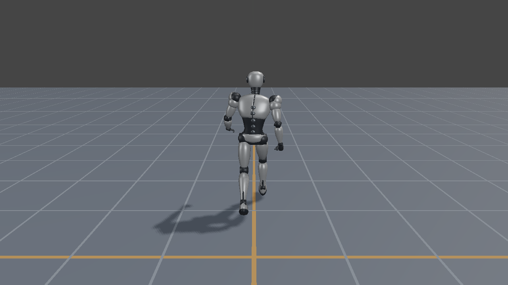
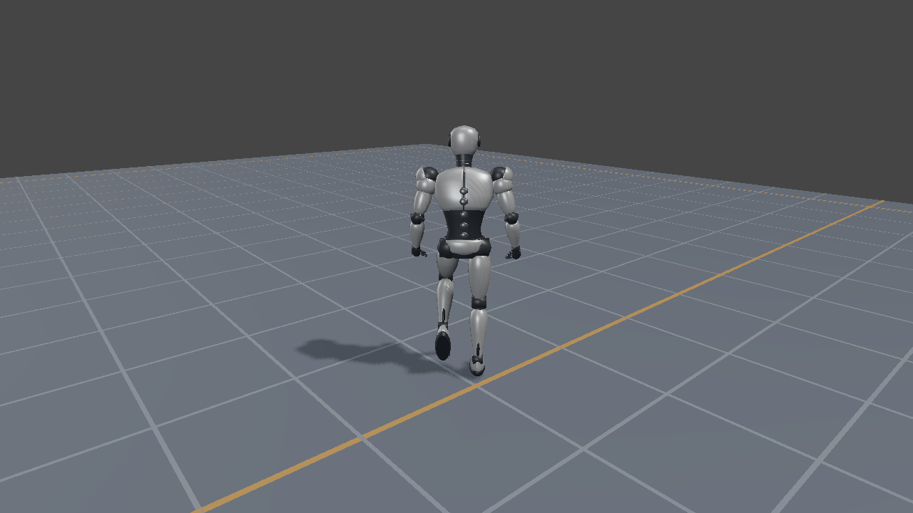
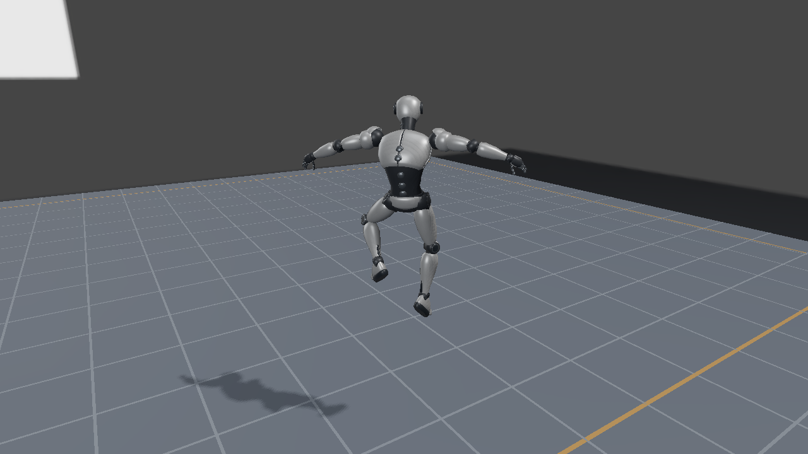

# 第28回：XInput／WASDでスキニングキャラクターを操作する

第22回は、選んだアニメーションクリップを再生してGPUスキニングを調べるサンプルでした。第28回では同じSilverRobotを、プレイヤーが歩かせ、走らせ、ジャンプさせます。入力から移動を計算し、移動状態に対応する姿勢をブレンドしてから、Vertex ShaderのLBSへ渡します。

対応する実行プロジェクトは`Direct3D12_28_CharacterController`と`Vulkan_28_CharacterController`です。描画の組込みは[Direct3D12](Direct3D12/28_CharacterController.md)／[Vulkan](Vulkan/28_CharacterController.md)を参照してください。モデル、モーション、Blender正本は既存のものを使います。



## キャラクターコントローラとは

キャラクターコントローラは、プレイヤーやAIの指示を、ゲーム世界でのキャラクターの移動へ変換する仕組みです。「どちらへ進むか」「どの速さで進むか」「今ジャンプできるか」を判断し、位置、速度、向き、接地状態を更新します。たとえばW入力はカメラ基準の前進方向へ変換し、Space入力は接地しているときに上向き速度へ変換します。

操作するキャラクターを描くまでには、次の役割があります。

| 役割 | 決めること | このサンプルでの例 |
|---|---|---|
| 移動の制御 | 世界のどこにいて、どちらへ動くか | `position`、`velocity`、`yaw`、接地判定 |
| アニメーションの制御 | 今の動作をどの姿勢で見せるか | Idle／Walk／Run／Jumpの選択、再生時刻、姿勢ブレンド |
| スキニング | その姿勢でメッシュをどう変形するか | ボーンパレットを使ったVertex ShaderのLBS |

本サンプルでは前の2つをCPUの`CharacterController`にまとめています。地上での走行時は最大速度を3 m/sにし、Runの姿勢へ遷移します。ジャンプでは配置の高さを更新しながらJumpStart／JumpLoop／JumpLandを選びます。モデル全体の配置と骨格の姿勢を別々に持つことで、ジャンプの軌道と腕・脚の動きを組み合わせられます。

ステージ内を移動するコントローラには、壁に沿って滑る、段差を上る、斜面で接地を保つ、といった処理を加えることもあります。たとえば[PhysXのCharacter Controllers](https://nvidiagameworks.github.io/PhysX/4.1/documentation/physxguide/Manual/CharacterControllers.html)は、カプセルなどの形状を使って周囲との衝突を解決します。この回は平面上の位置・速度の更新、床との接地、移動範囲の制限に絞った簡易コントローラを実装します。

## 入力、移動、姿勢、描画を順につなぐ

CPUの更新は次の順序です。

1. Win32のキー／マウスメッセージと`XInputGetState`の状態を集める。
2. 入力を`CharacterCommand`の移動軸、カメラ回転、走行、ジャンプ、Resetへ変換する。
3. `CharacterController`を1/120秒刻みで更新する。
4. 速度、接地、離陸・着地に応じてアニメーションの状態を選ぶ。
5. ローカルTRSを補間し、親子階層からGlobal行列とボーンパレットを作る。
6. 各APIでGPU完了を待ち、配置・ボーン・カメラのバッファを更新してShadow／Colorを描く。

`Samples/Shared`で共有するのはCPUの入力、シミュレーション、カメラとUIです。GPUリソースの所有、Descriptor、Pipeline、Command、同期は各APIの`Sample.cpp`で追えます。

## 操作

| 動作 | キーボード／マウス | XInputパッド |
|---|---|---|
| 移動 | WASD | 左スティック |
| 走行 | Shiftを保持 | 左スティック押込みを保持 |
| ジャンプ | Space | A |
| カメラ回転 | 右ドラッグ | 右スティック |
| 配置・視点・姿勢の初期化 | R／UIのReset | View／Back |
| 終了 | Esc／閉じる | 閉じる操作 |

歩行は1.5 m/s、走行は3 m/sです。斜め入力を長さ1以下へ制限し、W+Dの速度がWだけの√2倍になることを防ぎます。スティックの倒し量は残すので、ゆっくり倒すと低速で歩けます。移動キーとスティックが同時に入った場合は移動キーを優先します。

床には1 mの格子と原点・境界の目印を置いています。キャラクターの水平座標は±14 mで制限します。段差や障害物との衝突判定は扱いません。

## XInputの円形デッドゾーンと押下エッジ

Windows SDKの`Xinput.h`と`xinput.lib`を使用します。XInputは描画APIから独立しているため、Windows上のVulkan版でも同じ処理を使えます。[Microsoftの概要](https://learn.microsoft.com/en-us/windows/win32/xinput/getting-started-with-xinput)に状態取得とデッドゾーンの説明があります。

左右のスティックにはSDK定数の円形デッドゾーンを適用し、範囲外を0〜1へ再正規化します。X/Yを個別に切り捨てる方式とは操作方向の境界が異なります。ゼロ長で割らず、符号付き16 bitの最小値-32768や斜めの最大入力でも出力長を1以下にします。

```cpp
const float length = std::hypot(float(x), float(y));
if (length <= deadzone) return {};
const float magnitude =
    (std::min(length, 32767.f) - deadzone) / (32767.f - deadzone);
return {x / length * magnitude, y / length * magnitude};
```

ジャンプは「押されている」状態から、直前フレームとの差分で「今回押された」を作ります。キーの自動リピートでも繰り返し跳びません。接続直後は現在のパッド状態を押下履歴として採用するため、Aを保持して接続・再接続してもジャンプしません。接続中の1台を追跡し、未接続時は2秒間隔でスロットを再確認します。

UIが入力を取得している間、フォーカスを失った間、最小化中はシミュレーションを止め、押下履歴とマウスキャプチャを解除します。右ドラッグはウィンドウ外でボタンを離した場合も終了します。

## カメラ基準の移動と三人称視点

モデルの正面は-Zです。カメラのYawを使って前／右の水平ベクトルを作り、入力軸をワールドの速度へ変換します。上を向いたカメラでも移動が空中へ向かわないよう、キャラクター移動にカメラのPitchは使いません。

```text
right   = (-cos(yaw), 0,  sin(yaw))
forward = (-sin(yaw), 0, -cos(yaw))
velocityXZ = speed * (inputX * right + inputY * forward)
```

このカメラはYaw=0で+Z側から-Z方向を見ます。左手系の`XMMatrixLookAtLH`では、画面の右方向は`cross(worldUp, forward)`で、この初期視点では-Xです。右入力をワールドの+Xへ直接割り当てると、画面上の左右が逆転します。

キャラクターは速度の方向へ旋回します。カメラは配置位置＋高さ1 mの点へ指数的に追従し、距離4 mで周回します。Pitchは約7〜72度へ制限します。ボーンのHipsを注視点にすると歩行の腰揺れが画面全体へ伝わるため、注視点は制御コード側の配置位置から求めます。



## ジャンプの軌道は配置で管理する

ジャンプ初速は5 m/s、重力は9.8 m/s²です。離陸時は入力を消費した固定更新ですぐに上向き速度を与えます。各更新では`y += vy * dt - 0.5 * g * dt * dt`、続いて`vy -= g * dt`とします。平面へ戻り、下向き速度で接地したら高さと鉛直速度を0へ戻します。

```text
接地中の入力 → JumpStart → JumpLoop → 床へ接触 → JumpLand
                                         ↓
                        Idle／Walk／Run、または次のジャンプ
```

連続時間での頂点高さは約1.28 m、滞空時間は約1.02秒です。空中では離陸時の水平速度を保持し、入力があれば地上より弱く速度の向きを修正します。空中で押し直しても二段ジャンプにはなりません。着地動作中も移動と次のジャンプを受け付けます。



配布クリップはその場で再生するモーションです。第22回の支持足から復元するRoot motionによる前進は適用しません。ワールドでの移動とジャンプは制御コードが管理し、クリップ中の腰の上下動、姿勢の変化、床への侵入を抑えるRoot補正は維持します。

## モーションブレンドとは

モーションクリップは、各ボーンの位置・回転・拡大率が時間に沿ってどう変わるかを記録したデータです。クリップをある時刻で評価すると、その瞬間の全ボーンの姿勢が得られます。モーションブレンドは、複数の姿勢を重み付きで混ぜ、中間の姿勢を作る処理です。このサンプルでは、同じSilverRobotの骨格を使う6クリップを対象にします。

たとえばIdleからWalkへ瞬時に切り替えると、腕や脚が別の角度へ飛んで見えることがあります。そこで、Idle側の影響を減らしながらWalk側の影響を増やし、短い時間をかけてつなぎます。この時間による切替をクロスフェードと呼びます。ブレンドの重みを`alpha`とすると、0で遷移元、1で遷移先、0.5で両者の中間になります。

| 遷移開始からの時間 | 遷移元の重み | 遷移先の重み | 表示する姿勢 |
|---|---:|---:|---|
| 0秒 | 1.0 | 0.0 | 切替直前の姿勢 |
| 0.06秒 | 0.5 | 0.5 | 元と先の中間姿勢 |
| 0.12秒以降 | 0.0 | 1.0 | 遷移先クリップの姿勢 |

この実装では遷移元に切替直前の表示姿勢を保存し、遷移先クリップの再生を進めながら混ぜます。表の「遷移先の姿勢」は時刻とともに変わります。状態遷移が次に再生するクリップを選び、ブレンドがそこへ至る姿勢のつながりを作ります。

速度などのパラメータで複数クリップを継続的に混ぜる方法は、Blend Treeなどで使われます。[UnityのAnimation Blend Trees解説](https://docs.unity3d.com/6000.0/Documentation/Manual/class-BlendTree.html)も、状態間の遷移とパラメータによる混合を区別しています。本サンプルはWalkまたはRunを選び、その切替時にクロスフェードします。スティックの倒し量は移動速度と歩行周期の進み方へ反映します。

姿勢ブレンドの重みは「同じボーンについて、元と先の姿勢をどの割合で使うか」を表します。一方、LBSの頂点ウェイトは「1つの頂点が各ボーンからどれだけ影響を受けるか」を表します。CPUで姿勢をブレンドしてボーンパレットを作り、その結果をGPUのスキニングへ渡します。

## ローカル姿勢をブレンドする

`EvaluateGltfLocalPose`で各ノードのTranslation／Rotation／Scaleを評価し、`BlendGltfLocalPoses`で混ぜてから`MakeGltfGlobalPose`で親子階層を構築します。既存の`EvaluateGltfPose`もこの経路を使います。

TranslationとScaleにはLerp、Rotationには正規化したQuaternionのSlerpを使います。Quaternionの符号が反転して同じ回転を表している場合にも、短い経路で補間します。静的なMatrixノードは元の行列を維持します。

各ボーンの親に対する変換をローカル姿勢と呼びます。まずこの座標系で位置`T`、回転`Q`、拡大率`S`を混ぜ、次に親子の行列を積み上げます。これにより、肩から腕、腕から手という骨格の階層を通して、ブレンド結果を反映できます。

```text
alpha = clamp(遷移開始からの時間 / 0.12秒, 0, 1)
T = (1 - alpha) * T_from + alpha * T_to
S = (1 - alpha) * S_from + alpha * S_to
Q = normalize(slerp(Q_from, Q_to, alpha))
```

この計算を各ノードに適用します。位置と拡大率のLerpは値の間を直線的に進み、回転のSlerpはQuaternionが表す向きの間を補間します。コードでは`BlendGltfLocalPoses`がこの役割を担います。

```text
clip AのLocal TRS ─┐
                  ├─ Lerp / Slerp ─ 親子階層 ─ Global ─ Palette
clip BのLocal TRS ─┘
```

Walk／Runは、周期のどこまで再生したかを0〜1で表す位相を引き継ぎます。たとえばWalkの周期を25%まで再生していたら、Runも25%の時点から評価します。足運びをつなぐには、素材側でも同じ位相に同じ足の接地が来るように揃えることが有効です。

遷移途中でWalkからRunなどへ操作が変わった場合は、その時点で実際に表示しているブレンド済み姿勢を保存し、そこから新しい遷移を始めます。これにより、古いクリップの姿勢へ戻る跳ねを抑えます。接地中の足を床に固定するIKや、候補の動きから次の姿勢を検索するMotion Matchingは、この回の対象外です。

元のJumpStartは約1.33秒、JumpLandは約1.27秒です。操作への応答を優先して、それぞれ全区間を0.18秒／0.16秒へ短縮して再生します。この再生時間と、姿勢をつなぐ0.12秒のブレンド時間は別の値です。着地判定は配置位置が床へ戻った時点で行います。

## 描画と同期

描画方式は第22回と同じVertex ShaderのLBSです。PaletteでMeshローカルの頂点を変形した後、Meshノードの変換とキャラクターの回転・平行移動を適用します。ColorとShadowは同じパレットとWorld行列を参照します。

床や格子にはスキニングを適用しません。Shadowの投影範囲は床全体とジャンプ中のモデルを含めます。毎フレームの配置はCPUの制御状態から作り直し、前フレームの行列へ移動を重ね続けません。

GPUで使用中のボーン・配置・UIバッファを書き換えないよう、各APIの完了待機後に転送します。[API別解説](Direct3D12/28_CharacterController.md)で実際の順序を確認してください。

## 再現と検証

```powershell
./Tools/ValidateProjects.ps1
./Tools/TestCharacterControllerCpu.ps1
./Tools/TestCharacterController.ps1 -Configuration Debug
./Tools/TestCharacterController.ps1 -Configuration Release -CaptureDocs
./Tools/TestSamples.ps1 -Configuration Debug -Topics 28_CharacterController
```

`--test-character`は自動試験用の入力列です。通常のフォーカス制限と実デバイス入力を置き換え、停止、歩行、走行、カメラ回転、ジャンプ、着地、Resetを300フレームで再現します。既定の刻みは1/60秒です。`--log`を指定すると位置・速度・状態を`.character.json`へ記録し、`--screenshot`の名前を基に各場面のPNGも保存します。

CPU試験では実際のglTF、デッドゾーン、入力エッジ、フォーカス、ブレンド、ジャンプ、床の境界、30／60／144 fps相当の一致を確認します。GPU試験では両APIと両構成で描画変化とResetのRGB完全一致を検査します。自動入力は物理パッドの動作確認とは分けて記録します。[検証記録](CharacterControllerVerification.md)

モデルのメッシュ・リグはリポジトリのMIT、QuaterniusのモーションはCC0-1.0です。[アセットとライセンス](Assets/SilverRobotAnimated.md)を参照してください。

## ユーザー録画の操作動画

ユーザー提供のDirect3D12版とVulkan版の実行動画です。どちらも1280×720で、元のMP4を再圧縮せずに保存しています。

| API | 動画 | 長さ |
|---|---|---:|
| Direct3D12 | [操作録画を開く](<Assets/Videos/Shader.jp Direct3D12 28_CharacterController 2026-10-21 01-05-16.mp4>) | 約23.3秒 |
| Vulkan | [操作録画を開く](<Assets/Videos/Shader.jp Vulkan 28_CharacterController 2026-10-21 01-05-58.mp4>) | 約24.5秒 |

[動画記録](CharacterControllerVideos.json)に元ファイル名、録画日時、容量、SHA-256、動画形式を記録しています。記事側にも同じバイト列を配置しています。

## 自動操作動画の再生成

```powershell
./Tools/CaptureCharacterVideo.ps1
```

Release版を自動操作し、実GPUの300フレームを保存して、Windows SDKのMedia Foundationで1280×720／60 fps／5秒のMP4へ符号化します。固定刻みの再現動画で、処理速度の計測ではありません。符号化にはWindows SDKだけを使い、追加の動画ツールは不要です。

[MicrosoftのSink Writer解説](https://learn.microsoft.com/en-us/windows/win32/medfound/using-the-sink-writer)も参照してください。

[Direct3D12の操作動画](Assets/Videos/Direct3D12_28_CharacterController.mp4)／[Vulkanの操作動画](Assets/Videos/Vulkan_28_CharacterController.mp4)

## 公開サンプルの参照

実装・画像・動画は[コミット`f48de6a`](https://github.com/shaderjp/ShaderjpGraphicsSamples/tree/f48de6a62e17425b73961ce38339df90f840486b/)を参照できます。検証環境の基点コミットと作業ツリー情報は、公開前の検証時点の記録として保持しています。
