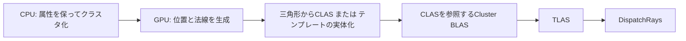
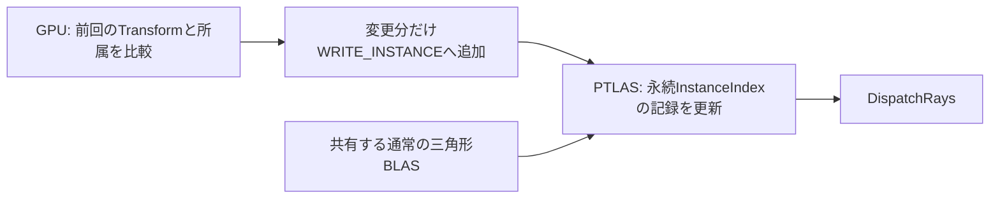

# Clustered GeometryとPartitioned TLAS

発展20〜23はDirect3D 12 Previewの独立した4アプリです。発展01〜03／14で学んだPBR・影・1バウンス反射・IBLを使い、形状の構築と更新を比較します。[発展編目次](AdvancedGraphicsSamples.md)／[Geometry Labアセット](Assets/GeometryLab.md)

| 回 | 内容 |
|---|---|
| [20](Direct3D12/Advanced20_ClusteredGeometry.md) | 三角形 → CLAS → Cluster BLAS → 通常TLAS |
| [21](Direct3D12/Advanced21_ClusterTemplates.md) | 固定トポロジーのテンプレートとGPU変形 |
| [22](Direct3D12/Advanced22_ClusterTessellation.md) | Compute細分化、変位、LOD境界の接続 |
| [23](Direct3D12/Advanced23_PartitionedTLAS.md) | 通常BLASとPTLASの疎なインスタンス更新 |

## SDKと初期化

既存D3D12はAgility 1.620.1・DXC 1.9.2609.5・SM6.6、新4本はAgility 1.722.0-preview・DXC 1.10.2605.37-previewを使います。20〜22のCluster LibraryだけがSM6.10です。通常BLAS比較用Library、23、Compute、表示とUIはSM6.6です。VulkanのSDK・シェーダ設定は従来通りです。

VS 2026、v145、Windows SDK 10.0.26100.0、C++20、HLSL2021を使用します。Windows Developer Modeと対応ドライバが必要です。新4本はSDK export 722と対応DLLを配布し、作成前に`D3D12RaytracingPreview`、必要な場合は`D3D12ExperimentalShaderModels`を有効化します。`ID3D12Device16::CheckFeatureSupport1`で`ClustersAndPTLASSupported`とシェーダモデルを確認し、`ID3D12DeviceRaytracing2`／`ID3D12CommandListRaytracing2`を取得します。機能が不足した場合は理由とHRESULTを記録して終了します。

各アプリは1920×1080で起動します。`SampleDefaults`の後に`--width`／`--height`を適用し、最小化からも選択した初期サイズへ復帰します。

## 形状を共有して比較する

不規則な形状は固定版meshoptimizer v1.3の空間分割で最大256頂点、32〜128三角形のクラスタへ変換します。`fill_weight=0.5`、`meshopt_optimizeMeshlet`を使用します。位置だけで頂点を統合せず、UV・法線・接線を保持します。マテリアルごとに分割し、比較用通常BLASにも同じ最終三角形列を渡します。

通常BLASではクラスタごとにGeometryを登録し、`GeometryIndex()`で対応クラスタを求めます。Cluster BLASでは`ClusterID()`とクラスタ内の`PrimitiveIndex()`を使います。シェーダが参照する頂点・属性は共通です。CLASを変更したら参照するCluster BLASも再構築し、その後にTLASを更新します。

初版は`FLOAT32_3`とimplicit destinationを使います。GPUが出力したCLASアドレス配列を次の構築へ渡し、通常フレームではCPUへ読み戻しません。CLAS、テンプレート、BLAS、TLASのresultとscratchをそれぞれprebuild情報から確保します。

CLASを走査するPipelineには`ALLOW_CLUSTERED_GEOMETRY`を設定します。SM6.10のPayloadは`raypayload`とread/write修飾を宣言します。通常BLAS側はクラスタintrinsicを含まないSM6.6の別Libraryです。

## 同期とPTLAS

Computeの出力と構築引数は、書込み後に`NON_PIXEL_SHADER_RESOURCE`へ遷移します。`ExecuteIndirectRTASOperations`の読取り引数には通常の`INDIRECT_ARGUMENT`状態を使いません。ASとscratchの依存をUAV Barrierで接続し、トレース前にもASの完了を保証します。定数、アップロード領域、UI BufferのCPU更新はGPU完了待ちの後です。

PTLASは通常の三角形BLASを使用します。GPUが変更したインスタンスだけをコンパクトな`WRITE_INSTANCE`配列に追加します。出力スロットと永続的な`InstanceIndex`は別の番号です。外側のoperation数は1、`ArgCount`がそのフレームの書込み数です。未書込みのインスタンスは前回の内容を保持します。

Transformとpartitionの変更には`WRITE_INSTANCE`を使用します。`UPDATE_INSTANCE`はTransform変更用ではありません。可動パネルは元の4×4空間partitionかglobal partitionへ所属し、停止後は元へ戻ります。容量は全インスタンスを保持できる上限から確保し、当該フレームの更新数では縮小しません。

メモリ値は各Bufferの確保容量です。入力データには頂点、構築引数、アドレス配列、インスタンス更新状態と保持している元データのコピーを含め、AS resultとscratchを別に集計します。材質・IBL・表示用リソースや、ヒープの配置アラインメントを含む物理VRAM使用量ではありません。

## 検証と計測

[専用試験](../Tools/TestClusterGeometry.ps1)はGPUのHDR、ヒット距離・ID、生成頂点・法線、選択トポロジーを読み戻し、通常ASや独立したCPU計算と比較します。平面へのレイ距離、LOD 2／4／8、更新0件・一部・全件、global partitionへの移動、実際のStep／Reset操作も確認します。Debugは検証レイヤー有効・エラー0を必須とします。

計測はRelease、UI非表示、1920×1080、固定時間刻み1/60秒です。120フレームのウォームアップ後に600フレームを5回測ります。GPU時間は頂点生成・CLAS・BLAS・TLAS／PTLAS・トレース・表示を分け、AS result、scratch、入力データのメモリも区別します。各試行の中央値の中央値とp95を保存します。[検証記録](ClusteredRaytracingVerification.md)

## 参照した版

- [Microsoftの紹介記事](https://devblogs.microsoft.com/directx/clas-ptlas-preview/)、[DXR仕様 Part 2](https://microsoft.github.io/DirectX-Specs/d3d/Raytracing2.html)、[Payload修飾の仕様](https://microsoft.github.io/DirectX-Specs/d3d/Raytracing.html#payload-access-qualifiers)。
- [DirectX-Graphics-Samples](https://github.com/microsoft/DirectX-Graphics-Samples/tree/68a2b1e97f71642924e74c7757ca21756ad221b5/Samples/Desktop/D3D12Raytracing/src)：`68a2b1e97f71642924e74c7757ca21756ad221b5`。CLASのimplicit構築、テンプレートの実体化、PTLASの疎なwriteと同期を参考にしています。
- [RTXMG v2.2.0](https://github.com/NVIDIA-RTX/RTXMG/tree/1c0bc90b06c482213bf313670b238fbc683ed67b)：`1c0bc90b06c482213bf313670b238fbc683ed67b`。Computeで生成する構造化クラスタと有限個のテンプレートを参考にしています。教材は独自の小規模実装です。

Catmull-Clark、汎用クラスタLOD DAG、ディスクからのストリーミング、圧縮頂点、独自ASアロケータは後続テーマです。
