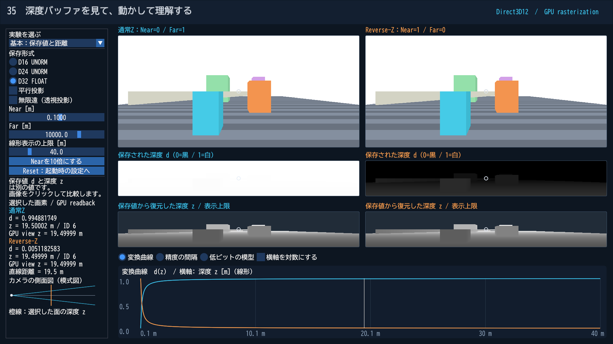
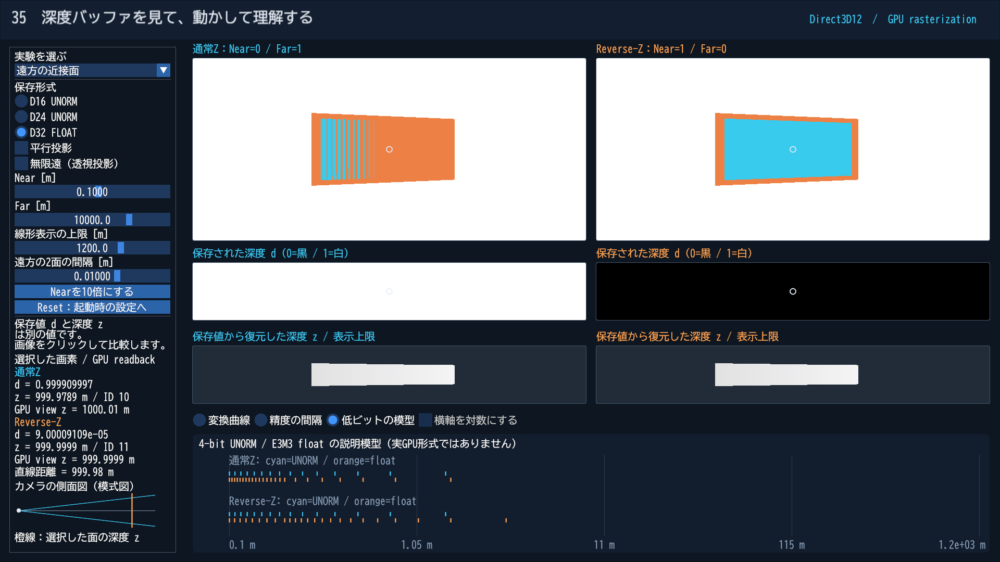
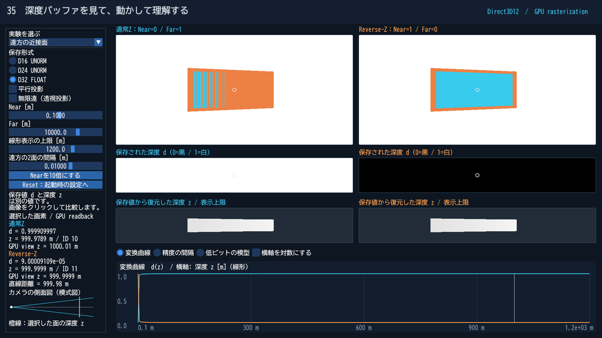

# 深度バッファを見て理解する：非線形深度とReverse-Z

「カメラから10mなら0.1、100mなら1.0が保存される」と考えると、深度画像がほぼ真っ白になる理由が分かりません。通常の透視投影では、保存される値は距離に比例しないからです。基本編35では、同じシーンを通常ZとReverse-Zで実際に描画し、その値を読み戻します。

前提は[第04回のBOXと深度テスト](Direct3D12/04_Box.md)です。PBRやレイトレーシングの知識は必要ありません。[Direct3D12の実装](Direct3D12/35_DepthPrecision.md)／[Vulkanの実装](Vulkan/35_DepthPrecision.md)から起動してください。

## まず画面を読む

上段は3D描画、中段はGPUの深度バッファから読んだ値、下段は保存値から復元した深度です。左が通常Z、右がReverse-Z。青い曲線は通常Z、橙色の曲線はReverse-Zです。

中段は0を黒、1を白として表示します。通常Zの画像がほぼ白くても、データが壊れたわけではありません。近くにある箱も、保存値は1に近づいています。Reverse-Zでは同じ場所が0に近づくため、暗く見えます。下段の明るさは「復元した深度／線形表示の上限」です。同じ距離なら左右でほぼ同じ明るさになります。

画像をクリックすると、同じ画素位置の保存値、復元したz、別のカラー出力に記録したGPUのview z、面のIDを確認できます。背景は復元しません。側面図は位置関係の模式図で、遠方は表示上限までに収めます。

| 名前 | 意味 |
|---|---|
| 視点空間の深度 z | カメラの視線方向に沿って測った長さ。この教材では正方向、単位m |
| カメラからの直線距離 | 視点空間の位置 (x,y,z) の長さ。画面の中心以外では通常zと異なる |
| クリップ座標 zc, wc | 投影行列で変換した後、まだ透視除算していない値 |
| 保存深度 d | 通常の設定では zc/wc。0〜1の無次元の値 |

画面の「直線距離」は保存深度から位置を復元した結果です。測定誤差を含むので、正解の距離として深度精度の判定には使いません。

## なぜ透視投影では線形にならないのか

透視投影では、遠くの物体ほど小さく見えるようにxとyをwで割ります。同じ透視除算をzにも適用します。この教材の左手系では投影後のwc=z、zc=A*z+Bなので、

$$d = \frac{zc}{wc} = A+\frac{B}{z}$$

となります。zを等間隔に増やしても、dの増え方は等間隔になりません。なお、通常の投影深度は三角形の**画面上では線形に補間できる**値です。「視点空間のzに対して非線形」と「画面上で線形に補間できる」は両立します。この性質がラスタライズや深度を使った処理に適しています。[参考：NVIDIAの記事](https://developer.nvidia.com/blog/visualizing-depth-precision/)

Nearをn、Farをfとすると、有限遠の通常Zは次の式になります。

$$d = \frac{f(z-n)}{(f-n)z}, \qquad z = \frac{nf}{f-d(f-n)}$$

例えばn=1m、f=101mでは、z=2mですでにd=0.505です。Nearからわずか1mのところで、保存値の範囲の半分を使っています。

**操作：**「Nearを近づける」を選び、Nearを0.001mから増やします。3D画像だけでなく、深度画像と曲線が変わることを確認してください。Nearは「できるだけ小さく」ではなく、必要な近さを考えて設定します。

## 保存できる値は有限個

「低ビットの模型」は、4-bit UNORMの16段階と、指数3-bit・仮数部3-bitの浮動小数点模型を使います。模型には0と非正規化数も含めます。これは実GPUのD16／D24／D32を縮小再現したハードウェアではなく、値の分布を理解するための図です。

UNORMでは0〜1の保存値の間隔が一定です。しかしそれをzへ戻すと、通常の透視投影では遠方ほど隣の値までの距離が広がります。「精度の間隔」では、隣の保存値をzへ戻した差をmで表示します。このグラフは保存形式の理論値で、頂点変換やラスタライズの誤差を含みません。

**操作：**「遠方の近接面」を選びます。約1km先に、奥の橙色の面と、その手前に青い面を置いています。初期の間隔は視線方向に1cmです。面には同じ傾きを付け、広い範囲の深度を比較します。奥の面を先に描くため、重なる範囲は手前の青い面が勝つはずです。

通常Zでは、異なる面が同じ保存値になったり、変換計算の丸めで前後関係が乱れたりします。これがZ-fightingの原因の一つです。縞模様や誤判定する画素はGPU・コンパイラ・パラメーターで変わります。画像を固定の正解として比較せず、面のIDと読み戻した値も確認します。

## Reverse-Zは何を変えるのか

Reverse-ZはNearを1、Farを0へ対応させます。有限遠では、

$$d_R = \frac{n(f-z)}{(f-n)z}, \qquad z = \frac{nf}{n+d_R(f-n)}$$

です。D32_FLOATでは0に近いほど表現可能な値の絶対間隔が細かくなります。遠くへ行くほど0に近づくReverse-Zと組み合わせることで、遠方の精度が大きく改善します。改善は深度が線形になるためではありません。

| 設定 | 通常Z | Reverse-Z |
|---|---|---|
| Near／Farの保存値 | 0／1 | 1／0 |
| クリア値 | 1 | 0 |
| 深度比較 | LESS | GREATER |
| 投影 | 通常の係数 | 逆Z用の係数 |

実数としてはd_R=1-dですが、すでに丸めたdを読み出して1から引いても、失われた区別は戻りません。サンプルは頂点シェーダーの投影から逆Zを生成します。有限遠ではDirectXMathのNearZ／FarZ引数を逆順にした投影も利用できます。[DirectXMathの説明](https://learn.microsoft.com/en-us/windows/win32/api/directxmath/nf-directxmath-xmmatrixperspectivefovlh)

**操作：**D32_FLOATからD24、D16へ切り替えます。UNORMの値の間隔は反転しても変わらないので、Reverse-Zだけで保存形式の量子化精度は増えません。実GPUで左右に差が出る場合は、変換・補間の丸めも含まれています。

## 無限遠、平行投影、線形化

無限遠の透視投影では通常Zがd=1-n/z、Reverse-Zがd=n/zになります。Reverse-Zの復元はz=n/dです。背景のクリア値0をこの式へ無条件に渡すとゼロ除算になるため、サンプルは有効画素を別の出力で識別します。

無限遠にしても、図とグレースケール画像の表示上限は有限です。「線形表示の上限」は描画範囲を切るFar面ではありません。また、Reverse-Zや無限遠はNear面によるクリッピングを解消しません。

平行投影ではwc=1で、

$$d=\frac{z-n}{f-n}$$

となり、視線方向のzに対して線形です。「平行投影」プリセットでは変換曲線が直線になります。変換曲線の横軸は線形／対数を選択できます。対数軸に切り替えると、線形な関数でも直線に見えるとは限りません。精度の間隔と低ビット模型は対数軸です。「深度バッファは常に非線形」と覚えるのも正確ではありません。

深度の線形化は保存値からzを復元する操作です。線形化した画像が見やすくなっても、保存段階で同じ値になった2面の区別は戻りません。

## 原記事から現在の説明へ

確認日：2026-11-10。NVIDIAの[Visualizing Depth Precision](https://developer.nvidia.com/blog/visualizing-depth-precision/)を参考に、図・シーン・測定はこの教材で作成しました。中心となる投影と数値精度の説明は今も有効です。次の点は区別して読みます。

- 原記事の誤差ゼロは、その数値実験の結果です。完全に重なる面、大きなワールド座標で失われた精度、あらゆる行列合成の誤差まで解決する保証ではありません。保存形式の精度と、その値に到達するまでの計算誤差を分けます。
- OpenGL ESについては、2017年のEXT_clip_control仕様があり、対応実装では0〜1の規約を選択できます。「ESでは不可能」という無条件の説明は使いません。[Khronos仕様](https://registry.khronos.org/OpenGL/extensions/EXT/EXT_clip_control.txt)
- WebGLにも同機能の拡張仕様があります。仕様の存在と、個々のブラウザー・端末での対応は別です。[WebGL仕様](https://registry.khronos.org/webgl/extensions/EXT_clip_control/)
- Vulkanは標準で深度のクリップ範囲が0〜1です。サンプルの負の高さのViewportはY方向の規約を合わせるための設定で、Reverse-Zとは別です。[Vulkanの深度解説](https://docs.vulkan.org/guide/latest/depth.html)

続きは[Shadow Mapの深度](ShadowDepth.md)です。カメラの深度とライトの深度を分けて考えます。
