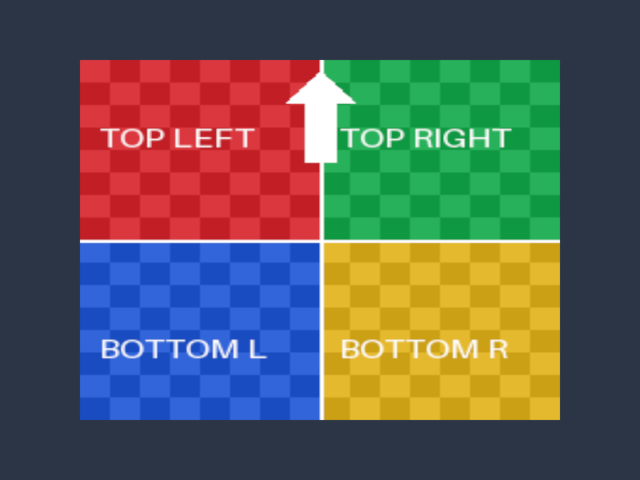

# Direct3D12 03: NDC座標のテクスチャ表示

PNGをCPUでRGBA8に展開し、GPUへ転送して四角形に貼ります。頂点にUVを持たせ、画像とSamplerをピクセルシェーダに渡します。



## ビルドと実行

Windows、Visual Studio 2026（v145）、Windows SDK 10.0.26100.0、x64が対象です。Agility SDK 1.619.6とDXC 1.9.2609.5をNuGet復元します。FL12_0／Shader Model 6.6対応GPUとドライバが必要です。Vulkan SDKはこのプロジェクト単体には不要です。

```powershell
msbuild .\Samples\Direct3D12\03_Texture\Direct3D12_03_Texture.vcxproj -p:Configuration=Debug -p:Platform=x64
& .\bin\x64\Debug\Direct3D12_03_Texture\Direct3D12_03_Texture.exe
```

コマンドはリポジトリ直下で実行します。D3D12のNuGet復元手順は[README](../../README.md)を参照してください。ESCまたは閉じるボタンで終了します。

## データと処理順

`ModelVertex`の位置とUVだけを使用します。初回はIndex Bufferを使わず、6頂点のTriangle Listで四角形を描きます。`Common/Image.cpp`のWICローダーはファイルの最初のフレームをRGBA8へ変換し、上から下へ進む行順で返します。画面左上のUVは(0,0)、右下は(1,1)です。

実装は[Sample.cpp](../../Samples/Direct3D12/03_Texture/Sample.cpp)、宣言は[Sample.h](../../Samples/Direct3D12/03_Texture/Sample.h)です。

- **`LoadTexture`**: RGBA8 sRGBのDefault HeapテクスチャをCOPY_DESTで作ります。GetCopyableFootprintsで得たRowPitchに合わせてUpload Bufferへ行ごとにコピーし、CopyTextureRegionで転送します。
- **`CreatePipeline`**: t0のSRVをDescriptor Table、s0のSamplerをStatic SamplerとしてRoot Signatureに配置します。Samplerは線形補間・Clamp、mipは1段です。
- **`OnRender`**: テクスチャをPIXEL_SHADER_RESOURCEへ遷移し、Shader Visible SRV HeapとRoot Descriptor Tableを設定して6頂点を描画します。転送用Upload BufferはFence完了後に解放します。


## 共通HLSLとの対応

[頂点シェーダ](../../Shaders/03_Texture/Vertex.hlsl)と[ピクセルシェーダ](../../Shaders/03_Texture/Pixel.hlsl)は両APIで同じファイルです。Shader Model 6.6／HLSL 2021を指定し、D3D12ではDXIL（`.cso`）へコンパイルします。実行時コンパイルは行いません。ソースまたは共通includeの変更時にはビルドで再生成します。

画像は`Texture2D : register(t0)`、Samplerは`SamplerState : register(s0)`で宣言します。Vulkanのbinding/locationは`Common.hlsli`のマクロで指定し、D3D12向けでは属性部分だけを除きます。詳細は[共通シェーダの規約](../SharedShaders.md)を参照してください。

## リサイズと確認

最小化中は描画を止め、復帰後にサイズ変更を反映します。リサイズ時はGPU完了を待ち、Swapchainの画像・Viewを作り直します。3Dサンプルでは深度画像も作り直します。初回は理解しやすさを優先し、複数フレームを並行実行しません。

```powershell
& .\bin\x64\Debug\Direct3D12_03_Texture\Direct3D12_03_Texture.exe --frames 48 --test-window --screenshot ".\.cache\Direct3D12_03_Texture.png" --log ".\.cache\Direct3D12_03_Texture.log"
```

`--test-window`は640×480への変更、最小化、800×600への復帰を実行します。`--screenshot`はGPUから描画結果を読み戻してPNGを保存します。Debugの検証エラーが出た場合はログと終了コードで確認できます。画像・シェーダの欠落時も原因のファイル名を表示します。

テクスチャはsRGBとしてサンプリングし、色の補間・シェーダ計算は線形空間で行い、sRGB描画先で出力変換します。テクスチャの赤／緑／青／黄、上向き矢印、BOXの奥行きがAPI間で一致することを確認します。

初回検証の環境と結果は[検証記録](../Verification.md)に記載しています。

前のテーマ: [02 NDC座標の三角形と頂点カラー](02_Triangle.md)

次のテーマ: [04 頂点カラーBOXと3D座標変換](04_Box.md)

同じテーマの別API: [Vulkan](../Vulkan/03_Texture.md)
