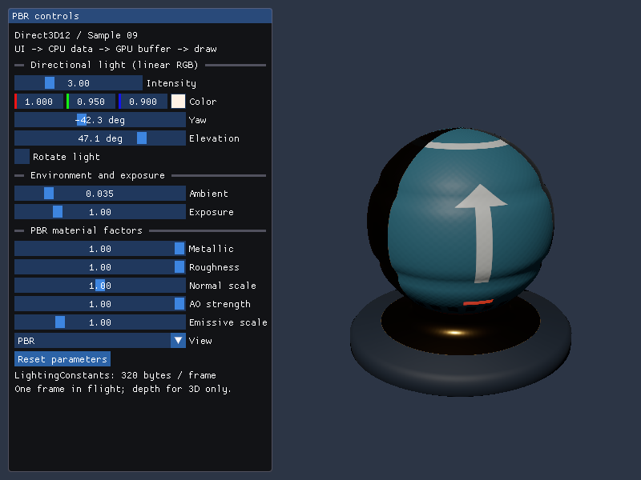
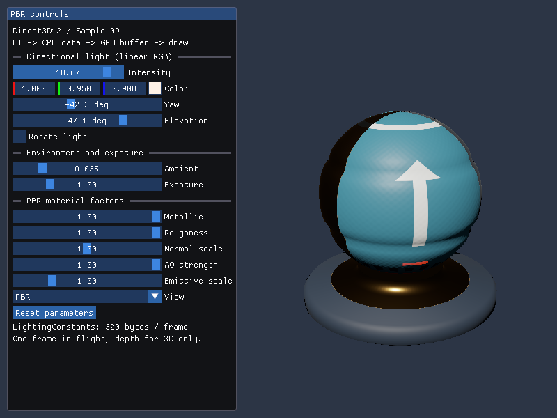

# Direct3D12 09: Dear ImGuiと動的Constant Buffer

08のPBR描画へDear ImGuiを加え、ライトや材質のパラメータを編集します。ウィジェットが変えたCPUの値から毎フレーム`LightingConstants`を作り、Constant Bufferへ書き込んで同じフレームの描画に使います。



初期の描画領域は全サンプル共通で**1280×720ピクセル**です。掲載画像は変更前の800×600で取得したものを使用しています。

## ビルドと実行

Visual Studio 2026／v145、Windows SDK 10.0.26100.0、C++20、x64を使います。Agility SDK 1.620.1／DXC 1.9.2609.5はNuGet、nlohmann/json v3.12.0とDear ImGui v1.92.9bは固定Submoduleです。Vulkan SDKはD3D12単体ビルドには不要です。

```powershell
git submodule update --init --recursive
msbuild ShaderjpGraphicsSamples.sln -t:Restore -p:RestorePackagesConfig=true
msbuild Samples\Direct3D12\09_ImGui\Direct3D12_09_ImGui.vcxproj -p:Configuration=Debug -p:Platform=x64
& .\bin\x64\Debug\Direct3D12_09_ImGui\Direct3D12_09_ImGui.exe
```

VSでは`Direct3D12_09_ImGui`をスタートアッププロジェクトにします。モデルと4画像は08と同じShaderBall_PBR.gltfです。`--model`／`--texture`も08と同じ対応範囲で使用できます。画像・シェーダは実行ファイルを基準に読みます。

## パネルの操作

| 操作 | シェーダへ渡す値と意味 |
|---|---|
| Intensity／Color | 光の強度と線形RGB。積を`lightColor.xyz`へ渡す |
| Yaw／Elevation | 方向光の角度。単位ベクトルへ変換して`lightDirection.xyz`へ渡す。表面から光源を向く方向 |
| Rotate light | 毎フレームYawを約28.65度/秒進める |
| Ambient | 一定拡散環境項の明るさ。IBLではない |
| Exposure | Reinhardの前に掛ける露出係数 |
| Metallic／Roughness | ORM画像のB／Gに掛ける材質係数 |
| Normal scale | 接線空間Normal MapのXYに掛ける係数 |
| AO strength | ORMのRによる遮蔽の強さ。一定拡散環境項だけに適用 |
| Emissive scale | glTFのEmissive Factor全体に掛ける係数 |
| View | PBR／Albedo／World Normal／Metallic／Roughness／AO／Emissive／Normal MapなしPBR |
| Reset parameters | 光・表示・回転を初期状態へ戻し、材質係数は読み込んだglTFの値へ戻す |

スライダーはドラッグ、Ctrl+クリックは数値入力です。数値入力でもスライダーの範囲に制限します。Tabなどのキーボード操作も有効です。UIがキーボード入力を使っている間はESCをウィンドウ終了へ渡さず、UI外ではESCまたは閉じるボタンで終了します。08の数字キー／Spaceの操作は09ではウィジェットで行います。起動時の`--shading`と`--rotate-light`は使用できます。



強度を上げると白い矢印や塗装部分が明るくなります。モデル・テクスチャ・Pipelineを作り直さず、Constant BufferのlightColorだけを更新した比較です。

左側は操作パネル、右側は3D用Viewportです。右側の幅で投影行列のアスペクト比を計算するため、UIにモデルが隠れず、ウィンドウサイズを変えても球が横に伸びません。小さなウィンドウではパネルをスクロールできます。

## ImGuiを構成する三つの部分

Dear ImGui本体のimgui.cpp／imgui_draw.cpp／imgui_tables.cpp／imgui_widgets.cppと、公式Win32プラットフォームバックエンドをプロジェクトから参照します。Submoduleのコミットは`f1cc2ae15e53a861a874c3034aae6798fde194ab`です。MITのLICENSE.txtを保持し、実行ファイル横のLicensesにも配置します。[依存関係の運用](../../ThirdParty/README.md)を参照してください。

Win32バックエンドはマウス・キーボード・時刻などをImGuiへ伝えます。[Common/Application.cpp](../../Common/Application.cpp)のWndProcは任意の`ISample::OnMessage`へ入力を渡し、09の`OnMessage`が`ImGui_ImplWin32_WndProcHandler`を呼びます。既存サンプルのフックは何もしない既定実装です。WM_SIZEや終了処理は従来のライフサイクルで扱います。

GPU描画は[ImGuiRenderer.cpp](../../Samples/Direct3D12/09_ImGui/ImGuiRenderer.cpp)に明示します。公式DX12レンダラーが含む実行時D3DCompileを使わず、[共通UI HLSL](../../Shaders/09_ImGui/ImGuiVertex.hlsl)をDXCでSM6.6／HLSL 2021のDXILへ事前コンパイルするためです。本体と公式Win32バックエンドは改変しません。パネルのウィジェットだけは[Samples/Shared/ImGuiPanel.h](../../Samples/Shared/ImGuiPanel.h)でVulkanと共有します。

この教材用レンダラーは固定フォントアトラス1枚を初期化時に転送し、`RendererHasVtxOffset`を設定します。`RendererHasTextures`は設定せず、1.92以降の動的フォント・テクスチャ更新、ユーザー画像、複数Viewportは扱いません。フル機能のバックエンドにする場合は[公式バックエンド資料](https://github.com/ocornut/imgui/blob/v1.92.9b/docs/BACKENDS.md)のテクスチャ更新契約に従って拡張します。

## 毎フレームのConstant Buffer更新

[Sample.cpp](../../Samples/Direct3D12/09_ImGui/Sample.cpp)の順序は次の通りです。

1. `OnUpdate`でWin32_NewFrame、ImGui::NewFrame、パネルのウィジェット、ImGui::Renderを呼ぶ。
2. ウィジェットが[LightingControls](../../Common/LightingControls.h)のCPUデータを直接変更する。
3. `OnRender`の`WaitForGpu`で前のフレームの読取りが完了したことを確認する。
4. 右側のViewportサイズと編集値から320-byteの`LightingConstants`を作り、Map済みアドレスへコピーする。
5. Root CBVのGPUアドレスを設定してPBRを描き、その後にUIを描く。
6. Presentし、Fenceでこのフレームの完了を待つ。

```cpp
WaitForGpu();
const auto constants = panel_.controls.MakeConstants(
    width_ - panel_.SceneLeft(width_), height_, model_);
std::memcpy(constantsData_, &constants, sizeof(constants));
// ... コマンドの記録 ...
commands_->SetGraphicsRootConstantBufferView(0, constants_->GetGPUVirtualAddress());
commands_->DrawIndexedInstanced(drawCount_, 1, 0, 0, 0);
```

CPUデータはfloat4／row_major float4x4の配置を08から引き継ぎます。320 bytesをD3D12の256-byte単位へ切り上げ、512-byteのUpload Heapを一度作ります。Mapも初期化時に一度行い、同じGPUアドレスとRoot CBVを使い続けます。フレームごとにリソースやDescriptorを作り直す必要はありません。CPUの構造体と共通HLSLの配置は同一です。

MapはGPUの読取り完了を保証しません。書込み前にFenceの完了を確認するのが要点です。CPUがGPU使用中の同じ領域を書き換えると、前フレームのライトや行列まで混ざる可能性があります。09は1フレームずつ完了を待つ構成なので、1領域を安全に再利用できます。複数フレームを並行させる際は、フレームごとの領域と完了Fence、256-byte境界を組み合わせます。[Upload Heapと同期の公式解説](https://learn.microsoft.com/en-us/windows/win32/direct3d12/uploading-resources)も参照してください。

## UI用のGPUリソースと描画

モデルのSRVは0〜3、フォントは5個目のslot 4です。PBRのRoot Signatureは08と同じ4 SRVを参照し、UI専用Root Signatureはフォント1 SRV、Clamp／LinearのStatic Sampler、b0のRoot CBVを使います。UIの64-byte投影行列は256-byteのUpload Heapに置き、GPU完了後に毎フレーム更新します。シーンの320-byte Constant Bufferとは別のリソース・Root Signatureです。UIもb0／t0／s0の規約を保ちます。

ImGui::RenderはGPUへ描画しません。`ImDrawData`に入った頂点・インデックス・Draw Commandを`RenderImGui`が処理します。`ImDrawVert`の位置・UV・RGBA8カラーをUpload Heapへコピーし、バッファ容量が不足したときだけ増やします。ClipRectをウィンドウ内へ制限してScissorに設定し、各コマンドのIdxOffset／VtxOffsetを使ってDrawIndexedInstancedを呼びます。16-bit／32-bitのImDrawIdxとResetRenderStateコールバックを扱います。

UI用PSOはカリングなし、標準のSrcAlpha／InvSrcAlpha合成、深度テストなしです。描画先はPBRと同じsRGB RTVです。ImGuiのUI色をPixel Shaderで線形化し、sRGB描画先が保存時のエンコードを行います。フォントはRGBA8 UNORM、アルファは線形の被覆率として扱います。HLSL／include変更でUIのシェーダも再ビルドされます。

## Depth Bufferは3D描画にだけ使う

球と台座には08と同じD32_FLOATのDepth Bufferを使います。毎フレーム1.0へクリアし、LESS比較で近い面を採用して深度を書き込みます。深度範囲は0〜1、左手系のカメラです。光の明るさやNormal Mapは表面の反射を変えますが、輪郭や深度を動かしません。

UIを描く前に`OMSetRenderTargets`のDSVをnullptrへ変更し、UI用PSOのDepthEnableをFALSEにします。これにより、球の深度によってパネルの一部が隠れたり、UIが3Dの深度を書き換えたりしません。UIは画面座標のクリッピングと描画順・アルファで重なりを扱います。リサイズではGPU完了後にSwapchainのRTVと3DのDepth Bufferを作り直し、フォントと編集値は保持します。

## 検証

```powershell
.\Tools\ValidateProjects.ps1
.\Tools\TestSamples.ps1 -Topics 09_ImGui -CaptureDocs
.\Tools\TestImGui.ps1 -CaptureDocs
.\Tools\TestImGui.ps1 -Configuration Release
.\Tools\TestFailureCases.ps1 -Topics 09_ImGui
```

TestImGuiは値への直接代入ではなく、ImGuiの入力イベントでIntensityスライダー、Resetボタン、再編集を操作します。UI外のGPU画素が変化し、Reset後に元の画素へ戻ることを確認します。Debug Layer、リサイズ、最小化復帰、モデル／画像／モデル用・UI用シェーダ欠落時の終了も確認します。[検証記録](../Verification.md)に環境と結果を残しています。上のPNGは本APIの実GPU描画です。

前：[08 PBR](08_PBR.md)。別API：[Vulkan 09](../Vulkan/09_ImGui.md)。

この回の後に読む共通章：[LambertとBlinn-PhongからPBRへ ライトとシェーディングを振り返る](../LightingToRendering.md)。Cyclesの参考画像と比較しながら、今後のCube map、IBL、Shadowの役割を説明します。
