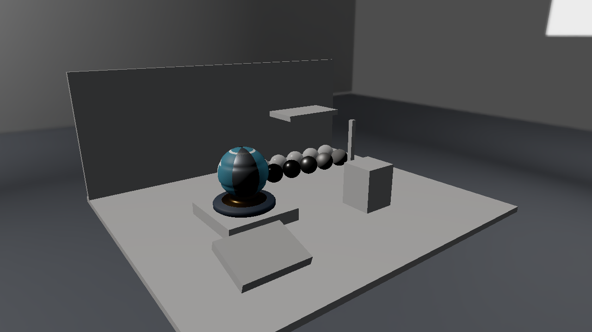
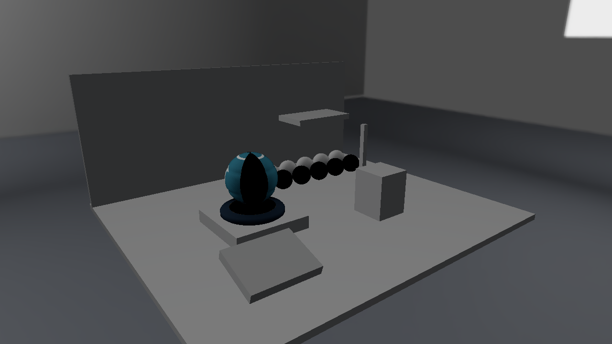
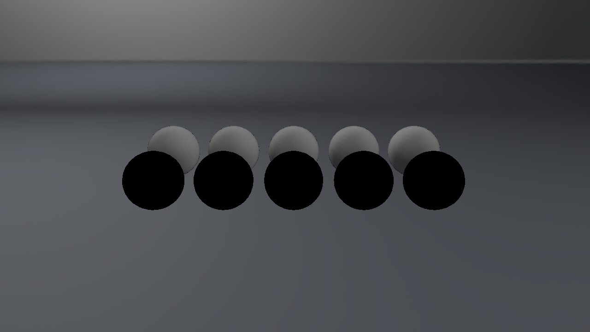

# Direct3D12 第11回 Irradiance Cubemapで拡散環境光を加える

第10回のCubemapを光の分布として使い、表面の上側の半球から届く光を加えます。事前計算したIrradianceをワールド法線で参照し、一定Ambientから方向に依存する拡散環境光へ進みます。



画像は1280×720の実GPUキャプチャです。形状と環境は[Lighting Labの自作アセット](../Assets/LightingLab.md)、反射の式と各回のつながりは[共通解説](../EnvironmentLighting.md)を参照してください。

## ビルドと標準の実行

Visual Studio 2026／v145、Windows SDK 10.0.26100.0、C++20、x64を使います。Agility SDK 1.620.1とDXC 1.9.2609.5をNuGetで復元します。 DirectXTexはmay2026の固定Submoduleで、CPUのDDS読込に使います。Dear ImGuiの版は第9回と同じです。

```powershell
git submodule update --init --recursive
msbuild ShaderjpGraphicsSamples.sln -t:Restore -p:RestorePackagesConfig=true
msbuild Samples\Direct3D12\11_DiffuseIBL\Direct3D12_11_DiffuseIBL.vcxproj -p:Configuration=Debug -p:Platform=x64
& .\bin\x64\Debug\Direct3D12_11_DiffuseIBL\Direct3D12_11_DiffuseIBL.exe
```

VSではDirect3D12_11_DiffuseIBLをスタートアッププロジェクトにします。実行には配布済みglTF・PNG・DDSを使い、BlenderやIBLベイクは不要です。アセットは実行ファイル基準で探すので、作業ディレクトリを変えても同梱データを読めます。

## アセットを読み込みGPUへ配置する

[Sample.cpp](../../Samples/Direct3D12/11_DiffuseIBL/Sample.cpp)のOnInitでSceneを読み、APIのデバイス・描画先・コマンド・同期を準備します。CreateSceneでは各モデルのVertex／Index Bufferと材質画像、環境の6面と各mip、BRDF LUTを作ります。環境のGPU転送とView作成もこのプロジェクト内にあります。

CPUのLoadLightingSceneは、各glTFを既存のLoadGltfPbrで読み、配置だけを別に保持します。モデルごとに1メッシュ・1材質のプロフィールです。LoadDdsはDirectXTexでDDSを展開し、数値形式・面・mip・バイト配置を返します。CommonはGPU Resourceを作りません。

`CreatePipeline`でb0のRoot CBVと、t0〜t8のSRV Descriptor Tableを作ります。s0は材質用のmip 0のSampler、s1は環境用の線形・mip補間Samplerです。各モデルに9個のSRVを並べ、描画ごとにそのモデルのTableを設定します。

`LoadDdsTexture`はCPUの各面・mipをD3D12のSubresourceへ対応させます。Texture2DのDepthOrArraySizeを6、MipLevelsを実データの数にし、GetCopyableFootprintsのRowPitchへ合わせてUpload Bufferへコピーします。CopyTextureRegionのSubresourceIndexはmip+face*mipCountです。転送後にCOPY_DESTからPIXEL_SHADER_RESOURCEへ遷移し、Fence完了を待ってUpload Bufferを解放します。

環境はTEXTURECUBEのSRV、BRDF LUTはTEXTURE2DのSRVです。RGBA16F／RG16Fの値をそのまま使い、sRGB変換しません。材質のBase ColorとEmissiveだけは従来どおりsRGBです。

モデルごとの480-byte定数は512-byte境界に置きます。フレーム先頭のFence完了後に全モデル分の定数と、環境切替に伴うSRVを書き換えます。UIの頂点・インデックスもGPU完了後に更新します。


## HLSLでこの回の照明を計算する

共有する[Pixel.hlsl](../../Shaders/LightingLab/Pixel.hlsl)と[Scene.hlsli](../../Shaders/LightingLab/Scene.hlsli)はSM6.6／HLSL 2021で事前コンパイルします。LAB_TECHNIQUE=11で、この回までの計算を有効にします。CPUとHLSLはWorld、ViewProjection、Normal Matrix、材質・光、逆ViewProjection、Light ViewProjection、環境とShadow設定の480-byte配置を揃えています。

IrradianceはE(N)=∫Li(L) max(N・L,0)dωを保存しています。シェーダは`kD * BaseColor / π * Irradiance(N)`を計算します。kDは`(1-Fresnel(NoV))*(1-Metallic)`という教材上の近似です。

ベイクはcosine-weighted samplingを使い、π×サンプルした環境色の平均でEを求めます。一様な環境CならE=πCです。この係数を生成側とシェーダ側の両方へ重ねたり、両方から省いたりすると照明の強さが変わります。

## 表示を切り替えて観察する

ViewをDirect only、Diffuse IBL only、Combinedへ切り替えます。金属には拡散項を足さないため、Diffuse IBL onlyで金属の比較球が暗くなることを確認します。環境の方向を変えると、法線の向きに応じて非金属の色と明るさが変わります。





AOは拡散IBLにだけ掛けます。方向光の遮蔽はまだありません。床へ影が投影されないことも、この回の計算範囲を示しています。

```powershell
& .\bin\x64\Debug\Direct3D12_11_DiffuseIBL\Direct3D12_11_DiffuseIBL.exe --shading combined --environment studio --no-ui --frames 8 --screenshot ".\.cache\Direct3D12_11_DiffuseIBL.png"
& .\bin\x64\Debug\Direct3D12_11_DiffuseIBL\Direct3D12_11_DiffuseIBL.exe --scene "Assets/Scenes/LightingLab/MaterialStudy.json" --environment room
```

`--scene`は指定した配置JSONへ、`--environment`はstudio／room／orientationへ切り替えます。`--no-ui`は撮影時にUIを隠します。環境強度、回転、直接光の強度、露出はUIで変更し、Resetで標準値へ戻します。

カメラの深度は引き続き0〜1、LESS比較、毎フレーム1へクリアします。リサイズではGPU完了後に描画先とカメラ用深度を作り直し、環境データと編集値は保持します。

## 検証と記事画像

```powershell
.\Tools\ValidateProjects.ps1
.\Tools\TestLightingLabAssets.ps1
.\Tools\TestLightingLab.ps1 -CaptureDocs
.\Tools\TestLightingLab.ps1 -Configuration Release
.\Tools\TestSamples.ps1 -Topics 11_DiffuseIBL -CaptureDocs
```

TestLightingLabはCPUのDDS・配置読込と不正データの拒否、両APIの環境切替、IBLの寄与、Shadow・遮蔽物の移動、実ウィジェットの編集とResetを確認します。TestSamplesはリサイズ・最小化復帰・読戻し・終了を確認します。Debugではグラフィックス検証Layerを有効にし、Vulkanでは同期検証も使います。結果と環境は[検証記録](../Verification.md)を参照してください。

前：[第10回](10_Cubemap.md)。 次：[第12回](12_SpecularIBL.md)。 別API：[Vulkan 第11回](../Vulkan/11_DiffuseIBL.md)。
