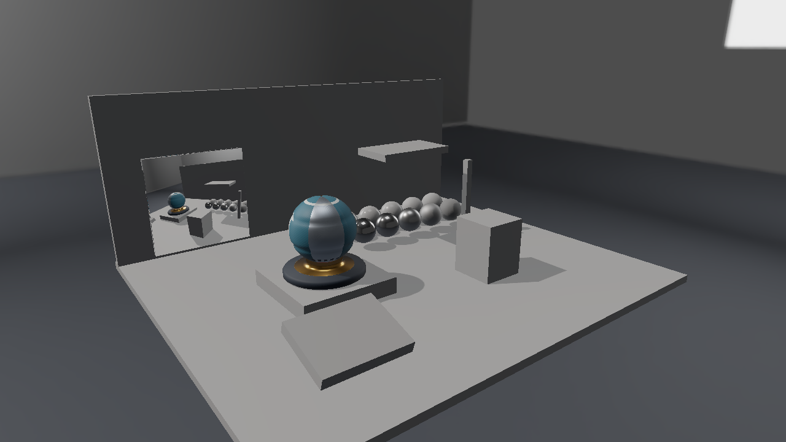
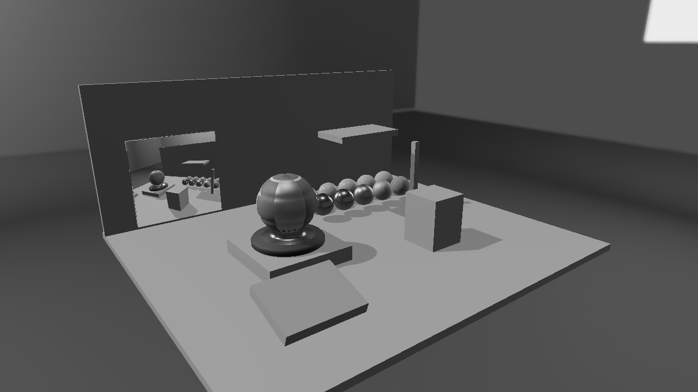
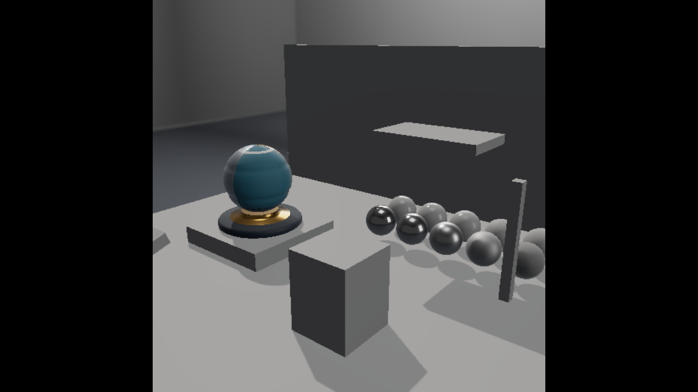
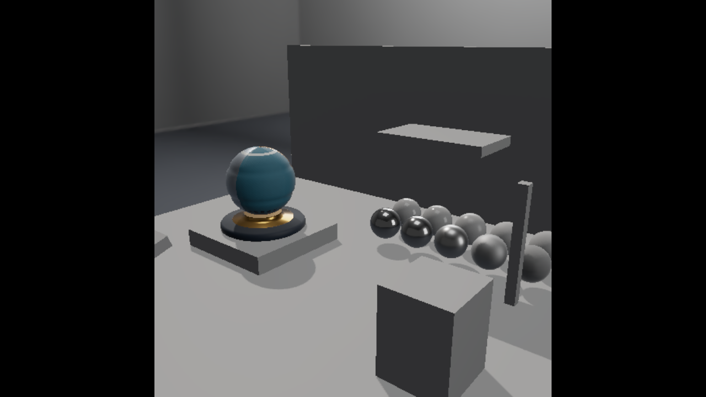

# Direct3D 12 第14回 HDRのRender-to-Textureとポスト処理と3Dモニター

第13回の照明を、RGBA16Fのオフスクリーン画像へ描きます。全画面のPixel Shaderで読み直して露出とReinhardを適用し、同じ仕組みで別カメラの映像を3Dモニターへ貼ります。描画先のTextureと、それを書いたり読んだりするViewの関係を学びます。



この回の完成表示。1280×720、RTX 4070の実GPU読戻しです。

## ビルドと実行

VS 2026／v145、Windows SDK 10.0.26100.0、C++20、x64を維持します。D3D12はAgility SDK 1.619.6、DXC 1.9.2609.5です。

```powershell
msbuild ShaderjpGraphicsSamples.sln -t:Restore -p:RestorePackagesConfig=true
msbuild Samples\Direct3D12\14_RenderTexture\Direct3D12_14_RenderTexture.vcxproj -p:Configuration=Debug -p:Platform=x64
& .\bin\x64\Debug\Direct3D12_14_RenderTexture\Direct3D12_14_RenderTexture.exe
```

Blenderはアセットを編集・再書出しするときだけ使います。実行には同梱glTF・PNG・DDSを使い、追加のランタイム依存はありません。[共通章](../PostProcessing.md)と[モニターの制作](../Assets/Monitor.md)も参照してください。


## HDRへ描いてから表示を決める

第13回はモデルとSkyboxのPixel ShaderでReinhardを適用していました。第14回以降は`LINEAR_HDR=1`のコンパイル設定で、表示変換前の線形色を出します。以前のサンプルはこの設定を使わず、既存画像の見た目を保ちます。

```text
方向光のShadowパス
→ 別カメラのHDR映像 512×512（モニターを除外）
→ メインカメラのHDR画像（モニターは映像を読むUnlit描画）
→ 全画面のポスト処理
→ Dear ImGui → Present
```

メイン画像はクライアント領域と同じサイズです。UIを表示する場合は、従来どおり右側の領域へ3Dを描きます。別カメラの映像と深度は512×512で、メインのDepthとは別に保持します。HDR画像はRGBA16F、数値をsRGBとしてデコードしません。

モニターの映像も線形HDRです。UnlitのPixel ShaderはそのRGBを返し、露出やReinhardを掛けません。完成画像にする処理は最後の全画面パスで一度だけ行います。表示用PNGを照明用HDRに戻す処理ではありません。

## リソースとシェーダへの接続

HDR TextureへALLOW_RENDER_TARGETを指定し、RGBA16FのRTVとSRVを作ります。同じTextureへ書くためのRTVと読むためのSRVを接続します。別カメラのTextureとDSVは、メインのTextureとDSVから独立しています。

Post用Root Signatureはb0、t0〜t1のSRV Table、u0のUAV Table、s0の線形Clamp Samplerです。モデル用の480-byte定数は512-byte Stride、80-byteのPostConstantsは256-byte Strideに揃えます。GPU完了後に5パス分の定数を別々の領域へ書き、描画中に同じ定数を上書きしません。

## 全画面のPixel Shader

`PostVertex.hlsl`はSV_VertexIDから三角形とUVを作ります。`PostPixel.hlsl`が描画結果をt0から読み、次の処理を行います。

```hlsl
float3 c = sceneTexture.SampleLevel(linearSampler, i.uv, 0).rgb;
if (settings.w == 1)
    c = dot(c, float3(.2126, .7152, .0722)).xxx;
c = max(c * settings.x, 0);
return float4(c / (1 + c), 1);
```

settings.xがExposureです。Grayscaleは線形RGBの輝度を求めてから表示変換します。sRGB出力はSwapchainのsRGB View／Formatが行います。UIはこの後へ描くため、Exposureで文字やボタンの色は変わりません。

## 別カメラとモニターを分ける

`Assets/Scenes/PostProcess/Exhibition.json`は、従来の配置に`secondaryCamera`と`renderTexture: true`のモニターを追加します。CPU側で右手系・Y-up・mを左手系へ変換します。旧JSONは新しい項目がなくても読み込めます。

カメラごとの定数は別の領域に置きます。メインの定数を書き換えてから別カメラを描く方式では、GPUが読む前に値を上書きしてしまうためです。480-byteのLabConstantsを2カメラ×モデル数だけ確保し、描画時にカメラとモデルの領域を選びます。

映像取得パスではモニターを描きません。同じTextureを書きながら、そのTextureをモデルのシェーダから読む循環を避けます。モニター用のt0だけをHDR映像へ差し替え、材質画像のsRGB Viewとは区別します。


## 書込みと読込みを同期する

DrawHdrSceneでShader ResourceからRENDER_TARGETへ遷移して描き、PIXEL_SHADER_RESOURCE | NON_PIXEL_SHADER_RESOURCEへ戻します。別カメラを先に完成させ、メインパスのモニターからそのSRVを読みます。

GPUの初期化、リソース、Pipeline、転送、描画、同期、解放は、このプロジェクトの[Sample.cpp](../../Samples/Direct3D12/14_RenderTexture/Sample.cpp)へ置いています。CommonはCPUの配置読込と数学を担当します。共有HLSLは[Shaders/PostProcess](../../Shaders/PostProcess)、UIは[PostProcessPanel.h](../../Samples/Shared/PostProcessPanel.h)です。

## 画像を切り替えて観察する



同じHDR画像をGrayscaleで表示。1280×720、RTX 4070の実GPU読戻しです。



別カメラの映像だけを表示する診断モード。1280×720、RTX 4070の実GPU読戻しです。



Occluder Xを1へ動かした別カメラの映像。1280×720、RTX 4070の実GPU読戻しです。

Monitor cameraの診断表示は、512×512の正方形を縦横比を保って表示し、余白を黒にします。

モニター映像は毎フレーム更新します。箱を動かすと、メインの形状・影と、別カメラの映像の両方が更新されます。FinalとGrayscaleは同じカメラと照明です。

```powershell
& .\bin\x64\Debug\Direct3D12_14_RenderTexture\Direct3D12_14_RenderTexture.exe --post-view grayscale --environment studio --no-ui --frames 8 --fixed-dt 0.016666667 --screenshot .\.cache\Direct3D12_14_RenderTexture.png
```

`--post-view`はfinal／grayscale／extract／horizontal／bloom／monitor／inputです。第14回ではBloomの途中表示を使いません。第16回は`--pause`、`--particles 257`、`--gravity 3`も指定できます。

## 検証する

```powershell
.\Tools\ValidateProjects.ps1
.\Tools\TestPostProcessAssets.ps1
.\Tools\TestPostProcess.ps1 -CaptureDocs
.\Tools\TestPostProcessFailures.ps1
.\Tools\TestPostProcess.ps1 -Configuration Release
.\Tools\TestSamples.ps1 -Topics 14_RenderTexture
```

`--capture-gpu`は撮影時だけ線形HDR画像と粒子Bufferを読み戻し、PNGと同名の`.gpu`フォルダへ保存する診断オプションです。通常のフレームでは使いません。黒入力、一定色、端の単一画素、641×479、257粒子、実ウィジェットのStep／Resetを[GPU数値検証スクリプト](../../Tests/VerifyPostProcess.py)で確認します。両API・両構成で成功しています。HDR導入前後の最大差は8bitで1、Bloomにより3,863〜3,865画素が変わり、粒子のReset後は初期Bufferと完全一致しました。環境と実測値は[検証記録](../Verification.md)へまとめています。

前：[第13回](13_ShadowMap.md)。別API：[Vulkan 第14回](../Vulkan/14_RenderTexture.md)。次：[第15回](15_ComputeBloom.md)。

画像と新規アセット、コードは自作。Copyright (c) 2026 masafumi、[MIT License](../../LICENSE)。比較はStudio、直接光3、環境強度1、露出1、同じ配置とカメラを使います。掲載画像は8 frames、固定dt 1／60で撮影しています。

## カメラ操作

WASDで移動、Q/Eで上下移動、右ドラッグで視線を回転、Shiftで加速します。Rで選択中の固定カメラへ戻り、UIのResetはカメラと設定を初期化します。ImGuiの操作中はカメラ入力を抑えます。[共通の操作と検証手順](../CameraNavigation.md)も参照してください。
