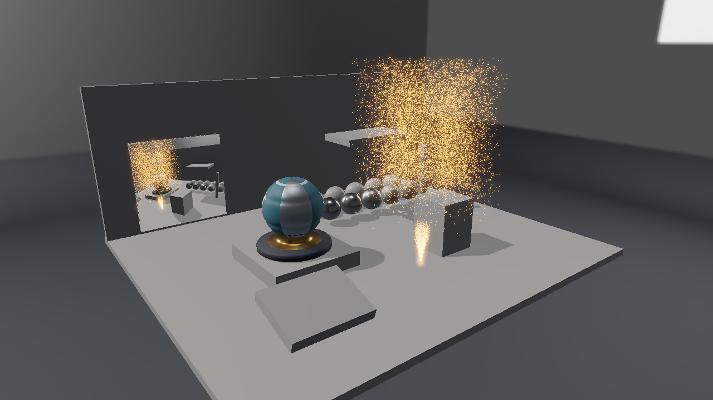
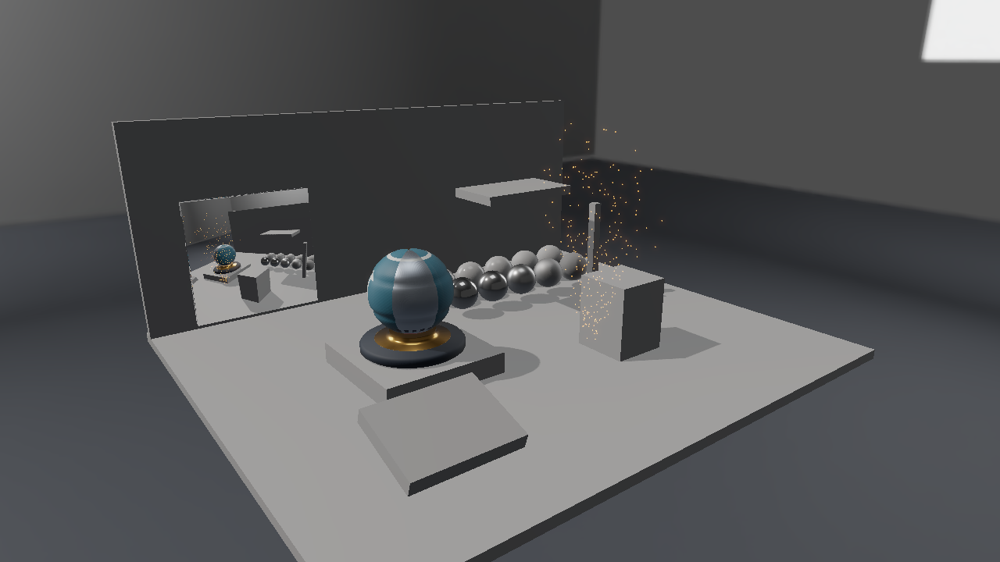

# Direct3D 12 第16回 Compute Shaderで更新したBufferをGPUパーティクルへ使う

第15回のHDRとBloomへ、GPU上で更新する火花の噴水を加えます。同じDevice-local BufferをCompute Shaderの書込み先と、ビルボードのインスタンス用頂点入力に使います。通常の更新でCPUへ粒子を読み戻したり、頂点データを転送し直したりしません。



この回の完成表示。1280×720、RTX 4070の実GPU読戻しです。

## ビルドと実行

VS 2026／v145、Windows SDK 10.0.26100.0、C++20、x64を維持します。D3D12はAgility SDK 1.619.6、DXC 1.9.2609.5です。

```powershell
msbuild ShaderjpGraphicsSamples.sln -t:Restore -p:RestorePackagesConfig=true
msbuild Samples\Direct3D12\16_GpuParticles\Direct3D12_16_GpuParticles.vcxproj -p:Configuration=Debug -p:Platform=x64
& .\bin\x64\Debug\Direct3D12_16_GpuParticles\Direct3D12_16_GpuParticles.exe
```

Blenderはアセットを編集・再書出しするときだけ使います。実行には同梱glTF・PNG・DDSを使い、追加のランタイム依存はありません。[共通章](../PostProcessing.md)と[モニターの制作](../Assets/Monitor.md)も参照してください。


## 更新と描画を同じBufferで行う

粒子は次の48-byte構造です。Structured Bufferと頂点入力で同じStrideを使います。

```cpp
struct Particle {
    DirectX::XMFLOAT4 positionSize;
    DirectX::XMFLOAT4 velocityAge;
    DirectX::XMFLOAT4 color;
};
```

容量は65,536個、既定の描画・更新数は16,384個です。初回とResetでは、固定Hashによる初期化をGPUで全容量へ行います。通常は有効な粒子数だけを更新し、一つのスレッドが一つの粒子を担当します。粒子間の参照や衝突がないため、更新用のBufferを別に用意する必要はありません。

```text
Computeによる位置・速度・寿命の更新
→ 更新Bufferを頂点入力として使えるようにする
→ Shadowと別カメラとメインカメラ
→ 各カメラの不透明モデルの後に粒子を加算合成
→ Bloom → 表示変換 → UI
```

## リソースとシェーダへの接続

Particle BufferはDefault Heap、ALLOW_UNORDERED_ACCESS、初期状態COMMONで作ります。初回はCOMMON→UNORDERED_ACCESS、その後はVERTEX_AND_CONSTANT_BUFFER→UNORDERED_ACCESSで更新し、Dispatch後にVERTEX_AND_CONSTANT_BUFFERへ戻します。

## 重力と寿命で小さな噴水を作る

```hlsl
p.positionSize.xyz += p.velocityAge.xyz * simulation.x;
p.velocityAge.y -= simulation.y * simulation.x;
p.velocityAge.w += simulation.x;
```

simulation.xはdt、yはGravityです。寿命が1.5秒を超えるか床付近へ落ちると、発生位置へ戻します。これは独立した粒子のEuler更新です。任意のglTF形状との衝突、粒子同士の力、流体や煙のシミュレーションは含めません。

通常のdtは経過時間を最大0.05秒へ制限します。最小化から戻ったときに長い時間を一度に進めません。`--fixed-dt 0.016666667`は撮影・検証用の固定刻みです。

## インスタンス用頂点入力とビルボード

位置とサイズはoffset 0、色はoffset 32から読みます。頂点入力をInstance Rateとし、6頂点×粒子数を一回で描きます。6個の角はVertex Shaderで生成し、カメラを向く小さな四角形へ広げます。粒子Bufferをもう一つのVertex Bufferへコピーしません。

```cpp
commands_->IASetVertexBuffers(0, 1, &particleView_);
commands_->DrawInstanced(6, UINT(panel_.particleCount), 0, 0);
```

Pixel ShaderはUVから円形の減衰を作ります。深度テストは有効、深度書込みは無効、合成はONE＋ONEです。加算する発光粒子として描くため、透明な煙のようなソートは行いません。粒子はShadowを落とさず、周囲を照らすPoint Lightにもなりません。

## PauseとStepとReset

Pause中は通常の更新Dispatchを止めます。Pause中のStepは一度だけ1／60秒を進めます。Resetは全容量を同じseedで初期化し、照明・Bloom・粒子数・Gravityを標準値へ戻します。粒子数を増やしても未初期化の領域を読まないよう、初期化と更新の範囲を分けています。

`--particles 257`のように256の倍数でない数でも動きます。ParticleUpdateは256 threads／groupで、Group数を切り上げ、indexが有効数以上なら戻ります。


## 書込みと読込みを同期する

Structured UAVのStrideとD3D12_VERTEX_BUFFER_VIEWのStrideを48に揃え、Input LayoutへPER_INSTANCE_DATAとStep Rate 1を指定します。UAVとVertex Buffer Viewは同じID3D12Resourceを参照します。通常フレームにMapや粒子のCPU転送はありません。

GPUの初期化、リソース、Pipeline、転送、描画、同期、解放は、このプロジェクトの[Sample.cpp](../../Samples/Direct3D12/16_GpuParticles/Sample.cpp)へ置いています。CommonはCPUの配置読込と数学を担当します。共有HLSLは[Shaders/PostProcess](../../Shaders/PostProcess)、UIは[PostProcessPanel.h](../../Samples/Shared/PostProcessPanel.h)です。

## 更新数と時間を制御する


257個の粒子をPauseした検証表示。1280×720、RTX 4070の実GPU読戻しです。



同じ257個を固定刻みで7回更新した表示。1280×720、RTX 4070の実GPU読戻しです。

初期化と7回のEuler更新、描画したBufferをGPUから読み戻して検証しています。表示の変化だけでなく、最初の粒子の位置・速度・年齢と、更新範囲外の粒子が変わらないことも確認します。

```powershell
& .\bin\x64\Debug\Direct3D12_16_GpuParticles\Direct3D12_16_GpuParticles.exe --post-view final --environment studio --no-ui --frames 8 --fixed-dt 0.016666667 --screenshot .\.cache\Direct3D12_16_GpuParticles.png
```

`--post-view`はfinal／grayscale／extract／horizontal／bloom／monitor／inputです。第14回ではBloomの途中表示を使いません。第16回は`--pause`、`--particles 257`、`--gravity 3`も指定できます。

## 検証する

```powershell
.\Tools\ValidateProjects.ps1
.\Tools\TestPostProcessAssets.ps1
.\Tools\TestPostProcess.ps1 -CaptureDocs
.\Tools\TestPostProcessFailures.ps1
.\Tools\TestPostProcess.ps1 -Configuration Release
.\Tools\TestSamples.ps1 -Topics 16_GpuParticles
```

`--capture-gpu`は撮影時だけ線形HDR画像と粒子Bufferを読み戻し、PNGと同名の`.gpu`フォルダへ保存する診断オプションです。通常のフレームでは使いません。黒入力、一定色、端の単一画素、641×479、257粒子、実ウィジェットのStep／Resetを[GPU数値検証スクリプト](../../Tests/VerifyPostProcess.py)で確認します。両API・両構成で成功しています。HDR導入前後の最大差は8bitで1、Bloomにより3,863〜3,865画素が変わり、粒子のReset後は初期Bufferと完全一致しました。環境と実測値は[検証記録](../Verification.md)へまとめています。

前：[第15回](15_ComputeBloom.md)。別API：[Vulkan 第16回](../Vulkan/16_GpuParticles.md)。次の候補は、深度・法線・位置復元を使うSSAOです。Async Compute、粒子のソート・衝突、Indirect Drawは後の拡張です。

画像と新規アセット、コードは自作。Copyright (c) 2026 masafumi、[MIT License](../../LICENSE)。比較はStudio、直接光3、環境強度1、露出1、同じ配置とカメラを使います。完成画像は48 frames、257粒子の比較は8 frames、固定dt 1／60で撮影しています。
