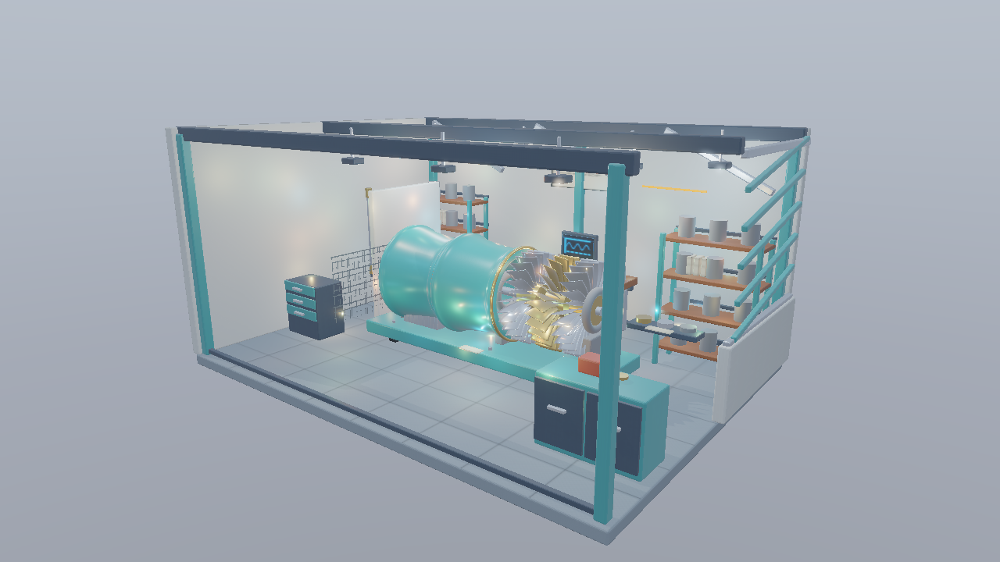
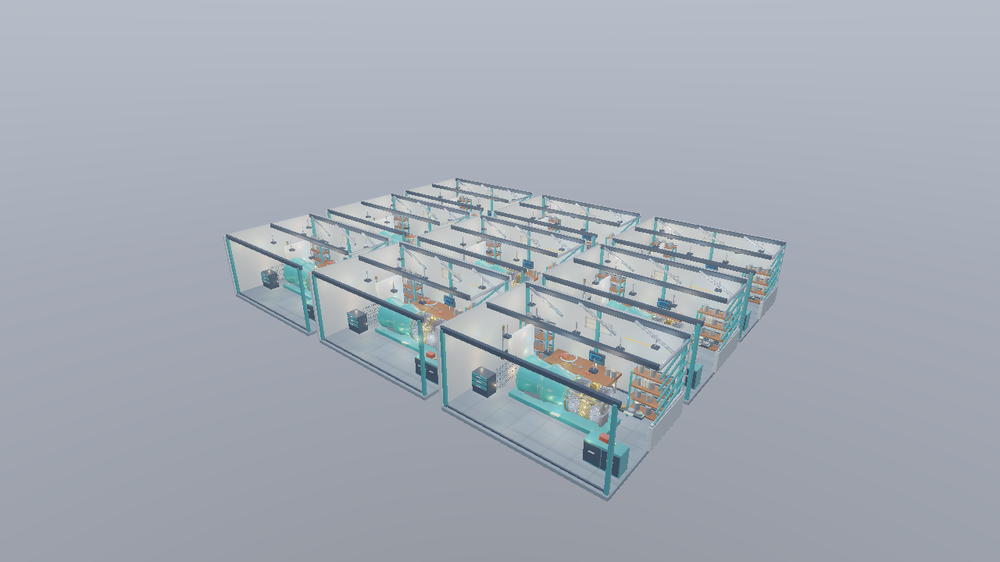

# Direct3D 12 第19 Tile-based Deferred Renderingで多数の点光源を絞り込む

第18回のCompute版Deferredへ、GPUで作るライトリストを加えます。16×16画素ごとの最小／最大View Zと4つの側面から、有限な点光源の球を判定します。同じライト列を全評価するモードと比較し、光を変えずに計算対象を減らすことを確かめます。



1280×720、Standard、Hero、OpaqueMask。既存8個に追加256個を加えた264点光源、追加ライトの半径1.6 m、強度0.4、露出1、環境強度0.8です。Shadow、IBL、Bloomを維持しています。[共通章](../LightCulling.md)と[Workshop](../Assets/Workshop.md)も参照してください。

## ビルドと実行

VS 2026／v145、Windows SDK 10.0.26100.0、C++20、x64を維持します。Agility SDK 1.619.6、NuGet DXC 1.9.2609.5を使います。実行には同梱のglTF、PNG、DDS、JSONを使い、Blenderと再ベイクは不要です。

```powershell
msbuild ShaderjpGraphicsSamples.sln -t:Restore -p:RestorePackagesConfig=true
msbuild Samples\Direct3D12\19_TiledDeferred\Direct3D12_19_TiledDeferred.vcxproj -p:Configuration=Debug -p:Platform=x64
& .\bin\x64\Debug\Direct3D12_19_TiledDeferred\Direct3D12_19_TiledDeferred.exe
```

第19・20回は独立した実行プロジェクトです。両方で`All lights`、`Tiled`、`Clustered`を切り替えられ、既定モードだけを変えています。点光源の数、配置、半径、材質、カメラを揃えて比較してください。

## 処理の流れ

```text
Shadow Map → G-buffer
→ TileDepth（16×16）：最小／最大Zと24-bitのスライスマスク
→ CullLights（64 threads）：セルごとのライトIDリスト
→ LightingCompute（8×8）：選ばれたライトを評価してHDRへ書く
→ Skybox → Forward透明 → Bloom → 表示変換 → UI
```

G-bufferは従来の4カラー＋Depth、18 B／画素です。Normal Map適用後の法線をOctahedral方式で2成分へ保存し、ワールド位置は深度から再構築します。位置用ターゲットとクラスタIDの画像は追加しません。

## リソースと接続

追加ライトは[LightGridData.h](../../Samples/Shared/LightGridData.h)の固定HashからCPUで生成します。既存の`range`なしのライトを維持し、追加ライトには有限rangeを設定します。Standardは264個、Stressは2,376個、512個／区画を指定したStressは4,680個です。ライトとカメラのBufferを更新するのは、前フレームのGPU完了待機の後です。

1セルに`uint2`のHeaderと256個の`uint` Indexを予約します。Headerは候補数と容量超過の有無です。Indexへの書込みは設定容量内に限定し、容量超過のセルではシェーディングを全ライト評価へ戻します。候補を黙って切り詰めません。

候補数、半径、強度、容量、アニメーションをUIで操作できます。既存のScene／Preset／Camera／カメラ経路、Forward診断、Shadow／PCF、Bloom、Resetも維持します。BLENDは不透明Depthのリストを使わず、従来のForwardパスで全ライトを評価します。

主なコードは[Sample.cpp](../../Samples/Direct3D12/19_TiledDeferred/Sample.cpp)、[TileDepth.hlsl](../../Shaders/LightCulling/TileDepth.hlsl)、[CullLights.hlsl](../../Shaders/LightCulling/CullLights.hlsl)、[共通BRDF](../../Shaders/Deferred/Lighting.hlsli)です。GPUリソースの作成・転送・同期・解放は各APIのサンプルで追えます。

## シェーダで行うライト判定

タイルの深度は`projectionB / (depth - projectionA)`でView Zへ戻します。正のZをuintへbitcastし、共有変数のInterlockedMin／Maxで範囲を集めます。背景のDepth 1は除外します。

64スレッドのライト判定では、球がタイル側面4枚と深度範囲へ交差するかを調べます。`range`なしのライトは必ず残します。

```hlsl
for (uint i = thread; i < controls.x; i += 64) {
    if (unbounded || IntersectsCell(centerView, radius, slopes, zBounds)) {
        uint slot;
        InterlockedAdd(candidateCount, 1, slot);
        if (slot < listCapacity) indices[cell * 256 + slot] = i;
    }
}
```

候補の順序はGPUの実行順に依存します。加算順序による浮動小数点の微小差を許容し、全ライトとのHDR比較を行います。リストはフレームごとに作り直すため、カメラとライトの移動にも追従します。

近い壁と遠い床が同じタイルに入ると、その間の広いZ範囲を候補判定へ使います。表面がない奥行きのライトも残るケースを、第20回のクラスターと比較してください。

## APIの同期

ライトリストはDefault Heap、ALLOW_UNORDERED_ACCESS付きのBufferをCOMMONから作ります。TileDepthとCullLightsは同じDirect Queueへ記録します。深度はDEPTH_READ＋ALL_SHADER_RESOURCEの状態でComputeから読みます。

タイル深度とスライスマスクの書込み後にUAV Barrierを置き、CullLightsの読取りへ接続します。HeaderとIndexはCullLightsの後にUNORDERED_ACCESSからNON_PIXEL_SHADER_RESOURCEへ遷移し、ライティングでSRVとして読みます。

```cpp
commands_->Dispatch(tilesX, tilesY, 1); // TileDepth
commands_->ResourceBarrier(1, &uavBarrier);
commands_->Dispatch(tilesX, tilesY, clustered ? 24 : 1); // CullLights
Move(headers, headerState, D3D12_RESOURCE_STATE_NON_PIXEL_SHADER_RESOURCE);
Move(indices, indexState, D3D12_RESOURCE_STATE_NON_PIXEL_SHADER_RESOURCE);
```

既存のb0／t0／s0を維持し、グリッド定数をb1、Header／IndexのSRVをt15／t16へ追加します。Cullでは同じBufferをu1／u2として書き、タイル深度とマスクをu3／u4へ渡します。Root Signatureの追加テーブルはScene用です。Bloomと表示用のRoot Signatureは従来の接続を維持します。[D3D12のResource Barrier](https://learn.microsoft.com/en-us/windows/win32/direct3d12/using-resource-barriers-to-synchronize-resource-states-in-direct3d-12)も参照してください。

## 比較画像と操作

```powershell
& .\bin\x64\Debug\Direct3D12_19_TiledDeferred\Direct3D12_19_TiledDeferred.exe --light-culling all --no-ui
& .\bin\x64\Debug\Direct3D12_19_TiledDeferred\Direct3D12_19_TiledDeferred.exe --light-culling tile --light-view count --no-ui
& .\bin\x64\Debug\Direct3D12_19_TiledDeferred\Direct3D12_19_TiledDeferred.exe --workshop-scene Stress --camera StressHero
& .\bin\x64\Debug\Direct3D12_19_TiledDeferred\Direct3D12_19_TiledDeferred.exe --lights-per-room 512 --light-radius 1 --animate-lights
```


表面が参照する候補数を青から赤へ表示します。赤は128個以上、暗い線は16画素の境界です。実際の数と有効セル平均はUIで確認できます。ライティングの画と候補数の画を分け、リストを増やす位置を観察してください。



Stress、StressHero、OpaqueMask、2,376点光源。形状・材質・画像を共有する3×3のWorkshopです。追加数、半径、強度が同じなら、All／Tiled／Clusteredの画は一致する範囲に収まります。

## GPU時間と検証

UIの`tile-depth`、`cull`、`lighting`を分け、生成パスも含む`total`で比較します。統計用Headerの読戻しはGPU完了後に読み、GPUの描画時間とCPU集計を分けています。

```powershell
& Tools\TestLightGrid.ps1 -Configuration Debug
& Tools\TestLightGrid.ps1 -Configuration Release -CaptureDocs
& Tools\TestLightGrid.ps1 -Configuration Release -BenchmarkOnly
```

同一APIのAll／Tiled／ClusteredでG-bufferとDepthのバイト一致、HDRの絶対誤差`1e-3`＋相対誤差`2e-3`を確認します。Standard、Stress、透明、641×479、室内カメラ、最大4,680ライト、移動、容量超過を含みます。GPUから読んだ全リストはCPUの独立した球／平面判定とも照合します。SDK、GPU、実測値と撮影条件は[検証記録](../LightCullingVerification.md)にまとめます。

後続では、可変長リスト、ライト階層、法線コーンによるライト除外、透明物のクラスター登録へ進めます。照明の絞り込みと、Mesh Shaderによる形状のカリングを分けて計測できる構成です。

## カメラ操作

WASDで移動、Q/Eで上下移動、右ドラッグで視線を回転、Shiftで加速します。Rで選択中の固定カメラへ戻り、UIのResetはカメラと設定を初期化します。ImGuiの操作中はカメラ入力を抑えます。[共通の操作と検証手順](../CameraNavigation.md)も参照してください。
