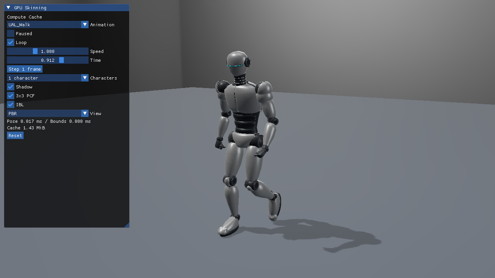
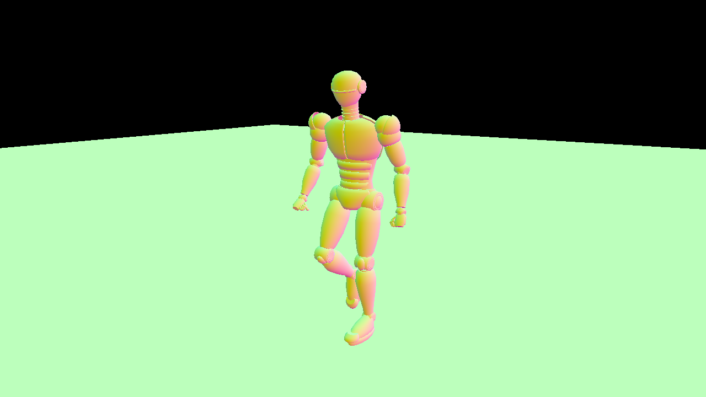

# Direct3D12 23：Computeのスキニング結果をVertex Bufferへキャッシュ

Computeのスキニング結果をVertex Bufferへキャッシュし、動くロボットのShadowとPBR Colorを描画します。前提は[glTFスキニング対応ローダー](../GltfSkinningLoading.md)と[GPUスキニング共通章](../GpuSkinning.md)です。実装は[Sample.cpp](../../Samples/Direct3D12/23_ComputeSkinningCache/Sample.cpp)にあり、初期化・Buffer作成・転送・描画・同期・終了処理をこのプロジェクト内で追えます。



## Compute Cacheの動きを動画で確認する

共有HLSLのCompute CacheによるJogは、Vulkan版の実行録画で確認できます。この動画のAPIはVulkanです。Direct3D12固有のUAV／Vertex Buffer遷移は、この後の実装解説を参照してください。

[](../Assets/Videos/Vulkan_23_ComputeSkinningCache_Run.mp4)

[全6本の録画一覧](../Assets/Videos/README.md)

## 共通アセットと操作

[SilverRobotAnimated.blendと配布glTF](../Assets/SilverRobotAnimated.md)を使用します。53ボーン、31,138頂点、44,584三角形、5つの定数PBR材質です。1体では53行列、64体ではそれぞれの位相に合わせた53×64行列をCPUで評価します。元形状とIndexは共有します。

初期値はUAL_Walk／速度1／1体。ImGuiで6クリップ、Paused、Loop、速度、Time、1フレーム送り、Reset、1／64体、Shadow、Hard／3×3 PCF、IBL、診断表示を切り替えられます。JumpStart／JumpLandは終端保持、その他はループが初期値です。カメラはWASD／Q・E／右ドラッグ／Shift／Rを継承します。

```powershell
& .\bin\x64\Debug\Direct3D12_23_ComputeSkinningCache\Direct3D12_23_ComputeSkinningCache.exe `
  --animation UAL_Walk --animation-time 0.3 --pause-animation --characters 1
```

`--animation-speed`、`--characters 64`、`--post-view weights`、`--camera OffscreenCaster`、`--hard-shadow`、`--no-shadow`も使えます。全3方式に同じ引数を与えれば、同じ姿勢と光で比較できます。

## Direct3D12の初期化と入力

VS 2026／v145／Windows SDK 10.0.26100.0、Agility SDK 1.619.6、NuGet DXC 1.9.2609.5、SM6.6／HLSL 2021を使います。基本22／23はMesh Shader Tierを要求しません。発展10はMesh Shader Tier 1が必要です。

`CreateDevice`で機能を確認し、`CreateResources`／`CreateMeshResources`／`CreateSkinResources`でアセットとBuffer、`CreateMeshPipelines`でPSOを作ります。Root Signatureに新しいSRV tableとUAV tableを追加し、Descriptor Heapにウェイト、palette、動的境界、キャッシュを配置します。

| データ | HLSL register | Stride |
|---|---|---|
| JOINTS＋WEIGHTS | t96 | 32 byte |
| row-major palette | t97 | 64 byte |
| 動的Meshlet Sphere | t98 | 16 byte |
| 変形済み頂点UAV | u7 | 48 byte |

元頂点、Index、Primitive、Instanceの既存Meshデータと同じDescriptor Heapへ置きます。Texture／IBL／Shadowのregisterは既存規約を保ちます。paletteと境界のUpload heapはGPU完了待ちの後に更新します。

## この方式の描画と同期

`CreateSkinResources`で64体分のDEFAULT heap Bufferを`ALLOW_UNORDERED_ACCESS`付きで作ります。UAVは48 byte strideのStructuredBuffer、描画側は同じリソースの`D3D12_VERTEX_BUFFER_VIEW`です。別の描画BufferへCPUコピーする構成ではありません。

```cpp
Move(skinCache_.Get(), skinCacheState_, D3D12_RESOURCE_STATE_UNORDERED_ACCESS);
for (UINT actor = 0; actor < actors; ++actor) {
    BindMesh(1, actor * primitiveCount, vertexCount, 0, true);
    commands_->SetPipelineState(skinCompute_.Get());
    commands_->Dispatch((vertexCount + 63) / 64, 1, 1);
}
Move(skinCache_.Get(), skinCacheState_, D3D12_RESOURCE_STATE_VERTEX_AND_CONSTANT_BUFFER);
```

`SkinningCompute.hlsl`は1 threadにつき1頂点を変形し、`actor * vertexCount + vertex`へ書きます。キャラクターごとの領域が重ならないので、Actor間にUAV依存はありません。最後のtransitionでCS書込みからIA読取りを同期します。[D3D12 Resource Barrier](https://learn.microsoft.com/en-us/windows/win32/direct3d12/using-resource-barriers-to-synchronize-resource-states-in-direct3d-12)のstateとUAV依存の違いも確認してください。

ShadowとColorの両方で同じVertex Bufferをbindし、stride48、位置＋U、法線＋V、接線をそれぞれRGBA32_FLOATの属性として読みます。Primitive単位のviewの先頭へキャラクターとPrimitiveのoffsetを加えます。床は元頂点Bufferを頂点入力へbindし、Compute対象に含めません。`CacheVertex.hlsl`は変形を繰り返さず、Instance WorldとViewProjectionだけを適用します。

## Shadow、PBR、HDR表示

静的床、方向光、2048×2048のD32 Shadow、Hard／3×3 PCF、StudioのIrradiance／Specular IBL、BRDF LUTを基本22／23／発展10で揃えます。PBRは定数Base Color／Metallic／Roughness／Emissiveを使い、ColorをHDRへ出してから表示変換します。モデルにUVやTextureがなくても法線と材質を評価できます。

`--post-view normal`で変形後の法線、`depth`でカメラ深度、`shadow`でライト深度、`weights`で4成分のウェイトを確認できます。表示用のポスト処理の前の線形HDRも`--capture-gpu`で読戻せます。3方式の比較はPNGの見た目だけでなく、このDepth・Shadow・HDRとComputeの実頂点を対象にします。

変形後の法線をRGBで確認できます。



## 検証と測定

```powershell
.\Tools\TestSkinningCpu.ps1
.\Tools\TestSkinning.ps1 -Configuration Debug -Api Direct3D12
.\Tools\TestSkinning.ps1 -Configuration Release -Api Direct3D12
.\Tools\MeasureSkinning.ps1 -Api Direct3D12
```

全クリップのCPU参照、1体／64体、Shadow ON/OFF、カリングON/OFF、画面外Caster、リサイズ・最小化／復帰、Seek／Reset、ループ／終端、再生速度を検証します。DebugのGraphics Validationエラーは0件です。Shader欠落時の診断と終了処理も試験します。具体的な誤差・環境・ReleaseのCPU/GPU時間は[検証記録](../SkinningVerification.md)へまとめています。

実行ローダーの対象はglTF JSON＋外部BIN、4インフルエンス、TRS LINEAR／STEPです。Morph、CUBICSPLINE、追加ウェイトセット、任意のTexture材質は対象外として診断します。モデル・モーションのライセンスは[アセット記事](../Assets/SilverRobotAnimated.md#採用素材とライセンス)を参照してください。

次は[発展10 Mesh Shader](Advanced10_MeshShaderSkinning.md)へ進みます。
