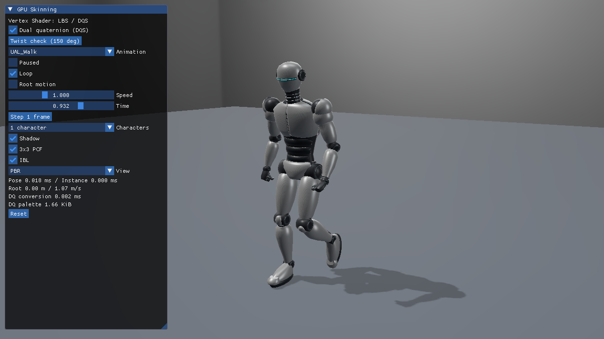
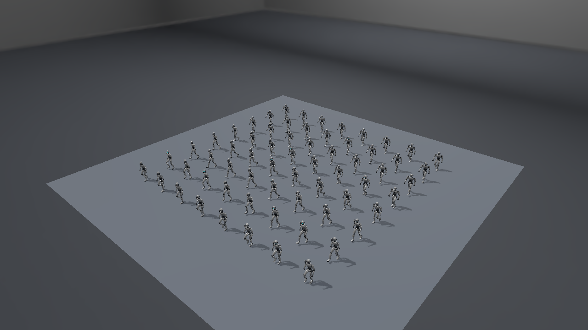
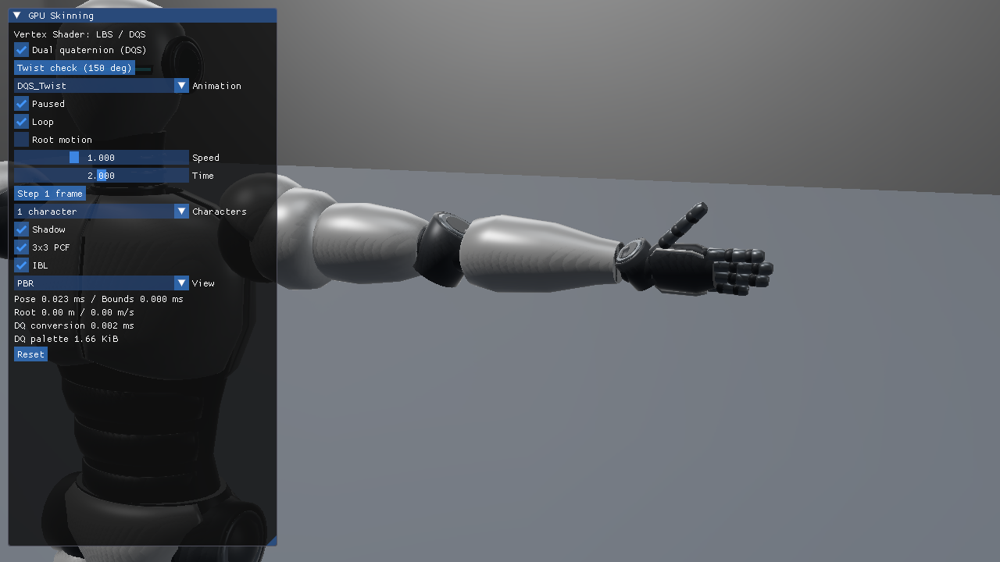

# 24. Direct3D12でDual Quaternion Skinning

基本22のIndexed Vertex Shader描画にDQSを追加し、同じ姿勢でLBSと切り替えます。数学、適用できるアセット、ねじり確認は[共通DQS解説](../DualQuaternionSkinning.md)、数値比較と性能は[検証記録](../DualQuaternionVerification.md)にまとめています。



## 独立プロジェクトとCPUデータ

[Sample.cpp](../../Samples/Direct3D12/24_DualQuaternionSkinning/Sample.cpp)がデバイス・Buffer・Root Signature・PSO・描画・同期・解放を持ちます。VS 2026／v145／SDK 10.0.26100.0、Agility 1.619.6、DXC 1.9.2609.5、SM6.6／HLSL 2021です。Mesh Shader対応は不要です。

[DualQuaternionSkinningData.h](../../Samples/Shared/DualQuaternionSkinningData.h)は既存glTF CPU評価を再利用し、メッシュローカル空間の最終行列を32 byteのReal／Dualペアへ変換します。比較用にLBS行列とDQを両方保持するため、ImGuiの切替でアセットを再読込しません。

| 入力 | register | StructuredBufferの要素 |
|---|---|---|
| JOINTS＋WEIGHTS | t96 | 32 byte |
| LBS palette | t97 | row-major float4x4、64 byte |
| DQ palette | t98 | float4、16 byteを1ジョイントにつき2要素 |
| 検査用頂点出力 | u7 | 48 byte、capture時のみ実サイズを確保 |

`CreateSkinResources`でUpload heapの2つのpaletteを作り、`UpdateMeshDescriptors`でSRVを置きます。t98は基本22で使わない動的境界のスロットをこの独立プロジェクトでDQ用に割り当てています。インデックスは`2 * (actorPaletteBase + joint)`です。Shader側の名前は`skinDualQuaternionParts`で、Meshlet境界として読まないようにしています。

## 同じVSをShadowとカラーへ使う

`BindMesh`はRoot constant b2のmodeの`0x10000`をDQSフラグにします。`ReferenceVertex.hlsl`→`SkinVertexAt`がこのビットで行列ブレンド／DQブレンドを選びます。頂点・ウェイト・Actorのpalette先頭は共通です。

```text
Upload: matrix palette + DQ palette
Shadow PSO: ReferenceVertex → selected skinning → light VP → D32
Color  PSO: ReferenceVertex → selected skinning → camera VP → PBR HDR
```

IAには元のIndex Bufferをbindし、`DrawIndexedInstanced`でPrimitiveを描きます。DQSの変形はそれぞれのVSで行います。法線・接線も同じDQの回転で変形するため、PBRの向きも追従します。床はスキン対象外です。Studio IBL、2048×2048 Shadow Map、Hard／3×3 PCF、HDR診断は基本22と共通です。

## 完了待ちと読戻し

`OnRender`のGPU完了待ち後にpalette、Instance、UIのUpload領域を書き換えます。単一Graphics QueueとFenceで再利用を制御します。通常の描画ではCSを起動せず、変形頂点キャッシュも使用しません。

`--capture-gpu`では検査用CSを別途有効にし、VSと同じ`SkinVertexAt`の結果をUAVへ書きます。UAVから頂点読取り状態への遷移、Fence待ち、COPY_SOURCEへの遷移、Readback heapへのコピーを経て`skin-cache.bin`を保存します。これは**共有関数のCS実行結果**であり、VSの出力を直接取得したものではありません。実描画はDepth／Shadow／HDR比較とImGui操作でも検証します。性能測定ではcaptureを付けません。

## 実行

```powershell
& .\bin\x64\Debug\Direct3D12_24_DualQuaternionSkinning\Direct3D12_24_DualQuaternionSkinning.exe
& .\bin\x64\Debug\Direct3D12_24_DualQuaternionSkinning\Direct3D12_24_DualQuaternionSkinning.exe `
  --skinning dqs --animation DQS_Twist --animation-time 2 --pause-animation --camera Twist
```

`Dual quaternion (DQS)`をOFFでLBS、`Twist check (150 deg)`でねじり確認、ResetでDQS／Walk／Root motion OFFへ戻ります。1／64体、Root motion、速度・Seek・1フレーム送りも利用できます。






## Compute／Mesh版へ進む

[基本25 DQS Compute Cache](25_DualQuaternionComputeCache.md)ではCSの出力をShadow／Colorで共有し、[発展11 DQS Mesh Shader](Advanced11_DualQuaternionMeshSkinning.md)ではMS内で直接変形します。[共通の実行方式とDQS境界](../DualQuaternionStages.md)と[検証・性能](../DualQuaternionStagesVerification.md)で同じ姿勢の結果を比較できます。
