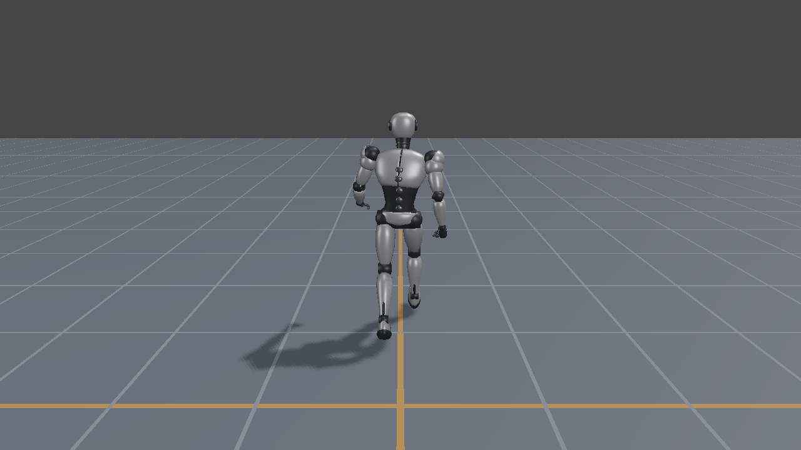
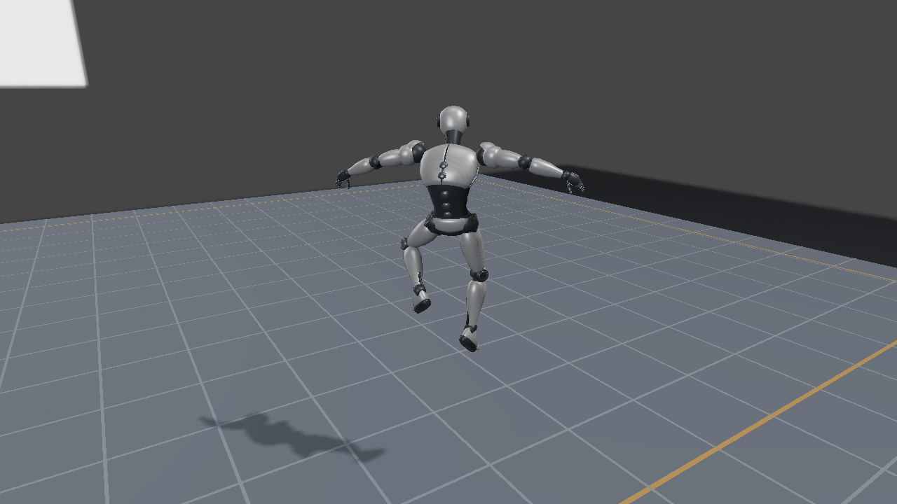

# Direct3D12 第28回：操作するスキニングキャラクター

第22回のVertex Shaderスキニングを使い、WASD／XInputで歩行・走行・ジャンプするロボットを描きます。移動と状態遷移は[共通解説](../CharacterController.md)、この回ではCPUの結果をDirect3D12へ反映する順序を扱います。

[キャラクターコントローラ](../CharacterController.md#キャラクターコントローラとは)が位置・速度・向き・接地状態を更新し、[モーションブレンド](../CharacterController.md#モーションブレンドとは)が動作の切替に中間姿勢を作ります。前者の配置を`ActorWorld`へ、後者の姿勢をボーンパレットへ反映し、GPUのスキニングでロボットを変形します。



## 実行する

`ShaderjpGraphicsSamples.sln`から`Direct3D12_28_CharacterController`を選び、x64 Debug／Releaseで実行します。VS2026、v145、Windows SDK 10.0.26100.0、Agility SDK 1.620.1、DXC 1.9.2609.5を使用します。パッド入力はWindows SDKの`xinput.lib`です。

WASDで移動、Shiftで走行、Spaceでジャンプ、右ドラッグでカメラを回転します。パッドでは左スティック、L3保持、A、右スティックです。R／ViewまたはUIのResetで初期状態へ戻します。初期クライアント領域は1280×720です。

## 操作動画

ユーザー提供の[Direct3D12版の操作録画](<../Assets/Videos/Shader.jp Direct3D12 28_CharacterController 2026-10-21 01-05-16.mp4>)です。1280×720、約23.3秒。元のMP4を再圧縮せずに保存しています。

固定入力による[5秒の自動操作動画](../Assets/Videos/Direct3D12_28_CharacterController.mp4)も用意しています。出典とSHA-256は[動画記録](../CharacterControllerVideos.json)を参照してください。

## CPU更新とGPU転送を分ける

`OnUpdate`ではWin32のImGuiフレームを開始し、入力を`CharacterCommand`へ変換します。固定刻みのシミュレーションを進めてから診断UIを作り、追従カメラの位置・注視点をシーンへ渡します。この段階ではGPU使用中のバッファを書き換えません。

`OnRender`では次の順序になります。

1. `WaitForGpu`で前フレームのFence完了を待つ。
2. 現在のカメラからCamera／Light定数を作る。
3. `MakeGltfGlobalPose`と`MakeSkinPalette`でブレンド済み姿勢からパレットを作る。
4. 配置、ボーン、描画定数をUpload Bufferへ書き込む。
5. Shadow Map、Forward PBR、Sky、トーンマップ、ImGuiを記録する。
6. Queueへ送信し、Presentと完了待機を行う。

UIの頂点・インデックス・定数の転送も、この完了待機より後にあります。入力処理からGPUバッファへ直接書き込まないことが、姿勢更新の責務と同期位置を読みやすくします。

## PaletteとWorldの役割

```text
Palette[j] = InverseBind[j] * JointGlobal[j] * inverse(MeshGlobal)
pWorld = SkinVertex(pBind, Palette) * MeshGlobal * ActorWorld
ActorWorld = RotationY(character.yaw) * Translation(character.position)
```

行ベクトル／row-majorの順序です。`CharacterPanel::UpdateSkin`は、毎フレーム作り直した配置へ`MeshGlobal * ActorWorld`を適用します。前フレームの配置を再利用して移動を累積させません。法線には対応する逆転置行列を渡します。

床と格子の配置にはスキニング無効の印を付け、静的な頂点として描きます。1体のボーンパレットをColorとShadowで共用するため、ジャンプ中の本体と影に別々の姿勢時刻が入ることはありません。

## 共通HLSLとShadow

第22回と同じ`ReferenceVertex.hlsl`から`TransformMeshVertex`を呼びます。4つのウェイトによるLBSで頂点・法線・接線を変形し、同じWorld行列を適用します。Passの指定でCamera VPとLight VPを選びます。Shader Model 6.6、HLSL 2021、`-Zpr`でオフラインコンパイルします。



Shadow Mapは2048×2048で、Depth書込みとShader読込みのResource Barrierを切り替えます。投影範囲は±15 mの床と高さ4 mまでの領域を含みます。キャラクターが原点から移動しても、元の1体表示用の小さい範囲から影が外れないようにしています。

描画、Descriptor、Pipeline、リソースの生成と終了処理はこのプロジェクト自身が持ちます。CPUの操作を共有するために、Direct3D12とVulkanの描画APIを共通ラッパーへまとめてはいません。

## 検証

```powershell
./Tools/TestCharacterControllerCpu.ps1
./Tools/TestCharacterController.ps1 -Configuration Debug -Api Direct3D12
./Tools/TestCharacterController.ps1 -Configuration Release -Api Direct3D12 -CaptureDocs
./Tools/TestSamples.ps1 -Configuration Debug -Topics 28_CharacterController
```

状態ログ、歩行・走行・回転・ジャンプ・着地の画像変化、Reset後のRGB一致を検査します。リサイズ、最小化／1280×720への復帰、正常終了も対象です。[検証条件と結果](../CharacterControllerVerification.md)、[Vulkan版](../Vulkan/28_CharacterController.md)も参照してください。
