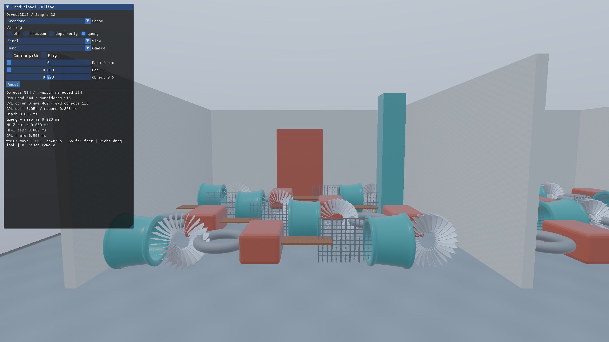
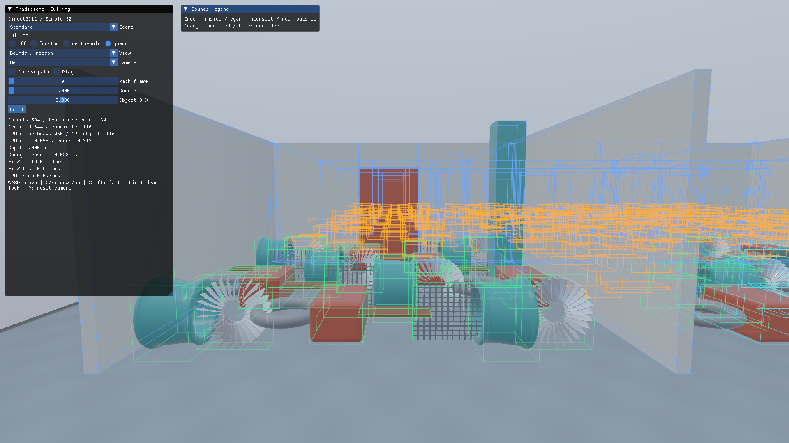

# 第32回 GPUオクルージョンクエリ — Direct3D12



[共通解説](../TraditionalCulling.md)と[CullingLabの制作データ](../Assets/CullingLab.md)を併読してください。通常のPBR／IBLとIndexed Drawを使い、Primitive配置ごとの可視性を学びます。

## 判定の原理

遮蔽物のDepthに対し、対象を完全に包むAABBを描きます。Depth Testを通るサンプルがゼロのときだけ対象を除外します。AABBを描く際の色とDepthの書込みは無効です。実形状より大きい境界なので、隠れた対象が残ることはあります。

## データの流れ

```text
CPU Frustum → 遮蔽物Depth → AABB Queryをまとめて発行 → Queryをまとめて解決 → 条件付きIndexed Draw → 完了後に診断統計を読む
```

CPUの境界・判定データは`Samples/Shared/CullingData.h`にあります。ローカル境界の8隅を現在のWorld変換で動かし、描画と同じカメラ・扉・対象位置を使います。Near面交差、カメラ内包、確定できない投影は可視候補に残します。

## API実装

Occlusion Query Heapを作成し、`BeginQuery`／`EndQuery`には`D3D12_QUERY_TYPE_BINARY_OCCLUSION`を指定します。検査対象を連続スロットに詰めて`ResolveQueryData`で64-bit値へ解決し、`COPY_DEST`から`PREDICATION`へ遷移します。`SetPredication(..., D3D12_PREDICATION_OP_EQUAL_ZERO)`は値がゼロのDrawを省略します。対象Drawの後にはPredicationを解除します。

GPUリソース、Barrier、描画、完了待ち、破棄はこのプロジェクトの`Sample.cpp`／`Culling.cpp`にあります。`Samples/Shared/CullingPanel.h`はCPUのUI、`Shaders/Culling`は両API共通HLSLです。

```powershell
msbuild Samples/Direct3D12/32_OcclusionQueries/Direct3D12_32_OcclusionQueries.vcxproj -p:Configuration=Debug -p:Platform=x64
bin/x64/Debug/Direct3D12_32_OcclusionQueries/Direct3D12_32_OcclusionQueries.exe --culling query
```

VS 2026／v145／Windows SDK 10.0.26100.0／C++20、x64 Debug・Release、HLSL 2021／SM6.6、1920×1080で動作します。

## 可視化と操作

比較モードは**OFF／Frustum／Depthのみ／Query**です。Scene、Camera、Camera path、Door X、Object 0 X、Resetを共通UIで操作します。`--culling`と`--culling-view`で同じ設定を再現できます。

BoundsではQueryに使うAABBと判定理由を表示します。Depthのみモードは遮蔽物Pre-passだけを有効にします。QueryによるDraw省略と、Depth Test／Early-Zだけの効果を比較できます。CPUの色Draw記録数はFrustum通過数のままです。



Boundsの緑は内側、水色は視錐台との交差、赤は外側、橙は遮蔽除外、青は指定遮蔽物です。CPUの色Draw記録数とGPUの可視候補数は別に表示します。候補には画素を生成しない対象が残る場合もあります。

## 正確性と性能

カリングOFFを基準として、Object ID・Depth・完成HDRを比較します。見えている対象を誤って除外した件数はゼロを必須とし、見えない対象を残す保守的な判定は許容します。CPU版の全解像度、奇数サイズ、Near面、開口部、移動する扉・対象、急なカメラ移動、初回フレームを検査します。

`Tools/TestCulling.ps1`は画像とGPUデータの比較、`-UiOnly`は実UI入力とCLI再現、`-MotionOnly`は同一プロセス内のカメラ移動・振り返り・Resetを検査します。`Tools/TestSamples.ps1`はリサイズ・最小化復帰・終了を確認します。

追加の判定処理が描画削減分より高価なら遅くなります。[実機検証記録](../CullingVerification.md)と[5反復の計測表](../Measurements/Culling/Summary.md)で、CPU判定・記録とGPU各パスを比較してください。
