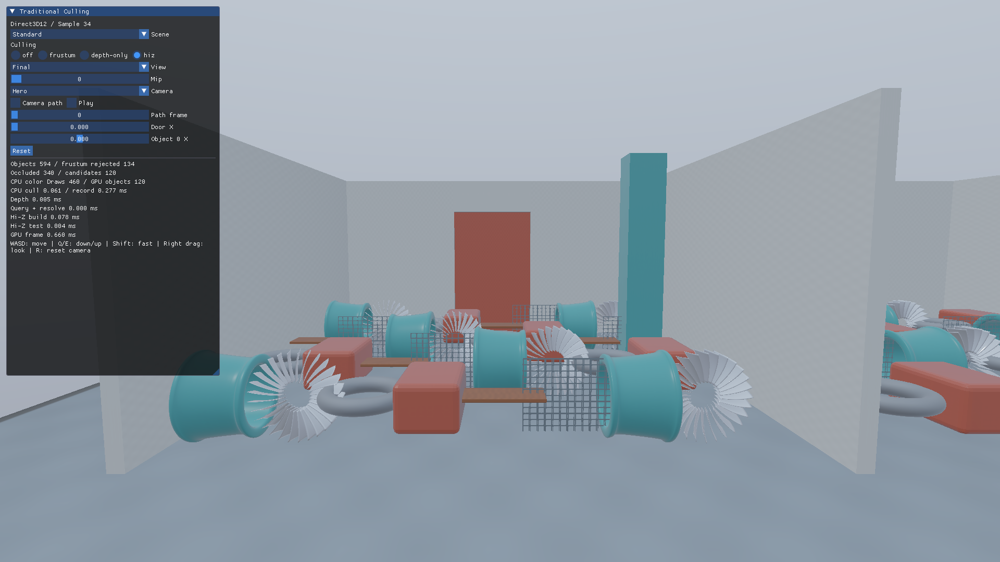
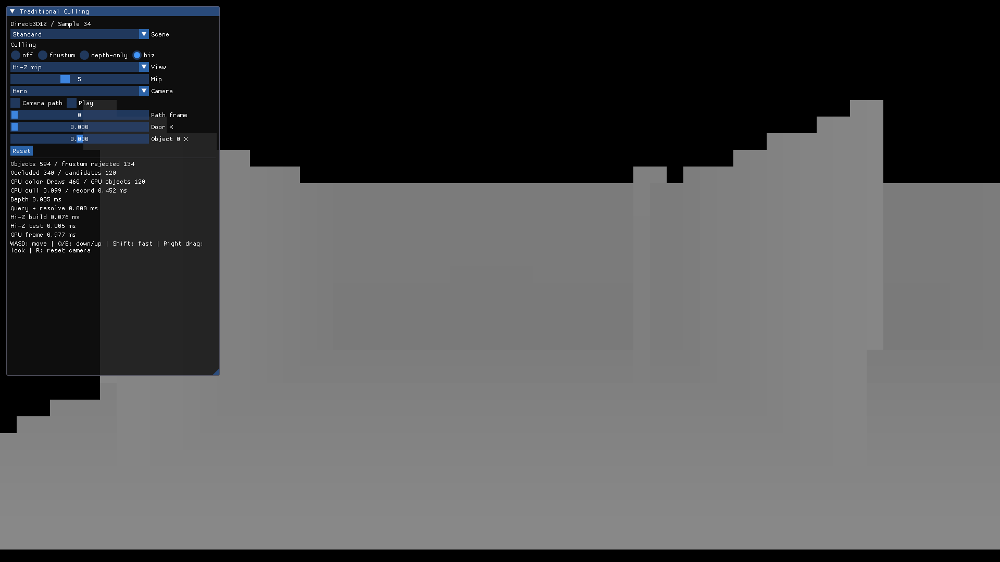
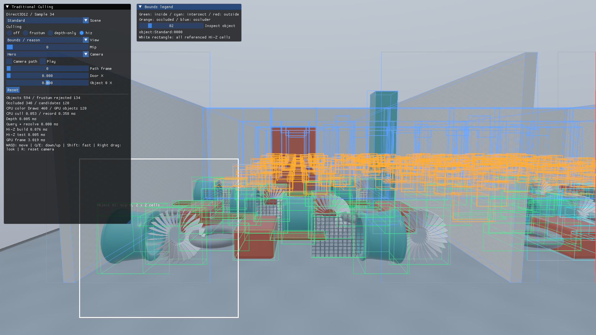

# 第34回 Compute Hi-Z遮蔽判定 — Direct3D12



[共通解説](../TraditionalCulling.md)と[CullingLabの制作データ](../Assets/CullingLab.md)を併読してください。通常のPBR／IBLとIndexed Drawを使い、Primitive配置ごとの可視性を学びます。

## 判定の原理

Near=0／Far=1のDepthを2×2の最大値で縮約します。対象の投影矩形を覆うMipセルの最大Depthより、対象の最近Depthが十分奥にある場合だけ除外します。未被覆のDepth=1があれば強い遮蔽とは判断しません。

## データの流れ

```text
CPU Frustum → 遮蔽物Depth → 2冪へ拡張したMip 0 → 各段の最大値縮約 → AABBの一括検査 → Predicate → 条件付きIndexed Draw
```

CPUの境界・判定データは`Samples/Shared/CullingData.h`にあります。ローカル境界の8隅を現在のWorld変換で動かし、描画と同じカメラ・扉・対象位置を使います。Near面交差、カメラ内包、確定できない投影は可視候補に残します。

## API実装

現在のDepthを`NON_PIXEL_SHADER_RESOURCE`へ遷移させ、各段のDispatch間へUAV Barrierを置きます。`TestHiZ`の書込み後はPredicateを`UNORDERED_ACCESS`から`PREDICATION`へ遷移し、`SetPredication`で各Indexed Drawを制御します。色描画前にDepthを書込み可能な状態へ戻します。

GPUリソース、Barrier、描画、完了待ち、破棄はこのプロジェクトの`Sample.cpp`／`Culling.cpp`にあります。`Samples/Shared/CullingPanel.h`はCPUのUI、`Shaders/Culling`は両API共通HLSLです。

```powershell
msbuild Samples/Direct3D12/34_HiZOcclusion/Direct3D12_34_HiZOcclusion.vcxproj -p:Configuration=Debug -p:Platform=x64
bin/x64/Debug/Direct3D12_34_HiZOcclusion/Direct3D12_34_HiZOcclusion.exe --culling hiz
```

VS 2026／v145／Windows SDK 10.0.26100.0／C++20、x64 Debug・Release、HLSL 2021／SM6.6、1920×1080で動作します。

## 可視化と操作

比較モードは**OFF／Frustum／Depthのみ／Hi-Z**です。Scene、Camera、Camera path、Door X、Object 0 X、Resetを共通UIで操作します。`--culling`と`--culling-view`で同じ設定を再現できます。

各段はfloatバッファに連続して配置します。実画面の右・下を次の2冪までDepth=1で埋め、奇数寸法の端も保持します。AABB矩形が最大2×2セルに収まる段を選び、重なる全セルを調べます。BoundsのInspect objectで、選択対象が参照する段・セル数・白い参照範囲を確認できます。Hi-Z mip表示は選択した段のDepthです。



Boundsの緑は内側、水色は視錐台との交差、赤は外側、橙は遮蔽除外、青は指定遮蔽物です。CPUの色Draw記録数とGPUの可視候補数は別に表示します。候補には画素を生成しない対象が残る場合もあります。

## 正確性と性能

カリングOFFを基準として、Object ID・Depth・完成HDRを比較します。見えている対象を誤って除外した件数はゼロを必須とし、見えない対象を残す保守的な判定は許容します。CPU版の全解像度、奇数サイズ、Near面、開口部、移動する扉・対象、急なカメラ移動、初回フレームを検査します。

`Tools/TestCulling.ps1`は画像とGPUデータの比較、`-UiOnly`は実UI入力とCLI再現、`-MotionOnly`は同一プロセス内のカメラ移動・振り返り・Resetを検査します。`Tools/TestSamples.ps1`はリサイズ・最小化復帰・終了を確認します。

追加の判定処理が描画削減分より高価なら遅くなります。[実機検証記録](../CullingVerification.md)と[5反復の計測表](../Measurements/Culling/Summary.md)で、CPU判定・記録とGPU各パスを比較してください。


