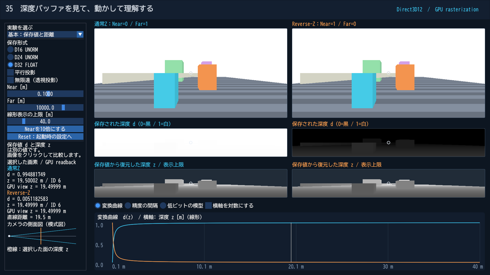

# Direct3D12 第35 深度の非線形性とReverse-Zを比較する

[共通の入門記事](../DepthPrecision.md)で観察の順序と数式を説明しています。このページでは、実行方法とDirect3D12の処理を追います。

## ビルドと起動

Visual Studio 2026／v145、Windows SDK 10.0.26100.0、C++20、x64 Debug／Releaseを使います。初期クライアント領域は1920×1080です。Dear ImGuiは既存のv1.92.9bを使い、日本語フォントはBIZ UDゴシックv1.051を固定Submoduleから配置します。追加のモデル作成ツールは不要です。

~~~powershell
git submodule update --init --recursive
msbuild ShaderjpGraphicsSamples.sln -t:Restore -p:RestorePackagesConfig=true
msbuild Samples\Direct3D12\35_DepthPrecision\Direct3D12_35_DepthPrecision.vcxproj -p:Configuration=Debug -p:Platform=x64
& .\bin\x64\Debug\Direct3D12_35_DepthPrecision\Direct3D12_35_DepthPrecision.exe
~~~

Agility SDK 1.620.1／SDK export 620とDXC 1.9.2609.5をNuGetで復元します。Preview SDKは不要です。

## 操作とプリセット

左のコンボで「基本」「Nearを近づける」「遠方の近接面」「無限遠」「平行投影」を選びます。上段の描画は同じカメラで、左が通常Z、右がReverse-Zです。中段は保存値そのもの、下段は保存値から復元した深度です。

Near／Far、線形表示の上限、D16／D24／D32、投影方式を編集できます。遠方の近接面では面の間隔も変更できます。グラフは変換曲線／精度の間隔／低ビットの模型を切り替えます。画像をクリックすると同じ画素位置の値を比較でき、Resetは起動時の設定へ戻します。

この実験は固定カメラを使います。WASDによる自由移動はありません。カメラを動かして異なる距離を測る代わりに、既知の距離のシーンとNear／Farを操作して比較条件を揃えます。

| CLI | 値 |
|---|---|
| --depth-preset | mapping / near / precision / infinite / orthographic |
| --depth-format | d16 / d24 / d32 |
| --depth-near / --depth-far | m単位、0 < Near < Far |
| --depth-projection | perspective / orthographic |
| --depth-infinite | off / on。平行投影との併用は不可 |
| --depth-display-far | 図と線形画像の表示上限、m単位 |
| --depth-gap | 遠方の2面のz方向の間隔、m単位 |
| --depth-graph | mapping / spacing / toy |

~~~powershell
& .\bin\x64\Debug\Direct3D12_35_DepthPrecision\Direct3D12_35_DepthPrecision.exe --depth-preset precision --frames 3 --capture-gpu --screenshot ".\.cache\35_DepthPrecision.png" --log ".\.cache\35_DepthPrecision.log"
~~~

プリセットを先に適用し、個別CLI指定をその後に適用します。--width／--height、--no-ui、--frames、--screenshot、--logも共通の指定として使えます。フォントなどは実行ファイル基準で読み込みます。

## リソースと描画の順序

[Sample.cpp](../../Samples/Direct3D12/35_DepthPrecision/Sample.cpp)に初期化、画像作成、パイプライン、描画、同期、読戻し、終了処理を置いています。CPUの設定・幾何データ・投影計算と日本語UIだけをSharedへ置き、共有レンダリングAPIは作っていません。

D16／D24／D32のリソースは、それぞれR16_TYPELESS／R24G8_TYPELESS／R32_TYPELESSから作り、型付きのDSVとSRVを関連付けます。D24のStencilは使いません。必要な深度描画とShader Loadの対応をCheckFeatureSupport1で確認し、非対応の選択肢は無効にします。別形式への自動置き換えは行いません。

ライト用にD32とR32_FLOATを作ります。比較用カメラは左右別々の深度、RGBA8の色、RGBA32_FLOATの測定データを持ちます。測定データはview z、面のID、Shadow Visibility、有効画素を保持します。

書き込み前にPIXEL_SHADER_RESOURCEからDEPTH_WRITE／RENDER_TARGETへ遷移し、描画後に読み取りへ戻します。シーンは2つのMRT、ライトは線形深度のカラー出力とDSVを使います。表示パスは深度画像をLoadし、6つの領域へ描画します。

Root Signatureはb0のCBVとt0〜t7のSRV Tableです。各パスの320-byte定数を512-byte間隔に置き、CBVの256-byte整列を満たします。GPUのFence完了後に定数・頂点・UIのバッファを更新します。

## HLSLで追うポイント

- [DepthVertex.hlsl](../../Shaders/Depth/DepthVertex.hlsl)：View変換とProjectionを分け、投影から通常Z／Reverse-Zを作ります。
- [DepthPixel.hlsl](../../Shaders/Depth/DepthPixel.hlsl)：色と測定データを出力します。第36回は受光点をライト空間へ移し、同じ定義の深度同士で比較します。
- [ShadowLinear.hlsl](../../Shaders/Depth/ShadowLinear.hlsl)：ライト視点のzをR32_FLOATへ保存します。SV_Depthへの書き込みではありません。
- [DepthDisplay.hlsl](../../Shaders/Depth/DepthDisplay.hlsl)：保存値、復元深度、Shadow Visibilityを表示し、数値検証用の出力も生成します。

SM6.6／HLSL 2021／row-majorで事前コンパイルします。表示を見やすくするための線形化と、実際に前後判定を行う深度バッファは別の処理です。

## 数値の読戻しと検証

--capture-gpuを指定すると、PNGと同じ場所に「画像名-gpu」フォルダを作ります。metadata.jsonに寸法・Near／Far・形式・投影方式などを記録し、standard.bin／reversed.binにRGBA32_FLOATの読戻しを保存します。第36回のファイル名は共通ですが、中身は左右の保存方式の比較です。

1画素はlittle-endian float32の4要素で、深度画像からLoadしたd、別出力のview z、面ID、有効画素です。D16／D24の元のパックされたメモリを直接保存したものではありません。第36回のshadow.binは投影深度、明示的線形深度、予約値、有効画素です。

~~~powershell
.\Tools\ValidateProjects.ps1
.\Tools\TestDepthCpu.ps1
.\Tools\TestDepth.ps1 -Api Direct3D12
.\Tools\TestDepth.ps1 -Api Direct3D12 -Configuration Release
.\Tools\TestDepth.ps1 -Api Direct3D12 -CaptureDocs
.\Tools\TestSamples.ps1 -Apis Direct3D12 -Topics 35_DepthPrecision -CaptureDocs
~~~

PythonのGPU検証は既存と同じNumPyのある環境を使います。既定はBlender同梱Pythonで、-PythonPathで変更できます。Pillowは不要です。

起動、リサイズ、最小化／復帰、撮影、終了と、実ウィジェットの編集／Resetを検証します。初期サイズの指定はSampleDefaultsとMSBuildのSampleClientWidth／SampleClientHeightを揃えています。実測結果は[検証記録](../DepthVerification.md)を参照してください。

別API：[Vulkan版](../Vulkan/35_DepthPrecision.md)。共通記事：[入門解説](../DepthPrecision.md)。
