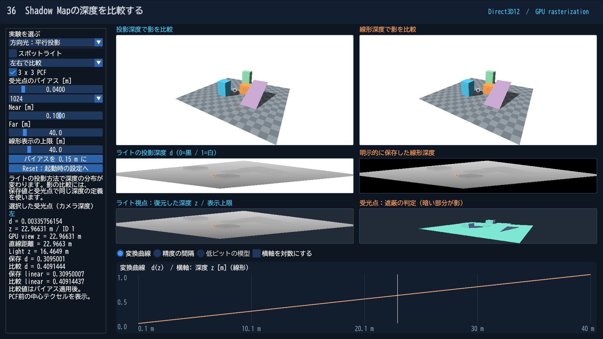

# Direct3D12 第36 Shadow Mapの投影深度と線形深度を比較する

[共通の入門記事](../ShadowDepth.md)で観察の順序と数式を説明しています。このページでは、実行方法とDirect3D12の処理を追います。

## ビルドと起動

Visual Studio 2026／v145、Windows SDK 10.0.26100.0、C++20、x64 Debug／Releaseを使います。初期クライアント領域は1920×1080です。Dear ImGuiは既存のv1.92.9bを使い、日本語フォントはBIZ UDゴシックv1.051を固定Submoduleから配置します。追加のモデル作成ツールは不要です。

~~~powershell
git submodule update --init --recursive
msbuild ShaderjpGraphicsSamples.sln -t:Restore -p:RestorePackagesConfig=true
msbuild Samples\Direct3D12\36_ShadowDepth\Direct3D12_36_ShadowDepth.vcxproj -p:Configuration=Debug -p:Platform=x64
& .\bin\x64\Debug\Direct3D12_36_ShadowDepth\Direct3D12_36_ShadowDepth.exe
~~~

Agility SDK 1.620.1／SDK export 620とDXC 1.9.2609.5をNuGetで復元します。Preview SDKは不要です。

## 操作とプリセット

「方向光：平行投影」「スポットライト：透視投影」「バイアスなし」「解像度256」を切り替えます。上段の左は投影深度で影を比較、右は明示的に保存した線形深度で比較します。保存方式の選択で両側を同じ方式にもできます。

中段はライトの投影深度と線形深度です。下段左は投影深度から復元したライト視点の深度、右はカメラから見たShadow Visibilityです。上段をクリックすると受光点に対応するライト画像上の位置を強調します。数値欄は中心テクセルの比較を示します。必要なら左の欄をスクロールしてください。

PCF、受光点のバイアス、Shadow Map解像度、ライトのNear／Farを変更できます。カメラは固定したD32のReverse-Zです。Resetは起動時の設定へ戻します。

| CLI | 値 |
|---|---|
| --depth-preset | directional / spot / bias / resolution |
| --depth-light | directional / spot |
| --depth-encoding | projected / linear / compare |
| --depth-bias | ライトの視線方向のm単位、0〜1 |
| --depth-resolution | 256 / 1024 / 2048 |
| --depth-pcf | off / on |
| --depth-near / --depth-far | ライトのNear／Far、m単位 |
| --depth-display-far | 線形画像と図の表示上限 |
| --depth-graph | mapping / spacing |

ライトの投影方式は--depth-lightで選びます。D16／D24、無限遠、カメラの平行投影は第36回では使用しません。

~~~powershell
& .\bin\x64\Debug\Direct3D12_36_ShadowDepth\Direct3D12_36_ShadowDepth.exe --depth-preset spot --frames 3 --capture-gpu --screenshot ".\.cache\36_ShadowDepth.png" --log ".\.cache\36_ShadowDepth.log"
~~~

プリセットを先に適用し、個別CLI指定をその後に適用します。--width／--height、--no-ui、--frames、--screenshot、--logも共通の指定として使えます。フォントなどは実行ファイル基準で読み込みます。

## リソースと描画の順序

[Sample.cpp](../../Samples/Direct3D12/36_ShadowDepth/Sample.cpp)に初期化、画像作成、パイプライン、描画、同期、読戻し、終了処理を置いています。CPUの設定・幾何データ・投影計算と日本語UIだけをSharedへ置き、共有レンダリングAPIは作っていません。

D16／D24／D32のリソースは、それぞれR16_TYPELESS／R24G8_TYPELESS／R32_TYPELESSから作り、型付きのDSVとSRVを関連付けます。D24のStencilは使いません。必要な深度描画とShader Loadの対応をCheckFeatureSupport1で確認し、非対応の選択肢は無効にします。別形式への自動置き換えは行いません。

ライト用にD32とR32_FLOATを作ります。比較用カメラは左右別々の深度、RGBA8の色、RGBA32_FLOATの測定データを持ちます。測定データはview z、面のID、Shadow Visibility、有効画素を保持します。

書き込み前にPIXEL_SHADER_RESOURCEからDEPTH_WRITE／RENDER_TARGETへ遷移し、描画後に読み取りへ戻します。シーンは2つのMRT、ライトは線形深度のカラー出力とDSVを使います。表示パスは深度画像をLoadし、6つの領域へ描画します。

Root Signatureはb0のCBVとt0〜t7のSRV Tableです。各パスの320-byte定数を512-byte間隔に置き、CBVの256-byte整列を満たします。GPUのFence完了後に定数・頂点・UIのバッファを更新します。

## HLSLで追うポイント

- [DepthVertex.hlsl](../../Shaders/Depth/DepthVertex.hlsl)：View変換とProjectionを分け、投影から通常Z／Reverse-Zを作ります。
- [DepthPixel.hlsl](../../Shaders/Depth/DepthPixel.hlsl)：色と測定データを出力します。第36回は受光点をライト空間へ移し、同じ定義の深度同士で比較します。
- [ShadowLinear.hlsl](../../Shaders/Depth/ShadowLinear.hlsl)：ライト視点のzをR32_FLOATへ保存します。SV_Depthへの書き込みではありません。
- [DepthDisplay.hlsl](../../Shaders/Depth/DepthDisplay.hlsl)：保存値、復元深度、Shadow Visibilityを表示し、数値検証用の出力も生成します。

SM6.6／HLSL 2021／row-majorで事前コンパイルします。表示を見やすくするための線形化と、実際に前後判定を行う深度バッファは別の処理です。

## 数値の読戻しと検証

--capture-gpuを指定すると、PNGと同じ場所に「画像名-gpu」フォルダを作ります。metadata.jsonに寸法・Near／Far・形式・投影方式などを記録し、standard.bin／reversed.binにRGBA32_FLOATの読戻しを保存します。第36回のファイル名は共通ですが、中身は左右の保存方式の比較です。

1画素はlittle-endian float32の4要素で、深度画像からLoadしたd、別出力のview z、面ID、有効画素です。D16／D24の元のパックされたメモリを直接保存したものではありません。第36回のshadow.binは投影深度、明示的線形深度、予約値、有効画素です。

~~~powershell
.\Tools\ValidateProjects.ps1
.\Tools\TestDepthCpu.ps1
.\Tools\TestDepth.ps1 -Api Direct3D12
.\Tools\TestDepth.ps1 -Api Direct3D12 -Configuration Release
.\Tools\TestDepth.ps1 -Api Direct3D12 -CaptureDocs
.\Tools\TestSamples.ps1 -Apis Direct3D12 -Topics 36_ShadowDepth -CaptureDocs
~~~

PythonのGPU検証は既存と同じNumPyのある環境を使います。既定はBlender同梱Pythonで、-PythonPathで変更できます。Pillowは不要です。

起動、リサイズ、最小化／復帰、撮影、終了と、実ウィジェットの編集／Resetを検証します。初期サイズの指定はSampleDefaultsとMSBuildのSampleClientWidth／SampleClientHeightを揃えています。実測結果は[検証記録](../DepthVerification.md)を参照してください。

別API：[Vulkan版](../Vulkan/36_ShadowDepth.md)。共通記事：[入門解説](../ShadowDepth.md)。
