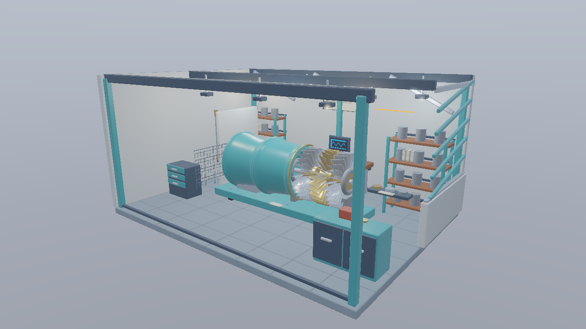
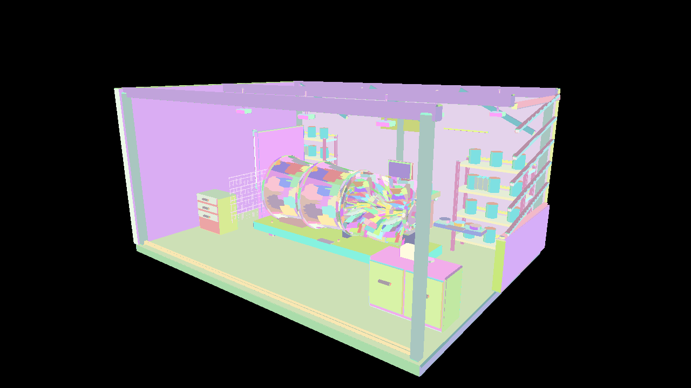

# 発展編05 GPU Driven Rendering — Direct3D12

GPUのCompute Shaderで可視Meshletリストと間接描画引数を作り、CPUへ可視数を読み戻さずMesh Shaderを起動します。GPU Driven Renderingでは、GPUが次のGPU処理の仕事量を決めることを中心に考えます。






```powershell
msbuild Samples\Direct3D12\Advanced05_GpuDrivenRendering\Direct3D12_Advanced05_GpuDrivenRendering.vcxproj -p:Configuration=Debug -p:Platform=x64
bin\x64\Debug\Direct3D12_Advanced05_GpuDrivenRendering\Direct3D12_Advanced05_GpuDrivenRendering.exe
```


## 使用するAPIと事前コンパイル

D3D12はAgility SDK 1.619.6、NuGet DXC 1.9.2609.5、SM6.6を使用します。Mesh Shader Tierを起動時に問い合わせます。Pipeline State StreamにMS／PSを設定し、通常描画は`ID3D12GraphicsCommandList6::DispatchMesh`で起動します。 GPU生成の引数は`D3D12_INDIRECT_ARGUMENT_TYPE_DISPATCH_MESH`を持つCommand Signatureと`ExecuteIndirect`で消費します。UAV書込みからShader／Indirectの読取りへ遷移します。

VS 2026、v145、Windows SDK 10.0.26100.0、C++20、x64 Debug／Releaseを維持します。共通HLSLは`Shaders/MeshShader`にあります。GPUリソース、Pipeline、描画、Barrier、Fence／Semaphore、終了時の解放はこのプロジェクトの`Sample.cpp`で追えます。共有C++はCPUデータとウィジェットです。

## CPU起動からGPUが仕事量を決める構成へ

従来のCPUによるInstanceごとの描画発行では、CPUが対象を決めて個々のDrawを記録します。この回ではシーンのInstanceとMeshletの組を候補としてGPUへ渡します。Computeは境界球の視錐台判定と法線コーン判定を行い、可視な組だけをリストへ登録します。

片面と両面はRasterizer Stateが異なるため、可視リストを2区分にします。OPAQUEとMASKは同じ材質配列から識別し、MASKをPixel Shaderで判定します。BLENDの描画順に依存する透明合成は今回含めません。

```text
Counter初期化 → Compute Culling → 描画引数の確定
→ 片面のIndirect Mesh Draw → 両面のIndirect Mesh Draw
→ HDR・Bloom・表示・UI
```

## 可視リストと間接描画引数

Atomicで取得した位置へInstance IDとMeshlet IDを書きます。別のComputeが確定した件数からX／Y／ZのDispatch数を作ります。Xの幅を256、Yを件数の切上げ、Zを1にし、`group.x + group.y * 256`を仕事番号に戻します。これによりStressでもAPIの1次元Group上限を超えず、最後の行の余りを明示的に扱います。Mesh ShaderはGroup IDを線形の仕事番号へ戻し、可視リストから形状と材質を参照します。端数グループは出力数0、可視数0はDispatchのXを0にします。

容量は候補総数を上限に確保します。CPU読戻しは診断とUI表示に限定し、描画発行の条件には使いません。Compute書込みの後に、可視リストのShader読取りと描画引数のIndirect読取りを可能にする同期を置きます。

直接Mesh経路とVertex経路も選べます。全方式でGGX、Schlick、Smith、Lambert、IBL、HDR、Bloomを揃え、Shadow Mapは使用しません。カリングOFFでもリスト生成を通し、GPU Drivenの管理コストを含めて比較します。


## 操作と比較

全サンプルでWASD移動、Q/E上下移動、Shift加速、右ドラッグ回転、RのカメラResetを使用できます。ImGui操作中やフォーカスを失ったときにはカメラ入力を解放します。初期解像度は1280×720です。 Scene／Preset／Camera／Camera path、Occluder XとResetを継承します。OPAQUE／MASKに対応し、Fullはエラーです。

CLIは`--render-path vertex|mesh|indirect`、`--meshlet-culling off|frustum|frustum-cone`、`--meshlet-view off|meshlets`を使用します。既存の`--no-ui`、`--frames`、`--test-odd`、`--test-camera`、`--screenshot`、`--capture-gpu`も継承します。04はPNGの画像読戻し、05以降はG-buffer／HDR・Meshletリストの診断読戻しを行います。デバッグ用の既知形状は`--mesh-test-scene`で選びます。

## 検証と性能の読み方

`Tools/TestMeshlets.ps1`はCPUで元の全三角形、局所Indexと境界を検証します。`Tools/TestMeshShaders.ps1`は実GPUで各経路、カリング、材質、UI・Resetとリサイズを検証します。`Tools/TestMeshShaderBinaries.ps1`はDXIL／SPIR-Vと配置を照合します。

05以降の性能はRelease、同一のStandard／Stress、固定カメラ経路、UI・VSyncなしで測定します。60フレーム準備後の1200フレームを記録し、管理・判定の追加コストを含むTotalも比較します。カリングで候補が減ることと、全体が速くなることを別々に報告します。AS／Taskの時間はGeometryへ含みます。

## このGPUでの測定

RTX 4070／610.88、Release、1280×720、同じ固定経路1,200フレームです。値はmsの中央値で、CPUは形状処理のコマンド記録だけを測っています。

| Scene | 経路・条件 | GPU Total | CPU記録 |
|---|---|---:|---:|
| Standard | vertex／off | 0.5376 | 0.0334 |
| Standard | mesh／off | 0.5284 | 0.0303 |
| Standard | indirect／off | 0.5612 | 0.0071 |
| Standard | indirect／frustum-cone | 0.4833 | 0.0066 |
| Stress | vertex／off | 2.5385 | 0.2880 |
| Stress | mesh／off | 2.5108 | 0.2521 |
| Stress | indirect／off | 2.1432 | 0.0084 |
| Stress | indirect／frustum-cone | 2.2159 | 0.0081 |

判定の追加コストによってONが遅くなる条件もあります。平均・p95・全パスの生データと比較条件は[検証記録](../MeshShaderVerification.md)を参照してください。

[Meshletとmeshoptimizerの共通章](../Meshlets.md)・[検証記録](../MeshShaderVerification.md)・[発展編目次](../AdvancedGraphicsSamples.md)
