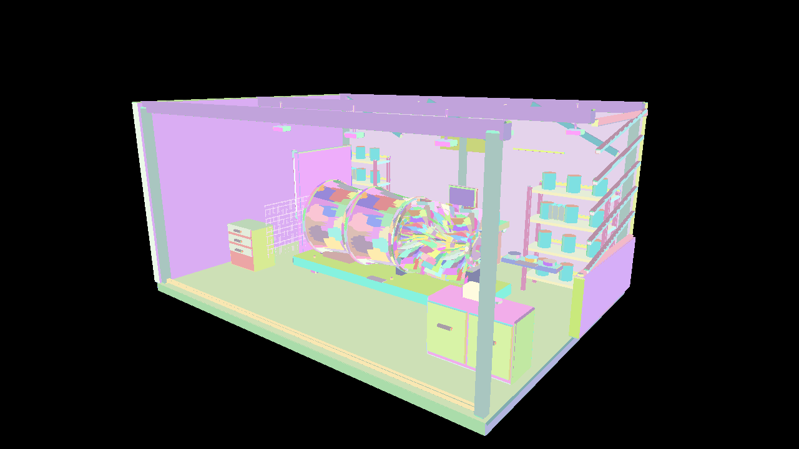

# 発展編06 AS／TaskによるMeshlet Culling — Direct3D12

Amplification Shader／Task Shaderが小さなMeshlet集合を調べ、可視IDをPayloadへ詰めてMesh Shaderを起動します。05と同じ形状・判定・照明を使い、可視性を選ぶ処理の置き場所を比較します。





```powershell
msbuild Samples\Direct3D12\Advanced06_MeshletCulling\Direct3D12_Advanced06_MeshletCulling.vcxproj -p:Configuration=Debug -p:Platform=x64
bin\x64\Debug\Direct3D12_Advanced06_MeshletCulling\Direct3D12_Advanced06_MeshletCulling.exe
```


## 使用するAPIと事前コンパイル

D3D12はAgility SDK 1.619.6、NuGet DXC 1.9.2609.5、SM6.6を使用します。Mesh Shader Tierを起動時に問い合わせます。Pipeline State StreamにMS／PSを設定し、通常描画は`ID3D12GraphicsCommandList6::DispatchMesh`で起動します。 ASを追加したPipelineを用意し、HLSLの`DispatchMesh`からPayloadと子のグループ数を渡します。

VS 2026、v145、Windows SDK 10.0.26100.0、C++20、x64 Debug／Releaseを維持します。共通HLSLは`Shaders/MeshShader`にあります。GPUリソース、Pipeline、描画、Barrier、Fence／Semaphore、終了時の解放はこのプロジェクトの`Sample.cpp`で追えます。共有C++はCPUデータとウィジェットです。

## AS／TaskからMesh Shaderの仕事を作る

CPUはInstanceごとにAS／Taskを起動します。1グループの32スレッドが最大32 Meshletを判定し、可視IDをgroupsharedのPayloadへ詰めます。Group内の初期化・書込みをBarrierで揃え、可視数を指定して子のMesh Shaderを起動します。固定のWave幅を前提にせず、可視数0と端数グループも扱います。

Mesh Shaderの64スレッドは、最大64頂点・96三角形を協調して出力します。Meshlet内の頂点参照と局所Indexを読み、InstanceのWorld行列と逆転置で位置・法線を変換します。材質の参照はInstanceが持つPrimitiveから解決します。

視錐台は境界球、背面は幾何法線のコーンで判定します。両面材質と無効なコーンでは背面の除外を行いません。MASKは描画されたFragmentでAlpha Cutoffを評価します。Hi-Z遮蔽判定とLODは加えません。

## 05と比較する

05はComputeとIndirect Bufferを使い、シーン全体の可視リストを作ります。この回はInstance単位のAS／Taskで局所リストをPayloadへ渡します。CPUからの描画起動は残りますが、子のMesh Shaderを何グループ実行するかはGPUが決めます。

直接Mesh、AS／TaskでカリングOFF、視錐台のみ、視錐台＋コーンを同じ条件で比べます。AS／Taskの処理時間はGeometryパスに含まれます。05のCompute Culling時間と同じ独立した時間区間としては扱いません。


## 操作と比較

全サンプルでWASD移動、Q/E上下移動、Shift加速、右ドラッグ回転、RのカメラResetを使用できます。ImGui操作中やフォーカスを失ったときにはカメラ入力を解放します。初期解像度は1280×720です。 Scene／Preset／Camera／Camera path、Occluder XとResetを継承します。OPAQUE／MASKに対応し、Fullはエラーです。

CLIは`--render-path vertex|mesh|task`、`--meshlet-culling off|frustum|frustum-cone`、`--meshlet-view off|meshlets`を使用します。既存の`--no-ui`、`--frames`、`--test-odd`、`--test-camera`、`--screenshot`、`--capture-gpu`も継承します。04はPNGの画像読戻し、05以降はG-buffer／HDR・Meshletリストの診断読戻しを行います。デバッグ用の既知形状は`--mesh-test-scene`で選びます。

## 検証と性能の読み方

`Tools/TestMeshlets.ps1`はCPUで元の全三角形、局所Indexと境界を検証します。`Tools/TestMeshShaders.ps1`は実GPUで各経路、カリング、材質、UI・Resetとリサイズを検証します。`Tools/TestMeshShaderBinaries.ps1`はDXIL／SPIR-Vと配置を照合します。

05以降の性能はRelease、同一のStandard／Stress、固定カメラ経路、UI・VSyncなしで測定します。60フレーム準備後の1200フレームを記録し、管理・判定の追加コストを含むTotalも比較します。カリングで候補が減ることと、全体が速くなることを別々に報告します。AS／Taskの時間はGeometryへ含みます。

## このGPUでの測定

RTX 4070／610.88、Release、1280×720、同じ固定経路1,200フレームです。値はmsの中央値で、CPUは形状処理のコマンド記録だけを測っています。

| Scene | 経路・条件 | GPU Total | CPU記録 |
|---|---|---:|---:|
| Standard | task／off | 0.5386 | 0.0315 |
| Standard | task／frustum-cone | 0.4997 | 0.0315 |
| Stress | task／off | 2.6542 | 0.2463 |
| Stress | task／frustum-cone | 2.3511 | 0.2468 |

判定の追加コストによってONが遅くなる条件もあります。平均・p95・全パスの生データと比較条件は[検証記録](../MeshShaderVerification.md)を参照してください。

[Meshletとmeshoptimizerの共通章](../Meshlets.md)・[検証記録](../MeshShaderVerification.md)・[発展編目次](../AdvancedGraphicsSamples.md)
