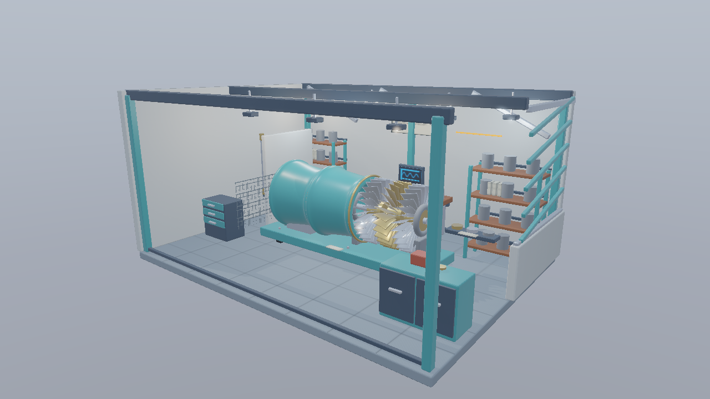
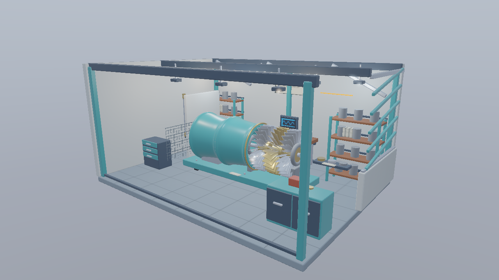

# 発展編07 Mesh ShaderによるShadow Map — Direct3D12

06のAS／Task経路を、方向光のShadow Mapにも適用します。カメラとライトで別の視錐台を使用し、画面外のCasterが作る影も維持します。







```powershell
msbuild Samples\Direct3D12\Advanced07_MeshShaderShadows\Direct3D12_Advanced07_MeshShaderShadows.vcxproj -p:Configuration=Debug -p:Platform=x64
bin\x64\Debug\Direct3D12_Advanced07_MeshShaderShadows\Direct3D12_Advanced07_MeshShaderShadows.exe
```


## 使用するAPIと事前コンパイル

D3D12はAgility SDK 1.619.6、NuGet DXC 1.9.2609.5、SM6.6を使用します。Mesh Shader Tierを起動時に問い合わせます。Pipeline State StreamにMS／PSを設定し、通常描画は`ID3D12GraphicsCommandList6::DispatchMesh`で起動します。 ASを追加したPipelineを用意し、HLSLの`DispatchMesh`からPayloadと子のグループ数を渡します。

VS 2026、v145、Windows SDK 10.0.26100.0、C++20、x64 Debug／Releaseを維持します。共通HLSLは`Shaders/MeshShader`にあります。GPUリソース、Pipeline、描画、Barrier、Fence／Semaphore、終了時の解放はこのプロジェクトの`Sample.cpp`で追えます。共有C++はCPUデータとウィジェットです。

## ライト用の可視性を別に求める

方向光の2048×2048 Shadow MapをDepthのみで描画します。Shadow用のMesh ShaderはWorld位置をLight View Projectionへ変換し、AS／Taskはライトの6面で境界球を判定します。法線コーンもカメラ位置ではなく方向光の方向で判定します。

カメラ用の可視リストをShadowへ流用すると、画面外の物体が作る影が欠落します。今回は、カメラから見えない板が画面内の面へ影を落とす試験を用意し、ShadowパスでそのCasterが残ることを確認します。

OPAQUEはDepthを記録し、MASKはAlbedoのAlpha×Base Color Factorと同じCutoffでFragmentを破棄します。両面材質を維持します。Forwardの照明では従来と同じBias、Hard／3×3 PCFを使用します。点光源のShadow Map、CSMやレイトレーシングによる影は追加しません。

## 描画から照明へ同期する

ShadowのDepth書込みを完了させ、ShaderのDepth読取りへ遷移してからPBR照明を行います。Shadowの可視数とMainの可視数は別に記録します。カメラ移動でMainの可視性が変わっても、ライトの条件を不用意に変更しません。


## 操作と比較

全サンプルでWASD移動、Q/E上下移動、Shift加速、右ドラッグ回転、RのカメラResetを使用できます。ImGui操作中やフォーカスを失ったときにはカメラ入力を解放します。初期解像度は1280×720です。 Scene／Preset／Camera／Camera path、Occluder XとResetを継承します。OPAQUE／MASKに対応し、Fullはエラーです。

CLIは`--render-path vertex|mesh|task`、`--meshlet-culling off|frustum|frustum-cone`、`--meshlet-view off|meshlets`を使用します。既存の`--no-ui`、`--frames`、`--test-odd`、`--test-camera`、`--screenshot`、`--capture-gpu`も継承します。04はPNGの画像読戻し、05以降はG-buffer／HDR・Meshletリストの診断読戻しを行います。デバッグ用の既知形状は`--mesh-test-scene`で選びます。

## 検証と性能の読み方

`Tools/TestMeshlets.ps1`はCPUで元の全三角形、局所Indexと境界を検証します。`Tools/TestMeshShaders.ps1`は実GPUで各経路、カリング、材質、UI・Resetとリサイズを検証します。`Tools/TestMeshShaderBinaries.ps1`はDXIL／SPIR-Vと配置を照合します。

05以降の性能はRelease、同一のStandard／Stress、固定カメラ経路、UI・VSyncなしで測定します。60フレーム準備後の1200フレームを記録し、管理・判定の追加コストを含むTotalも比較します。カリングで候補が減ることと、全体が速くなることを別々に報告します。AS／Taskの時間はGeometryへ含みます。

## このGPUでの測定

RTX 4070／610.88、Release、1280×720、同じ固定経路1,200フレームです。値はmsの中央値で、CPUは形状処理のコマンド記録だけを測っています。

| Scene | 経路・条件 | GPU Total | CPU記録 |
|---|---|---:|---:|
| Standard | task／off | 0.7240 | 0.0597 |
| Standard | task／frustum-cone | 0.6666 | 0.0596 |
| Stress | task／off | 3.0484 | 0.5063 |
| Stress | task／frustum-cone | 2.9420 | 0.4989 |

判定の追加コストによってONが遅くなる条件もあります。平均・p95・全パスの生データと比較条件は[検証記録](../MeshShaderVerification.md)を参照してください。

[Meshletとmeshoptimizerの共通章](../Meshlets.md)・[検証記録](../MeshShaderVerification.md)・[発展編目次](../AdvancedGraphicsSamples.md)
