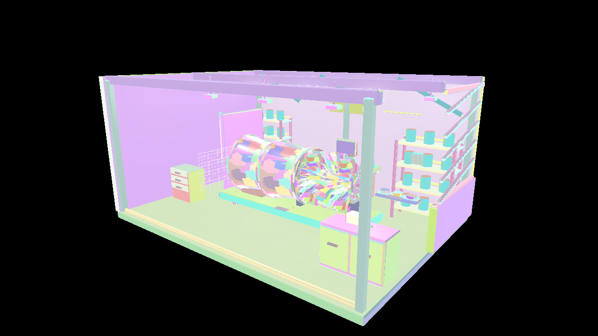
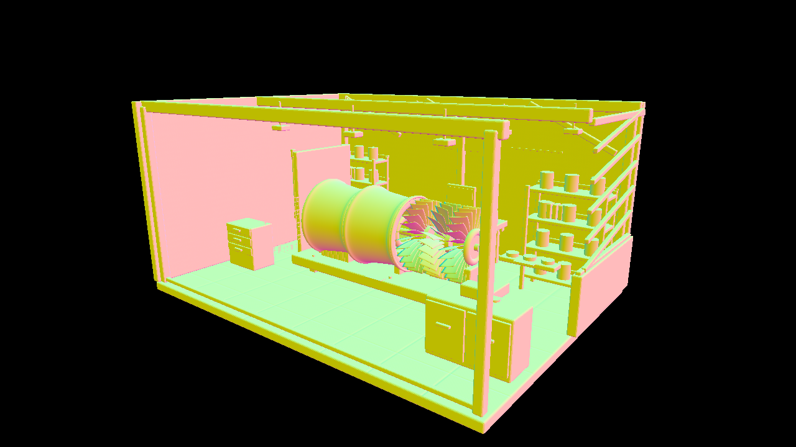

# 発展編08 Mesh ShaderによるDeferred Rendering — Direct3D12

Mesh ShaderでG-bufferを描画し、既存のComputeによるDeferred Lightingへ接続します。形状をGPUで選別する処理と、可視表面へ照明する処理を分けて観察します。







```powershell
msbuild Samples\Direct3D12\Advanced08_MeshShaderDeferred\Direct3D12_Advanced08_MeshShaderDeferred.vcxproj -p:Configuration=Debug -p:Platform=x64
bin\x64\Debug\Direct3D12_Advanced08_MeshShaderDeferred\Direct3D12_Advanced08_MeshShaderDeferred.exe
```


## 使用するAPIと事前コンパイル

D3D12はAgility SDK 1.620.1、NuGet DXC 1.9.2609.5、SM6.6を使用します。Mesh Shader Tierを起動時に問い合わせます。Pipeline State StreamにMS／PSを設定し、通常描画は`ID3D12GraphicsCommandList6::DispatchMesh`で起動します。 ASを追加したPipelineを用意し、HLSLの`DispatchMesh`からPayloadと子のグループ数を渡します。

VS 2026、v145、Windows SDK 10.0.26100.0、C++20、x64 Debug／Releaseを維持します。共通HLSLは`Shaders/MeshShader`にあります。GPUリソース、Pipeline、描画、Barrier、Fence／Semaphore、終了時の解放はこのプロジェクトの`Sample.cpp`で追えます。共有C++はCPUデータとウィジェットです。

## Mesh ShaderからG-bufferへ

Mesh Shaderが出力したUV、World法線、接線と材質IDをPixel Shaderへ渡します。Pixel ShaderはNormal／ORM／Emissiveを接続し、従来と同じG-bufferを記録します。

| 画像 | 保存する値 |
|---|---|
| Base Color＋AO | sRGB RGBと線形AO |
| Normal | Octahedral法線、RG16 SNORM |
| Metallic＋Roughness | RG8 UNORM |
| Emissive | R11G11B10 FLOAT |
| Depth | D32 |

合計18 B／画素です。位置用のRender Targetは追加せず、Depthと逆View ProjectionからWorld位置を再構築します。

```text
Mesh Shadow → Mesh G-buffer → Compute Lighting
→ Sky → Bloom → 露出・Reinhard・sRGB → UI
```

Geometryの可視性とDeferred Lightingを別に保つことで、Mesh Shaderの置換と照明の結果を別々に検証できます。Vertex referenceは同じPixel ShaderでG-bufferを作ります。MASK、両面材質、Shadow、IBLとHDRを継承し、透明合成は対象外です。


## 操作と比較

全サンプルでWASD移動、Q/E上下移動、Shift加速、右ドラッグ回転、RのカメラResetを使用できます。ImGui操作中やフォーカスを失ったときにはカメラ入力を解放します。初期解像度は1280×720です。 Scene／Preset／Camera／Camera path、Occluder XとResetを継承します。OPAQUE／MASKに対応し、Fullはエラーです。

CLIは`--render-path vertex|mesh|task`、`--meshlet-culling off|frustum|frustum-cone`、`--meshlet-view off|meshlets`を使用します。既存の`--no-ui`、`--frames`、`--test-odd`、`--test-camera`、`--screenshot`、`--capture-gpu`も継承します。04はPNGの画像読戻し、05以降はG-buffer／HDR・Meshletリストの診断読戻しを行います。デバッグ用の既知形状は`--mesh-test-scene`で選びます。

## 検証と性能の読み方

`Tools/TestMeshlets.ps1`はCPUで元の全三角形、局所Indexと境界を検証します。`Tools/TestMeshShaders.ps1`は実GPUで各経路、カリング、材質、UI・Resetとリサイズを検証します。`Tools/TestMeshShaderBinaries.ps1`はDXIL／SPIR-Vと配置を照合します。

05以降の性能はRelease、同一のStandard／Stress、固定カメラ経路、UI・VSyncなしで測定します。60フレーム準備後の1200フレームを記録し、管理・判定の追加コストを含むTotalも比較します。カリングで候補が減ることと、全体が速くなることを別々に報告します。AS／Taskの時間はGeometryへ含みます。

## このGPUでの測定

RTX 4070／610.88、Release、1280×720、同じ固定経路1,200フレームです。値はmsの中央値で、CPUは形状処理のコマンド記録だけを測っています。

| Scene | 経路・条件 | GPU Total | CPU記録 |
|---|---|---:|---:|
| Standard | task／off | 0.5806 | 0.0600 |
| Standard | task／frustum-cone | 0.5530 | 0.0600 |
| Stress | task／off | 1.7203 | 0.4910 |
| Stress | task／frustum-cone | 1.5555 | 0.4905 |

判定の追加コストによってONが遅くなる条件もあります。平均・p95・全パスの生データと比較条件は[検証記録](../MeshShaderVerification.md)を参照してください。

[Meshletとmeshoptimizerの共通章](../Meshlets.md)・[検証記録](../MeshShaderVerification.md)・[発展編目次](../AdvancedGraphicsSamples.md)
