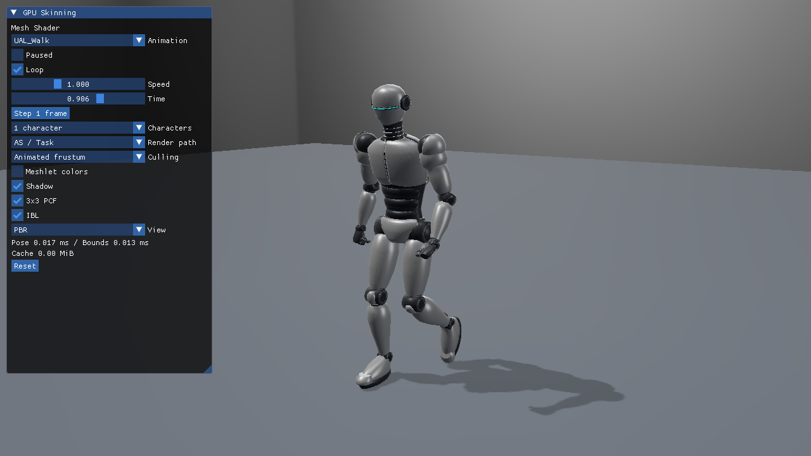
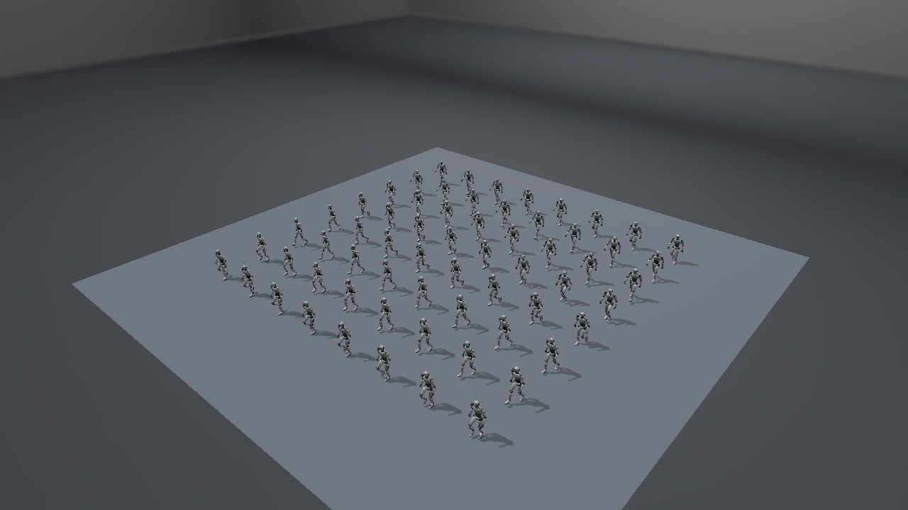
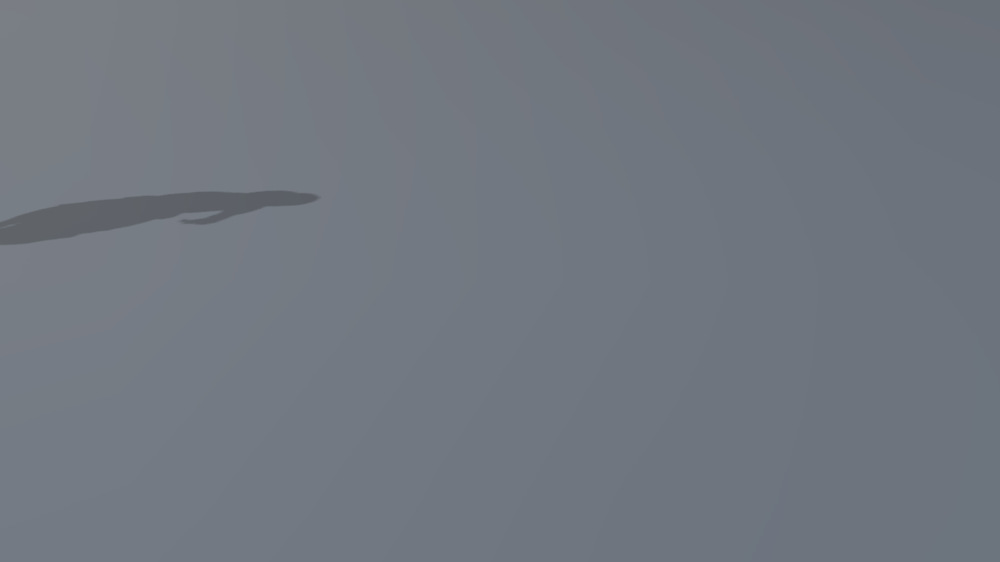
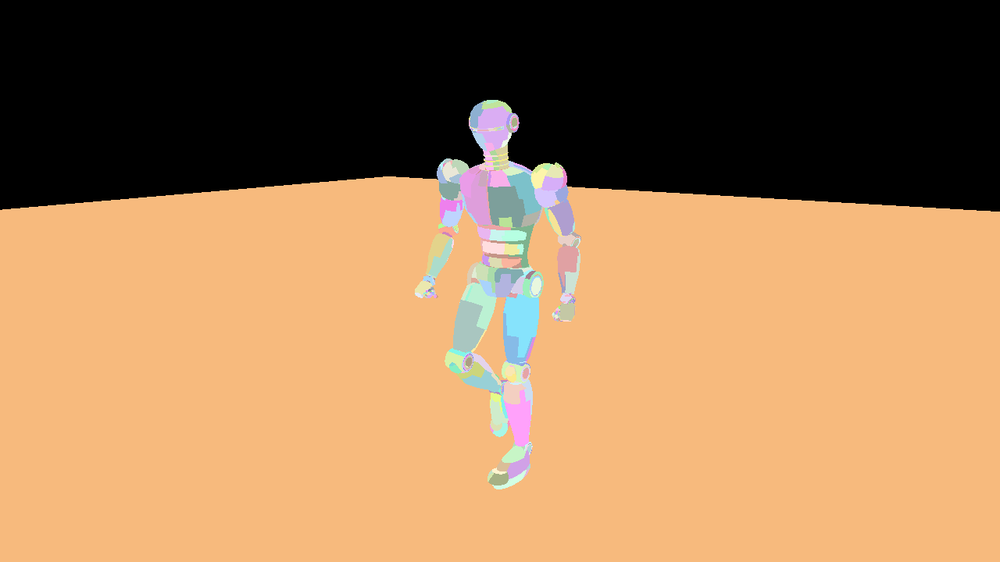

# Direct3D12 発展10：Mesh ShaderでスキニングとShadowを描画

Mesh ShaderでスキニングとShadowを描画し、動くロボットのShadowとPBR Colorを描画します。前提は[glTFスキニング対応ローダー](../GltfSkinningLoading.md)と[GPUスキニング共通章](../GpuSkinning.md)です。実装は[Sample.cpp](../../Samples/Direct3D12/Advanced10_MeshShaderSkinning/Sample.cpp)にあり、初期化・Buffer作成・転送・描画・同期・終了処理をこのプロジェクト内で追えます。



## 実行動画

プレビュー画像をクリックするとMP4を開きます。

**UAL_Walk／1体**：Mesh Shaderによる1体の歩行です。AS／TaskとAnimated frustumを有効にし、関節の動きとShadowを確認できます。

[](../Assets/Videos/Direct3D12_Advanced10_MeshShaderSkinning_Walk.mp4)

**UAL_Run／64体**：AS／TaskとAnimated frustumを有効にした64体のJogです。位相をずらした独立姿勢と、それぞれに追従するShadowを確認できます。

[](../Assets/Videos/Direct3D12_Advanced10_MeshShaderSkinning_Run64.mp4)

録画は2026-10-15、1280×720です。Root motionはOFF、速度1です。[全8本の動画一覧と元ファイルの記録](../Assets/Videos/README.md)も参照できます。

## 共通アセットと操作

[SilverRobotAnimated.blendと配布glTF](../Assets/SilverRobotAnimated.md)を使用します。53ボーン、31,138頂点、44,584三角形、5つの定数PBR材質です。1体では53行列、64体ではそれぞれの位相に合わせた53×64行列をCPUで評価します。元形状とIndexは共有します。

初期値はUAL_Walk／速度1／1体／Root motion OFF。ImGuiで6クリップ、Paused、Loop、Root motion、速度、Time、1フレーム送り、Reset、1／64体、Shadow、Hard／3×3 PCF、IBL、診断表示を切り替えられます。JumpStart／JumpLandは終端保持、その他はループが初期値です。カメラはWASD／Q・E／右ドラッグ／Shift／Rを継承します。

```powershell
& .\bin\x64\Debug\Direct3D12_Advanced10_MeshShaderSkinning\Direct3D12_Advanced10_MeshShaderSkinning.exe `
  --animation UAL_Walk --animation-time 0.3 --pause-animation --characters 1
```

`--animation-speed`、`--characters 64`、`--post-view weights`、`--camera OffscreenCaster`、`--hard-shadow`、`--no-shadow`も使えます。全3方式に同じ引数を与えれば、同じ姿勢と光で比較できます。

`Root motion`をONにするとWalk／Runが前進し、OFFとResetでは元の配置へ戻ります。現在の素材はその場モーションなので、支持足の動きから進行量を復元しています。ループで位置を巻き戻さず、Pause／速度／Seek／1フレーム送りも移動へ反映します。CLIは`--root-motion on|off`、省略時はOFFです。[復元方法と移動・Shadowの扱い](../GpuSkinning.md#root-motionを切り替える)

## Direct3D12の初期化と入力

VS 2026／v145／Windows SDK 10.0.26100.0、Agility SDK 1.619.6、NuGet DXC 1.9.2609.5、SM6.6／HLSL 2021を使います。基本22／23はMesh Shader Tierを要求しません。発展10はMesh Shader Tier 1が必要です。

`CreateDevice`で機能を確認し、`CreateResources`／`CreateMeshResources`／`CreateSkinResources`でアセットとBuffer、`CreateMeshPipelines`でPSOを作ります。Root Signatureに新しいSRV tableとUAV tableを追加し、Descriptor Heapにウェイト、palette、動的境界、キャッシュを配置します。

| データ | HLSL register | Stride |
|---|---|---|
| JOINTS＋WEIGHTS | t96 | 32 byte |
| row-major palette | t97 | 64 byte |
| 動的Meshlet Sphere | t98 | 16 byte |
| 変形済み頂点UAV | u7 | 48 byte |

元頂点、Index、Primitive、Instanceの既存Meshデータと同じDescriptor Heapへ置きます。Texture／IBL／Shadowのregisterは既存規約を保ちます。paletteと境界のUpload heapはGPU完了待ちの後に更新します。

## この方式の描画と同期

元のMeshlet作成は既存のmeshoptimizerを再利用します。`MeshGeometry.hlsl`と`MeshShadow.hlsl`はMeshletのローカル頂点から元頂点へたどり、`SkinVertexAt`で現在の姿勢を直接出力します。ColorはPBRの属性を、Shadowはライトのクリップ座標を使います。

`DispatchMesh`を直接行う`Mesh direct`と、`MeshTask.hlsl`をASとして使う`AS / Task`を切り替えられます。ASは候補32個ずつを調べ、動的Sphereが視錐台へ入る候補だけをPayloadに詰めてMSを起動します。VS referenceは基本22と同じ変形を使う比較経路です。

```text
CPU: pose → palette → bone別影響AABBを変形・合成 → Sphere Upload
Shadow AS: light frustum → MS: skin → light depth
Color  AS: camera frustum → MS: skin → PBR HDR
```

カメラの可視判定の結果をShadowへ使い回しません。Light FrameとCamera FrameのRoot CBVを切り替え、それぞれのASが同じ動的Sphereを別の視錐台で判定します。静的normal coneは使いません。保守境界を作る理由と証明は[共通GPU解説](../GpuSkinning.md#動くメッシュの保守境界)で説明しています。

MSはShadowとColorで再び頂点を変形します。Meshletの頂点再利用はMeshlet内に限定され、パス間の変形キャッシュはありません。基本23との比較ではGPU時間に加え、CPU境界更新とメモリ使用量も見ます。

## 直接描画とカリングを再現する

```powershell
--render-path mesh --meshlet-culling off
--render-path task --meshlet-culling frustum
```

UIのRender path／Culling／Meshlet colorsでも切り替えられます。`frustum-cone`は動的なコーンを構築していないため拒否します。カリングOFFでも同じ姿勢、材質、Shadowを描画します。





## Shadow、PBR、HDR表示

静的床、方向光、2048×2048のD32 Shadow、Hard／3×3 PCF、StudioのIrradiance／Specular IBL、BRDF LUTを基本22／23／発展10で揃えます。PBRは定数Base Color／Metallic／Roughness／Emissiveを使い、ColorをHDRへ出してから表示変換します。モデルにUVやTextureがなくても法線と材質を評価できます。

`--post-view normal`で変形後の法線、`depth`でカメラ深度、`shadow`でライト深度、`weights`で4成分のウェイトを確認できます。表示用のポスト処理の前の線形HDRも`--capture-gpu`で読戻せます。3方式の比較はPNGの見た目だけでなく、このDepth・Shadow・HDRとComputeの実頂点を対象にします。

Meshlet単位の色分けでMSへ渡す仕事の分割を確認できます。



## 検証と測定

```powershell
.\Tools\TestSkinningCpu.ps1
.\Tools\TestSkinning.ps1 -Configuration Debug -Api Direct3D12
.\Tools\TestSkinning.ps1 -Configuration Release -Api Direct3D12
.\Tools\MeasureSkinning.ps1 -Api Direct3D12
```

全クリップのCPU参照、1体／64体、Shadow ON/OFF、カリングON/OFF、画面外Caster、リサイズ・最小化／復帰、Seek／Reset、ループ／終端、再生速度を検証します。DebugのGraphics Validationエラーは0件です。Shader欠落時の診断と終了処理も試験します。具体的な誤差・環境・ReleaseのCPU/GPU時間は[検証記録](../SkinningVerification.md)へまとめています。

実行ローダーの対象はglTF JSON＋外部BIN、4インフルエンス、TRS LINEAR／STEPです。Morph、CUBICSPLINE、追加ウェイトセット、任意のTexture材質は対象外として診断します。モデル・モーションのライセンスは[アセット記事](../Assets/SilverRobotAnimated.md#採用素材とライセンス)を参照してください。

次は[3方式の比較と性能計測](../SkinningVerification.md)へ進みます。
