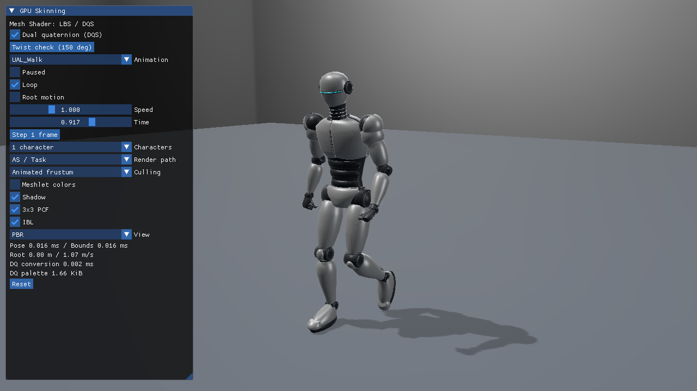
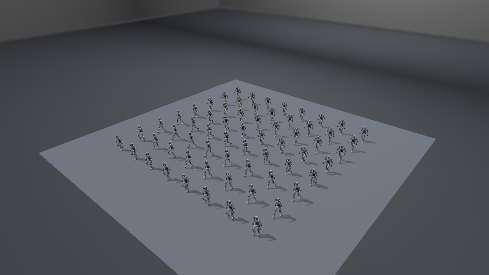

# 発展11. Direct3D12でDQSをMesh Shader内で実行する

同じロボットをMS内でDQS変形し、ShadowとPBR Colorを描きます。直接MSとAS／Taskによる可視判定を切り替え、[基本24 Vertex](24_DualQuaternionSkinning.md)と[基本25 Compute Cache](25_DualQuaternionComputeCache.md)を比較対象にします。[共通DQS](../DualQuaternionSkinning.md)、[DQS境界の導出](../DualQuaternionStages.md#mesh版のdqs境界)、[検証・実測](../DualQuaternionStagesVerification.md)を先に参照できます。



## APIの初期化とリソース

[Sample.cpp](../../Samples/Direct3D12/Advanced11_DualQuaternionMeshSkinning/Sample.cpp)がGPU初期化、Buffer作成、Pipeline、描画、同期、終了処理を担当します。VS 2026／v145／SDK 10.0.26100.0、C++20、SM6.6／HLSL 2021です。D3D12 Options7のMesh Shader Tierを検査し、ID3D12GraphicsCommandList6のDispatchMeshを使います。Root Signatureは既存SRV Tableを4要素へ広げ、t99に可視判定用球を追加します。Descriptor Heapも1要素増やし、UAV Tableの先頭を対応させます。

| 入力 | register／Vulkan binding | 内容 |
|---|---|---|
| ウェイト | t96／38 | JOINTS＋WEIGHTS |
| LBS palette | t97／39 | 行列64 byte |
| DQ palette | t98／40 | float4×2、32 byte |
| 検査用UAV | u7／41 | 通常の描画では使わない |
| 可視判定用球 | t99／42 | Actor×Meshlet、float4 |

元Vertex、Index、Meshlet構造、Materialは共有です。meshoptimizerで最大64頂点／96三角形のMeshletを作り、Actorごとにpaletteと球の先頭を渡します。

## MSとAS／TaskのHLSL

[MeshletMesh.hlsl](../../Shaders/Skinning/MeshletMesh.hlsl)はgroupごとにMeshletを読み、出力数を設定します。各頂点が`TransformMeshVertex`→`SkinVertexAt`を通り、DQSの符号合わせ・正規化・位置／法線／接線の変形を実行します。Colorはcamera VP、Shadowはlight VPを選びます。Pixel側はPBR／IBLまたはShadow depthです。

`CreateMeshPipeline`がShadowとPBR Colorに対し、直接MSとAS＋MSのPSOを作ります。`BindMesh`はb2のRoot constantへActor、Meshlet先頭、pass、DQSのmode bitを設定します。直接描画は`DispatchMesh`でMeshlet数だけ起動し、AS使用時は32候補ごとのgroupを起動します。

[MeshletTask.hlsl](../../Shaders/Skinning/MeshletTask.hlsl)は候補32個を`VisibleMeshlet`で判定し、可視IDをgroupshared payloadへ詰め、可視数だけMesh Shaderを起動します。直接MSはこの可視判定を省きます。

## DQSを包む球とライトの可視性

LBS用の影響頂点AABBはDQSへ流用しません。[DualQuaternionSkinningBounds.h](../../Samples/Shared/DualQuaternionSkinningBounds.h)で、バインド球とジョイントで変形した中心から`r + K D`の球を作ります。2インフルエンスは`K=sqrt(2)`、3／4は`K=N`でDQの正規化を考慮します。CPUで全頂点を変形する方法は使いません。LBS選択時は従来の影響頂点AABBへ戻します。

球はメッシュローカル空間にあり、Instance Worldへ変換してFrustumに照合します。CameraとLightのFrame／6平面を別々に使います。カメラ外のCasterをライト側から除外しないため、その影が画面内の床に残ります。静的Normal ConeはDQS／LBSとも無効です。Root motionはWorldとライト範囲へ適用します。

行列、DQ、球のUpload heapを前フレームのFence完了後にMapして更新します。MS／ASのSRV読取りは同じGraphics Queueへ記録します。通常描画にCSキャッシュやUAV書込みはありません。

`--capture-gpu`だけは共有変形関数を検査用CSから実行して読戻します。これはMS出力を直接取得したものではありません。実際のMesh描画はVertex／ComputeとのDepth・Shadow・HDR、カリングON／OFF、画面外Casterでも照合します。検査用dispatchはベンチマークで無効です。

## 操作と再現

```powershell
& .\bin\x64\Debug\Direct3D12_Advanced11_DualQuaternionMeshSkinning\Direct3D12_Advanced11_DualQuaternionMeshSkinning.exe `
  --skinning dqs --characters 64 --render-path task --meshlet-culling frustum
```

初期値はDQS／Walk／AS・Task／Animated frustum／1体／Root motion OFFです。ImGuiでVertex reference／Mesh direct／AS・Task、Culling、Meshlet色を切り替えます。`--render-path vertex|mesh|task`、`--meshlet-culling off|frustum`で同じ条件を固定できます。LBS／DQS、150度ねじり、6クリップとA／Tポーズ、再生・Root motion・1／64体の操作も共通です。


