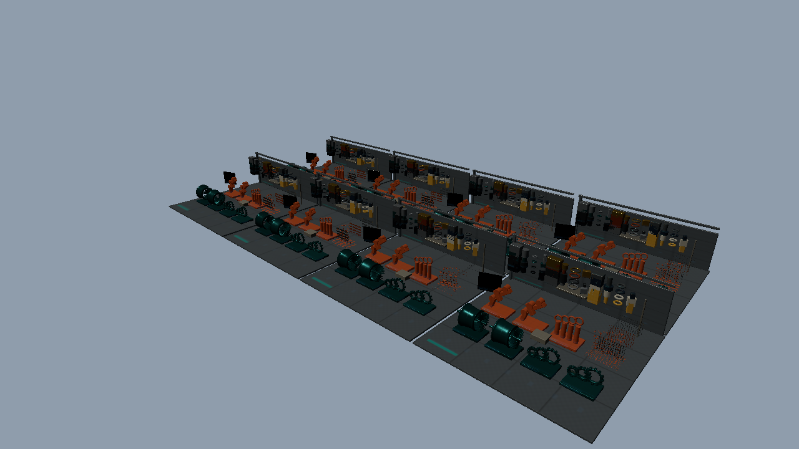

# 発展12：材質ごとのバインドから画像インデックスへ（Direct3D12）

BindlessGalleryの同じSceneを使い、リソースの取得方法を切り替える独立プロジェクトです。[共通章](../BindlessGraphics.md) → [アセット制作](../Assets/BindlessGallery.md) → このサンプルの順に確認します。



## 比較する処理

`bound`は材質順の同じInstanceリストを描き、材質が変わると4用途の固定Textureスロットを切り替えます。`textures`は同じDrawIndexedを実行し、Materialの画像IDをDescriptorインデックスにします。形状のIndex Buffer、描画順、描画回数、Sampler、照明を変えません。

基本08のMaterial定数とTextureバインドを、`BindlessData.h`の`GalleryMaterial`と`Scene.hlsli`の`SampleImage`へ対応させて読むと、CPUの選択がシェーダへ移る部分を追えます。基本21の64枠もバインドレスの一形態です。このサンプルのStandardは208画像を使用します。

## API側で読む場所

D3D12はBinding Tier 3とSM6.6を確認し、`ResourceDescriptorHeap`からTexture2D／ByteAddressBuffer／RWTexture2Dを取得します。非一様なIDには`NonUniformResourceIndex`を付けます。Root Signatureの直接参照フラグとHeap先頭からのインデックスを`CreatePipeline`と`UpdateDescriptors`で確認できます。

[Sample.cpp](../../Samples/Direct3D12/Advanced12_BindlessMaterials/Sample.cpp)に初期化・画像転送・Descriptor作成・描画・待機・解放を残しています。[共有CPUデータ](../../Samples/Shared/BindlessData.h)はAPIを操作しません。[共通HLSL](../../Shaders/Bindless/Scene.hlsli)のGetGeometry／GetMaterial／GetInstance／SampleImageから呼出側を追ってください。

固定のフレーム定数はb0／binding 0、画像はt0／binding 1、Samplerはs0／binding 2、すべてset 0です。追加のBuffer・UAV・G-buffer・ASには別のbindingを割り当てています。行列はrow-major、左手系、深度0..1、Vulkanは負の高さのViewportを使います。

## 実行と観察

```powershell
.\bin\x64\Release\Direct3D12_Advanced12_BindlessMaterials\Direct3D12_Advanced12_BindlessMaterials.exe --gallery-preset Mini --materials 64 --binding bound
.\bin\x64\Release\Direct3D12_Advanced12_BindlessMaterials\Direct3D12_Advanced12_BindlessMaterials.exe --gallery-preset Mini --materials 64 --binding textures
```

UIからBinding、Objects、Materials、Camera、診断表示、Resetを操作できます。配置数と使用材質数は独立です。共通CLIの`--gallery-view material|geometry|uv`でIDと既知UVを確認します。変更による再構築・解放はGPU完了後です。Samplerと全Descriptorは事前作成し、フレームごとのDescriptor更新を行いません。

[既存08_PBR](./08_PBR.md)、[既存21_VisibilityBuffer](./21_VisibilityBuffer.md)の処理と比較できます。照明は共有の直接光と環境近似を使います。Cycles参考画像は画作り用であり、正当性は同じ描画経路のモード間で検証します。

## 検証と測定

`Tools/TestBindless.ps1`は64枚を超える画像を使い、HDRと表面情報を浮動小数点で比較します。`Tools/TestBindlessFeatures.ps1`は診断表示、GPU Drivenの空／全可視／端数、UI入力／Reset、入力エラーを検査します。`Tools/TestSamples.ps1`はリサイズ、最小化・1280×720復帰、終了を確認します。

[検証記録と比較表](../BindlessVerification.md)、[測定データ](../BindlessPerformance.json)を併記します。Release・60フレームのウォームアップ・固定経路1,200フレーム・5反復を使います。GPU Drivenの描画集約と参照方式の差を区別し、GPUやシーンにより小差・逆転も起こることを確認してください。

掲載した性能値は固定ランタイムによる46条件×5反復の再測定結果です。初回参考値は別途保存しています。
