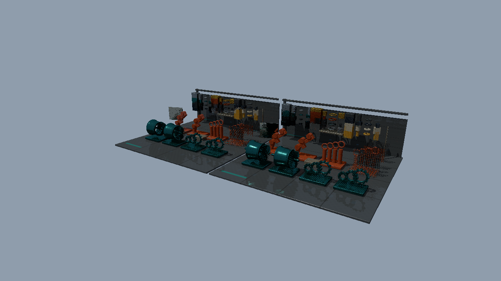

# Bindless・Mesh Shader・RayQueryを接続する（Direct3D12）

発展15 BindlessHybridから進む独立した実行プロジェクトです。[共通解説](../InlineRaytracing.md)／[検証記録](../InlineRaytracingVerification.md)も確認してください。

## 実装と観察

発展15と同じBindlessGallery、Mesh ShaderのG-buffer、Geometry／Material／Instance、BLAS／TLASを使用します。Ray Generationで行っていた影・反射・照明をCompute Shaderへ移し、RayQueryで交差判定を行います。

<code>--binding bound|textures|resources</code>、<code>--gpu-driven</code>、影／反射の無効化と材質・形状・UV診断を継承します。照明式、反射合成、Sampler、原点オフセット、TMin／TMaxを発展15と揃えます。基本27の鏡面IBL置換とは別の既存15の仕様です。

固定カメラ、同じBinding／配置数／材質数／GPU Driven設定で15と16を比較し、次にバインド方式だけ、GPU Drivenだけを変えてください。RayQueryの性能はGPUとシーンに依存します。

## 同じ条件での比較

記事画像はMini・128配置・64材質・textures・GPU Driven OFFです。下の発展15の画像も同じ条件で描いています。性能測定では両者をStandard・512配置・64材質へ揃えます。

## APIと実行

DXR Tier 1.1以上を確認し、Compute PipelineとDispatchからRayQueryを実行します。RT State ObjectやShader Tableは作りません。

VS 2026／v145、Windows SDK 10.0.26100.0、C++20、SM6.6／HLSL 2021、x64 Debug／Releaseを使用します。発展16はMesh ShaderとBindless、発展17はMesh／Task Shaderも必要です。初期1280×720、OPAQUE／MASK対応です。FullのBLENDはエラーになります。

    msbuild Samples\Direct3D12\Advanced16_BindlessInlineHybrid\Direct3D12_Advanced16_BindlessInlineHybrid.vcxproj -p:Configuration=Debug -p:Platform=x64
    .\bin\x64\Debug\Direct3D12_Advanced16_BindlessInlineHybrid\Direct3D12_Advanced16_BindlessInlineHybrid.exe

[Sample.cpp](../../Samples/Direct3D12/Advanced16_BindlessInlineHybrid/Sample.cpp)に初期化、リソース作成、AS構築、描画、同期、解放があります。WASD／Q/E／右ドラッグ／Shift／Rのカメラ操作とImGui入力抑制を継承します。

## 検証

Tools/TestInlineRaytracing.ps1を両構成で実行します。MASK、反射、点光源の距離制限、既存サンプルとのHDR比較、UI／Reset、奇数サイズを検証します。Tools/TestInlineRaytracingShaders.ps1はDXIL／SPIR-VとRayQuery機能宣言を検査します。resize／最小化復帰／終了はTools/TestSamples.ps1、性能はReleaseの-BenchmarkOnlyで測定します。
