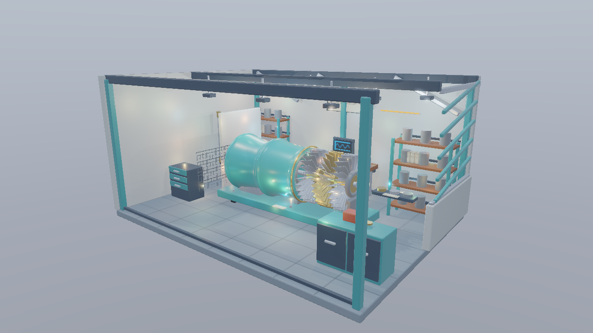
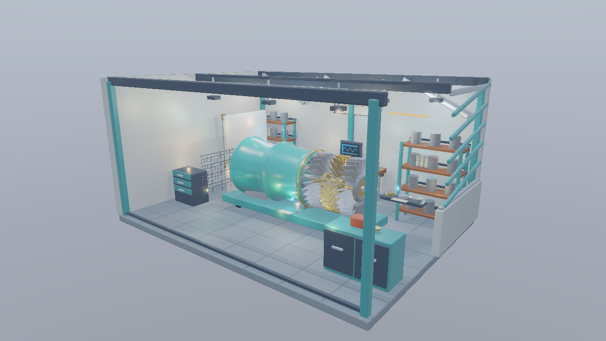

# Tiled Deferredの多数光源へレイによる影を加える（Direct3D12）

発展09 MeshShaderTiledDeferredから進む独立した実行プロジェクトです。[共通解説](../InlineRaytracing.md)／[検証記録](../InlineRaytracingVerification.md)も確認してください。

## 実装と観察

発展09のWorkshop、Meshlet Culling、G-buffer、16×16画素のTiled Deferredを継承します。<code>--light-culling all|tile</code>（既定tile）で全ライト評価と候補リストを比較します。

<code>--shadow-point-lights N|all</code>で影付き点光源数を変更します。既定8灯、0なら点光源の影なし、allなら全灯です。安定したグローバルLight ID順の先頭N灯を対象とし、タイル内の並び順では選びません。対象外のライトも照明に寄与します。

距離減衰が0、または面の裏側のライトへのレイは発射しません。TMaxは光源までで、光源より先の物体は影を作りません。リスト容量超過では全ライト評価へ戻します。

<code>--shading ray-count</code>は影レイ数の診断です。赤は32本、緑は128本を1とし、太陽のレイも含みます。通常表示・性能測定ではカウントを無効化します。All lights／Tiledで同じ寄与判定を使うと有効な影レイ数は基本的に同じで、候補探索の負荷が変わります。影付き灯数の比較と分けて測定します。

## 影付き灯数と探索方式の比較

| 全ライト評価・影付き8灯 | Tiled・全灯に影 |
|---|---|
|  |  |

全ライト評価・8灯の画像は、上のTiled・8灯と同じ結果になります。[Shadow Map・点光源の影0灯](Images/Advanced17_MeshShaderTiledInlineShadows-many-map0.png)は発展09との比較条件です。光源の選択と照明への寄与を変えず、探索方式だけを比較します。

## APIと実行

DXR Tier 1.1以上を確認し、Compute PipelineとDispatchからRayQueryを実行します。RT State ObjectやShader Tableは作りません。

VS 2026／v145、Windows SDK 10.0.26100.0、C++20、SM6.6／HLSL 2021、x64 Debug／Releaseを使用します。発展16はMesh ShaderとBindless、発展17はMesh／Task Shaderも必要です。初期1280×720、OPAQUE／MASK対応です。FullのBLENDはエラーになります。

    msbuild Samples\Direct3D12\Advanced17_MeshShaderTiledInlineShadows\Direct3D12_Advanced17_MeshShaderTiledInlineShadows.vcxproj -p:Configuration=Debug -p:Platform=x64
    .\bin\x64\Debug\Direct3D12_Advanced17_MeshShaderTiledInlineShadows\Direct3D12_Advanced17_MeshShaderTiledInlineShadows.exe

[Sample.cpp](../../Samples/Direct3D12/Advanced17_MeshShaderTiledInlineShadows/Sample.cpp)に初期化、リソース作成、AS構築、描画、同期、解放があります。WASD／Q/E／右ドラッグ／Shift／Rのカメラ操作とImGui入力抑制を継承します。

## 検証

Tools/TestInlineRaytracing.ps1を両構成で実行します。MASK、反射、点光源の距離制限、既存サンプルとのHDR比較、UI／Reset、奇数サイズを検証します。Tools/TestInlineRaytracingShaders.ps1はDXIL／SPIR-VとRayQuery機能宣言を検査します。resize／最小化復帰／終了はTools/TestSamples.ps1、性能はReleaseの-BenchmarkOnlyで測定します。

Ray origin offsetはワールド座標のm単位で、既存のShadow MapのDepth比較Biasとは独立です。UIのInline Raytracing内で変更し、Resetで0.001 mへ戻せます。
