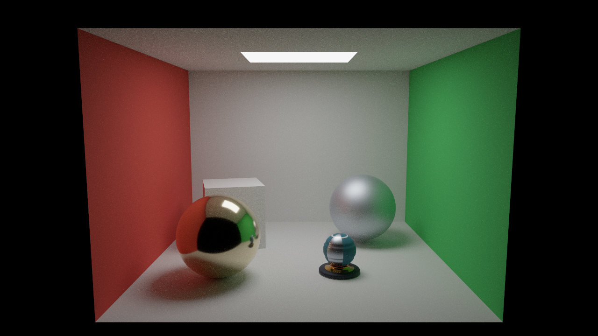
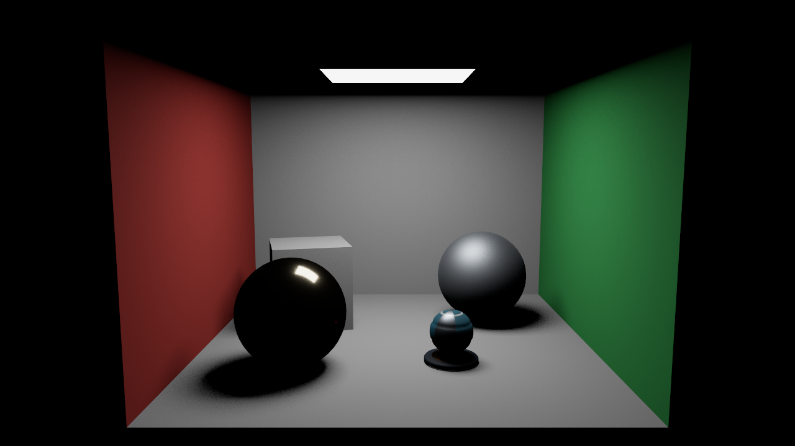
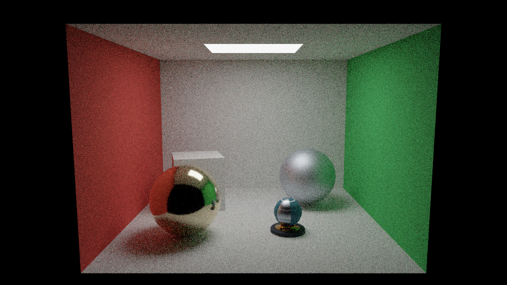
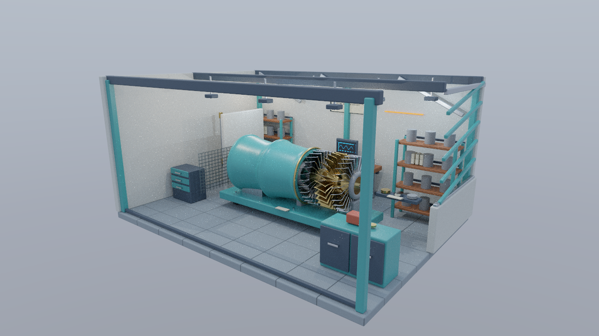
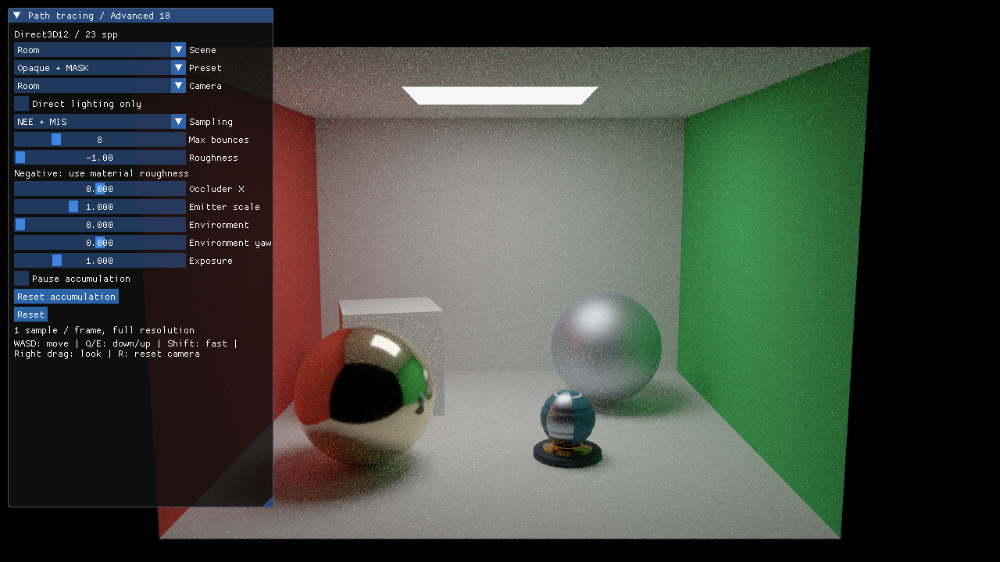

# Direct3D12 発展編18 パストレーシング入門

面で確率的に反射を続け、局所的な拡散間接光と粗い鏡面反射を求めます。理論は[共通章](../PathTracing.md)、モデルと制作条件は[共通アセット](../Assets/PathTracing.md)、実機試験は[検証記録](../PathTracingVerification.md)を参照してください。



## ビルドと実行

VS 2026／v145、Windows SDK 10.0.26100.0、C++20、x64 Debug／Releaseを使用します。HLSL 2021・SM6.6をオフラインでコンパイルします。D3D12は固定NuGet版Agility SDK 1.619.6／DXC 1.9.2609.5、Vulkanはインストール済みSDKのDXCを使用し、実行ターゲットはVulkan 1.3です。

```powershell
msbuild ShaderjpGraphicsSamples.sln -t:Restore -p:RestorePackagesConfig=true
msbuild Samples/Direct3D12/Advanced18_PathTracingBasic/Direct3D12_Advanced18_PathTracingBasic.vcxproj -p:Configuration=Release -p:Platform=x64
.\bin\x64\Release\Direct3D12_Advanced18_PathTracingBasic\Direct3D12_Advanced18_PathTracingBasic.exe
```

## API側の処理

[Sample.cpp](../../Samples/Direct3D12/Advanced18_PathTracingBasic/Sample.cpp)に初期化、画像転送、AS、Pipeline、描画、同期、撮影、解放があります。共有するのはCPUデータ・ウィジェットとHLSLで、共通のGPU描画APIは作りません。

DXR Tier 1.0以上を確認します。Global Root Signatureへ材質Texture、形状・Instance・Material、点光源、面光源Buffer、TLAS、出力UAVを登録します。非一様な材質参照には`NonUniformResourceIndex`を付けます。

`CreateRayPipeline`はRay Generation、Closest-hit、MASK用Any-hit、通常Miss、Shadow MissをDXIL Libraryとして登録します。交差Payloadは24 bytes、三角形Attributeは8 bytes、最大再帰深度は1です。Shader Tableは32-byte識別子と32-byte Record／64-byte Table alignmentを守ります。RadianceとShadowの2種類のHit Groupを用意します。

`BuildBlas`で固有PrimitiveごとにBLASを作り、`BuildTlas`で選択Sceneの配置と面光源Bufferを作ります。カメラや露出の変更ではASを再構築しません。形状・プリセット・遮蔽物が変わる場合はGPU完了後にTLAS、Instance、面光源を更新します。

描画時はRGBA32FをUAVへ遷移し、`DispatchRays`で1サンプルを追加します。サンプル番号0では旧画像を読みません。表示前にShader Resourceへ遷移し、Fullscreen Triangleから平均HDRを参照します。次フレームもGPU完了を待ち、画像の状態遷移で蓄積の読書きを同期します。定数・点光源・ImGui Bufferは完了待ちの後に更新します。

固定定数はb0／binding 0、材質画像はt0／binding 1、Samplerはs0／binding 2、set 0です。面光源はt75／binding 18に追加しています。行列はrow-major、左手系、深度0..1です。`RayConstants`は240 bytes、`PathLight`は64 bytesで、CPUのstatic_assertとSPIR-Vのoffset／strideを検証します。

## 光の計算を追う

共通`Shaders/PathTracing`の`RayGeneration.hlsl`が経路のループ、NEE、MIS、蓄積を担当します。`BSDF.hlsli`がLambert＋GGXの評価・混合PDF・可視法線サンプリングを担当します。Closest-hitからは交差情報だけを返します。8回の反射とAPIのレイ再帰深度1を区別してください。

初期状態はRoom、NEE＋MIS、最大8バウンス、seed 1、1 spp／フレームです。蓄積数の初期上限はありません。UIからPause／Resetできます。粗さのOverrideが負なら元の材質値を使用します。露出だけを変えた場合は蓄積を維持します。直接光のみは、最初の散乱から光源・環境へ到達する経路までの比較です。

## 同じ条件で比較する



冒頭の多重反射と比較すると、白い面に回り込む光と色移りが分かります。次のBSDFのみも同じ256 sppです。MISでは小さな光源を見つける頻度を改善しますが、すべての場面のノイズがなくなるわけではありません。



```powershell
.\bin\x64\Release\Direct3D12_Advanced18_PathTracingBasic\Direct3D12_Advanced18_PathTracingBasic.exe --pt-sampling bsdf --pt-max-bounces 8 --pt-seed 1
.\bin\x64\Release\Direct3D12_Advanced18_PathTracingBasic\Direct3D12_Advanced18_PathTracingBasic.exe --pt-scene workshop --workshop-scene Standard --preset OpaqueMask
```



WorkshopはStandard／Stress、Opaque／OpaqueMaskを選べます。点光源と太陽光は「BSDFのみ」でも直接評価します。環境は元のCubemapをMissで参照し、重点サンプリングは後続テーマです。BLENDを含むFullはエラーになります。

WASD／Q・E／右ドラッグ／Shift／Rのカメラ操作と、ImGui入力中のカメラ抑制を引き継ぎます。移動中は毎フレーム蓄積を始め直すため、初回ではノイズが目立ちます。デノイズや再投影は実装しません。



## 撮影と検証

```powershell
.\bin\x64\Release\Direct3D12_Advanced18_PathTracingBasic\Direct3D12_Advanced18_PathTracingBasic.exe --frames 256 --pt-target-spp 256 --no-ui --capture-gpu --screenshot room.png
.\Tools\TestPathTracingCpu.ps1
.\Tools\TestPathTracingAssets.ps1
.\Tools\TestPathTracingShaders.ps1 -Configuration Release
.\Tools\TestPathTracing.ps1 -Configuration Release -CaptureDocs
.\Tools\TestSamples.ps1 -Configuration Release -Topics Advanced18_PathTracingBasic
```

`--pt-target-spp 0`は上限なしです。`--frames`を指定する場合、撮影に必要なspp以上のフレーム数を設定してください。`--capture-gpu`は撮影画像と同名の`-gpu`フォルダへfloat32のHDR、最終サンプル、表面情報と、実際のspp・seed・バウンス数を含むJSONを保存します。HDRをfloat16として読み込まないでください。

試験には既知の発光面、独立した面積積分による直接光の照合、複数seedのBSDF／MIS比較、実UIの編集・Reset・露出、奇数サイズを含めます。確率的画像のAPI間のバイト一致は要求しません。

この回の`BSDF.hlsli`は反射成分だけを扱います。BRDF／BTDF／BSDFの関係と、同じアセットでの反射・透過の比較は[共通章](../BRDFAndBSDF.md)と[発展19](Advanced19_BSDFMaterials.md)へ進んでください。
