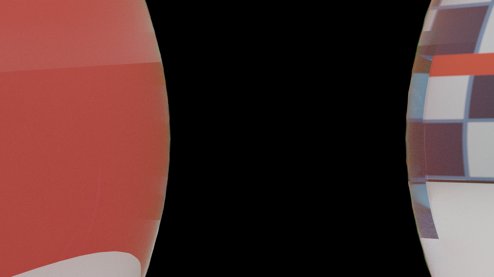
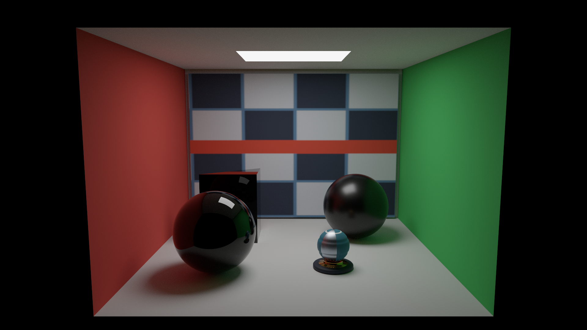
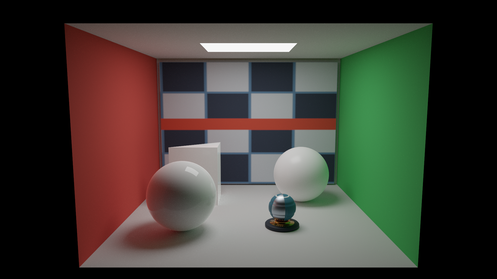
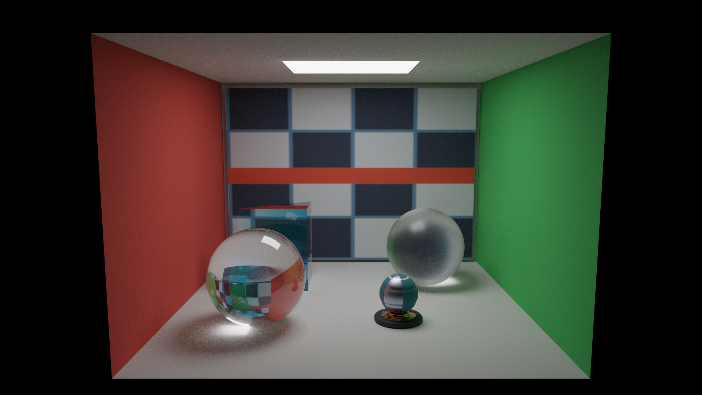
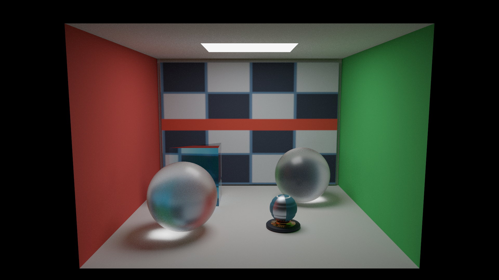
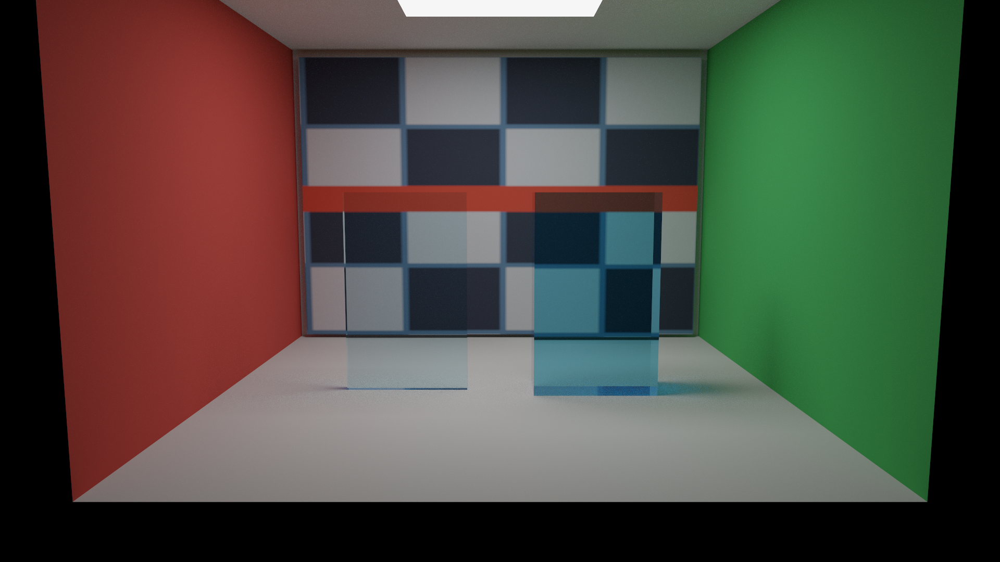
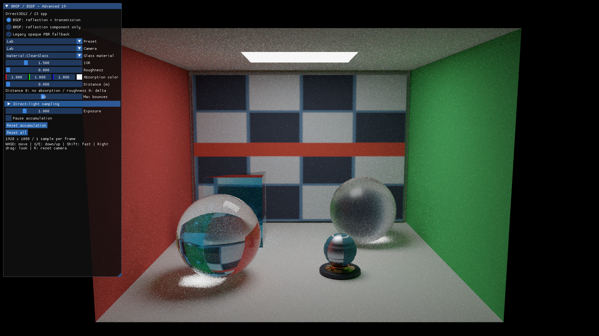
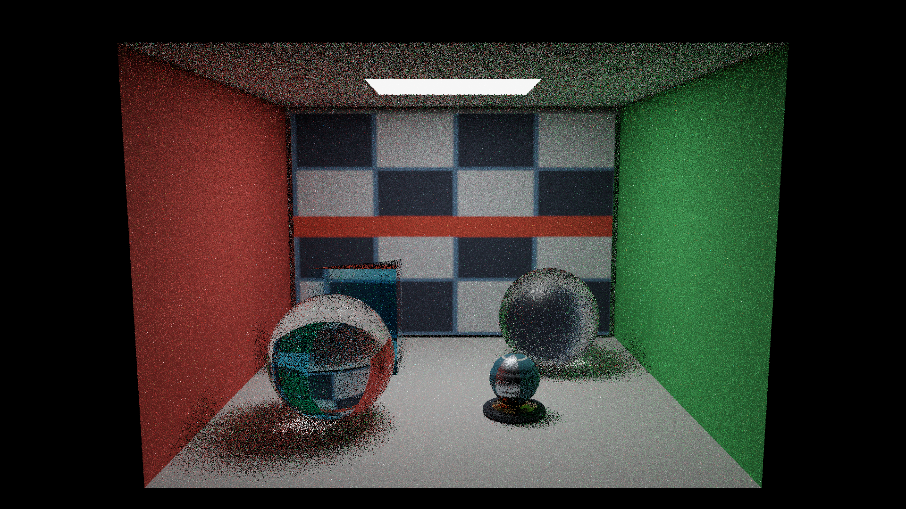
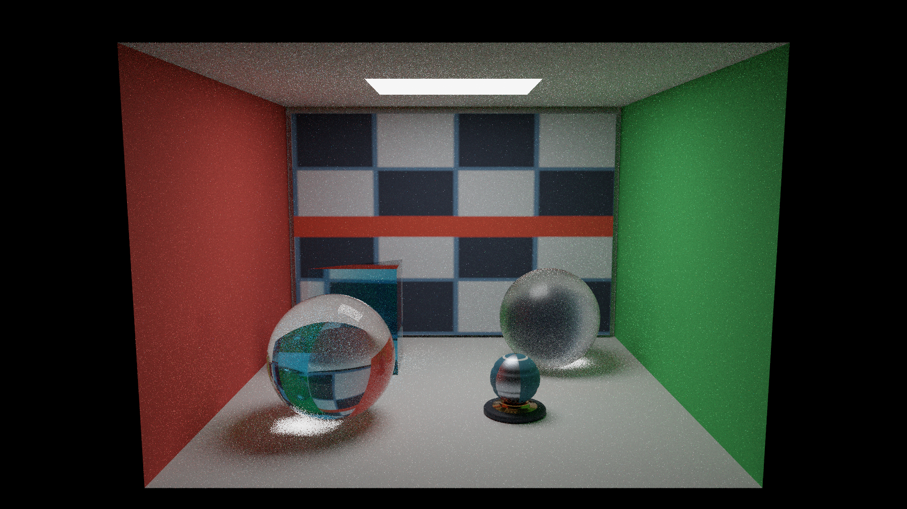

# Direct3D12 発展編19 BRDFとBSDF：反射・透過と色ガラス

同じアセットを「反射＋透過」「反射成分だけ」「従来の不透明PBR」で評価します。3モードとも同じパストレーサーを使い、描画方式と散乱モデルの違いを分けます。[共通解説](../BRDFAndBSDF.md)／[共通アセット](../Assets/BSDFMaterials.md)／[Vulkan版](../Vulkan/Advanced19_BSDFMaterials.md)


## ビルドと初期状態

VS 2026／v145、Windows SDK 10.0.26100.0、C++20、x64 Debug／Releaseです。D3D12はAgility SDK 1.620.1とNuGet DXC 1.9.2609.5、VulkanはSDK付属DXCでVulkan 1.3向けにコンパイルします。共通HLSLはSM6.6／HLSL 2021です。

```powershell
msbuild ShaderjpGraphicsSamples.sln -t:Restore -p:RestorePackagesConfig=true
msbuild Samples/Direct3D12/Advanced19_BSDFMaterials/Direct3D12_Advanced19_BSDFMaterials.vcxproj -p:Configuration=Release -p:Platform=x64
.\bin\x64\Release\Direct3D12_Advanced19_BSDFMaterials\Direct3D12_Advanced19_BSDFMaterials.exe
```

発展19から新規サンプルは1920×1080です。`Main.cpp`で`SampleDefaults{1920,1080,16}`を`RunSample`へ渡し、その後にCLIを適用します。既存の呼出しは従来の1280×720・8バウンス初期値を保ちます。最小化・復帰も、そのサンプルの初期サイズを使います。

初期状態はLab、反射＋透過、NEE＋MIS、16バウンス、seed 1、1 spp／フレーム、蓄積上限なしです。

## API側の処理

`OnInit`でDXR対応を確認し、Swap Chain、Command Queue／Allocator／List、Fenceを作ります。共有CPUローダーから頂点・Index・Primitive・BSDF Materialを取り出し、それぞれのBufferとTextureを作成します。BLASはPrimitiveごとに共有し、選択Presetの配置でTLASを作ります。

`CreateRayPipeline`は共通HLSLからオフライン生成したDXILライブラリを使い、Ray Generation、Closest-hit、Any-hit、2種類のMissとHit Groupを登録します。Payloadは交差情報だけです。Shader TableはShader Identifierとレコード・Tableのアラインメントを守り、最大再帰深度は1です。

この実装のShader Tableは次の配置です。レコードは32 bytes、Tableの開始は64 bytesに揃えます。`DispatchRays`にはRay Generation、Miss 2個、Hit Group 2個の範囲を渡します。[DXR仕様](https://microsoft.github.io/DirectX-Specs/d3d/Raytracing.html)

| byte offset | Export | 用途 |
|---:|---|---|
| 0 | RayGeneration | 経路ループ |
| 64／96 | Miss／ShadowMiss | 環境／遮蔽なし |
| 128／160 | RadianceHit／ShadowHit | 交差情報／MASK付き遮蔽 |

影レイもRay Generationから発射し、Closest-hit内では次の`TraceRay`を呼びません。16バウンスは経路ループでの散乱回数であり、APIの再帰深度1と矛盾しません。

ガラスのInstanceには`D3D12_RAYTRACING_INSTANCE_FLAG_TRIANGLE_CULL_DISABLE`を指定します。glTFのdoubleSidedとは別に、Volumeの入射・出射の両面を探索するためです。外向き幾何法線はシェーダーでも保持します。

`OnRender`はFence完了後に、編集したMaterial Buffer、定数、ライト、ImGui Bufferを更新します。HDR画像をUAVへ遷移し、`DispatchRays`で1 sppを追加します。表示前にShader Resourceへ戻し、Fullscreen Triangleで露出・Reinhard・sRGB変換を適用し、その後にImGuiを描きます。

HDR画像のUAV→Shader Resource→次フレームのUAVという遷移で、前の平均を読む依存を作ります。診断画像にはUAV Barrierも入れます。FenceによるCPUの再書込み待ちと、GPU上の画像アクセスの依存を両方保ちます。

CPUの`BSDFMaterial`は112 bytes、`BSDFConstants`は256 bytesです。旧`RayMaterial`の80 bytesと`RayConstants`の240 bytesは維持します。CPUのstatic_assertとSPIR-Vのoffset／strideで配置を照合します。

既存のb0／binding 0、t0／binding 1、s0／binding 2、set 0、row-major・左手系・深度0..1を保ちます。ガラスの物性は既存Material Bindingの専用構造体へ追加し、描画APIを共有化しません。

## 光の経路を追う

`Shaders/BSDFMaterials/Scene.hlsli`が外向き幾何法線と物性を復元し、`Dielectric.hlsli`がFresnel、反射・透過の評価／PDF／サンプリングを担当します。不透明面の評価には発展18のLambert＋GGXを再利用します。

`RayGeneration.hlsl`は媒質IDと前回の実際の交差位置を持ちます。交差間の距離へ吸収を適用し、透過時だけ媒質を変更します。粗さ0をデルタとして区別し、発光面到達時のMISとRussian rouletteのetaScaleを扱います。一次レイはカメラから始め、CPUの閉メッシュ包含判定で内部開始にも対応します。



`--camera InsideClear`の256 sppです。開始媒質を空気として扱うと、この境界のFresnelと屈折率比が逆になります。全反射を繰り返して光源へ届かない経路は黒くなり、有限バウンスの打切りとノイズの影響も残ります。

## 3モードを比較する



反射成分だけのモードは、同じIORと粗さのFresnel反射を保ちます。透過した先の寄与を省くため、特に正面に近いガラスが暗く見えます。反射率を1にするモードではありません。



従来PBRモードは、透過非対応の評価へ変換した場合の再現です。ガラスのBase Colorは白なので、不透明な白い物体として見えます。既存ローダーが新拡張を黙って無視しているわけではなく、旧ローダーは引き続き未対応拡張を拒否します。




上の2枚は透明球だけのIOR／粗さを変更しています。壁や床、すりガラス球の物性は維持します。



同じ吸収係数の0.1 m／0.5 mの板です。形状や非一様スケールを変えた場合も、吸収にはワールド空間の実距離を使います。厚みマップによる推定値を掛けません。

## 操作と蓄積



Surface modelの3モード、Lab／Thickness、カメラ、選択したガラスのIOR・粗さ・吸収色・吸収距離を操作できます。WASD／Q・E／右ドラッグ／Shift／Rを引き継ぎ、ImGui操作中はカメラ入力を抑えます。

モード・物性・カメラ・積分条件・サイズの変更は蓄積をリセットします。露出とUI表示だけでは線形HDR平均を維持します。`Reset accumulation`は物性を保って蓄積を計算し直し、`Reset all`は初期の物性とモードへ戻します。サンプリング方式は`Direct-light sampling`内の別設定で、散乱モデルの3モードと区別します。

`Reset all`の初期状態には、CLIで指定したカメラ・Preset・材質とIOR／粗さ／吸収距離、モード、バウンス数、サンプリング方式も含みます。

## 再現可能な撮影と検証

```powershell
.\bin\x64\Release\Direct3D12_Advanced19_BSDFMaterials\Direct3D12_Advanced19_BSDFMaterials.exe --frames 1024 --pt-target-spp 1024 --pt-seed 1 --no-ui --capture-gpu --bsdf-mode full --screenshot full.png
# --bsdf-mode reflection / legacy-pbr
# --bsdf-preset lab / thickness
# --bsdf-material material:ClearGlass --bsdf-ior 2.2
# --bsdf-material material:ClearGlass --bsdf-roughness 0.3
.\Tools\TestBSDFCpu.ps1
.\Tools\TestBSDFAssets.ps1
.\Tools\TestBSDFShaders.ps1 -Configuration Release
.\Tools\TestBSDF.ps1 -Configuration Release -CaptureDocs
.\Tools\TestSamples.ps1 -Configuration Release -Topics Advanced19_BSDFMaterials
```

`--pt-target-spp 0`は上限なしです。`--frames`を指定する場合は目標spp以上にします。CLIの材質編集は安定IDで対象を選び、元アセットを書き換えません。`--bsdf-absorption-distance 0`は吸収なしです。

`--capture-gpu`はRGBA32FのHDR平均、最終サンプル、表面情報とJSONを保存します。JSONには実際のspp、seed、モード、物性、カメラ、開始媒質を含めます。通常の表面情報はUV／距離／Material IDです。明示的な`--bsdf-test optics`では光学関数の診断値、`slab`／`scaled`では内部距離と界面通過数を出力します。





バウンスは表面での散乱回数で、入射と出射もそれぞれ数えます。有限深度の打切り、有限sppのノイズ、単純なNEEでは屈折経路を接続できない制約は[共通章](../BRDFAndBSDF.md)を参照してください。今回、デノイズ・ReSTIR・分散・媒質散乱・入れ子の媒質は実装しません。

試験条件、コンパイラ・SDK・GPU・ドライバと結果は[検証記録](../BSDFMaterialsVerification.md)へ保存します。確率的画像の両API間のバイト一致は要求しません。

[発展18](Advanced18_PathTracingBasic.md)／[発展編目次](../AdvancedGraphicsSamples.md)
