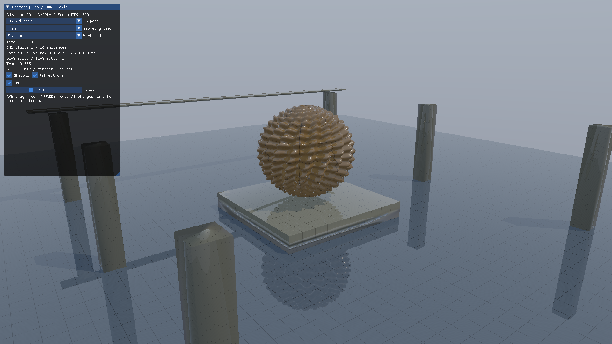
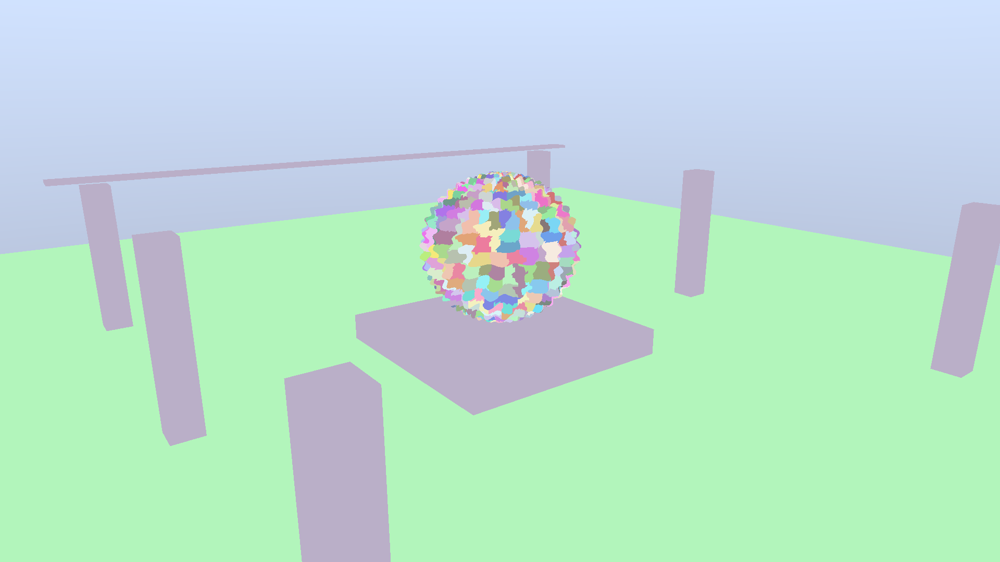

# Direct3D12 発展20 Raytracing: Clustered Geometry

高密度のレリーフ彫刻をクラスタに分け、CLASからCluster BLASを組み立てます。同じ三角形を通常BLASでも描画し、画像、初期構築時間、メモリを比較します。[共通解説](../ClusteredRaytracing.md)／[アセット](../Assets/GeometryLab.md)／[次：テンプレート](Advanced21_ClusterTemplates.md)



## 起動と比較

Agility SDK 1.722.0-preview、DXC 1.10.2605.37-preview、対応ドライバとWindows Developer Modeが必要です。初期サイズは1920×1080、標準方式はCLAS直接構築です。

```powershell
msbuild ShaderjpGraphicsSamples.sln -t:Restore -p:RestorePackagesConfig=true
msbuild Samples/Direct3D12/Advanced20_ClusteredGeometry/Direct3D12_Advanced20_ClusteredGeometry.vcxproj -p:Configuration=Release -p:Platform=x64
.\bin\x64\Release\Direct3D12_Advanced20_ClusteredGeometry\Direct3D12_Advanced20_ClusteredGeometry.exe --cg-mode clusters
```

`--cg-mode rebuild`で通常BLASへ切り替えます。UIのAS pathでも変更できます。StandardとStressで同じ形状のインスタンス数を変え、両方式で同じBLAS共有方針を使います。通常起動では静的ASを初期化時と設定変更時に構築し、カメラだけの変更では作り直しません。

## APIを追う順序

1. `LoadGeometryLab`と`MakeClusterSceneData`がCPUデータを読み、meshoptimizerの空間分割とクラスタ内部最適化を行います。
2. `CreateClusterResources`が頂点、インデックス、クラスタ属性、GPU構築引数を確保します。
3. `BuildBlas`がprebuild情報を照会し、`BUILD_CLAS_FROM_TRIANGLES`をimplicit destinationで実行します。
4. GPUが出力したアドレス配列を`BUILD_BLAS_FROM_CLAS`へ渡します。各Cluster BLASの保存先はアプリが確保した領域です。
5. `BuildTlas`が共有BLASの配置を登録し、`CreateRayPipeline`がクラスタ対応LibraryとPipeline flagを設定します。

クラスタ用の`ClusterID()`と通常BLASの`GeometryIndex()`を同じ属性表へ対応させます。全Geometryで同じ2レコードのHit Group Tableを使うため、`TraceRay`のGeometryによるTable加算係数は0です。三角形ごとの属性はTableへ複製しません。

CLASの頂点形式はFLOAT32_3です。頂点は位置＋U、法線＋V、接線の48-byte構造体ですが、構築へは位置3成分と48-byte strideを渡します。`UniqueVertexIndexCount`は異なる数値インデックスの個数です。マテリアルはすべてOPAQUEです。

## 表示と試験

`--cg-view clusters`はクラスタ色、`--cg-view triangles`は三角形の辺を表示します。RMBドラッグ、WASD、Rで既存のカメラ操作を使えます。



```powershell
pwsh Tools/TestClusterGeometryCpu.ps1
pwsh Tools/TestClusterGeometry.ps1 -Configuration Debug
pwsh Tools/MeasureClusterGeometry.ps1
```

CPU試験は三角形の欠落・重複と全頂点属性を比較します。GPU試験は通常BLASとのヒットID、距離、線形HDRと既知の平面への距離を比較します。`--benchmark`では静的ASも毎フレーム構築し、同じ負荷で構築コストを測ります。[検証・計測結果](../ClusteredRaytracingVerification.md)
