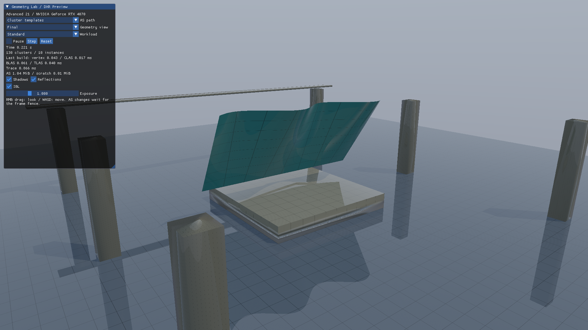

# Direct3D12 発展21 Raytracing: Cluster Templates

薄板彫刻の三角形接続を固定し、毎フレームの頂点位置をComputeで生成します。初期化時のテンプレートを再利用して、変形後のCLASを構築します。[共通解説](../ClusteredRaytracing.md)／[前：CLAS基礎](Advanced20_ClusteredGeometry.md)／[次：細分化](Advanced22_ClusterTessellation.md)



## 起動と方式

```powershell
.\bin\x64\Release\Direct3D12_Advanced21_ClusterTemplates\Direct3D12_Advanced21_ClusterTemplates.exe --cg-mode templates
```

| `--cg-mode` | 構築方法 |
|---|---|
| `templates` | 事前構築したテンプレートへ現在の頂点位置を渡してCLASを生成 |
| `direct` | 現在の三角形からCLASを直接構築 |
| `rebuild` | 同じ現在位置から通常BLASを再構築 |
| `refit` | ALLOW_UPDATEで初期化した通常BLASを更新 |

新しい方式へ切り替えるとGPU完了を待ち、必要な構築フラグと領域を確保し直します。通常BLAS比較用LibraryはSM6.6、クラスタ側はSM6.10です。

## テンプレートとフレーム処理

基準姿勢でmeshoptimizerによる分割を固定します。`PrepareTemplates`は三角形接続とヒント位置からテンプレートを作成します。テンプレート自体はレイと交差できません。

フレームでは`GenerateGeometry`のComputeが基準頂点から位置、法線、接線を計算し、CLAS直接構築とテンプレート実体化の引数をGPUメモリへ書きます。`INSTANTIATE_CLUSTER_TEMPLATES`は同じテンプレートのアドレスと現在の頂点Bufferを参照します。生成したCLASを使ってCluster BLASを再構築し、通常TLASを更新してからトレースします。

変形式は位置と微分から解析的に法線・接線を計算します。UVとトポロジーは維持します。CLAS更新後に古いCluster BLASをそのまま走査することはできません。大きな変形でクラスタの空間的なまとまりが失われる場合の再分割は後続テーマです。

## Pause・Step・Reset

UIのPauseで時間を止め、Stepで1/60秒だけ進めます。Resetは起動時の時間へ戻します。固定フレーム試験には次を使用します。

```powershell
.\bin\x64\Release\Direct3D12_Advanced21_ClusterTemplates\Direct3D12_Advanced21_ClusterTemplates.exe --cg-mode templates --pause-animation --animation-time 0.7 --frames 3 --capture-gpu --screenshot template.png
```

`--fixed-dt 0.016666667`は実時間によらず同じ時間刻みで進めます。CPU更新・UI Bufferの書換えはGPU完了待ちの後です。

試験ではテンプレート、直接CLAS、通常BLAS rebuild／refitの画像を比較し、GPUの生成頂点と法線を独立したCPU式でも確認します。UIのStepでHDRが変わり、Resetで初期値へ戻ることを実入力で確認します。[検証結果](../ClusteredRaytracingVerification.md)
