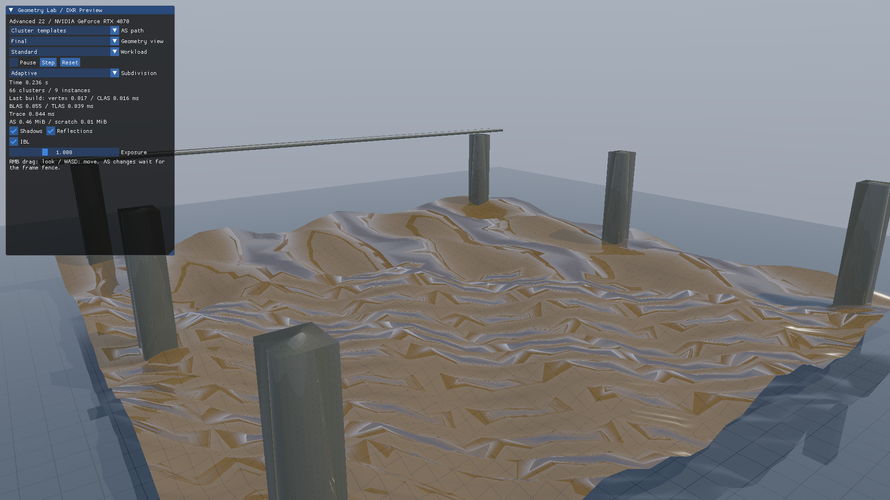
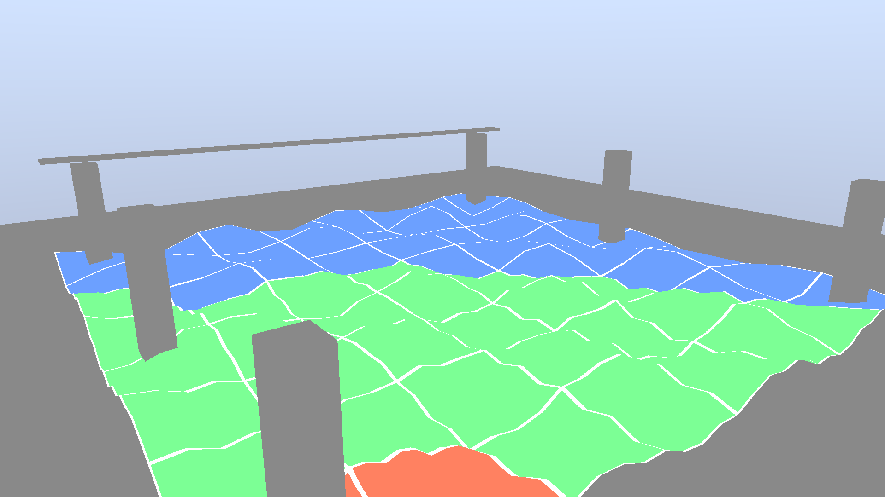

# Direct3D12 発展22 Raytracing: Cluster Tessellation

画面上の大きさに応じて規則タイルを2・4・8分割し、Computeで変位と法線を生成します。有限個のトポロジーからテンプレートを選ぶ、構造化クラスタの入門です。[共通解説](../ClusteredRaytracing.md)／[前：テンプレート](Advanced21_ClusterTemplates.md)／[次：PTLAS](Advanced23_PartitionedTLAS.md)



## 実行と比較

```powershell
.\bin\x64\Release\Direct3D12_Advanced22_ClusterTessellation\Direct3D12_Advanced22_ClusterTessellation.exe --cg-mode templates --cg-lod 0
```

`--cg-lod 0`は適応的選択、2／4／8は固定分割です。方式は`templates`、`direct`、`rebuild`を比較できます。通常BLASのrefitは、三角形数が変わるこのサンプルでは使用しません。

## GPUで選ぶトポロジー

標準形状は2 m四方のタイルを8×8配置します。各タイルに9×9の頂点領域を持ち、現在の分割率で使用するインデックスを選びます。距離と投影スケールから分割率を決め、隣接差を最大1段に制限します。

2分割・4分割には各辺の接続フラグ16通り、8分割には1通り、合計33テンプレートがあります。粗い側の境界セルへ中点と中心点を追加し、fanで接続します。共有境界の頂点位置は同じワールド座標で変位関数を評価します。

Computeが選択したトポロジーをクラスタ属性と構築引数へ書き、対応テンプレートを実体化します。通常BLASのCPU Geometry記述には独立した同じ選択式を使い、GPU読戻し試験で選択結果の一致を確認します。通常フレームではGPUから選択結果を読み戻して構築を制御しません。

Stressでは同じ形状を9配置し、同じLODを持つBLASを両方式で共有します。インスタンスごとに異なるLODのBLASを生成する方式は後続テーマです。

## LODと境界を調べる



`--cg-view lod`は青・緑・赤で分割段階を示し、白でタイル境界を表示します。`triangles`で接続用三角形も確認できます。カメラ移動とリサイズでも投影スケールを更新します。

CPU試験は全33トポロジーの向き、面積、使用インデックス、境界点を検証します。GPU試験は自動選択と2／4／8固定の各方式を比較し、生成頂点・法線と選択メタデータを検証します。[検証結果](../ClusteredRaytracingVerification.md)

この回はComputeによる高さ場の細分化です。ラスタライズのHull／Domain ShaderやCatmull-Clarkの実装は含みません。
