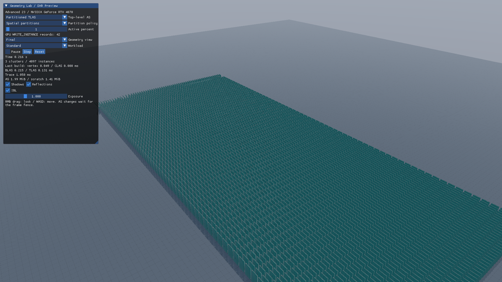
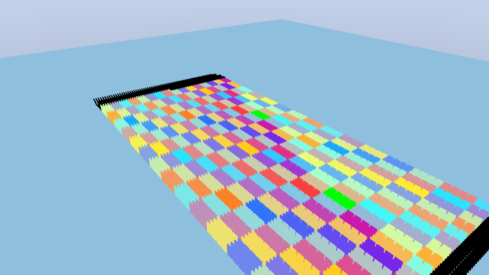

# Direct3D12 発展23 Raytracing: Partitioned TLAS

多数の可動パネルのうち、変更したインスタンスだけをGPUで列挙し、PTLASへ反映します。形状のBLASは通常の三角形から構築し、トップレベルの更新方式に集中します。[共通解説](../ClusteredRaytracing.md)／[前：細分化](Advanced22_ClusterTessellation.md)



## 実行と比較

```powershell
.\bin\x64\Release\Direct3D12_Advanced23_PartitionedTLAS\Direct3D12_Advanced23_PartitionedTLAS.exe --cg-mode ptlas --cg-partition spatial --cg-active-percent 1
```

`--cg-mode`は`ptlas`、`rebuild`、`refit`を選びます。3方式とも同じGPUアニメーション、インスタンス数、静的BLAS、シェーダを使います。23の全シェーダはSM6.6です。

Standardは64×64枚＋静的な床1個、Stressは128×128枚＋床1個です。パネルはBLASを共有します。アニメーションは局所的に進む波として定義し、`--cg-active-percent 0..100`で動いている割合を変えます。

## 固定容量と永続インスタンス

4×4枚を1空間partitionとします。Standardは256、Stressは1024 partitionです。通常partitionは最大17インスタンス、global partitionは全パネルを収容できる容量を確保します。17は16枚にpartition 0の床1個を加えた上限です。

初期構築は全インスタンスを書き、sourceを0にします。更新はsourceとdestinationを同じPTLASにします。書かれなかったインスタンスの記録は残ります。

`UpdateInstances` Computeは前回の角度・partitionと比較し、変更分をコンパクトな`WRITE_INSTANCE`配列へ追加します。各レコードの`InstanceIndex`は固定です。`ArgCount`だけが増え、外側のoperation数は1のままです。読戻した件数は表示・試験用で、AS構築の制御には使いません。

## partitionの移動



`--cg-partition spatial`は動くパネルも元の空間partitionに保持します。`global`は動く間だけglobal partitionへ移し、停止後は元へ戻します。Transformが同じでも所属が変わればwriteが必要です。`--cg-view partition`と`activity`で実際の所属と活動を表示します。

partition表示の黒はglobal partitionです。activity表示は活動中が橙、停止中が青です。

Pause後に未処理の変更がなくなるとwrite数は0になります。Step、Reset、所属方式の変更後には必要な記録を更新します。`UPDATE_INSTANCE`はTransform変更に使用しません。

GPU試験は0件・一部・全件、spatial／global、通常TLAS rebuild／refitとの画像一致、Step／Resetを検証します。計測では静的BLASの初期構築を毎フレームのPTLAS更新時間へ混ぜません。[検証結果](../ClusteredRaytracingVerification.md)

初版は固定容量です。partition translation、明示AABB、削除・ストリーミング、容量変更は別の操作として後続で扱います。
