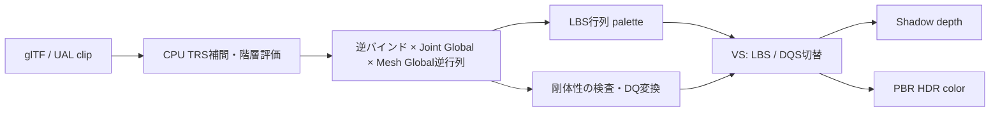

# Dual Quaternion Skinning：同じアセットでLBSと比較する

DQSの3方式は、既存のSilverRobotAnimatedとUniversal Animation Libraryのクリップをそのまま使い、変形をLinear Blend Skinning（LBS）／Dual Quaternion Skinning（DQS）で切り替えます。[Direct3D12実装](Direct3D12/24_DualQuaternionSkinning.md)、[Vulkan実装](Vulkan/24_DualQuaternionSkinning.md)、[検証・性能](DualQuaternionVerification.md)を参照してください。

基本22・23・発展10は「どのShader段階で変形するか」の比較です。DQSは「どう変形をブレンドするか」の比較なので、まず基本22と同じIndexed VS、Shadow＋PBRで導入します。追加のBlenderファイル、モーション、依存ライブラリは必要ありません。続けて基本25のComputeキャッシュ、発展11のMesh Shaderを実装しています。[3方式のAPI別記事・同期・DQS境界](DualQuaternionStages.md)と[追加検証・性能](DualQuaternionStagesVerification.md)を参照してください。

## 行列を混ぜると細くなる理由

LBSは各頂点について、4つのボーン行列をウェイトで足し合わせます。

```text
M = Σ wi Mi
p' = p M
```

回転行列の平均は、一般には回転行列ではありません。例えばZ軸の+80度と−80度を半分ずつ混ぜると、X方向の長さは約0.174倍になります。腕を強くねじったときに接合部が細くなる、いわゆるcandy wrapperの原因です。

DQSは各ボーンの剛体変換を回転Quaternion `qr` と並進を含むDual部 `qd` へ変換し、正規化してから頂点へ適用します。合成結果は回転＋並進を表すため、この回転の平均による収縮を避けられます。関節の膨らみや装甲同士の干渉をすべて解決する方法ではありません。[Kavanらの論文](https://users.cs.utah.edu/~ladislav/kavan08geometric/kavan08geometric.pdf)

## glTFから作る位置は同じ

[glTFローダー](GltfSkinningLoading.md)は変更せず、従来通りTRSを時間補間し、階層を評価します。スキンのジョイント番号とノード番号の対応、逆バインド行列も同じです。



行ベクトルの本サンプルでは `M = inverseBind * jointGlobal * inverse(meshGlobal)` です。**逆バインドやMeshの逆行列を適用する前のボーン回転だけをDQへ変換してはいけません。** 最終paletteを[Common/DualQuaternion.h](../Common/DualQuaternion.h)の`MakeSkinDualQuaternion`へ渡します。Worldと復元Root motionはその後のInstance変換です。

CPUはDirectXMathの行ベクトル行列からQuaternionを取り出します。Quaternionの積はCPU／HLSLとも独自の短いHamilton積で定義し、xyzwの成分順と積順序を明示しています。

## DQの作成・符号合わせ・正規化

並進を `t = (tx, ty, tz, 0)` とすると、1ボーンのDual部は次です。`*`はQuaternionのHamilton積です。

```text
qd = 0.5 * (t * qr)
```

Quaternion `q` と `−q` は同じ回転です。そのまま平均すると打ち消すため、最大ウェイトのボーンを基準にします。`dot(reference, qr) < 0`なら**Real／Dualの両方**を反転してから加算します。Dual部の反転を忘れると並進が壊れます。

```text
r = Σ wi si qr_i       d = Σ wi si qd_i
r /= length(r)        d /= length(original r)
d -= r * dot(r, d)
translation = 2 * (d * conjugate(r)).xyz
p' = rotate(r, p) + translation
n' = normalize(rotate(r, n))
```

最後の投影は`dot(r,d)=0`を満たすための処理です。接線も同じ回転で変形し、法線に直交化して正規化します。UV、接線のhandednessは保持します。実装は[DualQuaternion.hlsli](../Shaders/Skinning/DualQuaternion.hlsli)、呼出し元は[SkinningCommon.hlsli](../Shaders/Skinning/SkinningCommon.hlsli)です。Shadow／Color／検査用CSが同じ関数を使います。

## 操作とねじり確認

初期状態はDQS／UAL_Walk／速度1／1体／Root motion OFFです。`Dual quaternion (DQS)`のチェックを外すとLBSになります。切替では再生時刻、姿勢、材質、ライト、Shadow設定を変えません。ResetはDQSとRoot motion OFFへ戻します。

`Twist check (150 deg)`は、元のTポーズを基に手首をねじる実行時クリップ`DQS_Twist`を選び、2秒の最大ねじりで停止し、寄ったカメラへ切り替えます。0〜4秒の往復を30 fpsで生成しており、Time／Pausedで途中の姿勢も確認できます。AnimationからAポーズ、Tポーズ、既存6クリップにも戻せます。配布glTF／GLBとBlenderのActionには追加しません。

このロボットは装甲の多くが1ボーン100%の剛体です。2ボーンの影響を持つのは31,138頂点中848頂点で、通常の歩行では差は控えめです。ねじり確認とNormal／Depth表示を合わせて使ってください。1ボーンの頂点はDQSとLBSで同じ剛体変換になります。

`--skinning lbs|dqs`で固定し、既存の`--animation`、`--animation-time`、`--pause-animation`、`--characters 64`、`--root-motion on|off`と組み合わせられます。Root motionの復元とWorldへの適用は[従来の説明](GpuSkinning.md#root-motionを切り替える)と同じです。

## スケール、カリング、キャッシュへの拡張

今回のDQSは剛体変換専用です。CPUで全paletteの有限値、直交性、行列式、アフィン成分を確認し、スケール・shear・反転は診断します。許容誤差`1e-4`は既存エクスポートの丸め誤差を受け入れるためです。LBSとの比較用に両paletteを毎フレーム生成するので、このビューア全体が剛体paletteを前提とします。一般のスケール付きアセットにはLBSや別の二段階手法が必要です。[原著者の制約説明](https://users.cs.utah.edu/~ladislav/dq/index.html)

基本24はIndexed描画であり、Meshletの可視判定は行いません。LBS用の「各ボーンで変形した影響頂点AABBの合成」はDQSを保守的に囲めません。前述の±80度の例では各ボーンの点のXは約0.174でも、DQSの点はX=1になります。発展11では[正規化を考慮したDQS専用球](DualQuaternionStages.md#mesh版のdqs境界)を更新します。LBSを選んだ場合は従来のAABBへ戻します。

基本25ではCSから同じDQS関数を呼び、変形結果をShadow／Colorへ共有します。パスごとのDQS再計算を減らす効果と、キャッシュの書込み・読込み・Barrierの費用を比較します。[キャッシュする理由](GpuSkinning.md)も参照してください。基本24と発展11は描画に変形頂点キャッシュを使いません。これらの`--capture-gpu`だけが共有関数の検査用CSを追加します。基本25の読戻しは実際に描画したキャッシュです。

glTF標準のskinはLBSとして定義されています。DQSはこのランタイムの描画オプションで、glTFの意味や他のビューアの表示を変更する拡張を書き込むものではありません。[glTF 2.0 Skins](https://registry.khronos.org/glTF/specs/2.0/glTF-2.0.html#skins)
