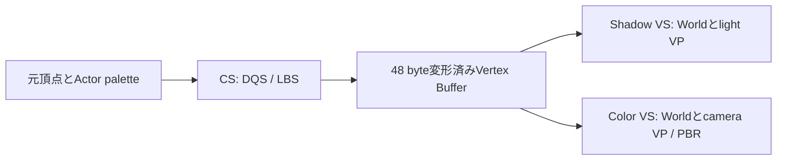

# DQSをVertex・Compute・Mesh Shaderで実行する

[DQSの数学とアセット](DualQuaternionSkinning.md)で作った同じpaletteを、3つの段階で実行します。DQS／LBSはブレンド方式、Vertex／Compute／Meshは実行場所の選択です。両方の軸を分けて比較します。

| 実行方式 | Direct3D12 | Vulkan | 変形と再利用 |
|---|---|---|---|
| 基本24 Vertex | [記事](Direct3D12/24_DualQuaternionSkinning.md) | [記事](Vulkan/24_DualQuaternionSkinning.md) | ShadowとColorのVSで変形 |
| 基本25 Compute Cache | [記事](Direct3D12/25_DualQuaternionComputeCache.md) | [記事](Vulkan/25_DualQuaternionComputeCache.md) | CSで変形済み頂点を生成し、両パスで共有 |
| 発展11 Mesh Shader | [記事](Direct3D12/Advanced11_DualQuaternionMeshSkinning.md) | [記事](Vulkan/Advanced11_DualQuaternionMeshSkinning.md) | MSで直接変形。AS／Taskでカメラとライトを別々に判定 |

すべて既存のSilverRobotAnimatedと6つのUALクリップを使います。A／Tポーズ、実行時`DQS_Twist`、1／64体、PBR、Studio IBL、2048×2048 Shadow、Hard／3×3 PCF、HDR診断を揃えています。初期値はDQS／Walk／速度1／1体／Root motion OFFです。ImGuiまたは`--skinning lbs|dqs`で、姿勢を変えずにブレンド方式を切り替えます。

## 共通の入力とHLSL

CPUがTRSと階層を評価し、逆バインドとMesh Global逆行列を含むメッシュローカル行列をDQへ変換します。[SkinningCommon.hlsli](../Shaders/Skinning/SkinningCommon.hlsli)の`SkinVertexAt`がLBSとDQSを選び、[DualQuaternion.hlsli](../Shaders/Skinning/DualQuaternion.hlsli)が符号合わせ、正規化、位置・法線・接線の変形を行います。

元Vertex・Index・ウェイトは全Actorで共有し、paletteとWorldをActorごとに変えます。64体はクリップの位相をずらした独立姿勢です。LBSとDQのpaletteを併存させることで、再読込を伴わずImGuiで比較できます。

| 入力 | HLSL | Vulkan set 0 | 要素 |
|---|---|---:|---|
| JOINTS／WEIGHTS | t96 | 38 | 32 byte |
| LBS行列 | t97 | 39 | 64 byte |
| DQ Real／Dual | t98 | 40 | float4×2、32 byte／joint |
| 変形済み頂点UAV | u7 | 41 | 48 byte／vertex |
| 発展11の可視判定用球 | t99 | 42 | float4、16 byte／meshlet |

`SKIN_TECHNIQUE`は24＝4、25＝5、発展11＝6です。Root constant／Push constantのmode bit `0x10000`がDQSを選びます。既存LBS専用22／23／発展10の動作と番号も保持しています。

## なぜComputeでキャッシュするのか

Vertex版はShadowとColorの各VSでDQSを計算します。Mesh版も両パスのMSで計算します。DQSはウェイトの加算に加え、Quaternionの符号合わせ・正規化・回転を行うため、パスが増えると同じ変形が繰り返されます。

基本25では毎フレーム、Actorごとに1回だけCSをdispatchします。出力は位置＋UV、法線＋UV、接線の3つのfloat4です。ShadowとColorのVertex Shaderは同じVertex Bufferを読み、Worldと各View Projectionだけを適用します。



変形コストを`S`、対象頂点数を`V`、パス数を`P`とすると、直接変形の概念的な費用は`P×V×S`です。キャッシュでは`V×S`に、出力の書込み・各パスの読込み・同期が加わります。Shadow＋Colorなら2パスでの変形を1回の生成へまとめられます。Cascaded Shadowや複数ライト、Depth prepassが加わる場合も再利用先になります。このサンプルのShadowは方向光1枚です。

キャッシュは1体`31,138×48 = 1,494,624 byte`、64体`95,655,936 byte`（約91.22 MiB）です。最大64体分を確保し、現在の体数だけdispatchします。床は静的Vertex Bufferを読みます。帯域、確保量、見えないActorの変形、Barrierも費用なので、キャッシュが常に有利とは限りません。[実測と条件](DualQuaternionStagesVerification.md)

## Computeの同期

最初は同じGraphics QueueでCS→Shadow→Colorを実行します。D3D12はキャッシュをUAVへ遷移してCSを書き込み、`VERTEX_AND_CONSTANT_BUFFER`へ遷移して両描画で使います。VulkanはCompute Storage WriteからVertex Attribute Readへ`vkCmdPipelineBarrier2`で同期します。両パス間に再スキニングは挟みません。

palette、Instance、可視判定用球、UIのUpload領域は前フレームのGPU完了待ちの後に更新します。Vulkanの非coherentメモリはFlushします。次フレームのキャッシュ上書きもこの完了待ちの後です。Async Computeや複数フレーム同時進行は今回の方式に追加していません。

## Mesh版のDQS境界

発展11は直接MSとAS／TaskによるFrustum Cullingを切り替えます。元形状をmeshoptimizerでMeshletへ分け、MSの`TransformMeshVertex`から同じ`SkinVertexAt`を呼びます。通常描画はCSキャッシュを使いません。

LBSの「各ボーンで変形した影響頂点AABBを合成する」方法はDQSを包めません。回転を正規化した結果が、LBSの端点の間から外へ出るためです。[DualQuaternionSkinningBounds.h](../Samples/Shared/DualQuaternionSkinningBounds.h)では、次の正規化を考慮した球を使います。

バインド空間のMeshletを中心`c`、半径`r`の球で包みます。影響する各ボーンで中心だけを剛体変換し、その点`bi = Ri c + ti`を囲むAABBの中央を出力球の中心`C`にします。`D = max |bi − C|`、Meshlet内の頂点が持つ最大インフルエンス数を`N`とします。

```text
出力球: center = C
radius = r + K D + 浮動小数点の余裕
K = 1       (N=1)
K = sqrt(2) (N=2)
K = N       (N=3,4)
```

中心をずらした座標では各ボーンのDual部の長さは`|bi−C|/2`です。DQSブレンドを正規化するReal部の長さを`L`とすると、並進の長さは`D/L`以下です。2インフルエンスは符号合わせ後の内積が非負なので`L≥1/sqrt(2)`。3／4インフルエンスは最大ウェイトの基準Quaternionへの射影が少なくとも`1/N`あるため`L≥1/N`です。回転は長さ`r`を保つので、上の半径で包めます。Dual部の直交化はこの上限を増やしません。

実装は`0.001 m + radius×5e-5`の余裕を加えます。各フレームに変形するのはMeshletの中心と関係ジョイントだけで、CPUで全頂点をスキニングする必要はありません。球が余分な領域を含む場合もあります。LBS選択時は従来の影響頂点AABB境界へ切り替えます。どちらも静的Normal Coneは無効です。

球はActor／Meshletごとに保持し、CameraとLightそれぞれの6平面へ独立に照合します。カメラの結果でライト側を省かないため、画面外のCasterの影も残ります。Root motionはInstance Worldとライト範囲へ適用され、メッシュローカル球とpaletteの空間は変えません。

## 操作と検証

発展11のRender pathは`Vertex reference`、`Mesh direct`、`AS / Task`。CullingはOFF／Animated frustumで、初期値はAS／Task＋有効です。CLIでは`--render-path vertex|mesh|task`、`--meshlet-culling off|frustum`を指定できます。他の再生・Root motion・ねじり確認は基本24と同じです。

`--capture-gpu`は比較用の読戻しを有効にします。基本25では描画に使ったキャッシュを読みます。24／発展11では同じ変形関数を検査用CSから呼んだ結果を読みます。VS／MSの出力を直接取得した検査とは区別し、実際のDepth／Shadow／HDRの一致、カリングON／OFF、画面外Caster、実UI操作も確認します。性能測定ではcaptureを付けません。

[検証記録・性能比較](DualQuaternionStagesVerification.md)に、CPUの境界検査、独立NumPy参照、両API・両構成のGPU試験と実測をまとめます。
