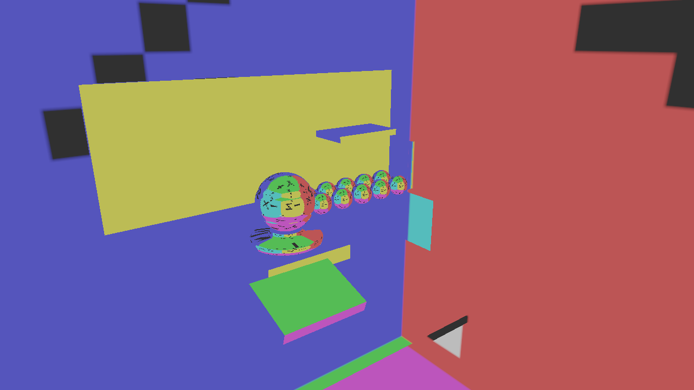
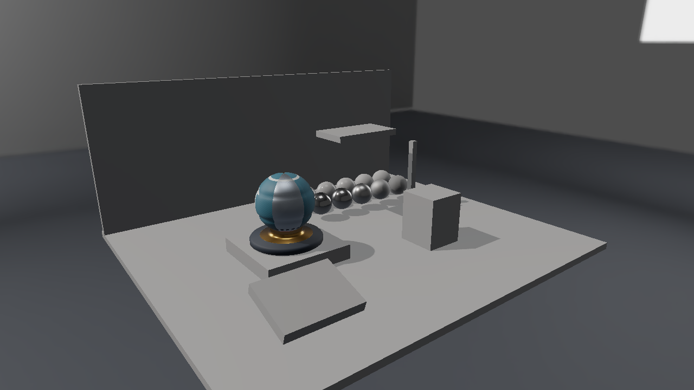

# CubemapからIBLとShadow mapへ 光を描画へ接続する

第8回までで材質の反射モデルを、第9回で値を変更して観察するUIを用意しました。第10〜13回では、同じLighting Labを使い、周囲の光と物体による遮蔽を順に加えます。[アセット制作と配布仕様](Assets/LightingLab.md)も併せて参照してください。

## 第10回 Cubemapで周囲の方向を参照する

Cubemapは6面へ保存した全方向の画像です。参照に使うのはUVではなく3次元の方向です。Skyboxではカメラから各画素へ向かう方向を使い、理想鏡面では表面からカメラへ向かうVと法線Nから`reflect(-V, N)`を求めます。



面名、上向き矢印、非対称な角で、面順・上下反転・左右反転を確認します。これはRoughnessを無視した診断表示です。PBRの鏡面環境反射は第12回で加えます。環境のYawを変更したとき、Skyboxと反射方向に同じ回転を適用することも確認できます。

照明には表示変換前のHDR値を使います。完成画像のPNGからは、ReinhardやAgXで圧縮する前の光源の強さを復元できません。DDSを読むCPU処理と、各APIで面・mipをGPUへ転送する処理も分けます。

## 第11回 拡散IBLで半球からの光を集める

方向光では一方向の光を評価しました。環境画像では、表面の上側の半球から届く光を集めます。Lambert BRDFは方向によらないため、光の積分を材質から分離して事前計算できます。

```text
E(N) = 半球上の積分 Li(L) × max(N・L, 0) dω
拡散IBL = kD × Base Color / π × E(N)
```

Irradiance CubemapへEを保存し、シェーダではワールド法線Nの方向で参照します。今回のkDは`(1 - Fresnel(NoV)) × (1 - Metallic)`という簡略化した配分です。厳密な方向依存のFresnelをこの積分から完全に分離した式ではありません。


非金属は周囲の光を受けますが、Metallic=1の比較球には拡散IBLを足しません。ここで金属が暗く見えることは、第12回で鏡面IBLを加えるための比較点です。AOはこの拡散環境項にだけ掛け、方向光やEmissiveを一括して暗くしません。

## 第12回 鏡面IBLを粗さと視線へ結び付ける

鏡面反射では、入射方向に加えて視線とRoughnessが関わります。毎ピクセルで大量の方向を積分する代わりに、GGXの反射の広がりに合わせて環境を事前フィルタし、粗さ別のmipへ保存します。

```text
R = reflect(-V, N)
LOD = Roughness × 8
鏡面IBL ≈ PrefilteredEnvironment(R, LOD) × (F0 × A + B)
(A, B) = BRDF LUT(NoV, Roughness)
NoV = max(N・V, 0)
```

BRDF LUTはSchlick FresnelのF0を係数として分離した二つの積分を保存します。環境と材質側の積分を分けるsplit-sum近似で、環境の事前フィルタではV=Nと仮定します。通常の縮小用mipmapとは異なり、各mipの意味は反射の粗さです。mip間補間やV=Nの仮定による誤差は残ります。[FilamentのIBL解説](https://google.github.io/filament/main/filament.html#lighting/imagebasedlights)も参考になります。


滑らかな金属では明るいパネルが鋭く映り、粗い金属では反射が広がります。Environmentの強度は入力の光を、Exposureは合成後の表示前の色を変えます。両者を混同せず、Direct、Diffuse、Specularの表示を個別に確認してから合成します。

この環境画像は一つの撮影位置から得た光の分布です。手前の展示物が別の展示物へ映り込む計算や、位置ごとに異なる近くの壁の反射は追加していません。動的Reflection ProbeやSSRへ進む前に、この近似の範囲を理解しておきます。

## 第13回 Shadow mapで方向光の遮蔽を求める

Shadow Mapは光源側から見た深度です。光を受ける表面を同じ光源の座標へ変換し、その深度より手前に別の面があれば、その方向光を遮ります。カメラ用のDepth Bufferが面の表示を選ぶのに対し、Shadow Mapは光が届く条件を選びます。

```text
直接反射 = 反射モデル × 方向光 × NoL × Shadow Visibility
最終色 = 直接反射 + 拡散IBL + 鏡面IBL + Emissive
```



深度の比較には有限の精度があるため、受光面の深度から小さなバイアスを引きます。小さすぎると自己遮蔽の斑点が出やすく、大きすぎると接地する影が離れます。斜面と細い柱で変化を確認します。

3×3 PCFは近傍9点の深度比較結果を平均します。境界のジャギーを和らげる処理であり、面光源の大きさから半影を求める処理ではありません。Shadowはこの方向光の項だけに掛けます。静的環境の光や鏡面反射まで同じShadow値で消すと、別の方向から来る光も失われます。

## 同じ条件で段階を比較する

比較するときはカメラ、配置、環境、露出を固定します。UIでは各寄与、環境の種類と回転、Shadow、バイアス、遮蔽物の位置を変更し、Resetで標準条件へ戻せます。新規画像は1280×720の実GPUキャプチャです。Cyclesの参考画像は形状や反射を観察するために使い、数値の正解は一定色環境や既知の入力で検証します。

| 回 | Direct3D 12 | Vulkan |
|---|---|---|
| 10 Cubemap | [記事](Direct3D12/10_Cubemap.md) | [記事](Vulkan/10_Cubemap.md) |
| 11 拡散IBL | [記事](Direct3D12/11_DiffuseIBL.md) | [記事](Vulkan/11_DiffuseIBL.md) |
| 12 鏡面IBL | [記事](Direct3D12/12_SpecularIBL.md) | [記事](Vulkan/12_SpecularIBL.md) |
| 13 Shadow map | [記事](Direct3D12/13_ShadowMap.md) | [記事](Vulkan/13_ShadowMap.md) |
