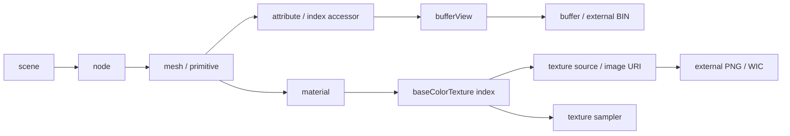

# サンプル06: glTF 2.0を読み、Albedoを表示する

Shader BallのglTF Separateデータを読み、1枚のAlbedoを貼って3D描画します。[Direct3D12](Direct3D12/06_Gltf.md)と[Vulkan](Vulkan/06_Gltf.md)の独立したプロジェクトで、CPU側のローダーとHLSLを共有しています。

基本21の後には、[glTFスキニング対応ローダー](GltfSkinningLoading.md)を読みます。既存APIを保持して`LoadGltfSkinned`を追加し、ノード階層、ジョイントとウェイト、逆バインド、TRS補間からGPUへ渡すpaletteまでを別記事で説明します。

## JSON解析とglTF読込を分ける

JSON構文解析には[nlohmann/json v3.12.0](https://github.com/nlohmann/json/tree/v3.12.0)の`single_include/nlohmann/json.hpp`を使います。MITライセンスなので、このリポジトリのMITライセンスの構成に導入でき、元の著作権・許諾表示を保持しています。Submoduleはコミット`55f93686c01528224f448c19128836e7df245f72`へ固定しています。

JSONパーサを自作すると、文字列エスケープ、Unicode、数値、構文エラー処理などが増えます。この教材ではJSONの解析をライブラリへ任せ、説明したい**glTFの参照・アクセサ・材質・座標変換**を[Common/Gltf.cpp](../Common/Gltf.cpp)で自作しました。cgltfなどの完成したglTFローダーは使っていません。

```powershell
git submodule update --init --recursive
```

ヘッダーがない場合はサンプル6のビルドがこのコマンドを示して停止します。既存01〜05はJSONライブラリを参照しません。出力フォルダには`Licenses/nlohmann-json-LICENSE.MIT`と本リポジトリのMITライセンスもコピーします。実行ファイルを配布する場合は許諾表示も同梱してください。

## 対応範囲

| 項目 | サンプル6の対応 |
|---|---|
| glTF | 2.0 JSON＋外部BIN＋外部PNG。GLB・data URI・拡張は未対応 |
| Scene / Node / Mesh / Primitive / Material | 各1個、ノード変換なし、静的なTRIANGLES、OPAQUE |
| 頂点 | POSITION／NORMAL=FLOAT VEC3、TEXCOORD_0=FLOAT VEC2 |
| 接線 | TANGENT=FLOAT VEC4があればCPUへ保持し、ZとWを反転。今回のGPU描画では使わない |
| Index | 16-bitまたは32-bit unsignedを読み、CPU／GPUでは32-bitへ統一 |
| Accessor | byteOffsetとbufferViewのbyteOffset／byteStride。sparse／normalizedは未対応 |
| 材質 | Base Color TextureとBase Color Factorのみ描画に使用 |
| Sampler | NEAREST／LINEAR、各mip filter、REPEAT／MIRRORED_REPEAT／CLAMP_TO_EDGE |
| mip | PNGのmip 0を作り、MinLOD=MaxLOD=0に制限 |

同梱のAlbedo版を既定値に使います。PBR版を`--model`で指定してもBase Colorだけを表示できます。その場合もNormal・ORM・Emissive画像はロードせず、PBR照明は計算しません。接線だけは次のPBRへの接続用にCPUデータへ保持します。

複数ノード、未適用変換、複数材質、アニメーション、スキン、モーフ、透過、両面指定などはファイル名とJSON Pointer付きのエラーにします。これは同梱アセットの仕様を追える教材用ローダーで、汎用glTFインポータではありません。

## JSONからGPUデータまでの参照



`Reader`はJSONの型・参照を確認し、`LoadGltfAlbedo`が教材の対応範囲に沿ってグラフを辿ります。画像配列の0番をAlbedoと決めつけず、materialのtexture index、textureのsource、imageのURIを辿ります。PNGとBINのURIはglTFファイルのあるディレクトリ基準です。相対URIのpercent escapeとUTF-8に対応し、ネットワークURIやモデルディレクトリ外への参照は受け付けません。

頂点要素の位置は次のようになります。

```text
bufferView.byteOffset + accessor.byteOffset + vertexIndex * stride
stride = bufferView.byteStride、指定がなければ要素のバイト数
```

Bufferの実サイズ、BufferViewの範囲、Accessorの要素サイズ・件数・アラインメントを順に検査します。最後の要素が範囲内かどうかは、加算・乗算で整数が溢れないよう残りバイト数から判定します。未整列のデータをC++構造体として直接参照せず、`memcpy`でFLOATやインデックスを取り出します。頂点数の一致、非有限値、インデックスが頂点数未満であることも確認します。

glTFの頂点分割をそのまま保持します。位置が同じでもUVや法線の異なる頂点を位置だけで統合すると、境界が崩れます。[ModelVertex](../Common/Mesh.h)は位置・UV・法線を保持しますが、今回のInput Layoutは位置・UVだけを使います。

## 座標系・UV・接線

glTFの右手系・Y-upから既存サンプルの左手系・Y-upへ合わせます。

```text
position      : ( x,  y, -z)
normal        : (nx, ny, -nz)
tangent.xyz   : (tx, ty, -tz)
tangent.w     : -w
triangle      : (i0, i2, i1)
UV            : 変更なし
```

Z反転が鏡映なので、三角形の頂点順と接線の符号も揃えます。今回もカリングは無効ですが、将来の面判定や接線基底のためにインデックスを変換しています。

OBJ用の`1-v`処理は使いません。glTFのTEXCOORD_0はPNGの左上基準の規約に合わせて書き出されています。APIを切り替えても同じUVを渡し、Vulkanのスクリーンの上下は負のviewport heightで揃えます。球の白い矢印・上側の白帯・下側の模様で二重の反転を検出できます。

## Albedoと定数バッファ

共有[Scene.hlsli](../Shaders/06_Gltf/Scene.hlsli)は、行ベクトル用の`row_major float4x4 mvp`と`float4 baseColorFactor`をb0に置きます。CPU側の[GltfSceneConstants](../Common/Gltf.h)は同じ並びで80バイトです。

[MakeGltfSceneConstants](../Common/Gltf.cpp)は実際の頂点のバウンドから中心と大きさを求め、固定方向から見る左手系カメラを作ります。リサイズ後にはaspect ratioを更新します。Depthは0〜1、MVPは行ベクトルの順序です。

[Pixel.hlsl](../Shaders/06_Gltf/Pixel.hlsl)の色は次の式です。

```hlsl
float3 color = albedoTexture.Sample(albedoSampler, input.uv).rgb * baseColorFactor.rgb;
return float4(color, 1.0);
```

画像はsRGBのビューでサンプリングして線形化します。glTFのBase Color Factorは線形値なので、そのまま掛けます。描画先もsRGBのため出力時にエンコードされます。OPAQUE材質では画像・factorのalphaを透過に使いません。照明・AO・Normal・Metallic・Roughness・Emissiveはこの回の色計算に含めません。

## テスト

```powershell
.\Tools\ValidateProjects.ps1
.\Tools\TestLoaders.ps1
.\Tools\TestSamples.ps1 -Configuration Debug -Topics 06_Gltf -CaptureDocs
.\Tools\TestSamples.ps1 -Configuration Release -Topics 06_Gltf
```

[GltfTests.cpp](../Tests/GltfTests.cpp)は同梱データに加えて、オフセット付きのinterleaved頂点、32-bit Index、Z／頂点順／UV、materialの参照・factor、percent escapeとUTF-8 URIを確認します。不正な範囲・stride・型・件数、非有限値、範囲外Index、欠落ファイル、未対応機能、JSON構文エラーも確認します。

実画像と検証したバージョンは[検証記録](Verification.md#サンプル06-gltf-albedoの追加検証)を参照してください。Blenderの正本・7画像・再書出し手順は[アセット制作の説明](Assets/ShaderBall.md)です。

参考：[Khronos glTF 2.0仕様](https://registry.khronos.org/glTF/specs/2.0/glTF-2.0.html)、[nlohmann/jsonのMITライセンス](https://github.com/nlohmann/json/blob/v3.12.0/LICENSE.MIT)。

次：[07のライティングと08のPBR](LightingAndPBR.md)。08の`LoadGltfPbr`が追加画像と係数を読み、06の`LoadGltfAlbedo`の表示は維持します。
