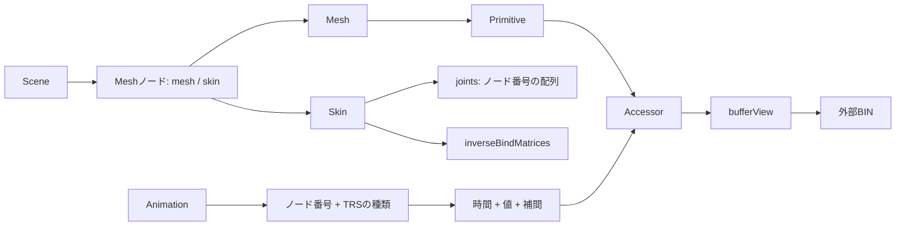
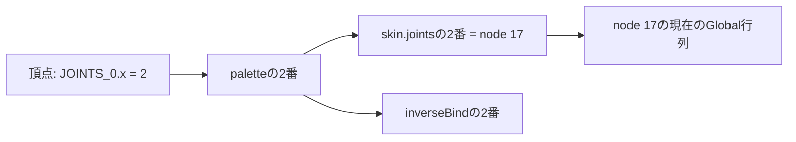

# glTFスキニング対応ローダー：ボーンとアニメーションをCPUで評価する

[基本21 Visibility Buffer](Direct3D12/21_VisibilityBuffer.md)の後に読み、[基本22 Direct3D12](Direct3D12/22_VertexSkinning.md)／[Vulkan](Vulkan/22_VertexSkinning.md)へ進む共通記事です。実行サンプルの番号は増やさず、GPUへ渡す前のノード、ウェイト、逆バインド、アニメーション評価をここでまとめます。

静的な[従来のglTFローダー](GltfLoading.md)はそのまま残し、[Common/SkinnedGltf.h](../Common/SkinnedGltf.h)／[cpp](../Common/SkinnedGltf.cpp)に`LoadGltfSkinned`を追加しました。JSON解析は既存のnlohmann/jsonを使い、変形に必要な参照解決と評価は教材のコードで実装しています。CommonはCPUデータを返し、Direct3D12／Vulkanのリソースを所有しません。

[実行動画](Assets/Videos/README.md)では、このローダーが評価したWalk／RunがVS／CS／MSへ渡り、ロボットとShadowが動く結果を確認できます。データの読込とCPU評価は以下で順に追います。

## glTFの構造と対応範囲

スキンを持つMeshノードから、Primitive、頂点Accessor、Skinへたどります。Skinの`joints`はノード番号の配列です。アニメーションのChannelはノードのtranslation／rotation／scaleを指し、Samplerが時間と値のAccessorを参照します。[glTF 2.0仕様](https://registry.khronos.org/glTF/specs/2.0/glTF-2.0.html)を参照しながら、次の参照をコード上で確認してください。



今回の読込プロファイルは次の通りです。未対応の情報を黙って落とさず、ファイル名と場所を含む例外で診断します。

| 項目 | 対応 |
|---|---|
| ファイル | glTF 2.0 JSON＋相対URIの外部BIN。GLBは配布・他ツール向けで、実行ローダーはJSON版を使用 |
| Scene／Node | 選択Scene、親子階層、TRSまたはmatrix。Meshは有効なSkinを持つこと |
| Primitive | 複数のindexed TRIANGLES、複数の定数PBR材質、OPAQUE／MASK／doubleSided |
| 頂点 | FLOAT POSITION／NORMAL必須。FLOAT TEXCOORD_0／TANGENTは省略可能 |
| JOINTS_0 | 非正規化unsigned byte／unsigned short VEC4 |
| WEIGHTS_0 | FLOAT、または正規化unsigned byte／unsigned short VEC4 |
| Index | unsigned byte／short／int SCALAR、内部はuint32 |
| Skin | 複数Skin、ジョイントノード、FLOAT MAT4逆バインド。省略時は単位行列 |
| Animation | TRS、LINEAR／STEP。rotationは単位Quaternionの最短経路Slerp |
| 今回の対象外 | モーフ、JOINTS_1／WEIGHTS_1、CUBICSPLINE、sparse、glTF拡張、材質のTexture、BLEND |

ローダーは複数Skin／Meshノードを返せますが、今回の3方式の比較ビューアは1つのMeshノードとSkinを共有するロボットを使います。Bone paletteをPrimitiveごとに組み立てれば、CPU APIは別のMeshノードにも使えます。一般的なglTFファイルすべてを扱うインポータではありません。

## Accessorを安全に読む

読み始める位置は`bufferView.byteOffset + accessor.byteOffset`、次の要素へ進む幅は`byteStride`または要素サイズです。`Reader::Access`は型、成分数、正規化指定、アライメント、要素数、BINの範囲を確認します。非整列ポインタを型付きポインタへcastせず、`memcpy`で16／32-bit成分を読みます。

```cpp
// Reader::Accessの範囲検査。減算と除算で乗算オーバーフローを避ける。
Check(count > 0 && offset <= bytes.size()
    && length <= bytes.size() - offset && inner <= length
    && element <= length - inner
    && count - 1 <= (length - inner - element) / stride,
    at, "Accessor exceeds BIN range");
```

正規化整数のウェイトはU8なら255、U16なら65535で割ってfloatへ直します。Indexはfloatを経由せずuint32を保持します。これにより24-bitを超える整数の丸めがIndexへ混入しません。URIのpercent escapeも復号し、モデルのディレクトリ外、絶対パス、ネットワーク／data URI、欠落BINを拒否します。JSONは32 MiB、各BINは256 MiBまでという教材の上限を設けています。

## ボーン番号とノード番号は違う

頂点の`JOINTS_0[k]`は**そのSkinのjoints配列の添字**です。ノード番号を直接入れた値ではありません。たとえば`JOINTS_0.x=2`、`skin.joints[2]=17`なら、使う姿勢はノード17です。逆バインドも同じジョイント配列の順番です。



4成分を内部の`XMUINT4 joints`と`XMFLOAT4 weights`に揃えます。ゼロウェイト成分もジョイント範囲を検査し、負の値、非有限値、ゼロ総和、1から大きく外れる総和を拒否します。整数量子化の小さな誤差は総和で再正規化します。装甲の大半は1本、関節周辺は2本に影響するモデルなので、両方の動作を同じ4成分の処理で確認できます。

UVがなければ(0,0)を入れ、接線がなければ法線に直交する軸を作ります。モデルは画像を使わないPBR定数材質なので、仮のUVでTextureを再現しようとはしません。GPUデータでは白色と平坦なNormalの1画素Textureへ材質係数を掛けます。

## TRS補間：毎回レスト値から始める

`EvaluateGltfPose`はノードのレスト値をコピーし、そのクリップが持つChannelだけを置き換えます。未指定のtranslation／rotation／scaleを前フレームの値やゼロで上書きすると、クリップ切替やSeekで姿勢が壊れます。

`upper_bound`で時間を挟むキーを探し、translation／scaleはLerp、rotationは`XMQuaternionSlerp`を使います。Quaternionの`q`と`-q`が同じ回転を表すことを踏まえ、最短経路を選びます。STEPは前のキーを保持し、指定時間がキー範囲の前後なら端の値を保持します。

```cpp
auto model = LoadGltfSkinned(path);
size_t clip = /* model.clipsからUAL_Walkを探す */;
auto pose = EvaluateGltfPose(model, clip, 0.3f);
auto palette = MakeSkinPalette(model, pose, 0); // Primitive番号
auto reference = DeformSkinVertex(model.primitives[0].vertices[0], palette);
```

CPU評価器そのものはループしません。ビューアの`SkinningPanel`が時刻をdurationで折り返すか終端へclampします。JumpStart／JumpLandは停止、それ以外のUALクリップはループが初期値です。`SkinRestPose`をclipに渡すとアニメーションを適用しないレスト姿勢を評価できます。

## 階層を評価する

このリポジトリはrow vector／row-majorを使います。TRSのLocalは`Scale * Rotation * Translation`、Globalは`Local * ParentGlobal`です。親が先に配列へ入るとは限らないので、親を再帰評価してから子を計算します。読込時に多重親、範囲外の子、循環を検査します。

```cpp
auto local = XMMatrixScaling(s.x, s.y, s.z)
           * XMMatrixRotationQuaternion(q)
           * XMMatrixTranslation(t.x, t.y, t.z);
global = local * parentGlobal;
```

matrixを持つ静的ノードも扱います。matrixとTRSの併記、matrixノードをTRS Channelで動かすファイルはこのプロファイルで拒否します。モデルノードの変換はボーンのGlobalとは別に最終描画へ渡します。

## スキニング行列と逆バインド

Meshの元頂点を現在のMeshローカル空間へ変形する行列は、row vectorで次の順序になります。

```text
Palette[j] = InverseBind[j] * JointGlobal[skin.joints[j]] * inverse(MeshGlobal)
pLocal     = Σ weight[k] * (float4(pBind,1) * Palette[joint[k]])
pWorld     = float4(pLocal,1) * MeshGlobal * ActorWorld
```

InverseBindは、バインド状態の頂点をそのボーンの基準空間へ移す行列です。レスト姿勢で元の位置が再現されるかを最初に確認します。今回のロボットでは全ジョイントのレストpaletteがほぼ単位行列になりますが、一般のglTFでpaletteの単位行列だけを正しさの条件にしてはいけません。MeshGlobalと逆バインドの定義を一緒に確認してください。

CPUの`DeformSkinVertex`は位置、法線、接線を4本へ分配します。法線を正規化し、接線から法線方向を除いて直交化します。これは同梱の回転・並進中心のリグを想定したLBSで、ボーンに任意の非一様Scaleを入れた場合の厳密な逆転置法線やDual Quaternion skinningは扱いません。

## 座標変換を全データへ揃える

glTFの右手系からリポジトリの左手系へZを反転します。位置だけ変えるとアニメーション時にボーンが逆へ回るため、レストノード、キー、逆バインド、法線、接線にも同じ変換を施します。

| データ | RH → LH |
|---|---|
| position／translation／normal | `(x,y,z)` → `(x,y,-z)` |
| Quaternion | `(x,y,z,w)` → `(-x,-y,z,w)` |
| row-vector行列 | `S * M * S`、`S=diag(1,1,-1,1)` |
| tangent | Zとhandedness Wを反転 |
| triangle | 2番目と3番目のIndexを交換 |

glTFの列優先MAT4の連続成分をrow-majorの`XMFLOAT4X4`へ読み込むと、row-vector表現に必要な転置に対応します。さらに`S*M*S`を施します。HLSLへ渡す時点では既にrow-majorの左手系なので、API別の追加transposeやZ反転をしません。Vulkanの負の高さのViewportは画面座標の処理で、ボーン評価の規約を変更しません。

## CPU検証からGPUへの受渡し

`Tools/TestSkinningCpu.ps1`はバインド、全Action、親子階層、STEP、符号反転Quaternion、U8／U16ウェイトとジョイント、異常入力を検査します。さらにBlenderの評価済みメッシュと、別実装のNumPy glTF評価器を照合しています。GPU試験ではこの独立した評価器をC++の参照頂点と比較し、Computeの実Vertex Bufferを読戻して位置・法線・接線も比較します。[検証記録](SkinningVerification.md)

GPUへは元頂点48 byte、ジョイント番号＋ウェイト32 byte、row-major palette64 byte／jointを分けて渡します。1体では53行列、64体では位相をずらした53×64行列です。床は単位行列の専用paletteを使います。ジョイント番号はモデル内のローカル番号のままで、インスタンスがpaletteの先頭番号を指定します。

ここから先のGPU初期化・転送・同期・解放は各サンプル内で追います。[共通GPUスキニング解説](GpuSkinning.md)で3方式を比較し、[22 VS](Direct3D12/22_VertexSkinning.md) → [23 Compute](Direct3D12/23_ComputeSkinningCache.md) → [発展10 Mesh](Direct3D12/Advanced10_MeshShaderSkinning.md)へ進んでください。
