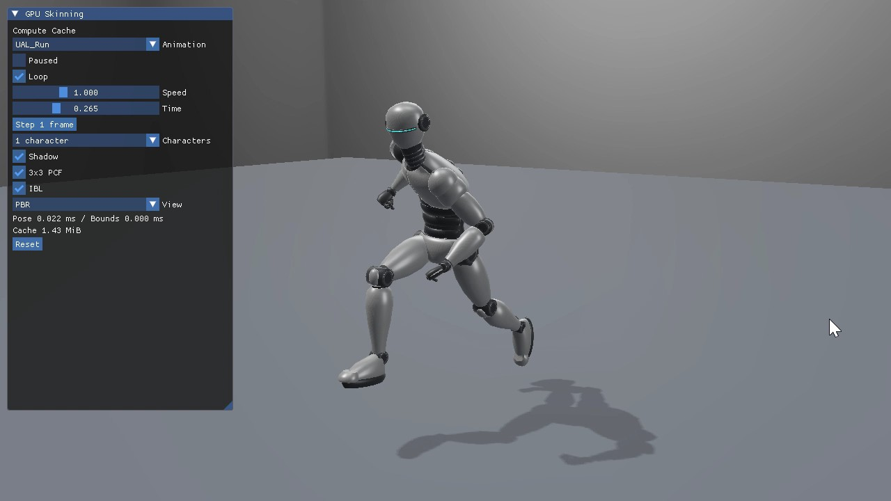
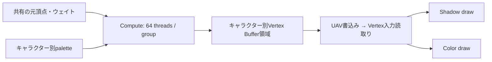
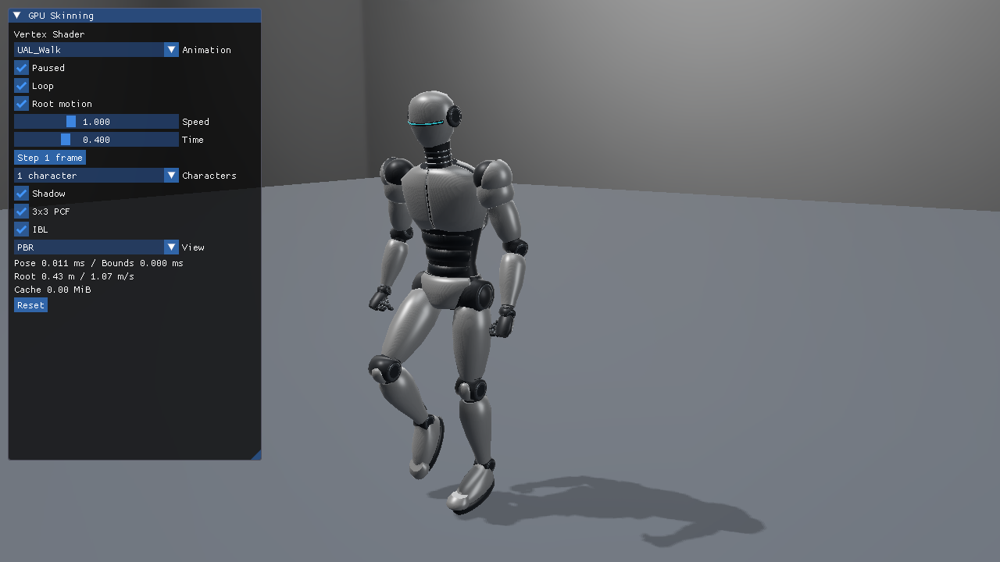

# GPUスキニング：Vertex、Compute Cache、Mesh Shader

同じ白銀ロボット、同じジョイントpalette、同じPBR／Studio IBL／方向光／2048×2048 Shadow Mapを、3つの場所で変形します。まず[glTFスキニング対応ローダー](GltfSkinningLoading.md)でCPU側の参照を理解してください。[Blender制作とリターゲット](Assets/SilverRobotAnimated.md)、[検証と実測](SkinningVerification.md)も用意しています。

| 実行サンプル | Direct3D12 | Vulkan | 変形と再利用 |
|---|---|---|---|
| 基本22 VertexSkinning | [記事](Direct3D12/22_VertexSkinning.md) | [記事](Vulkan/22_VertexSkinning.md) | Shadow／ColorのVSで毎回変形 |
| 基本23 ComputeSkinningCache | [記事](Direct3D12/23_ComputeSkinningCache.md) | [記事](Vulkan/23_ComputeSkinningCache.md) | CSで生成したVertex Bufferを両パスが読む |
| 発展10 MeshShaderSkinning | [記事](Direct3D12/Advanced10_MeshShaderSkinning.md) | [記事](Vulkan/Advanced10_MeshShaderSkinning.md) | 各パスのMSで直接変形、AS／Taskで可視判定 |

## 実行動画で3方式を確認する

[全6本の録画一覧](Assets/Videos/README.md)から、VSのWalk／Run、Compute CacheのRun、Mesh／Taskの64体を比較できます。下の画像からMP4を開けます。

| Vertex：Direct3D12、Walk | Compute Cache：Vulkan、Run | Mesh／Task：Vulkan、Run 64体 |
|---|---|---|
| [](Assets/Videos/Direct3D12_22_VertexSkinning_Walk.mp4) | [](Assets/Videos/Vulkan_23_ComputeSkinningCache_Run.mp4) | [](Assets/Videos/Vulkan_Advanced10_MeshShaderSkinning_Run64.mp4) |

録画ごとに選択クリップと体数が異なります。性能や数値の比較には[同一条件の検証・実測](SkinningVerification.md)を使い、動画では手足とShadowの追従、64体の位相差を確認してください。

## 共通の変形と描画

[Shaders/Skinning/SkinningCommon.hlsli](../Shaders/Skinning/SkinningCommon.hlsli)の`SkinVertexAt`をVS／CS／MSが呼びます。位置は4×4、法線・接線は3×3で変形し、法線を正規化、接線を直交化します。材質の境界でPrimitiveを分けても、元頂点とウェイトは全Primitiveを連結した1つのBufferです。

```hlsl
row_major float4x4 blend = skinBones[base+i.joints.x].matrix * i.weights.x
    + skinBones[base+i.joints.y].matrix * i.weights.y
    + skinBones[base+i.joints.z].matrix * i.weights.z
    + skinBones[base+i.joints.w].matrix * i.weights.w;
v.positionU.xyz = mul(float4(v.positionU.xyz,1), blend).xyz;
v.normalV.xyz = SafeNormalize(mul(v.normalV.xyz,(float3x3)blend));
float3 t = mul(v.tangent.xyz,(float3x3)blend);
v.tangent.xyz = SafeNormalize(t-v.normalV.xyz*dot(v.normalV.xyz,t));
```

元頂点のUVと接線のWは保持します。CPUからMeshローカルpaletteとMeshGlobal×ActorWorldを分けて渡し、変形済み位置へインスタンス変換を掛けます。床は変形せず同じPBRとShadow receiverを使います。Blenderを起動したり、実行時にリターゲットしたりする必要はありません。

ColorはForward PBRでHDRへ描き、露出・表示変換後にSwapchainへ出します。ShadowはライトのViewProjectionで描き、Hardまたは3×3 PCFで参照します。3方式の診断表示はBase／Normal／Metallic／Roughness／Emissive／Depth／Shadow depth／Weightsを共通にします。

Weights表示は1番目の成分を緑、2番目を赤、3・4番目の合計を青へ割り当てます。剛体装甲は緑、2本へブレンドした柔軟部は黄系です。これはウェイトの構成を確認する表示で、ボーン番号の色分けではありません。

## 22：VSに入力を渡す

元頂点、JOINTS／WEIGHTS、paletteをStructuredBufferから読みます。Indexed drawの`SV_VertexID`とPrimitiveの頂点先頭を使って元頂点を取り出し、ShadowとColorの両方で`SkinVertexAt`を呼びます。

変形済み頂点の保存領域もCompute→Vertexの同期も不要です。後段のパスが増えるほど同じ変形を繰り返しますが、Indexed drawの頂点再利用があるため、三角形数×3をそのままVS起動数とみなせません。小さいモデルやパス数の少ない描画の基準になります。

## 23：Computeで変形した頂点をキャッシュする



1フレームに1回、各キャラクターの31,138頂点を48 byteの変形済みデータへ書きます。ShadowとColorは同じBufferを頂点入力へbindします。静的なIndex Bufferは共有し、Primitiveの先頭とキャラクターの領域先頭を加えたVertex Buffer viewを使います。

D3D12はDEFAULT heapのUAV Bufferを`UNORDERED_ACCESS`へ遷移してdispatchし、書込み後に`VERTEX_AND_CONSTANT_BUFFER`へ遷移します。このstate transitionで後続頂点読取りを順序付けます。同じUAV状態のまま別の依存dispatchを行う場合はUAV barrierも必要になります。

Vulkanは`STORAGE_BUFFER | VERTEX_BUFFER`を持つ同じBufferを使い、`COMPUTE_SHADER / SHADER_STORAGE_WRITE`から`VERTEX_ATTRIBUTE_INPUT / VERTEX_ATTRIBUTE_READ`へ`vkCmdPipelineBarrier2`を発行します。次フレームの上書き前にもVertex read→Compute writeを明示します。Queueは同じGraphics Queueです。

キャッシュはD3D12のDEFAULT heap、VulkanのDEVICE_LOCALメモリへ置きます。GPUだけが生成・参照する大きな頂点領域をホスト可視メモリへ置くと、Discrete GPUではPCIeの帯域が律速になる場合があります。検証時は別のホスト可視Readback Bufferへコピーして比較します。

有効キャッシュ容量は1体1,494,624 byte（約1.43 MiB）、64体95,655,936 byte（約91.22 MiB）です。サンプルはUIの1↔64切替に備えて64体分を先に確保し、1体時にはその先頭だけを書きます。実測JSONは`cacheBytes`（使用領域）と`allocatedCacheBytes`（確保領域）を区別します。キャッシュの追加メモリと帯域に対し、パス間の変形再利用がどれだけ効くかを測ります。

## 発展10：Meshletの頂点をMSで直接変形する

既存meshoptimizer 1.3で最大64頂点／96三角形のMeshletを作ります。MSはMeshletのローカル頂点番号から元頂点へたどり、その場で変形し、ShadowまたはColorの頂点を出力します。Meshlet境界で共有頂点が重複する場合は変形も重複します。MSを使うだけで23のようなパス間キャッシュが得られるわけではありません。

`Mesh direct`は全候補を直接dispatchし、`AS / Task`は候補を可視判定してMSへ渡します。比較用のVertex referenceも切り替えられます。ShadowのTaskはライト視錐台、ColorのTaskはカメラ視錐台を別々に評価します。カメラから消えたキャラクターが床へ落とす影を消さないためです。

## 動くメッシュの保守境界

バインド姿勢のSphereをそのままカリングへ使うと、曲がった手足を切り落とすことがあります。[SkinningData.h](../Samples/Shared/SkinningData.h)では各Meshletについて、ジョイント別に正のウェイトを持つ元頂点のAABBを準備します。現在のpaletteでその8隅を変形し、全ジョイントの結果を合成してSphereへ包みます。

正規化された非負ウェイトのLBS位置は、ジョイント別の変形位置の凸結合です。全影響ジョイントを包む箱はその凸結合も含むため、頂点全数をCPUで変形せずに保守境界が得られます。Instance WorldのScaleも半径へ反映し、余裕0.001 mを加えます。この方法は保守的なので不要なMSが残ることがあります。Bone数・Meshlet数が多いとCPU境界更新の負荷も増えます。

静的な法線コーンは変形後の向きを表さないため、このサンプルでは判定を無効にしています。UIはOFFとAnimated frustumを提供し、CLIの`frustum-cone`指定はエラーにします。

## フレームの同期と操作

各サンプルはGPU完了を待ってからpalette、境界、Instance、UI Bufferを書き換えます。Compute、Shadow、Color、UI、読戻し、解放も各APIのSample.cpp内に置きます。複数フレームを並行させる最適化を追加するなら、paletteとキャッシュのフレーム別領域・Fence・再利用条件も追加してください。

初期値はUAL_Walk／速度1／1体／Root motion OFFです。クリップ、Paused、Root motion、速度、Time、30 fpsの1フレーム送り、Reset、1／64体、Shadow、PCF、表示モードを変更できます。64体はクリップ長の1/64ずつ位相をずらした独立姿勢です。JumpStartとJumpLandは自動連結せず、個別のクリップとして終端で保持します。

## Root motionを切り替える

6サンプル共通のImGuiの`Root motion`をONにすると、Walk／Runが左手系の前方（−Z）へ進みます。初期値はOFFで、従来と同じ配置のその場再生です。OFFへ戻すと元の配置へ戻り、ResetでもOFFと移動量0に戻ります。

配布したクリップと固定元ライブラリは水平Root移動を持たないため、[SkinningRootMotion.h](../Samples/Shared/SkinningRootMotion.h)で足運びから進行トラックを復元しています。30 fpsで足／つま先の中心を評価し、床に近い支持足が後方へ動く速度の中央値を使って一定速度の前進を作ります。元の作者が作成したRoot Motion曲線を読み込んだものではありません。glTF／GLBとBlender正本は変更せず、腰の上下動、揺れ、接地補正も維持します。Idle・ジャンプ・A/T確認ポーズには前進を加えません。

前進はActorのWorld行列へ一度だけ加えます。VS／Compute／Meshのpaletteやキャッシュへ二重に加えず、ShadowとColorで同じWorldを使用します。Meshlet境界のWorld変換とライトの撮影範囲も移動に追従します。床とカメラは固定なので、画面外へ進んだ場合はResetまたはカメラ移動を使ってください。

ポーズの時刻はループごとに折り返しますが、移動時間は累積して、周期の境界で位置が巻き戻らないようにします。Paused／速度0では停止し、速度、TimeのSeek、1フレーム送りも移動へ反映します。ONへの切替とクリップ変更は移動量を0から始め、Seekはその時刻の移動位置へ移します。64体にも同じ進行量を適用し、ポーズの位相差は維持します。

CLIでは`--root-motion on`／`--root-motion off`で指定できます。省略時はOFFです。`--pause-animation --animation-time 0.2 --root-motion on`なら、その時刻の移動を含めて再現できます。ImGuiに表示する`Root`は累積距離と復元した速度です。



[Root motionの検証結果](SkinningRootMotionVerification.json)には、両構成・両API・3方式での実チェックボックス操作、Depthの変化、Resetの完全一致、速度・Pause・周期をまたぐ移動を記録しています。

```powershell
.\Tools\TestSkinning.ps1 -Configuration Debug -RootMotionOnly
.\Tools\TestSkinning.ps1 -Configuration Release -RootMotionOnly
```

```powershell
# 3方式・両APIで同じ姿勢を再現できる。
& .\bin\x64\Debug\Vulkan_23_ComputeSkinningCache\Vulkan_23_ComputeSkinningCache.exe `
  --animation UAL_Walk --animation-time 0.3 --animation-speed 1 `
  --pause-animation --characters 64 --no-ui --frames 4
```

WASD／Q・E／右ドラッグ／Shift／Rの[カメラ操作](CameraNavigation.md)も継承します。`--post-view weights`でウェイト、`--camera OffscreenCaster`で画面外Casterの影、発展10の`--render-path mesh|task`／`--meshlet-culling off|frustum`でカリングの比較ができます。

## 比較は変形の位置と総コストを分けて測る

Releaseの1体／64体、同じカメラとUAL_Walk、固定1/60秒のアニメーション時刻で、60フレームをwarmupして1200フレームを測定します。CPU姿勢評価、CPU境界更新、CS変形、Shadow、Color、GPU Total、キャッシュ容量を記録します。MSの境界更新はGPU Totalへは含まれないため、CPUの欄も必ず確認してください。

`Tools/MeasureSkinning.ps1`の結果と条件は[検証記録](SkinningVerification.md)にあります。比較はこのモデル・GPU・Shadow＋Colorという条件の結果です。キャッシュが常に速い、MSが常に速いという結論へ広げず、パス数、影響数、見える割合、キャッシュ帯域、CPU評価を合わせて判断します。
