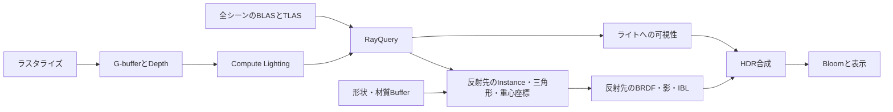

# インライン・レイトレーシング：Deferredから影・反射・多数光源へ

基本26 → 基本27 → 発展16 → 発展17の順に、ラスタライズとRayQueryを組み合わせます。両APIの独立したサンプルで、GPU処理は各Sample.cppに記載します。

| 回 | 一次可視面 | レイで求めるもの | 比較対象 |
|---|---|---|---|
| 基本26 | Vertex／PixelのG-buffer | 太陽の影 | 基本18のShadow Map |
| 基本27 | 同じG-buffer | 太陽の影・1バウンス反射 | 反射OFFで基本26 |
| 発展16 | Bindless Mesh Shader | 影・反射 | 発展15のRT Pipeline |
| 発展17 | Mesh Shader | 太陽・選択した点光源の影 | 全ライト／Tiled |

## 交差判定と材質評価

BLASは固有Primitiveの三角形を、TLASは配置と変換を記録します。カメラに見えない形状も影や反射に必要なので、Meshlet CullingでTLASを切り詰めません。静的BLASを共有し、配置が変わったときだけGPU完了後にTLASを再構築します。

HLSLのRayQueryは探索の状態を持ちます。TraceRayInlineでレイを設定し、Proceedで探索します。OPAQUEは自動で確定し、MASKは候補のUVとAlphaを調べてCommitNonOpaqueTriangleHitします。影は最初の有効ヒットで終了し、反射は最近傍まで探索します。Instance ID・三角形・重心座標から頂点、法線、材質を復元します。Any-hit／Closest-hit／Missの専用シェーダは作りません。

基本26・27のG-bufferは18 B／画素で位置をDepthから復元します。反射先はScene Bufferを使います。基本27は鏡面IBLを反射光へ置き換え、発展16は比較対象の発展15と同じ反射合成を維持します。確率的な粗さ付き反射、デノイズ、時間蓄積は扱いません。

影は有効ヒットがあるかだけを調べます。反射は途中のヒットで探索を止めず、最近傍の確定ヒットを読みます。MASKの穴を見つけた候補は確定せずに探索を続けます。ソースは[Query.hlsli](../Shaders/InlineRaytracing/Query.hlsli)、[Reflection.hlsli](../Shaders/InlineRaytracing/Reflection.hlsli)、発展16専用の[InlineHybrid.hlsl](../Shaders/Bindless/InlineHybrid.hlsl)です。

基本27の合成は `直接光 + 拡散IBL + Fresnel × 反射先からの光 + Emissive` です。反射OFFでは従来の鏡面IBLへ戻します。材質の粗さはBRDFの評価に使いますが、発射方向は理想鏡面の1方向なので、粗い材質でも反射像はぼけません。細い形状やMASKには空間エイリアシングが残ります。

## 機能要件と同期

D3D12はAgility SDK 1.619.6、DXC 1.9.2609.5、DXR Tier 1.1以上です。VulkanはSDK付属DXC、Vulkan 1.3、KHR Acceleration Structure／Ray Query、Buffer Device Addressと非一様画像参照を使用し、rayTracingPipelineは有効化しません。共通HLSLをSM6.6／HLSL 2021からDXILとSPIR-Vへ事前コンパイルします。

AS構築の書込みを次のAS構築とComputeのAS読取りへ同期します。G-bufferをShader Readへ、HDRをUAV／Storage Imageへ移し、照明後にSkybox・Bloom・表示へ接続します。Buffer／Descriptorの更新と解放はGPU完了後です。

UIで影方式を切り替えられるよう、Shadow Map方式でもASを保持します。基本18との比較では定常フレームの画とGPU時間を比べ、ASの起動時間とメモリは別に記録します。

## 測定の読み方

発展16と15は同じシーンとレイ条件で比較します。発展17のAll lights／Tiledは光源候補の探索量を、影付き灯数は遮蔽レイ数を変えます。同じ光源と寄与判定ならTiledだけで影レイ数が減るとは限りません。RayQueryが常にRT Pipelineより高速とはしません。

Release、1280×720、UI／VSync無効、60フレーム準備、固定経路1,200フレーム、5反復で平均・中央値・p95を記録します。AS初期構築は定常フレームから分け、ASメモリも記録します。[検証記録](InlineRaytracingVerification.md)を参照してください。

基本26・27と発展17のインラインRTはCompute Lighting内で実行するため、GPU時間はlightingに含まれます。shadowはShadow Map側のclear・描画・遷移を表します。発展16は発展15との比較のため、同じrt区間にComputeの照明・影・反射を記録します。

公式仕様：[Microsoft DXR](https://microsoft.github.io/DirectX-Specs/d3d/Raytracing.html#inline-raytracing)、[Khronos Ray Query](https://docs.vulkan.org/refpages/latest/refpages/source/VK_KHR_ray_query.html)。
